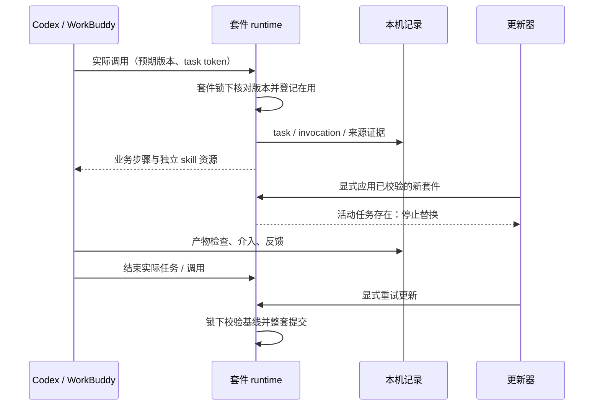

# 工程上下文：F-001 SELC 可运行首版

## 当前有效方案

### 架构设计

**关联产品上下文**：`.sdlc-v1/context/REQ-001.product.md`，DEC-003 至 DEC-017、DEC-020；AiTaxs 按 DEC-019/020 延后。  
**日期**：2026-10-20。**方案状态**：当前有效；主 Agent 已接受方案及有据修正，业务版本 `aa079e2` 已通过正式验证、独立评审及本地交付验收；尚无远端发布目标。
**目标分支**：`codex/design`，初始实现 commit `7cab4b82e4f9cf317647ede8beadc14de075cc3e`，修正版沿同一分支推进，以 Git HEAD 和正式验证绑定为准，无 remote。用户已确认主 Agent 执行本地提交及后续验证/评审；实现者仍不得自行提交或配置远端。

#### 背景

当前只有产品与讨论文档，无可复用业务代码、依赖清单或运行数据库。用户已授权先完成 SELC，用简单样例验证机制，不再等待税务案例。交付是可运行 CLI、Codex meta skill、包含完整 runtime 的套件与使用指南。真实 Git 服务写入、全局安装和真实模型批量运行不属于本轮实际执行范围。

#### 复用评估

| 候选 | 已核对事实与覆盖 | 决定 |
| --- | --- | --- |
| 当前仓库 | 只有文档和 lifecycle state；无现有安装、统计、评估实现 | 保留产品事实，不虚构复用 |
| Python 标准库 + Git + uv | 本机 uv/Python 3.12.13、sqlite3 3.50.4 与 Git 可用；标准库提供事务、hash、归档、参数解析及子进程接口 | 复用这些能力，自研小型 suite lifecycle glue；不引入服务框架或新数据库 |
| skill-creator 与宿主技能目录 | 已读系统 skill-creator，实测 initializer help；Codex `.agents/skills` 与 WorkBuddy `.codebuddy/skills` 有官方说明 | 复用作者工作流/初始化；SELC 补齐 manifest、runtime 与维护资源，不重做内容创作模型 |

SELC 特有缺口是双轴结果、最少汇总修订、suite 级在用更新、候选证据与发布确认绑定，已有通用 skill 格式不能提供这些行为。GitHub/GitLab 复用既有 PR/MR 与 Releases；不创建新市场。

#### 架构与组件

1. **作者入口**：`.claude/skills/selc/SKILL.md` + `.agents/skills/selc` 相对链接；仅用于 Codex。引导 skill-creator 编写候选内容，调用本地 CLI 创建/封装 suite。**覆盖**：FR-001、SC-001。
2. **可携带 CLI/runtime**：`src/selc/`、`scripts/selc.py`，Python >=3.11、标准库依赖。生成物携带必要 runtime、安装/维护说明，不依赖完整 SELC repo、Codex 或全局 selc 命令。**覆盖**：FR-001/005/006、SC-001/006。
3. **套件管理**：校验版本化 manifest，生成/校验/打包完整 suite，从 Git repo/子目录或归档安装，保存 source commit、路径、摘要和基线。注册每个独立 skill。**覆盖**：FR-004/006、SC-001/004。
4. **记录与统计**：项目独立 SQLite 库；task、invocation、delivery/check、intervention、feedback revision、观测能力分离；本地报告与脱敏最少汇总。**覆盖**：FR-002/003/007、SC-002/003/005。
5. **维护流水线**：从安装基线准备可编辑贡献分支/候选，保护评估依据，比较基线/候选，产生 diff/评估/完整包与贡献/发布计划；显式 provider 执行接口。**覆盖**：FR-005、SC-006/007。
6. **简单示例与可信评估**：文本整理 → Markdown 报告，两个独立 skill。可信确定性 runner/固定预期位于候选之外；不运行任意候选脚本。两个回归和两个留出案例足以验证首版编排；运行预算可配。**覆盖**：FR-009、SC-007。

#### 关键设计决定

**ARCH-001：一份源格式，两端注册。** suite manifest 使用 schema/version；canonical skill 正文与共享脚本统一打包。Codex 和 WorkBuddy 适配器只处理目录、入口和能力声明，不复制领域算法。生成套件的维护资源不能包含当前机器的绝对路径。默认当前项目、当前已识别 harness；识别不可靠时 unknown，安装需明确目标适配器，不能用模型名猜测。

**ARCH-002：结果证据与自报区分。** 最终交付由预声明必需检查与反馈计算；首个 delivery 不随补救替换。CLI 普通 agent 事件不足以证明连续无介入，两端 native 完整观测未实现/未验证的路径严格 one-shot unknown。可控 runner 的完整观测只用于标记为测试的数据，不能提升真实业务覆盖。人工业务判断/纠错/补做与必要输入/权限点击分开记录。task/call 使用稳定独立身份，不给所有子调用直接复制总任务成功。

**ARCH-003：显式版本与事务。** suite 和框架来源独立检查，稳定版本默认，每日缓存只在任务入口触发。应用更新必须主动调用。套件锁覆盖运行登记与更新提交，活动 task/session 阻止替换；异常退出保留待核对状态，不能以 TTL 自动忽略。整套候选校验完成后提交当前指针/目录，失败保持有效当前版。事务临时目录与恢复记录可保留至恢复完成，不提供可选历史版本/回滚库。调用携带预期版本，过时入口应拒绝并要求重新加载，不能混用新 runtime 和旧 skill。

**ARCH-004：候选与评估依据分开。** CLI 不为不可信代码承诺 OS 级隔离。首版可信确定性 runner 只读取候选声明/模板和业务输入，预期、评分实现、留出数据在候选外；候选修改受保护材料或证据不完整即停止发布。真实 LLM 编写由宿主调用 skill-creator；本轮不启动真实模型批测。报告区分测得的运行时间/次数与未知的 token/金额。

**ARCH-005：确认绑定待发布内容。** 发布准备计算 suite、diff、评估报告与目标版本/仓库/commit 的摘要；最后一次维护者确认必须匹配该计划。后续任何候选/评估/目标变化都使原确认失效。没有达标证据/权限/确认时不发布。贡献默认独立分支+PR/MR；实际 provider 权限来自已有登录/显式配置，安装不授予角色。真实权限不足报错，不用本地 maintainer 布尔值冒充远端授权。

**ARCH-006：最少完整快照，单一写入 owner。** 每个本机库有 origin_id，递增 snapshot_revision；只导出本机权威的最少 task/call 结果快照，不转发已导入的数据。新快照替换该 origin 的旧快照，而非累加百分比/增量计数；旧修订忽略，同修订不同摘要冲突。跨 origin 的同 task/call ID 去重成一个样本，矛盾来源/结果标 unknown，不能最后写入者获胜。首版不提供多机可写数据库复制；跨 harness 续作需传播 task token，单一 owner 收集结果，避免新建 task。

#### 数据模型 / 关键实体

所有公共持久化格式从 v1 起明确版本，未知未来版本拒绝写入，不静默按旧格式解释。业务输入/输出正文不进入汇总；本地尽量仅存路径/hash/检查状态和结构化事件。数据库与安装/source/candidate 分开，更新不删除统计。

| 实体 | 身份与核心约束 | 覆盖 |
| --- | --- | --- |
| Suite/installation | suite_id、version、framework_version、skills、source repo/subdir/ref/commit、内容 hash、独立 upstream；path 必须相对且在根内 | SC-001/004 |
| Task | 稳定 task_id、开始时间、发起方/证据、必要输入就绪、状态、first/current delivery、test 标志；恢复不创建新任务 | SC-002/003 |
| Invocation | 稳定 invocation_id、task_id、skill/实际版本、执行方/证据、显式/自动等触发；扫描不登记，重试不重算 task | SC-002/003 |
| Delivery/check/feedback | delivery_id 与 artifact hash、规则版本、逐项 pass/fail/unknown；反馈独立 ID/递增修订及适用范围；历史不可被补救抹除 | SC-002/003 |
| Aggregate sample | namespace + subject kind/id、revision、suite/skill/版本/harness、开始时间、两轴结果与统计口径；不含正文 | SC-005 |
| Candidate/evaluation/release | 基线 source+digest、隔离路径、环境、固定 oracle 指纹、预算、结果、候选摘要、完整包/发布计划摘要 | SC-006/007 |

汇总相同 sample 身份只计一次，所有导入先整体校验后事务提交，失败不部分写入。快照修订按 ARCH-006；任何不一致不能静默转为成功。删除先预览按套件/时间命中的统计影响，显式执行后清理明细；本机权威快照 revision 提升，删除的已导入样本保留最少 suppression ID 抑制旧文件重导入，不自动追回其他机器已分享数据。最少墓碑不保留业务正文且无自动过期。

#### API / 接口契约

使用一个 CLI 入口与统一 JSON 结果/可读错误，非零 exit 表示未完成；子命令名称可在实现中采用一致的命令组，但须同步 README 与实际 help，不改变下列契约：

- create/validate/package：suite_id、目标目录、独立 skills、版本；生成自包含安装维护资源，碰撞拒绝，不执行 suite 自带 install hook。
- install：repo/子目录链接或完整包、project root、harness、scope、可选 ref；默认稳定版本。返回版本、commit、digest、位置、skill 列表、维护入口。重复同源同版复用；本地编辑/不同来源重名拒绝。
- task/invocation/event/delivery/feedback：稳定 ID、规则/证据、来源；仅完整载荷相同才重放幂等，冲突明确失败；安装调用必须携带加载入口对应的 version 和 composite digest；允许显式结束/中断，不隐式重置 first delivery。任务入口做每日缓存检查。
- stats/export/import/delete：独立 task/call、双轴、N/S/K/U、S/N、S/K、K/N、版本/时点；零分母 null，不用 100%。默认排除 test；只有显式 export/import 跨本地。
- updates check/apply：分别指定 business/framework；检查不替换，apply 需干净基线和无活动租约；失败与恢复状态可检查。
- evolve prepare/evaluate：当前 source baseline、候选目标、creator brief；回归/留出固定并位于候选外、相同环境比较，预算耗尽/不达标保留报告。
- contribute/release prepare/execute：可审阅的分支/差异/说明/评估/完整包、明确 provider/target/ref；真实变更只有显式执行，发布还要求最后一次摘要匹配确认；测试仅用临时本地 Git 和受控 provider。

**CLI 与持久化约定**：公共 JSON 使用 `schema_version: 1`，CLI 成功 exit 0、输入/冲突/未完成非零，并给出稳定错误 code 与恢复信息；具体组内参数在同一个 argparse schema 中定义，README 引用实际 help，不另写第二套参数模型。基础入口 `scripts/selc.py`；命令族固定为 `create / validate / package / install / task / call / event / delivery / feedback / stats / export / import / delete / updates / evolve / contribute / release`，允许按需增加 `doctor` 或示例 `run` 这种有真实行为的辅助命令。包装后的脚本使用同一 CLI 实现。

**安装状态与租约**：安装记录具备 prepared → waiting → activating → active / needs_recovery 的等价可检查状态。内容路径按 digest 暂存，通过原子 current 指针或等价 journal 协议切换；旧内容只留至事务恢复/清理完成。任务与宿主 session 记录分开，二者任一在用都阻止更新。所有开始调用与最终激活在同一套件锁下完成，避免 TOCTOU；没有可靠 session 结束事件时必须显式关闭并保留关闭依据，不以进程退出认定结束。支持显式 `recover`，核对 journal、指针和 hash 后处理残留，不猜测成功。

**CreatorAdapter**：在当前宿主发现 skill-creator 时，实际调用可用 initializer/验证器并由 meta skill 驱动内容改写；缺失时明确返回缺依赖/准备 brief，不声称完成模型创作。官方 quick_validate 依赖 PyYAML，只能属于 creator 工具环境，portable runtime 保持标准库。WorkBuddy 生成物携带自包含维护创作指南/受控修改范围与同一 runtime，不要求额外安装 Codex。

**发布 provider 深度**：至少提供真实 local release center（完整包、元数据、可读/重新安装验证）和 GitHub/GitLab 显式客户端适配器。远端可复用 `gh`/`glab` argv 或受控 HTTP transport；依赖缺失报错，不用空 stub 冒充实现。两端均须先查询同 tag 已有内容：同 hash 幂等复用，不同内容冲突；响应不明先查询核实再重试，不重复盲建或覆盖已有 release。准备/执行/核实接口在本地与可注入 transport 测试中实测；真实远端调用未授权。贡献准备恢复 repo 基线和 suite 子目录，仅带代码/资源；执行使用明确非默认分支和 PR/MR，不推默认分支。

**固定评估默认值**：2 回归 + 2 留出，基线/候选使用同一可信 runner/环境；默认最多 2 个候选、每次 runner timeout 10 秒、整个评估最多 60 秒/8 次运行、真实模型调用预算 0。参数可配置，预算不足保留报告并不允许 release；模型调用预算不代替启动真实模型的用户授权。留出明细不自动提供给下一轮改写，只输出保留集摘要/是否达标。候选超时/未知/人工介入不能伪造成本改善。

**API-001：框架来源、兼容与实际应用。** 框架包使用 `framework.json`：`schema_version: 1`、`framework_version`、`runtime_protocol: 1` 和受控 `runtime/selc/` 内容/摘要。可由当前 SELC `src/selc/` 或已生成 suite 的 `runtime/selc/` 打包；不包含业务 skill、统计或业务产物。支持同协议的独立包，也可从显式指定的完整 suite 包提取该框架部分。suite manifest 缺省 `runtime_protocol` 为 1；未来不支持的协议拒绝应用，不能仅改版本字段冒充更新。沿用 `package` / `updates` 命令族，参数由 argparse 定义。

框架应用从当前业务 suite 构建完整暂存 composite，保留业务 `skills/`、`resources/` 与 business version，替换真实 runtime、更新 framework version/source/commit/hash 和完整内容摘要；通过校验与相同租约/锁/冲突条件后整套切换。`install --framework-source` 是主动选择并装配该框架，不能只保存 reference。后续 business 更新保留使用者已显式选定的外部框架；默认 embedded 则使用新业务包内的框架。新业务包与已选框架协议不兼容时拒绝并给出明确恢复动作，不暗中替换另一上游。调用始终绑定实际 composite digest，不能只依靠不变的 business version。

内容摘要相同也不能丢失显式选择：可复用已核对的内容目录，但必须在共同锁和 journal/registry 事务中保存当前选择的 business/framework 来源、commit/ref、business digest 与 framework 状态；中断后可一致恢复。显式改变来源选择仍遵守在用限制，不能靠同摘要复用绕过。后续业务更新须继续采用该外部框架，即使它最初与 embedded 内容相同。目录来源保存的根路径与 `subdir: "."` 必须可无损恢复到 resolver；`updates apply --suite-id … --framework-source …` 无需重新给出可用的已保存业务来源，且不放松不安全子目录校验。

参数缺省不表示新选择：已有显式外部框架时，普通 `install` 不带 `--framework-source` 的重复安装或追加另一 harness，继续使用当前外部来源及其实际 runtime；只有显式传入新框架来源才改变选择。尚无安装/外部选择时才取业务包的 embedded 框架。这个选择与内容组装必须在现有锁/事务协议下保持一致，不能仅保留 registry 标签而切换 runtime。

显式/缺省的选择意图必须从 CLI 保留到公共安装/激活实现。普通 `updates apply` 未给 framework source 时使用同一隐式框架选择协议，不能由 CLI 提前展开保存来源后冒充显式输入而跳过复核。框架单独更新未给 business source 时，准备取得业务快照（suite identity、source/ref/commit、version 与 business digest），激活在 registry→suite 锁内核对仍为同一业务；有并发更新就拒绝陈旧准备，不将业务降回旧 commit。来源意图与快照为本次调用的输入，不新增后台协调服务；持久化仍复用现有 journal/registry。显式选择新来源与保留未指定部分分开处理，两个入口遵循相同规则。

框架单独更新的候选业务自身也须匹配该被保留快照，不能仅比较 registry 未变就把可变目录中尚未应用的新业务带入；可以从当前业务构建，或在来源不再匹配时明确拒绝。无论哪种实现，最终 business version/内容和 provenance 不因 framework-only 操作静默改变。

安装准备先将业务的 portable surface 与外部框架的 descriptor/runtime 复制到本次调用独占的临时目录，再校验副本；manifest、business digest、framework version/protocol/digest 和最终组装都只读取这份已校验副本。不得从 live 目录计算 metadata 后再次从 live 目录组装，也不能为通过验证而刷新输入副本的原 content hash。复制期间发生不一致时拒绝；成功时实际激活字节必须与副本及记录摘要对应。来源 metadata 仍指原 repo/path/ref/commit，不改为临时路径。显式输入在取得副本之前已完整变化时可以选择其有效新内容；副本取得后原目录变化不影响本次内容。

隐式保留 external 时，副本的 version/protocol/runtime digest 及 source identity 必须匹配保存的选择；可变目录/归档已更新则返回 `STALE_FRAMEWORK_SELECTION` 并提示显式 framework 更新，不静默采用新 runtime。framework-only 的业务副本同样先匹配准备快照；副本取得后原目录变化可以正常完成原业务版本，或明确拒绝，不能变更被保留业务。现有 registry→suite 锁内的业务/框架选择 CAS、lease、journal/recover 与同摘要 metadata 事务继续生效。临时副本由本调用管理，成功/失败都清理，不能删调用者输入或 journal 尚需恢复的内容。复用现有 portable copy、manifest/framework 校验与临时目录机制，不新增后台服务、历史版本库或不相关 resolver 重构。

**API-002：每日检查的含义。** task 实际入口最多每日一次读取已配置 business/framework 上游的稳定 release/tag 和 manifest 元数据，缓存实际结果、检查时间、当前/上游版本与错误；只有缓存读取而未访问上游时标明 cache hit。没有上游配置是 `unconfigured`，不是已成功检查；检查失败保留当前可用版与原成功信息，在普通业务调用中显示未知/错误而不假装有更新，也不自动应用。显式 check 可强制刷新。cache 位于项目 state 外于 current 内容。临时 Git 新 tag 能证明同日缓存与次次显式刷新差异。

**API-003：贡献与发布的源码可追溯性。** `contribute prepare` 根据保存的 repo/subdir/commit 在独立工作区恢复基线，建立 `codex/` 前缀的非默认贡献分支，映射 candidate 的受控业务文件并产生实际 diff/摘要；不得只输出未来分支名。`contribute execute` 显式提交该工作区的受控代码资源、push 该分支、创建/查询 PR/MR，使用明确 repository/base/head 与已有 provider 登录。执行可用可注入 argv transport/fake gh/glab 验证，无需真实远端权限；缺失客户端或远端拒绝需可观察失败，不能用未实现路径代替。

发布包与 tag 的源码必须一致：`release prepare` 将 target 解析为完整 commit，核对该 commit 下 suite 的业务文件与已评估 candidate 相同；未进入该 commit 的候选不能用基线 commit 打 tag 后另附不同源码包。差异时返回需完成贡献/维护者集成的信息并保留候选。所选框架若来自独立上游，包元数据与 plan 另外固定它的 commit/digest 与构建来源。GitHub/GitLab 执行接口在匹配确认后先查询已有 tag/asset、明确同内容复用/异内容冲突，再创建完整资产，并查询或下载核实结果；响应不明先核实再重试。local provider 同样遵守目标与内容绑定。

执行时必须核对实际待提交内容，不能只检查改动路径。提交前校验 workspace 的基线 HEAD、受控业务文件、manifest/runtime/wrapper 与准备时的候选/包；提交后的实际 commit 再核对后才允许 push。候选外的 workspace 编辑明确失败，不将其自动收入已通过评估的提交。源码准确 commit、安装选中的 ref/tag、贡献目标 branch 分别记录，不能把稳定 tag 当作 PR/MR 的 base branch；默认分支从真实源仓库 HEAD/元数据解析，无法确定时要求显式指定。release ZIP 必须携带可从目标 commit 复算的 `source-baseline.json`（来源 repo/subdir/commit/contribution branch），不能只在开发目录 package 时具备。此派生元数据的构建依据和 hash 同样绑定计划；正式包重新安装后可在没有原 checkout 的环境准备贡献。

本地 baseline checkout（clone source）与中心 push target 必须分开记录。计划从作者 checkout 的已配置 upstream 或安装 provenance 固定 push URL/host/namespace；remote execute 的显式 repository 必须与之相符，并在任何 commit/push 前验证。无法确定 hosted upstream 时明确要求配置来源，不能先向作者 checkout push 再向另一中心创建 PR/MR。实际 Git push、provider 的带 host 仓库参数、发布 provenance 必须指向同一中心；local provider 仍可显式使用本地源仓库作为中心。fixture 可用临时 Git 配置的 URL rewrite 将声明的 hosted URL 指向本地 bare 中心，不执行真实网络操作。

provider 查询/创建/核实的 argv 均使用从已绑定 identity 取得的带 host 仓库标识，不能让 `GH_HOST` 等客户端默认值重新选择另一中心。未能确定 provider 的自托管 host 在首版明确拒绝 remote execute；不能以 provider 为空的 identity 接受任意客户端。该限制不影响 public GitHub/GitLab 或 local provider。

suite 位于仓库根目录或子目录都适用。准备/提交后的 suite 内容摘要只包含 portable surface，不包含 `.git`；同时用基线 diff/受控路径核对拒绝候选外的 tracked/untracked 业务改动，不能因改用 portable hash 而允许 `git add --all` 把其他未评估文件推送。

**API-004：交付事实先于统计投影（反馈段唯一诊断后的有效修正）。** 自动检查和反馈都先解释它们绑定的 delivery/artifact/原验收项，再由首次/当前 delivery 分别投影统计；不能给反馈一个直接改某个统计轴的开关。反馈 ID 的递增 revision 只替代该逻辑反馈自身。明确原要求失败是交付事实，不因输入写作 `first` 或 `final` 而改变含义；为兼容未发布首版的旧调用，两种旧 `scope` 都规范化为对应 delivery 的原要求评估。新增要求必须有独立的 `requirement_change` 分类，记录但不倒判原交付。模糊证据保留 unknown；已证实的必需检查失败不被好评覆盖。

| 相同初次产物的后续事实 | first | final |
| --- | --- | --- |
| 初次业务 pass、完整 fixture、输入就绪、无介入 | pass | pass |
| 原要求负评证伪该初次产物（任一旧 scope） | fail | fail |
| 上一行之后提交新的已验证 pass 交付 | fail | pass |
| 新增要求，原产物没有被证伪 | 保留原判断 | 保留原判断 |
| 只有业务检查 pass、缺完整人工观察 | unknown | pass |

补救不覆盖初次产物和介入历史；同一逻辑反馈修订若修正误判，可以依据当前有效证据重算，但不能用另一条独立好评抹掉仍有效的失败事实。task/call 分别应用与自身交付绑定的事实，不把总任务结果复制给所有调用。任务分组包含 initiator、suite/version/harness，导入往返保留同一分组身份，unknown 来源显式保留。

**API-005：已知在用与进程中断的可恢复性。** 活动 call 不能通过先关闭父 task 而绕过更新保护；关闭父任务的策略可以拒绝或保留活动调用租约，但套件替换必须被阻止，关闭任务下不得再开始新调用。task/call/session 的开始与激活都在同一 registry→suite 锁序下核对版本和未决 journal。锁必须在实际进程异常退出后允许恢复进入，同时不删除活跃所有者的锁、不推测业务 task/session 已结束；首版可采用 POSIX 进程退出自动释放的锁与持久 journal。真实 `os._exit` 中断需通过 `updates recover` 核对内容/registry/注册并恢复，不能只测试正常异常展开。

统计删除同样不能隐式终止运行登记或删除关闭关联。命中活动拥有者/调用/会话的 apply 可以原子拒绝，或保留独立最少租约；preview 显示影响，已结束历史样本仍正常删除。不为此增加远端租约服务。

删除的租约复核与实际删除必须在同一写事务/共同锁内，和 session/call/task 开始形成确定顺序，不能在检查通过后允许新会话进入再删除其 task。多 suite 删除遵守 registry→有序 suite 锁→数据库写事务的统一顺序，禁止以反向加锁制造死锁。

本地 release 的 tag 同时满足 Git ref 和受控相对路径约束；prepare、execute、verify 共用校验，并确认解析后仍在约定发布中心内。合法带 `/` 的 tag 可以使用中心内部子目录，绝对路径、`..`、非法 ref 和越界 symlink 不得写入中心外。所有新增失败回归继续用简单文本与临时本地 Git，不扩大业务样例。

路径边界固定为确认计划的 `center.resolve()`；还需验证 `center/releases` 自身及最终 tag/package 目录在此边界内，不能将越界 symlink 解析后的外部目录重新定义成合法中心。

**API-006：作者改写后的显式封装。** 初次 `create` 产生脚手架后，Codex 按可用 skill-creator 的创建/更新流程填充正文和业务资源、运行 creator 格式验证，再通过 `seal --suite <authoring-source>` 更新该源目录的内容摘要；不要求先提交一个空壳 Git 基线才能写出实际 skill。`seal` 校验 manifest 字段/相对路径/portable surface 和已有 framework protocol/runtime hash，再显式刷新 suite 的内容 hash。它不执行业务代码、不调用模型、不生成业务成功证据、不更新 installation registry/digest，也不自动修改 framework descriptor 来掩盖 runtime 篡改。普通 validate/package 仍严格拒绝未封装的内容变化，不能静默刷新摘要。

`seal` 为单一 CLI 的真实辅助命令，portable runtime 同样包含；README US-001 和 meta skill 给出 `create → creator 改写/验证 → seal → validate → package` 的实际步骤。安装后改进继续走隔离 candidate/evolve，显式 seal 也不能把安装本地编辑登记成干净升级基线。用普通追加技能正文模拟 creator 改写的确定性测试即可，不启动真实模型。

**API-007：无歧义内容摘要与兼容边界（Review F1）。** `tree_hash`、`portable_tree_hash`、`suite_content_hash` 复用同一无歧义条目编码：相对路径、类型、该项内容 SHA-256（或等价长度编码）组成 canonical 结构，排序后再 SHA-256；不能拼接无长度边界的路径标记和原始正文。suite manifest 排除自引用 content_hash 的规范化、portable surface 和 cache 排除语义保留；单文件 hash/json_hash 已有结构边界，不为此改写其算法。实际文件拆分碰撞必须在三个树摘要中区分，并使未更新 suite hash 的改写被拒绝，覆盖 installed-local-edit 与候选绑定行为。

当前是尚未发布的 v0.1，旧开发 commit 仅有合成 fixture，未建立真实用户安装基线。第一版的最终树摘要规则统一采用上述安全编码，明确记录其标识/规则；不加入接受旧弱摘要的 fallback，不自动改历史统计/用户内容以冒充验证。旧开发版生成物、评估/计划/确认需按最终代码重新生成；旧摘要安装状态明确拒绝并给出重新准备建议，不能自动 seal 或更新 registry 来掩盖差异。本次不增加已发布用户数据迁移或远端重写。

**API-008：可携带技能核心格式（Review F2）。** 声明的每个 SKILL.md 必须具备 frontmatter 边界、与声明匹配的字符串 name、非空字符串 description、非空正文。标准库 runtime 复用同一个核心结构校验器；它不是完整 YAML/官方 creator validator 的替代，须明确支持格式与错误，不能将无法判断的必要字段静默视为有效。作者侧仍运行官方 creator validator。evolve prepare 在候选外保护声明 skill 名称/相对路径；候选不能漏掉/清空这些入口或改为无效声明后仍通过评估。validate/seal/package、evaluate 以及消费 evaluation 的 contribute/release 都核对此结构和对应候选 hash；不得仅因 resources 的报告用例通过就认为空 skill 可发布。真实模型预算仍为 0。

**API-009：调用身份、幂等载荷与导入边界（Review F3–F5）。** 安装调用的 expected_hash 是必需证据，与 expected_version 一起在既有 suite 锁下核对实际 composite；缺失/陈旧摘要拒绝且不登记 call。不得用调用时查询的新摘要自动填补旧入口未提供的摘要。生成说明、README US003、CLI help 和实际旅程统一该合同，保留 unknown 来源语义。

相同 task/call/delivery ID 的重放必须比较所有不可变业务载荷，忽略仅由系统生成的时间/序号/运行状态；task 包括 suite/version/harness/initiator/evidence/test，call 包括 task/skill/executor/evidence/version/digest/trigger，delivery 包括 task/call/artifact/rule/declared result/完整观察及 checker 信任/结果。feedback 同 ID/同 revision 还须比较 body_hash；正常递增修订仍按 API004 解释交付事实，不能修改该统计投影。相同载荷重试不新增记录，不同载荷返回 ID_CONFLICT 且不改原结果。必要时以额外列保存此前未持久化的不可变输入摘要；旧行缺少无法重建的证据时明确拒绝不可核实重放，不能猜测相同。

导入在任何 noop/替换/事务写入前完整校验 envelope 与 task/call 样本：schema/revision/metric contract、非空身份及关联、字段类型、test 标志和结果枚举；结果允许表示进行中/缺失观测的 null，不能接受任意值。可缺失的来源维度规范为 unknown，不能持久化 None 后导致分组排序异常；必需身份/结果字段缺失或类型错误拒绝。重复样本 ID、同修订不同摘要、未知格式拒绝，整个文件失败不改变原库。统计读取兼容已有 nullable 来源为 unknown。最少导出、revision/dedupe/suppression、统计公式和反馈规则不变。

**API-010：维护流水线失败恢复与实际发布核验（Review F6–F8）。** 同一贡献 plan 允许从基线上的未提交受控候选继续，也允许核验已经产生的唯一贡献 commit 后继续；后者须相同 branch、parent 等于准备基线、commit tree/manifest/runtime/wrapper/business 摘要与 plan 一致，无额外提交或未评估改写。已核验 commit 可继续 push/PR-MR 查询创建，不重复 commit；push 暂时失败或请求创建失败/响应不明后先核实状态，不盲建第二个请求。不降低 API003 的固定来源/provider/repository 权限和目的地约束。

local release 对中心/目标 tag 使用受控互斥；在中心边界内、同文件系统的自有暂存目录复制完整包、写 metadata、核验后，原子发布为可见 tag。复制/写入失败不得留下半成品可见 tag，同 plan 重试可完成；只清理自己的暂存，不删除既有发布或不明目录。已有 tag 必须核验受控包路径、实际文件摘要和全部目标 metadata，完全相符才 reused；缺包/损坏/异内容明确失败而不覆盖。旧不完整目录提供稳定错误与恢复建议，不抛裸 FileExistsError。保留 slash tag、中心 containment、最终确认和无历史回滚库规则。

**API-011：resolver 临时资源所有权（Review F9）。** business/framework resolver 使用可组合上下文管理器或等价明确 owner 管理 zip 解压、Git checkout/稳定副本；install/check 在作用域内消费内容，正常、拒绝和异常退出均释放本调用临时资源。目录输入只借用，不能删除/修改；安装持久 contents、current、journal 恢复资源不属于 resolver 清理范围。不按全局前缀扫描/删除旧目录，不引入服务。复用 ExitStack/TemporaryDirectory 等标准库能力，所有内部调用点一起迁移，保持 source/ref/commit/`.` 恢复、稳定输入副本和选择 CAS 语义。实际 zip/Git 的成功和校验失败路径须验证临时 owner 收尾及原输入保留。

API009 补充：checker 的不可变身份还包括 checker ID/规则、实际业务输入内容摘要、产物摘要、实际检查资源摘要与 composite 身份。检查使用同一份已读取字节/稳定副本计算结果和这些摘要，不能先判结果再读取另一版输入计算身份；不保存业务正文。仅 checker/result 相同但业务输入或检查资源不同不能重放。

API010 补充：远端请求 reused 前，须核验固定中心的贡献分支实际指向已核验 contribution commit，并仅复用 repository/head/base 均与 plan 相同、结构可判断的 PR/MR；查询不明、分支内容/目的地不符明确停止。生成的贡献说明文件只有在路径与内容对应 plan 的确定性摘要时才可作为本工具资源参与恢复，不能将任意未跟踪文件放宽为可推送内容。请求创建失败后同 plan 恢复也不得被自身说明文件误判为候选外用户改写。

provider 结构化查询优先复用现有 gh/glab：官方 [gh pr list](https://cli.github.com/manual/gh_pr_list) 提供 head/base 过滤及所需 JSON 字段，[glab mr list](https://docs.gitlab.com/cli/mr/list/) 提供 source/target branch 和 JSON 输出、默认 open；glab 不沿用原代码中未在当前官方列表列出的 `--state opened`。GitLab repo/commit 身份字段可依据 [Merge requests API](https://docs.gitlab.com/api/merge_requests/) 核对。可使用已核实官方 API/CLI argv，受控客户端必须模拟真实结构；假客户端测试通过不能替代命令参数来源验证，仍不执行真实 provider。

**API-012：第二轮 Review 的有据局部细化。** contribution 首次提交和恢复都须核对实际 Git commit 相对 baseline 的完整 tree diff，而非用工作树对 baseline 的差异替代。suite 内内容仍须与 plan 摘要一致，suite 外提交变更一律拒绝；另外检查 index/worktree，避免已暂存的计划外文件、或 amend 后工作树恢复基线隐藏实际 commit 内容。自身生成说明仍只允许确定性未跟踪文件，不得混入提交。保留正常唯一 commit 重试、固定目的地/branch 与非强推规则。

portable SKILL 的必要 name/description 只取明确支持的顶层标量；不得 strip 缩进后把嵌套字段提升为顶层，无法判断的层级明确拒绝。manifest 既有省略 path → `skills/<name>` 语义保留，验证、封装、candidate mapping、安装链接及恢复核验使用同一规范化解释；不能为了修消费者而破坏有效输入，也不能在读时改写 manifest bytes/hash。GitLab API query 明确限定 `state=opened`，解析与 verify 也要求可核实的 opened 状态；closed/merged/未知状态不得报成功或盲建新请求，返回明确恢复建议。官方 [List project merge requests](https://docs.gitlab.com/api/merge_requests/#list-project-merge-requests) 的 state 默认 all，已只读核实；此前 glab mr list 的默认 open 不能套用于 API。删除已无引用的 contribution_verify_argv，无需替代，verify 使用现有结构化 query。所有变更限于已有模块/相关回归与必要 usage，同一 T003/实现者延续全部历史和诊断 allowance。

**API-013：第三轮 Review 的输入语义与副作用对象（取代 API012 的仅 opened 查询）。** contribution push 的源 refspec 必须直接使用刚核验的完整 `contribution_commit` 对象 ID，不使用随后可能改变的 HEAD/branch。校验后 workspace 并发产生新 commit 时，中心只可收到原已核验对象或操作拒绝，不能先推错再依赖事后报错；继续固定 push target/远端 branch、非强推和远端 commit 核验。相关有界搜索仅此一处贡献 push 使用 HEAD，不重做版本/锁架构。

请求查询必须能够区分“从未有请求”与“同一计划已有 inactive 请求”。采用显式所有状态查询并在 response 中要求可核实的 active 状态：GitLab `state=all` + `state=opened` 响应，GitHub `--state all` + JSON `state=OPEN`；这取代 API012 仅筛 opened 的 argv，其他身份约束不变。实际全状态查询为空才允许首次 create；同一 repository/head/base/commit 的 closed/merged 请求明确停止恢复，未知/冲突也不盲建。两端 fake 必须按真实过滤参数返回数据，覆盖从无请求创建、active 复用、inactive 不创建、unknown 拒绝及 ambiguous-create 恢复。GitHub 同因范围由 [gh pr list](https://cli.github.com/manual/gh_pr_list) 默认 open、支持 all/state JSON 的当前官方契约核实，尚无实际远端操作。

portable 核心格式明确为可证明字符串的单行子集，不再靠列举少量非字符串值后接受其余所有语法。必要字段的 `key: value` 分隔必须符合该子集。双引号使用 JSON 字符串语法（YAML 的有效子集）；单引号支持简单 YAML 字符串及成对单引号转义；引号内 `#` 保留。普通无引号文本须从字母/下划线开始，排除 null/布尔保留词、YAML 结构/映射歧义；只在引号外按明确空白边界处理行内注释。数字/日期/类型标签/集合或无法证明为字符串的输入拒绝并建议加合法引号，不引入 PyYAML runtime。保留普通生成值和合法引号字符串；作者仍用官方 creator validator。将 null/数字/布尔加注释、日期和映射/分隔歧义纳入共享校验和 evaluate/消费 evaluation 的负例，合法引用/普通文本做正常控制。

API013 字符级细化（当前）：首版取明确语法与实际 creator 接受集合的交集，必要字段分隔、引号外前导空白和注释分界仅用 ASCII space，不以 Unicode `isspace/lstrip` 或原始 tab 作为语法分隔。plain/tab 分隔在当前官方 PyYAML creator 实测失败，因此此前依据通用 YAML 的 space/tab 定义在这里收窄；合法引号内容中的 tab/Unicode 和 JSON 转义保留。frontmatter 原始字符须在任何会丢失字符的分行/规范化之前检查支持的 YAML 可打印子集，拒绝原始 NUL/FF 等非法控制字符；不能在 splitlines 后才检验已经改变的 source。检查原始 source，不把合法 JSON 转义后得到的字符当作非法原始字节。可复用带显式字符集合的标准库 strip/lstrip/rstrip，不重写等价扫描循环。官方 [YAML character set](https://yaml.org/spec/1.2.2/#51-character-set) / [white space](https://yaml.org/spec/1.2.2/#55-white-space-characters) 为一般语法参考，当前 creator 的实际可用条件决定首版支持的更小子集；不新增 full YAML/PyYAML runtime，仍属同一 T003。

API013 生成器一致性补充：create 所允许的合法 kebab-case 名称也可能是 YAML 保留词（如 off/null）。生成的 name 使用受支持的显式字符串序列化，description 可保留已证明安全的普通文本形式；不能 create 成功却产出后续 validate/package 自行拒绝的套件。主 Agent 实际 create_suite→load_manifest 对照确认普通 text-report 正常，off/null 创建返回成功后均 INVALID_SKILL；同因回归随本次 manifest 格式边界修正处理，不限制合法名称集合。

**API-014：第四轮 Review 的键语法与请求全集合（细化 API013）。** portable frontmatter 的顶层键在忽略可选字段前必须通过有限词法检查。首版支持不带引号、无前后空白的 ASCII 标识符键（字母或下划线起始，后续字母、数字、下划线或连字符）；必要键仍为精确的 `name`、`description`，值语法保持 API013。不支持的引号键、转义键、带空白键、显式复杂键、merge/tag/anchor 键写法明确拒绝，不能当未知字段跳过后隐藏 YAML 对必要字段的覆盖。正常可选 bare key、合法字符串和 off/null 生成名保留，不扩展成完整 YAML parser。共享校验与候选/贡献消费均须拒绝有据别名样例。

请求 query 必须检查完整结果集合，不能遇到第一条 active 就返回成功。空 JSON 列表才可 absent；其余条目按既有 repository/head/base/commit 身份和可核实状态检查，集合内出现匹配的 inactive、未知状态或身份冲突均停止，不能受列表顺序影响。只在全集合均支持当前计划的 active 复用时返回 matching；execute 初查、创建失败恢复、创建后核实与 verify 共用此解释。多条匹配 active 的正常控制与两端 open/closed、open/unknown、open/conflict 的反序控制覆盖该边界；不新增 provider 接口或实际外部操作。保留固定 SHA push、首次创建及同 plan 恢复。

#### 时序与数据流



真实宿主未报告的事件/关闭不假装已知；活动记录需要显式核对/结束才可更新。图为流程表达，未声称已有宿主运行证据。

#### 横切质量设计与风险

- 路径安全：拒绝绝对路径、`..`、外部 symlink、归档穿越/重复路径/异常成员；读取/解压有数量与大小上限。Git/CLI 使用参数数组、timeout，不拼接 shell，不执行候选 hook。允许的 URL/protocol 受控，不打印凭据。
- 本地锁+SQLite 事务保证并发写和修订完整性，失败不得留下半笔导入；安装/更新有可检查恢复证据。测试通过临时目录和 local Git，不清理用户目录或全机进程。
- 支持证据首先是当前 macOS/POSIX 上的真实 CLI 行为及两端目录/内容契约；Windows、真实 WorkBuddy 桌面、完整宿主 hooks、真实 GitHub/GitLab 发布没有本轮执行证据，README 如实标识。
- 无框架服务器、无后台调度器；Python/uv/Git 为显式环境前置。外部 provider 缺失/权限失败是可见失败，不自动切换到未授权目标。

#### 需求覆盖

| 产品验收 | 设计/契约 | Task | 计划验证 |
| --- | --- | --- | --- |
| SC-001 | 作者/portable runtime、ARCH-001、安装 manifest | T-001 | 生成双 skill；干净隔离目标安装 Codex/WorkBuddy；无 SELC 源码环境调用；重装/重名/路径拒绝 |
| SC-002/003 | 记录模型、ARCH-002、独立 task/call 和双轴公式 | T-001 | 成功/硬失败/未知/人工补救/必要输入与权限/反馈修订；多调用一任务、测试排除 |
| SC-004 | ARCH-003、独立 upstream、在用与内容基线 | T-001 | local Git 稳定 tag、缓存、检查不应用、显式更新、在用/编辑拒绝、失败/中断恢复 |
| SC-005 | Aggregate schema、事务/修订/墓碑 | T-001 | 重复及重叠文件去重、迟到反馈、同修订冲突、正文不导出、删除后重导入 |
| SC-006 | ARCH-004/005、candidate/eval/release | T-001 | 隔离候选、固定回归/留出、预算、修改候选后确认失效、贡献分支/PR/MR与完整包接口 |
| SC-007 | 简单文本→报告 runner、全局 usage | T-001 | 按 README 实际命令走通本地闭环，受控适配结果与真实宿主缺口分开记录 |

### 实施计划

**关联设计**：上文；**目标**：可运行 SELC v0.1 和一套简单示例。**当前执行不包含**：AiTaxs、真实远端发布、真实模型批测、个人全局安装。

#### 技术栈与实施层选择

Python >=3.11、argparse/SQLite/JSON/hashlib/归档/标准子进程库、Git、uv；不引入大型依赖。`UV_CACHE_DIR=/private/tmp/selc-uv-cache` 可避免本机默认 uv cache sandbox 问题。已实测 `UV_CACHE_DIR=/private/tmp/selc-uv-cache uv run --no-project --python 3.12 python -c ...` 成功。

先写关键行为失败测试，再实现一条可运行链路，随后补足上述失败/修订/安全分支。测试域保持简单，不建立复杂税务评估集。必要静态/结构检查与本地 CLI 旅程串行执行，不启动服务或大模型作业。源码保持正常缩进与结构，CLI 与记录/安装/维护职责分模块。

#### 实施顺序与风险处理

1. 基础 package/CLI/meta skill 与生成 suite；安装和 independent entries。
2. 本地结果/统计、汇总和删除，测试 first/final 不混淆。
3. 整套更新、候选/可信评估、贡献/发布接口，完成包装和恢复行为。
4. README 作为唯一全局 usage 入口，给出稳定场景 ID、前置条件、参数来源、实际命令和恢复步骤；同步所有命令的 help。最后按指南走完整链路。

一个 Terra worker 串行负责同一可验收交付和必要修正，避免多个 writer 改共享 runtime/manifest。主 Agent 验收后，独立 Validate/Review 对最终快照只读执行。Git 提交确认以前可以完成所有实现、测试和快照评审；正式 lifecycle 的 commit-bound validation 留待具体变更可审阅后再申请。

### 工程任务

#### T-001：实现可运行 SELC 与简单双宿主套件闭环

- **关联**：REQ-001 SC-001 至 SC-007、FR-001 至 FR-007/009；设计：以上全部组件与接口；依赖：无。
- **写范围**：本 repo 的 `src/`、`scripts/`、`tests/`、`examples/`、`schemas/`（有实际需要才建）、`pyproject.toml`、`.gitignore`、`.claude/skills/selc/`、`.agents/skills/selc`、`README.md`、与实现直接相关的 `docs/`；工程上下文仅补充实际决定与实现/验证证据。
- **禁止范围**：`.sdlc-v1/state.json`、产品规则、根 memory/config、其他 workspace、用户全局 skill/配置、真实 remote、Git 提交。不能创建子 Agent。
- **完成条件**：功能可从 CLI 实际调用、生成物自包含；全部映射有行为证据而非空接口；固定简例、失败处理、正文边界与 README 一致；给出原始检查命令、退出码、Git status、未测宿主/外部缺口。
- **验证**：标准库 unittest（或已评估的等价本地方案）、Python 编译/格式检查、skill-creator validator、CLI help 和 README 全链路临时目录 smoke；无需访问真实 provider。
- **文档覆盖**：README 的 US-001 创建、US-002 安装运行、US-003 统计汇总、US-004 更新、US-005 改进贡献发布；参数 owner 为 CLI help/manifest/schema，非 secret。

#### T-002：修正正式验证发现的框架来源复用和目录恢复缺陷

- **关联**：REQ-001 SC-004/007、API-001；依赖 T-001。继续由原实现者负责同一 Feature，不重置任何失败、非收敛或诊断历史。
- **范围**：`install.py`/`cli.py` 的相同内容复用、来源恢复与稳定输入准备，必要时复用/扩展 `manifest.py`/`util.py` 中直接相关复制函数；直接相关回归和必要 README/工程实际记录；禁止改产品/state、其他工程、真实远端、全局配置或自行 Git 提交。
- **完成条件**：相同摘要的显式外部框架选择持久化，后续业务更新保持所选框架；目录来源安装后可用 `--suite-id` 单独更新框架；CLI 传递的显式/缺省意图及业务/框架快照在激活时复核，框架单独更新不覆盖并发新业务；实际内容、metadata/digest/provenance 来自同一已校验副本，隐式调用拒绝已改变的框架来源；来源改变的在用拒绝、journal/recover、普通重复安装及两端注册不回归。
- **验证**：复现首轮 Validate 两个原始失败并转为通过；新增针对断言、完整 unittest、必要静态/creator/CLI 检查、受影响 README US-004 实际旅程及 coverage 80%/70%。后续正式验证绑定新的实现 commit。

#### T-003：修正独立评审发现的摘要、记录与维护完整性

- **关联**：REQ001 SC001–007；Review F1–F9，API007–011 细化既定合同；依赖 T002。九项问题分别保留各自原因/验收目标及尝试历史，不因合并 Task 重置任何段的计数。反馈投影段的唯一诊断额度继续已用；F4 是不可变重放载荷检查，不重新设计反馈投影。
- **范围**：同一原 Terra 实现者串行负责 `src/selc/` 的直接相关实现、测试、README/生成维护说明/必要 meta skill 和工程实际记录。禁止产品/state/project/当前有效方案的自行修改、根 memory/config、其他工程、真实 remote/models、全局安装、自行 commit/push 或派生 Agent。
- **完成条件**：F1–F9 逐项有实际拒绝/恢复与正常对照证据；保护既有统计/来源/CAS/租约/恢复/评估/发布路径；实际与 docs/help 一致，最少数据和标准库运行约束不变。按摘要核心→输入/记录完整性→维护恢复收敛，任一段两次无条件满足或无新因果证据则遵守既有 mandatory-stop，不盲修。
- **验证**：每项定向 TDD/正常对照，最后一次完整 unittest、Ruff/compile/creator、所有受影响 README US001–005 实际旅程及 raw coverage ≥80% lines/70% branches；顺序 combine/json/report，保留 stdout/stderr/命令/退出码。已改变哈希、CLI/记录或维护逻辑的旧证据不直接复用。修正后提交，独立 Validate/Review 绑定新 commit。

## 实现记录（实际）

- 已实现 `src/selc/` 标准库 runtime 与 `scripts/selc.py` 单一 argparse 入口。命令族覆盖 `create`、`validate`、`package`、`install`、`task`、`call`、`event`、`delivery`、`feedback`、`stats`、`export`、`import`、`delete`、`updates`、`evolve`、`contribute`、`release`、`doctor`、`run`；成功和失败均输出 schema v1 JSON。
- `create` 生成 canonical skill、portable runtime、`install.py`、安装维护说明和 `resources/text-report.json`；生成 skill 正文给出从 skill 目录调用 `bin/selc-suite.py`、task/call/delivery 观察和 `MAINTENANCE.md` 的入口，并明确扫描/发现不记业务调用。`install` 用 manifest/content digest/journal/current 指针注册 Codex `.agents/skills` 或 WorkBuddy `.codebuddy/skills`。生成物没有本机 skill 的绝对引用。
- `records.py` 用 SQLite 保存稳定 task/call、first/current delivery、输入/权限/业务介入、可修订 feedback、session lease 及最少 snapshot。普通自报没有 complete-observation fixture 时保留 `unknown`；fixture 只允许 test task。task 与 call 结果独立，统计输出 one-shot/final 的 N/S/K/U 与 S/N、S/K、K/N。
- `install.py` 支持完整包、目录、Git repo/subdir/ref；打包与安装都只复制显式 portable code/resource surface，拒绝其中的 symlink，排除 `.git`、`.selc`、业务输出和 Python bytecode cache。保存 Git commit/基线、拒绝活动 task/session 和本地编辑，使用 shared registry lock 后再取得 suite lock，保护跨 suite registry RMW、task 入口缓存与更新替换。task start 每日实际读取已保存的 Git business/framework 上游并缓存 fresh 或 cache-hit 结果；读取失败标记 unknown 而不替换当前版。`updates recover` 核对 journal/current/digest。解释器 bytecode cache 既由 portable wrappers 抑制，也从内容 hash 排除。
- `manifest.py` 生成并校验 `framework.json`（schema、framework version、runtime protocol 1、runtime hash）；`package --framework-only` 仅输出 runtime/descriptor。`install --framework-source` 与 framework update 实际构建 staging composite：保留 business skills/resources，替换受校验 runtime，存储外部 framework repo/subdir/commit/hash，并在同一 registry/suite lock、lease、local-edit、registration 条件下切换。嵌入框架随 business 更新，外部框架在 business 更新中保留；不兼容 protocol 在 current 切换前拒绝。
- `evolve.py` 将 candidate resources 与受保护的 baseline/oracle 分离，固定两个回归和两个 holdout 文本案例，候选实际改变 report resource 会改变评估结果。`contribute prepare` 从 source repo commit clone 独立 workspace，在 `codex/` 非默认 branch 映射 candidate skills/resources，生成真实 diff/package；execute 实际 commit/push 该 branch，并通过明确 repository/client argv query/create PR/MR。release prepare 要求 full target commit 的业务内容等于已评估 candidate；confirm 与 execute 都重新计算 `plan_hash`，execute 再核 candidate/evaluation/package business/target suite/framework/destination。GitHub/GitLab query/create argv 都带显式 `--repo`，不靠 CWD 猜测仓库；未调用真实服务。
- 使用真实 skill-creator initializer 创建 `.claude/skills/selc/`，建立 `.agents/skills/selc -> ../../.claude/skills/selc` 相对链接，并完成正文。README 成为唯一全局 usage 入口，覆盖 US-001 至 US-005。
- TDD 的首次执行 `/opt/homebrew/bin/python3.11 -m unittest tests.test_smoke -v` 失败（exit 1）：`install.py` 使用不存在的 `shutil.mkdtemp`。改为 `tempfile.mkdtemp` 后同一测试通过；这条记录只描述初轮实现。后续反馈段的非收敛触发、唯一诊断和修正证据保留在下文，不由本条重置。

## 验证记录（实际）

- 首次 TDD 运行贡献闭环失败（exit 2，`UNSAFE_CONTRIBUTION`）：porcelain path 解析遗漏首字符，限定 workspace 文件的检查误判 `suite/...`。改为按状态列后 strip 解析后，隔离贡献/branch/push 继续到下一步。随后 local release 路径发现未定义 package（exit 1），补回 plan 绑定包路径；两项均有明确因果定位，没有重复盲改。
- `UV_CACHE_DIR=/private/tmp/selc-uv-cache uv run --no-project --python 3.12 python -m unittest discover -s tests -v`：exit 0，4 tests passed。覆盖 portable 双宿主安装/运行、expected version/hash 拒绝、task/call 双轴以及导入 call 的 first/final 统计、unknown 自报、feedback revision、跨 origin snapshot 去重和删除抑制、local Git stable update、fresh/cache/force 上游检查、活动 lease/local edit 拒绝、journal recovery、外部 framework 实际 composite apply/embedded 保留/协议拒绝、candidate breakage/budget exhausted、独立 contribution workspace/commit/push/PR-MR fake adapter、candidate-target release binding/确认失效、本地 release/reinstall 和 fake GitHub/GitLab release execute/query。
- `/opt/homebrew/bin/python3.11 -m compileall -q src scripts tests` 默认会尝试写入 macOS 用户 Library 缓存并因 sandbox `PermissionError` 失败；设置 `PYTHONPYCACHEPREFIX=/private/tmp/selc-pycache` 后同一 compileall exit 0。`ruff` 未安装（`command not found`），因此没有将未运行的 Ruff 结果标为通过；`git diff --check` exit 0（仓库尚无 HEAD，所有文件未跟踪）。
- `/opt/homebrew/bin/python3.11 /Users/arnow117/.codex/skills/.system/skill-creator/scripts/quick_validate.py .claude/skills/selc`：exit 0，`Skill is valid!`。该 validator 的 PyYAML 仅在 creator environment 使用，没有添加到 runtime。
- `/opt/homebrew/bin/python3.11 scripts/selc.py --help` 与每个主命令 `--help`：exit 0。README 临时目录复核完成 `create → validate → package → Codex/WorkBuddy install → portable text-report → task/call/delivery → stats → export/import → delete preview/apply`，各成功命令 exit 0；临时目录已清理。

## 评审记录（实际）

- 已合并独立 reviewer 的只读规划分析：标准库/Git/uv 复用，明确 session/task 租约、单 owner 快照、官方 validator 工具依赖、本地可重装 provider 与确认绑定。实现后尚未进行独立 code review；按 lifecycle 由主 Agent 决定后续只读 Review/Validate。

## 发布与观察记录（实际）

- 产品观察引用 REQ-001 的“发布后观察计划”。没有实际发布/真实业务基线。此次交付可运行本地版本和打包/发布接口；真实 Codex/WorkBuddy desktop hook、真实 GitHub/GitLab、真实 remote push/PR/MR/release、真实模型批测仍未运行，需目标和单独授权。

## T-001 本轮实现与验证补充（2026-10-20，未提交快照）

- framework composite、daily upstream read、Git contribution/release adapter 按 API-001 至 API-003 落地为实际路径：嵌入与外部 framework 都在 protocol/hash 校验后完整 staging 切换；task entry 对已配置 Git upstream 写入 fresh/cache-hit/unconfigured/unknown 检查；contribution 能从 portable package 的 `source-baseline.json` 恢复精确 Git commit 到隔离 `codex/` branch。GitHub/GitLab release adapter 查询明确 repository、tag、target 和命名 asset，并下载 asset 校验 digest；create 响应不明时只查询核实，不盲重发。测试只使用本地 Git 和受控 fake client。
- 安装事务 journal 现保存 old/new installation 与 digest，所有 install/current/task/call/update 路径先拒绝未恢复 journal；recover 在 shared registry 与 suite 锁内验证 pointer、contents digest、registry 和 harness links 后完成或回退。升级同步所有已注册 Codex/WorkBuddy harness，并在切换前检查 skill-name 冲突；portable bytecode cache 不计入 suite digest。future embedded `runtime_protocol` 与 framework/manifest protocol 不一致均拒绝。
- 普通 delivery 不能因任意 checker 字符串或 `call complete --result pass` 得到成功。v0.1 的非测试成功证据只有内置 `text-report-v1`：它用当前安装 suite 的 declared resource 重算实际输入、核对输出与 artifact hash。可信业务检查可把 final 标为 pass，但没有 test fixture 或可信完整宿主观察时 first 保持 unknown；task business intervention 只让 task first 失败，不复制到无关 call。feedback 改为以 feedback ID 表示逻辑线程，同一 ID 的递增 revision 才替代自身，独立 negative feedback 不会被另一条 praise 覆盖，且 first/final scope 分别影响对应轴；已存在的旧 `feedback` 行在打开数据库时迁移并重算结果。delivery 仍逐项保存 checker/rule/artifact/call binding；fixture 仅 test task。records 修正 delivery sequence、typed input/permission events、call provenance/双轴快照、import identity conflict、serial snapshot revision 和 imported sample 原始时间删除。
- 文本 runner 与 evaluate 共享 `render_text_report` 和已安装/候选的 `resources/text-report.json` contract。修改 candidate resource 会改变实际产物并在固定 baseline/candidate runner 中失败；无需执行 candidate 脚本。生成 skill/MAINTENANCE 指向 selected execution 的 task/call/delivery 入口、`SELC_PYTHON`（Python 3.11+）及隔离 candidate 维护流程。

### 本轮实际验证

- `PYTHONDONTWRITEBYTECODE=1 /opt/homebrew/bin/python3.11 /private/tmp/selc-reducer-repros-pygtS2vs/repro_reducer.py`：该工具固定导入 `/private/tmp/selc-reducer-review-jpovx895` 且 SHA 与其历史 `records.py` 匹配，故按设计复现 11 条旧 snapshot failure（exit 1）；没有把固定快照改成当前代码。等价契约已转入当前 `tests/test_records_contracts.py` 与 `tests/test_install_contracts.py`，在当前工作树运行。
- `UV_CACHE_DIR=/private/tmp/selc-uv-cache uv run --no-project --python 3.12 python -m unittest discover -s tests -v`：exit 0，19 tests passed，覆盖 reducer contract、resource verifier、双 harness 升级、journal recovery、provenance portable contribution、framework protocol、local/fake provider release。
- README 临时目录从 `create → validate → package → Codex/WorkBuddy install → portable run → task/call/delivery → stats → export/import → delete preview/apply`：exit 0，临时目录清理完成。
- `PYTHONPYCACHEPREFIX=/private/tmp/selc-pycache /opt/homebrew/bin/python3.11 -m compileall -q src scripts tests`：exit 0。缓存 Ruff 0.15.6 的 `ruff check .`、`ruff format --check .`：exit 0。官方 `quick_validate.py .claude/skills/selc`：exit 0。
- 缓存 coverage 7.13.5 配合 `COVERAGE_PROCESS_START` subprocess bootstrap 对 19 tests 运行：行覆盖 85.81%，分支覆盖 70.16%，满足无项目阈值的行 80%/分支 70%。

### 可复现验证命令与留存路径（2026-10-20，未重跑）

**Coverage 环境。** 最终 coverage 数据由缓存的 coverage 7.13.5 解释器 `/private/tmp/selc-coverage-gjen_10p/env/bin/python` 产生；配置为 `/private/tmp/selc-coverage-gjen_10p/coverage.ini`：

```ini
[run]
branch = true
parallel = true
patch = subprocess
source = /Users/arnow117/hansen_agent_team/workspace/20261017-skill-evolving-life-cycle/src/selc
data_file = /private/tmp/selc-coverage-gjen_10p/.coverage
```

`patch = subprocess` 的子进程启动 bootstrap 位于 `/private/tmp/selc-coverage-bootstrap/sitecustomize.py`，实际内容为：

```python
from coverage import process_startup
process_startup()
```

最终执行在 repo root；完整命令与必须保留的环境变量如下。`PYTHONPYCACHEPREFIX` 避免 macOS 用户缓存写入，`COVERAGE_PROCESS_START` 加载上述配置，`PYTHONPATH` 使子进程找到 bootstrap：

```bash
coverage_python=/private/tmp/selc-coverage-gjen_10p/env/bin/python
coverage_config=/private/tmp/selc-coverage-gjen_10p/coverage.ini
coverage_bootstrap=/private/tmp/selc-coverage-bootstrap

PYTHONPYCACHEPREFIX=/private/tmp/selc-pycache "$coverage_python" -m coverage erase --rcfile="$coverage_config"
COVERAGE_PROCESS_START="$coverage_config" PYTHONPATH="$coverage_bootstrap" \
  PYTHONPYCACHEPREFIX=/private/tmp/selc-pycache "$coverage_python" \
  -m coverage run --rcfile="$coverage_config" -m unittest discover -s tests -v \
  >/private/tmp/selc-coverage-gjen_10p/latest-unittest.txt
PYTHONPYCACHEPREFIX=/private/tmp/selc-pycache "$coverage_python" \
  -m coverage combine --rcfile="$coverage_config" \
  >/private/tmp/selc-coverage-gjen_10p/latest-combine.txt
PYTHONPYCACHEPREFIX=/private/tmp/selc-pycache "$coverage_python" \
  -m coverage json --rcfile="$coverage_config" \
  -o /private/tmp/selc-coverage-gjen_10p/coverage.json \
  >/private/tmp/selc-coverage-gjen_10p/latest-json.txt
```

当前可读取的最终 structured artifact 是 `/private/tmp/selc-coverage-gjen_10p/coverage.json`（2026-10-20 01:02，1857/2164 lines、543/774 branches）。`latest-combine.txt` 与 `latest-json.txt` 同目录保存 command output。`unittest` 的 verbose output 写到 stderr，原命令只重定向 stdout，因此 `/private/tmp/selc-coverage-gjen_10p/latest-unittest.txt` 为 0 bytes；没有把它误记为完整 19-test log。新 shell 如需保留完整 raw log，应将 coverage run 的最后一行替换为同一命令加 `2>&1 | tee /private/tmp/selc-coverage-gjen_10p/coverage-unittest.log`，再执行 combine/json；本轮按要求不重跑。

**README journey。** 原验证是在 repo root 的 inline zsh block 执行，未创建持久脚本路径；以下是原命令的可复制内容。它使用临时目录 `/private/tmp/selc-readme-XXXXXX`，退出时只清理该目录：

```bash
set -euo pipefail
tmp_dir=$(mktemp -d /private/tmp/selc-readme-XXXXXX)
cleanup() { rm -rf "$tmp_dir"; }
trap cleanup EXIT
selc() {
  UV_CACHE_DIR=/private/tmp/selc-uv-cache uv run --no-project --python 3.12 python scripts/selc.py "$@"
}
selc_python() {
  UV_CACHE_DIR=/private/tmp/selc-uv-cache uv run --no-project --python 3.12 python "$@"
}
run() { selc "$@" >/dev/null; }
run create --suite-id simple-reports --version 1.0.0 --output "$tmp_dir/suite" --skill text-report --skill text-check
run validate --suite "$tmp_dir/suite"
run package --suite "$tmp_dir/suite" --output "$tmp_dir/suite.zip"
run install --source "$tmp_dir/suite.zip" --project-root "$tmp_dir/project" --harness codex
run install --source "$tmp_dir/suite.zip" --project-root "$tmp_dir/project" --harness workbuddy
printf 'one\ntwo\n' > "$tmp_dir/input.txt"
selc_python "$tmp_dir/project/.selc/installs/simple-reports/current/bin/selc-suite.py" run text-report --input "$tmp_dir/input.txt" --output "$tmp_dir/report.md" >/dev/null
run task start --project-root "$tmp_dir/project" --id task-1 --suite-id simple-reports --initiator author --evidence local-test --test --harness codex
run event --project-root "$tmp_dir/project" --task-id task-1 --kind input_ready --evidence input
run call start --project-root "$tmp_dir/project" --id call-1 --task-id task-1 --skill text-report --executor fixture --evidence local-test --expected-version 1.0.0
run delivery --project-root "$tmp_dir/project" --id delivery-1 --task-id task-1 --artifact-hash abc123 --rule-version v1 --result pass --complete-observation-fixture
run call complete --project-root "$tmp_dir/project" --id call-1 --result pass
run task close --project-root "$tmp_dir/project" --id task-1
run stats --project-root "$tmp_dir/project" --include-test
run export --project-root "$tmp_dir/project" --output "$tmp_dir/snapshot.json"
run import --project-root "$tmp_dir/other" --input "$tmp_dir/snapshot.json"
run delete --project-root "$tmp_dir/other" --suite-id simple-reports
run delete --project-root "$tmp_dir/other" --suite-id simple-reports --apply
```

该 inline journey 实际 exit 0，并在退出前打印 `README journey passed`。它不访问 provider 或模型。

## 主 Agent 集成验收（2026-10-20，未提交快照）

- 已固定业务快照 `/var/folders/xn/04v8lc5s20dg9wljvx7jvzww0000gn/T/selc-final-snapshot-3whfyc7e/project`，20 个业务文件的指纹为 `e073061d8176df5ac85f60bd0a949906daffcebe164121302b0a45232788b7ea`。当前无 HEAD/remote，T-001 尚未接受完成；以下不代表正式 commit-bound validation/review。
- 原目录独立运行 `UV_CACHE_DIR=/private/tmp/selc-uv-cache uv run --no-project --python 3.12 python -m unittest discover -s tests -v`：exit 0，19 tests，7.743s。缓存 Ruff 的 `check .`、`format --check .` 和官方 `quick_validate.py .claude/skills/selc`：exit 0。首次 format 命令误拼缓存路径而 exit 127，更正路径后实际通过。
- 用同一 coverage 环境实际读取结构化结果：1857/2164 lines（85.8133%）、543/774 branches（70.1550%）。报告位置 `/private/tmp/selc-coverage-gjen_10p/parent-reviewed.json`；它与集成快照的适用性仍需结合返修判断。
- 尚未接受更新的在用保护：临时实验 `/var/folders/xn/04v8lc5s20dg9wljvx7jvzww0000gn/T/selc-lease-acceptance-t_w64tri` 复现父 task 已关闭、call 仍 active 时 `active_leases` 为零且 v2 安装成功；另在 installer 完成 lease 检查后经正常 CLI 登记 session（exit 0），v3 仍完成替换。需修正活动 call 与 session 开始的共同锁/租约，再验证。
- 独立只读快照复核已分派，范围为数据口径、安装更新恢复、候选贡献发布及路径安全；结果在本上下文合并，不另建进度或评审报告。

### 反馈段唯一诊断（2026-10-20 01:08:27 +08:00 开始）

反馈撤销首次成功在初稿与本轮返修中仍未满足 DEC-007，本轮测试又固定了 `(pass, fail)` 的错误预期；该段停止继续盲改，保留两个尝试及原始证据。主 Agent 使用本段唯一一次诊断额度，不因后续更换 brief 或命名重置。

- **可证伪假设**：实现把反馈 `scope=first|final` 当作可分别修改统计轴的权限，因此同一个首次产物已被证实不满足原要求时，只改变 scope 就决定是否撤销 one-shot；根因在交付事实与统计投影的边界，和反馈线程 ID/修订存储无关。
- **最小实验**：对相同的 test task、完整观察、首次 pass 产物，分别记录同一条原要求失败反馈，仅改变 scope；再各自增加一份 pass 补救交付，比较 first/final。若两组都会撤销首次或差异来自其他输入，假设被否定。
- **时间与副作用**：总限时 10 分钟（截至 01:18:27），只读固定业务快照、创建本轮临时 SQLite 数据库；不修改实现、不运行 provider/模型或真实业务、不修改 lifecycle state。已知独立安装/贡献问题的只读复核可继续。

**诊断结果（01:08:47 结束，20 秒）**：临时数据库 `/var/folders/xn/04v8lc5s20dg9wljvx7jvzww0000gn/T/selc-feedback-axis-diagnosis-di2wvxtj` 中，唯一变量 scope 为 first 时，负评后 `(fail, pass)`、补救后 `(fail, pass)`；scope 为 final 时，负评后 `(pass, fail)`、补救后 `(pass, pass)`。实验 exit 0，直接支持假设：轴开关会产生同一产物同时有效/无效的矛盾。定位证据支持 API-004 的事实→投影修正，不再向实现者模糊要求“分开两轴”。本段诊断额度已用，后续若再次触发同段未收敛，停止报告并等待用户方向，不再开启第二轮诊断。

独立快照复核复现了活动 call、真实进程退出后 stale lock、反馈轴开关、未评估 workspace 改动被 push、release/source tag 基线、tag 越界和 initiator 分组七项问题。完整可执行证据：`PYTHONDONTWRITEBYTECODE=1 /opt/homebrew/bin/python3.11 /private/tmp/selc-snapshot-review-nVqQvV/run_repros.py`（exit 0，观察到失败行为）。连同主 Agent 的 session-start/activation 竞态，进入同一实现者的批量修正；不接受 T-001 done，也不记录正式 validation/review。

在用不变量的关联实验（exit 0）另复现 active task 的统计被 delete apply 删除后，leases 从 tasks=1 变为 0，后续 v2 更新成功；路径 `/var/folders/xn/04v8lc5s20dg9wljvx7jvzww0000gn/T/selc-delete-lease-case-bo6e63qi`。已将这一个关联实例并入同批 API-005 修正，失败删除要求保持原子性，不重置反馈段历史或诊断额度。

### API-004/API-005 批量实现与验证（2026-10-20，未提交快照）

- `records.py` 现在把 legacy `first`/`final` 反馈都投影为绑定交付的原始需求判断；负反馈将初始完整 fixture 的结果改为 `fail/fail`，之后新的通过交付产生 `fail/pass`。`requirement_change` 只保留历史，不倒判原交付。相同反馈 ID 只由自己的更高 revision 替换，独立失败仍有效。
- 活动 lease 现在包含 calls；关闭仍有活动 call 的 task 被拒绝，关闭 task 后也不能开始新 call。`delete --apply` 预览活动 task/call/session 数，命中活动拥有者时以 `ACTIVE_LEASE` 原子拒绝，不删除统计或 lease 记录。`session_start` 与 task/call/activation 同用 registry→suite 锁并检查 pending journal。
- `exclusive_lock` 改为 POSIX 进程拥有的 `flock` 文件锁：诊断文件可留存，但 `os._exit` 自动释放锁；恢复仍依赖 journal 的完整性检查。回归既覆盖实际 child `os._exit(86)` 后 recover，也覆盖 live child 锁不被接管。
- contribution plan 绑定工作区基线 HEAD、business、manifest、runtime、wrapper 和完整 suite hash；execute 在 commit 前核对，commit 后从实际 commit 再核对，未评估工作区改动以 `UNEVALUATED_WORKSPACE_CHANGE` 拒绝。release package 在临时无 `.git` 的 materialized suite 中显式携带 `source-baseline.json`（upstream、target commit、subdir 与独立 contribution base）。stable-tag Git 安装及 release ZIP 重装后的 portable contribution 都经本地 bare Git fixture 验证。
- release tag 经过同一 Git ref 与相对路径检查；斜杠 tag 可在 center 内创建，`../../` tag 在 prepare/verify 前拒绝。local metadata 同时保存 target commit、source upstream、subdir、contribution base，package metadata 路径必须留在 release directory 内。
- `stats`/snapshot 现在使 initiator 成为 task 与 call 分组/去重身份的一部分，并保持 harness 独立；跨 origin 的同 call ID 发起方或轴冲突会显式成为 unknown。

本轮命令（均 exit 0）：

```bash
PYTHONDONTWRITEBYTECODE=1 /opt/homebrew/bin/python3.11 -m unittest discover -s tests -v
/Users/arnow117/.cache/uv/archive-v0/Mhlgu-HmqJNWzvSqJnZFF/ruff-0.15.6.data/scripts/ruff check src tests scripts
/Users/arnow117/.cache/uv/archive-v0/Mhlgu-HmqJNWzvSqJnZFF/ruff-0.15.6.data/scripts/ruff format --check src tests scripts
PYTHONPYCACHEPREFIX=/private/tmp/selc-pycache /opt/homebrew/bin/python3.11 -m compileall -q src tests scripts
PYTHONDONTWRITEBYTECODE=1 /opt/homebrew/bin/python3.11 /Users/arnow117/.codex/skills/.system/skill-creator/scripts/quick_validate.py .claude/skills/selc
```

Normal unittest result: 28 tests in 10.489s. All 18 top-level and command-family `--help` invocations exited 0. The updated README US-001/003 portable install/run/records/export/import/delete journey ran from `/private/tmp/selc-readme-journey-20261020.zsh` with exit 0 and printed `README journey passed`; it uses `delivery --call-id` and `input_ready`.

Coverage was rerun from a clean database with the isolated cache environment. The required bootstrap remains `/private/tmp/selc-coverage-bootstrap/sitecustomize.py` (`from coverage import process_startup; process_startup()`). `COVERAGE_RCFILE` is required for the main runner as well as `COVERAGE_PROCESS_START` for child processes:

```bash
COVERAGE_RCFILE=/private/tmp/selc-coverage-gjen_10p/coverage.ini \
COVERAGE_PROCESS_START=/private/tmp/selc-coverage-gjen_10p/coverage.ini \
PYTHONPATH=/private/tmp/selc-coverage-bootstrap:src \
PYTHONDONTWRITEBYTECODE=1 /private/tmp/selc-coverage-gjen_10p/env/bin/python \
  -m coverage run -m unittest discover -s tests -v \
  > /private/tmp/selc-coverage-gjen_10p/coverage-unittest-20261020.log 2>&1
```

Then `coverage combine`, `coverage json`, and `coverage report` ran with the same `COVERAGE_RCFILE`; raw logs are `/private/tmp/selc-coverage-gjen_10p/coverage-unittest-20261020.log`, `coverage-combine-20261020.log`, and `coverage-report-20261020.log`, and structured output is `/private/tmp/selc-coverage-gjen_10p/coverage-20261020.json`. Result: 1,990/2,310 lines (86.15%) and 579/824 branches (70.27%), meeting the default 80%/70% thresholds. The original worker summary mislabeled the combined 81.97% as line coverage; the main Agent corrected it from the raw numerator and denominator.

### 主 Agent 对 API-004/API-005 候选的复核

- 固定业务快照 `/var/folders/xn/04v8lc5s20dg9wljvx7jvzww0000gn/T/selc-recheck-snapshot-mtxrgv91/project`，20 文件指纹 `f1abdebe070d51b8cb19f2f0bc834c8a98051ca975a8b5eb1d616734e2364bee`。
- 原目录独立复跑 uv/Python 3.12 的完整 unittest：28 tests，9.287s，exit 0；Ruff `check .`、`format --check .` 与官方 skill validator 均 exit 0。读取完整 coverage raw log 确认 28 tests / 19.583s / OK，结构化分子分母如上。
- 主 Agent 在临时数据库 `/var/folders/xn/04v8lc5s20dg9wljvx7jvzww0000gn/T/selc-feedback-accepted-x96_zyqz` 独立验证两种旧 scope 的初次完整 fixture：均为 `pass/pass → fail/fail → fail/pass`，exit 0。反馈段证据支持本次修正，唯一诊断额度仍保留为已用，未重置失败历史。
- 同一独立评审者正在按本批改动与既有反例有界复核；T-001 尚未接受 done，正式 commit-bound validation/review 仍待业务树收尾与本地提交确认。

该轮独立复核的反馈 14 项断言及常见恢复/删除拒绝/provenance/initiator/嵌套 tag 路径均通过。仍有四个新定位的关联边界：根目录 suite 的 aggregate hash 包含 `.git`；delete 租约检查与事务之间可插入 session；作者 checkout 被误作 hosted PR/MR 的 push 目标；`center/releases` symlink 被误作新的路径边界。原始可执行复现位于 `/private/tmp/selc-bounded-recheck-hK8RH0/recheck_edges.py`、`recheck_push_target.py`、`recheck_release_symlink.py`，各 exit 0（观察失败行为）。这些证据支持上文 API-003/API-005 的具体边界修正；T-001 保持未接受，前两轮失败和已用反馈诊断额度继续保留。

初次作者旅程的关联实验（exit 0）复现 `create → 正常追加 skill 正文 → validate/package` 均报 `CONTENT_HASH_MISMATCH`，既有 CLI 没有重新封装入口；证据 `/var/folders/xn/04v8lc5s20dg9wljvx7jvzww0000gn/T/selc-creator-authoring-case-2wxxxap5`。meta skill 要求 creator 填写正文，但 README 仅展示未改写的模板打包，不能证明用户要求的作者创建闭环。因此明确 API-006 的显式源目录封装，普通完整性检查和安装基线不放松。这属于原已授权 creator/scaffold 能力的闭环，不引入新业务案例。

### T-001 四项关联边界修正与验证（2026-10-20，未提交快照）

- contribution workspace 的 suite 摘要改为显式 portable surface；因此仓库根目录和子目录 suite 均不把 `.git` 纳入 prepared/post-commit 比对。提交前同时从 `workspace_base_head` 读取 tracked diff 和未跟踪文件，只有该 suite 的 `skills/`、`resources/`、精确 `suite.json` 可变；候选外文件拒绝，提交 argv 仍只列出受控路径。
- prepare 将 baseline clone source 与 `push_upstream` 分开写入并连同 hosted host/namespace identity 纳入 plan hash。GitHub/GitLab execute 在 commit/push 前要求 `--repository` 与保存 identity 相同，显式向固定 upstream push；release prepare/confirm validation 从同一保存 upstream clone target commit，避免把作者 checkout 当作中心。
- delete apply 现在在 SQLite `BEGIN IMMEDIATE` 写事务内重新读取租约并完成删除；CLI delete 与 task/call/session start 同样按 registry → suite 锁序运行。并发 session start 只能收到 `DATABASE_BUSY`/`TASK_CLOSED` 或先形成可见租约，不能留下缺失 task 的活动 session。
- local release prepare/execute/verify 复用以确认计划 `center.resolve()` 为边界的路径 helper，同时核对 `releases`、tag 子目录和 metadata package；`releases` 指向中心外的 symlink 被拒绝，中心内的嵌套 tag 仍可发布。

本轮命令均在当前未提交树执行：

```bash
PYTHONDONTWRITEBYTECODE=1 /opt/homebrew/bin/python3.11 -m unittest discover -s tests -v
# 33 tests, exit 0

/Users/arnow117/.cache/uv/archive-v0/Mhlgu-HmqJNWzvSqJnZFF/ruff-0.15.6.data/scripts/ruff check .
/Users/arnow117/.cache/uv/archive-v0/Mhlgu-HmqJNWzvSqJnZFF/ruff-0.15.6.data/scripts/ruff format --check .
PYTHONPYCACHEPREFIX=/private/tmp/selc-pycache /opt/homebrew/bin/python3.11 -m compileall -q src scripts tests
/opt/homebrew/bin/python3.11 /Users/arnow117/.codex/skills/.system/skill-creator/scripts/quick_validate.py .claude/skills/selc
zsh /private/tmp/selc-readme-journey-20261020.zsh
```

上述 formatter、compile、official validator、README journey 均 exit 0；所有顶层与子命令 help 也以 Python 3.11 逐项执行 exit 0。新增 `tests/test_boundary_contracts.py` 以临时本地 Git、仅该 fixture 的 `url.*.insteadOf` 映射和 fake `gh` 覆盖 root/subdir contribution、候选外 workspace 拒绝、中心实际收 branch/作者 checkout 无 branch、release symlink 三阶段拒绝、及删除-session 交错。

完整覆盖率重新写入独立目录，避免与先前平行子进程数据混合：`/private/tmp/selc-coverage-boundaries-qsApZM/coverage.ini`、`sitecustomize.py`、`unittest.log`、`combine.log`、`json.log`、`report.log`、`coverage.json`。命令使用 `COVERAGE_RCFILE` 与 `COVERAGE_PROCESS_START` 指向该 ini，并设 `PYTHONPATH=/private/tmp/selc-coverage-boundaries-qsApZM:src`；`coverage run -m unittest discover -s tests -v`、`combine`、`json`、`report` 均 exit 0。原始 33-test log 为 `unittest.log`，JSON totals 为 2,081/2,404（86.56% statements）和 605/858（70.51% branches），满足默认 80%/70% 阈值。

### API-006 作者封装闭环（2026-10-20，未提交快照）

- `manifest.seal_suite` 先校验 suite manifest 字段和相对 skill 路径、完整 portable surface、嵌入 `framework.json` 的 protocol/version 以及 runtime tree hash，随后只改写 `suite.json` 的自排除 `content_hash`。缺失 descriptor、未知 protocol、framework/version 不一致、runtime hash 不一致或可移植内容不安全均拒绝；它不重写 framework descriptor、不执行业务代码，也不写安装 registry。
- 单一 argparse CLI 现有 `seal --suite <authoring-source>`；`create_suite` 打包的 `runtime/selc` 复制同一 CLI，因此 source 和已安装的 `bin/selc-suite.py` 都可调用。生成的 `MAINTENANCE.md` 说明 seal 只适合通过 creator 校验后的 authoring source，installed current 的改进仍须使用隔离 `evolve` candidate。
- `tests/test_seal_contracts.py` 以普通追加正文模拟 creator 改写：seal 前 `load_manifest`/`package` 都因 `CONTENT_HASH_MISMATCH` 拒绝，global seal 后验证和打包通过；已安装 current 经 portable seal 后重新安装仍为 `LOCAL_EDIT_CONFLICT`。同一测试将 framework protocol 改为 999 或篡改 runtime 文件，分别得到 `UNSUPPORTED_RUNTIME_PROTOCOL`/`FRAMEWORK_HASH_MISMATCH`，并断言 descriptor 与 manifest 未被 seal 改写。
- README US-001 和 Codex meta skill 现给出 `create → skill-creator create/update + quick_validate → seal → validate → package` 的实际顺序，README journey 在临时目录按该顺序执行；没有调用模型或真实 provider。

本次完整验证均在当前未提交树执行：

```bash
PYTHONDONTWRITEBYTECODE=1 /opt/homebrew/bin/python3.11 -m unittest discover -s tests -v
# 35 tests, exit 0, 13.651s

/Users/arnow117/.cache/uv/archive-v0/Mhlgu-HmqJNWzvSqJnZFF/ruff-0.15.6.data/scripts/ruff format --check .
/Users/arnow117/.cache/uv/archive-v0/Mhlgu-HmqJNWzvSqJnZFF/ruff-0.15.6.data/scripts/ruff check .
PYTHONPYCACHEPREFIX=/private/tmp/selc-pycache /opt/homebrew/bin/python3.11 -m compileall -q src scripts tests
/opt/homebrew/bin/python3.11 /Users/arnow117/.codex/skills/.system/skill-creator/scripts/quick_validate.py .claude/skills/selc
zsh /private/tmp/selc-readme-journey-20261020.zsh
```

上述所有命令均 exit 0；root help、21 个 top-level command help 和 17 个 nested command help（含 `seal`）也都逐项以 Python 3.11 exit 0。最终 README journey 从 `/private/tmp/selc-readme-journey-20261020.zsh` 执行，打印 `README journey passed`。

Coverage 使用独立新目录 `/private/tmp/selc-coverage-seal-PiTQbu`，包含 `coverage.ini`、`sitecustomize.py`、完整 `unittest.log`、`combine.log`、`json.log`、`report.log` 与 `coverage.json`。bootstrap 内容是 `from coverage import process_startup; process_startup()`；runner 使用 `COVERAGE_RCFILE` 和 `COVERAGE_PROCESS_START` 指向该 ini，并用 `PYTHONPATH=/private/tmp/selc-coverage-seal-PiTQbu:src` 启动 `/private/tmp/selc-coverage-gjen_10p/env/bin/python -m coverage run -m unittest discover -s tests -v`。run/combine/json/report 都 exit 0，raw test log 为 35 tests/21.725s/OK；JSON totals 为 2,111/2,434 lines（86.73%）和 619/872 branches（70.99%），高于默认 80%/70% 阈值。

### API-003 provider host 绑定补正（2026-10-20，未提交快照）

- remote contribution preflight 现在要求 prepared upstream identity 的 provider 明确为 `github` 或 `gitlab`，即只接受 public `github.com`/`gitlab.com`。identity 缺少已识别 provider 的自托管 host 返回 `UNSUPPORTED_HOSTED_PROVIDER`，在任何 provider query、Git commit 或 push 前停止；local transport 不受此限制。
- execute 的 PR/MR query 与 create，以及 plan-bound `contribute verify`，都从保存的 identity 构造 `host/owner/repository` 形式的 `--repo`。这使 `GH_HOST` 或客户端默认 host 不能改写绑定目标。verify 现在必须接收 `--plan`，从 plan 重新验证 provider、host、namespace 与 branch，而不是接收可漂移的独立 repository/branch 参数。
- `tests/test_boundary_contracts.py` 的 fake GitHub 按 `--repo` 的 host/namespace 解析而非字符串包含判断。在 `GH_HOST=enterprise.invalid` 时，它确认 query/create/verify 仍收到 `github.com/owner/central`，且 branch/commit 实际出现在通过 fixture URL rewrite 映射的同一 bare center；未知 `gitlab.example.invalid` identity 以 GitHub 请求时，workspace HEAD 未变化、center 无 branch、fake client 未被调用。既有错误 provider 回归仍在 commit/push 前拒绝。
- README US-005 明确 remote contribution 仅支持 public hosted origin；host-qualified query/create 和 plan-bound verify 是实际 v0.1 接口，不承诺 self-hosted provider 支持。

本次变更后的实际验证：

```bash
PYTHONDONTWRITEBYTECODE=1 /opt/homebrew/bin/python3.11 -m unittest discover -s tests -v
# 36 tests, exit 0, 14.743s

/Users/arnow117/.cache/uv/archive-v0/Mhlgu-HmqJNWzvSqJnZFF/ruff-0.15.6.data/scripts/ruff format --check .
/Users/arnow117/.cache/uv/archive-v0/Mhlgu-HmqJNWzvSqJnZFF/ruff-0.15.6.data/scripts/ruff check .
PYTHONPYCACHEPREFIX=/private/tmp/selc-pycache-final /opt/homebrew/bin/python3.11 -m compileall -q src scripts tests
PYTHONDONTWRITEBYTECODE=1 /opt/homebrew/bin/python3.11 /Users/arnow117/.codex/skills/.system/skill-creator/scripts/quick_validate.py .claude/skills/selc
zsh /private/tmp/selc-readme-journey-20261020.zsh
```

命令均 exit 0；21 个 top-level command help、root help 与 17 个 nested help 也逐项通过，其中 `contribute verify --help` 显示必填 `--plan --provider --client`。最终 coverage 重新写入 `/private/tmp/selc-coverage-host-SouEVS`，含 `coverage.ini`、`sitecustomize.py`、完整 `unittest.log`、`combine.log`、`json.log`、`report.log`、`coverage.json`；使用 `COVERAGE_RCFILE`/`COVERAGE_PROCESS_START` 和 `PYTHONPATH=/private/tmp/selc-coverage-host-SouEVS:src`。run/combine/json/report 均 exit 0，raw log 为 36 tests/22.914s/OK，JSON totals 为 2,123/2,448 lines（86.72%）和 624/878 branches（71.07%），继续满足默认 80%/70% 阈值。

### 主 Agent 最终快照验收检查（2026-10-20 02:22+08，尚未正式验证）

- 固定业务快照 `/private/tmp/selc-acceptance-snapshot-0o4bu4xn/project`，22 个业务文件及相对 skill 链接的指纹为 `7c695facbb817bc304bf3e4068c8a3bbc4cd0b03770cdeb97b92910a363d943e`，逐文件摘要在同级 `fingerprints.json`。检查结束时活动仓库全部 22 项仍与快照相同；`.sdlc-v1/**` 不参与业务指纹。
- 独立重算反馈真值表，两种旧 scope 均为初次 `pass/pass` → 原要求负评 `fail/fail` → 新合格补救 `fail/pass`，exit 0；fixture 证据 `/private/tmp/selc-final-feedback-r53gwm1f`。反馈段唯一诊断额度仍已使用，没有重新开启诊断。
- `UV_CACHE_DIR=/private/tmp/selc-uv-cache uv run --no-project --python 3.12 python -m unittest discover -s tests -v`：exit 0，35 tests / 12.082s / OK。Ruff 0.15.6 的 `check .`、`format --check .`、以 Python 3.11 执行的官方 `quick_validate.py .claude/skills/selc` 以及 `compileall -q src scripts tests` 均 exit 0；编译缓存仅在 `/private/tmp/selc-final-pycache`。
- 检查 `/private/tmp/selc-readme-journey-20261020.zsh` 的实际命令后执行，exit 0，`README journey passed`；只使用并清理自身临时 fixture。覆盖 creator 正文修改、官方格式验证、seal、严格 validate/package、双宿主目录安装、portable 运行、task/call/delivery、统计、导入导出及删除。
- 独立读取最终 coverage JSON 与完整 unittest log，核实 2,111/2,434 lines（86.7297%）和 619/872 branches（70.9862%），35 tests / 21.725s / OK；不将 combined coverage 82.58% 误标为行覆盖。
- 已将该快照交给原独立 reviewer，仅复核根目录贡献摘要、delete/session 交错、hosted push 目标、发布中心 symlink、seal 创作闭环五项及相关正常/失败路径。当前仍无 HEAD、无 remote，不记录 commit-bound validation/review；T-001 等待该结果和主 Agent 接受。

该复核定位到贡献主机绑定尚不完整：保存的 identity 未参与 provider argv，`--repo owner/repository` 仍受 `GH_HOST` 影响；自托管未知 host 的 identity 未指定 provider 时也接受任意 provider。最小复现 `/private/tmp/selc-final-bounded-review-pY7wTx/repro_host_binding.py`（exit 0，观察失败行为）显示二者均在 commit/push 后才由 fake provider 拒绝。主 Agent 核对 `_validate_remote_contribution_destination` 与 query/create argv 后接受此发现，保持 T-001 未完成，按 API-003 既定中心一致规则继续修正同一实现。此处有新的具体定位证据，不重置既有失败历史或反馈诊断额度。

独立 reviewer 的最终有界结果为 `incomplete`，唯一必须修复项是上述 provider host。其余范围已执行 8 项相关测试及 `/private/tmp/selc-final-bounded-review-pY7wTx/additional_contract_checks.py`，exit 0：根/子目录 suite 与候选外修改拒绝、delete/session 顺序与已关闭历史删除、两类公共 provider 的中心收分支、symlink 三阶段拒绝及合法嵌套 tag、作者改写/格式验证/seal/打包/双端安装/portable 运行均有通过证据。没有将这轮 build 快照检查记录为正式 lifecycle Review。

### T-001 实现验收接受（2026-10-20，未提交）

- 最终固定快照 `/private/tmp/selc-host-final-snapshot-wa_bq326/project`，22 项业务文件/链接指纹 `223631c55b84f5ecc87237b40dabd6f1b2d283089104fb8d6863171fa2be1306`。主 Agent 检查实际 evolve/CLI diff：贡献核实改为 `--plan --provider --client`，三个 provider 操作使用计划固定主机；其余记录、安装、seal 代码与前一快照相同。
- 主 Agent 独立执行 `UV_CACHE_DIR=/private/tmp/selc-uv-cache uv run --no-project --python 3.12 python -m unittest discover -s tests -v`，exit 0，36 tests / 12.630s / OK；Ruff `check .`、`format --check .`、官方 skill validator 和 README journey 均 exit 0。逐项摘要核对为 22/22 与固定快照一致。独立读取 coverage raw log 与 JSON，核实 2,123/2,448 lines（86.72%）和 624/878 branches（71.07%），不是 combined percentage。
- 原独立 reviewer 返回 `awaiting_acceptance`，无剩余必须修复项或新增证据缺口。`PYTHONDONTWRITEBYTECODE=1 /opt/homebrew/bin/python3.11 /private/tmp/selc-host-acceptance-review-h9ffqi/verify_host_contract.py`：exit 0，public GitHub/GitLab 在冲突默认 host 下 query/create/verify 仍固定同一 host/namespace/branch，bare 中心收到正确 commit、作者 checkout 未收到；未知 host、错误 provider/namespace 在 commit/push/client 调用前拒绝，local 正常路径通过。两项定向测试与 verify help 均 exit 0；22 项快照摘要一致，新 diff 未触及此前通过的其他边界与 seal。
- 主 Agent 据此接受 Build，允许将 T-001 标为 done。保留全部失败/修正和唯一诊断历史。真实桌面 hooks、真实 provider 权限/远端写入与模型批测均未运行；AiTaxs 仍延后。
- 当前无 HEAD/remote；正式 commit-bound Validate/Review 尚未开始，待用户按父级 `soul.md` 的 Markdown 提交规则确认本地提交。此次接受不表示已正式验证、评审批准或发布。

## Validation

### 首轮正式验证：IMPLEMENTATION_FAILED

用户于本轮确认提交并继续本地验证/评审。实现已提交为 `7cab4b82e4f9cf317647ede8beadc14de075cc3e`（`feat: add portable SELC suite lifecycle`），`codex/design`，无 remote。验证由独立 `selc_validate` Agent 对该 commit 只读执行，主 Agent 已接受其失败归因并通过 CLI 记录 `record-validation --result fail`。

环境为 macOS 26.4.1 ARM64、uv 0.11.4、Python 3.12.13/3.11.15、SQLite 3.50.4、Git 2.50.1、Ruff 0.15.6。实际命令、argv、执行时间和退出码位于 `/private/tmp/selc-formal-validate-bj0svtk4/commands.json`、各 `*-commands.json` 与同名日志。检查截至 2026-10-20 07:39+08；被测 HEAD 未变，22/22 业务指纹一致、业务工作树干净。

- 07:34:40，`UV_CACHE_DIR=/private/tmp/selc-uv-cache uv run --no-project --python 3.12 python -m unittest discover -s tests -v`：exit 0，36 tests / 23.718s。07:35:04，Ruff `check --no-cache .`、`format --check --no-cache .`、Python 3.11 `compileall -q src scripts tests`、官方 creator `quick_validate.py .claude/skills/selc`、`zsh /private/tmp/selc-readme-journey-20261020.zsh` 均 exit 0。
- `readme_us004_005.py`：07:36:26–28，exit 1；同内容外部框架选择断言失败。`framework_selection_repro.py`：07:38:15，fixture exit 1，5 条真实 CLI 均 exit 0，但观察到 registry 仍为 `active_embedded`，后续 business 更新由 0.1.0 换成 0.2.0 embedded runtime，marker 出现。原始 `framework-selection-repro-{commands.json,observation.json,log}` 保存了该因果证据。
- 保存目录来源的框架单独更新：07:37:47–48，CLI exit 2 `INVALID_SOURCE`，证据 `directory-source-failure-framework-selection-repro-{commands.json,log}`。原因是恢复 `subdir: "."`，而 resolver 只接受 None。主 Agent 核对 `cli.py` 来源恢复与 `install.py` 目录入口及同摘要 registry 分支，接受两个定位；产品规则不变。
- `readme_us005.py`：07:37:26–28，exit 0，19 条操作；两回归/两留出、8 次固定评估、实际贡献 commit/push、确认后本地发布、verify/重复幂等及 WorkBuddy 目录重装运行通过。`metric_acceptance_matrix.py`：07:39:34，exit 0，6 task/5 call；双轴、介入、负评补救、unknown、默认排除 test 和快照往返通过。
- coverage 复用与业务内容匹配的 `/private/tmp/selc-coverage-host-SouEVS`：2,123/2,448 lines（86.72%）、624/878 branches（71.07%），8 个 runtime 模块；入口 shim 由实际 CLI 操作执行。

| 验收条件 | 结果 | 证据或缺口 |
| --- | --- | --- |
| SC-001 创建/安装/携带 runtime | COVERED（本地范围） | creator/seal、双 skill/双宿主目录、portable 运行及冲突检查 |
| SC-002 结果与反馈 | COVERED | 6 task/5 call 矩阵、失败/介入/补救/unknown 与比例公式 |
| SC-003 多阶段和调用统计 | COVERED | 跨 harness、重试重放、独立 task/call 分母 |
| SC-004 更新 | IMPLEMENTATION_FAILED | 缓存/租约/崩溃恢复通过；相同摘要来源丢失和目录参数恢复失败 |
| SC-005 本地明细与汇总 | COVERED | 修订/冲突、去重、删除抑制、并发修订、正文排除 |
| SC-006 迭代和发布 | COVERED（本地/受控 provider） | 固定评估/预算、真实临时 Git 贡献、确认绑定、发布核实/重装 |
| SC-007 简例闭环 | PARTIAL | US-001–003/005 通过，US-004 尚未满足完整契约 |

真实桌面 hooks、Windows、真实远端权限/变更、真实模型与 AiTaxs 为 NOT_RUN，不能从本地结果外推。验证会话均已结束、SQLite 连接已关闭，已知顶层 fixture 已删除，日志/脚本保留；补充 `ps` 核对受 sandbox 限制记为单项 ENV_BLOCKED，不覆盖确定的实现失败。首轮 fixture 漏同步 framework_version 被正确拒绝，单独保存在 fixture-preparation-rejected 日志，不归因实现。

CLI 直接 `done → in_progress` 被拒绝（exit 2，`invalid-task-transition:done->in_progress`）。主 Agent 通过受支持 CLI 在同一 F-001 增加返修 T-002（依赖 T-001）并置为 in_progress，`next` 为 build；不直接编辑 state，不修改 SDLC 工具，继续复用原实现者与全部失败历史。T-002 只是本轮具体返修范围，不作为非收敛或诊断额度重置。

### T-002 实现与返修验证（首轮返回，未接受）

主 Agent 复跑完整 unittest：39 tests / 23.683s / exit 0，并检查实际 diff 和 raw coverage。针对普通第二 harness 安装的独立检查定位到相关回归：先以同内容 external framework 安装 Codex，再普通 `install` 添加 WorkBuddy、不重复给框架参数，返回 `reused: true`，相同 digest `8c5f3ca2c3c3402fe113764ef4159f19f65a9d3d49807f0daf3f81fa8e0bcdb8` 的来源却由 `active_external` 变为 `active_embedded`。该检查 exit 0，输出了错误变化，临时 fixture `selc-t002-reinstall-*` 已正常清理。原因在于将缺省的 embedded framework_info 当作显式新选择写回；此前三条回归给第二 harness 再次显式传了原 framework，因此未覆盖缺省调用。原两个失败路径已有进展，但 T-002 尚不接受，按 API-001 明确参数缺省的保留语义，继续原实现者修正；没有重置历史或开启新的反馈诊断。

第二轮返回后的主 Agent 只读验收：`/private/tmp/selc-t002-default-framework-acceptance.py` exit 0，普通重复/第二 harness 在相同与不同 runtime 下均保留外部来源及实际 tree hash。raw coverage 2,165/2,485 lines（87.12%）、644/896 branches（71.875%），41-test raw log 63.998s/OK。另在 `_saved_external_framework_selection` 读锁释放后、激活前注入一次独立显式选择（仅自身临时 fixture，未改源码）：准备读到 None，交错选择后为 `active_external`，旧隐式安装结束却变为 `active_embedded`，且无 `STALE_FRAMEWORK_SELECTION`。原因是激活仅在 preserved_external_selection 非 None 时比较；“准备时尚无外部选择”同样需要快照复核，不能与“本操作显式选择、不走缺省保留”混用。此为新观察到的并发分支定位，正常保留路径已取得进展，T-002 继续未接受；按已有 API-001 一致性合同完成该分支，不扩大产品范围、不重置历史。

- `install.py` 的同摘要复用分支现比较保存的 business source、external/embedded framework source 和 business digest。内容目录仍复用，但来源选择变化先检查 task/call/session 租约，并以已有 `journal.json`、registry 和注册同步事务持久化新的 business/framework metadata。中断后的 `updates recover` 因此能完成同摘要的 metadata 事务。目录 suite source 对恰好 `subdir: "."` 恢复为目录根；其他 subdir 仍走原有 Git relative-path 校验。
- `tests/test_install_contracts.py` 增加三条回归：先在旧代码上运行 `PYTHONDONTWRITEBYTECODE=1 /opt/homebrew/bin/python3.11 -m unittest tests.test_install_contracts.InstallationContractsTests.test_same_digest_external_framework_selection_is_persisted_and_preserved tests.test_install_contracts.InstallationContractsTests.test_same_digest_framework_selection_respects_active_leases tests.test_install_contracts.InstallationContractsTests.test_same_digest_framework_selection_recovers_registry_transaction -v`，exit 1，三项失败（两项为 `INVALID_SOURCE`，一项 registry 保留 `active_embedded`）。修正后同命令 exit 0。成功路径实际选择与 embedded 字节相同的独立 framework、注册 WorkBuddy、修改后续 business embedded runtime，并确认 installed current 未含 marker 且 framework source 仍为 external；另覆盖活动租约拒绝及注入 registry 写失败后的 recover。
- README US-004 明确目录安装的 `--suite-id` framework-only apply 会恢复保存的 `subdir: "."`，以及相同 runtime bytes 的 external 选择仍影响后续 business update。`/private/tmp/selc-t002-us004-journey.py` 使用 Python 3.11 实际运行 create/install/check/framework-only apply/seal/business-only apply/recover，exit 0；完整 argv/stdout/stderr 在 `/private/tmp/selc-t002-us004-journey.log.json`，fixture 已删除。
- 修改后 `PYTHONDONTWRITEBYTECODE=1 /opt/homebrew/bin/python3.11 -m unittest discover -s tests -v` exit 0（39 tests，16.275s）。覆盖率使用 `/private/tmp/selc-coverage-gjen_10p/env/bin/python`、`COVERAGE_PROCESS_START` 与 bootstrap `/private/tmp/selc-t002-coverage-7xHFOT/{coverage.ini,sitecustomize.py}`，完整 unittest stdout/stderr、combine/json/report 和 summary 均在该目录：exit 0，2,139/2,456 lines（87.09%；原实现者摘要误将 combined 83.03% 标为行覆盖，主 Agent 已依 raw JSON 纠正）及 631/880 branches（71.70%）。第一次 bootstrap 尝试因 zsh 未加 braces 的 `$coverage_root:src` 变量修饰符而未启动测试（原始 stderr `/private/tmp/selc-t002-coverage-oEOB9u/unittest.stderr.log`）；修正为 `${coverage_root}:src` 后上述命令完整通过。
- `/private/tmp/selc-t002-checks/` 保留本轮 compile、Ruff 和 validator 原始日志：Python 3.11 `compileall -q src scripts tests`、Ruff 0.15.6 `format --check src tests scripts` 与 `check src tests scripts`、官方 `quick_validate.py .claude/skills/selc` 均 exit 0；`selc --help`、`install --help`、`updates --help`、`updates apply --help`、`updates recover --help` 与 `seal --help` 全部 exit 0。未调用真实 provider/remote、模型或 AiTaxs；它们仍为 NOT_RUN。

### T-002 缺省 framework 选择返修（awaiting acceptance）

- 普通第二 harness 安装的独立验收复现表明，已显式 external 的 suite 在不传 framework 参数时会错误变为 embedded；该发现不改变 API-001，只补充“参数缺省不是新选择”的既定解释。`install_suite` 现在在组装 repeat-install composite 前按 registry→suite 锁顺序读取当前 external selection，以其保存的 source/ref/subdir 组装 runtime；最终 activation 在同一锁协议内复核该 selection 快照，若并发显式改选则以 `STALE_FRAMEWORK_SELECTION` 拒绝重试，而不会覆盖新选择。首次安装或当前无 external 选择仍使用 embedded。
- `tests/test_install_contracts.py` 将同 digest 的第二 harness 回归改为不重传 framework 参数，并新增 external runtime 字节不同的普通 WorkBuddy 安装案例。旧实现对这两项定向命令 exit 1：前者 registry 降为 `active_embedded`，后者不再复用 digest；修正后四项 framework-selection 定向测试 exit 0。不同 runtime 案例确认 current 的 `EXTERNAL_RUNTIME_MARKER` 与完整 runtime hash 均仍等于 external source，且 registrations 为 Codex/WorkBuddy；既有显式来源租约拒绝、journal 写失败 recover、目录 `subdir: "."` 恢复和 business update 保留 external runtime 也继续通过。
- README US-004 现明确 ordinary `install` 不带 `--framework-source`（含添加第二 harness）保留已选 external runtime。更新后的 `/private/tmp/selc-t002-us004-journey.py` 实际运行 create/install/check/framework-only apply/ordinary WorkBuddy install/seal/business-only apply/recover，exit 0；完整 argv/stdout/stderr 更新至 `/private/tmp/selc-t002-us004-journey.log.json`，fixture 已删除。
- 本次源码变更后，`PYTHONDONTWRITEBYTECODE=1 /opt/homebrew/bin/python3.11 -m unittest discover -s tests -v` exit 0（40 tests，38.364s）。完整 coverage 环境位于 `/private/tmp/selc-t002-default-framework-coverage-K3B5sp/`：`coverage.ini`、`sitecustomize.py`（调用 `coverage.process_startup()`）、`COVERAGE_RCFILE`/`COVERAGE_PROCESS_START` 指向该 ini 且 `PYTHONPATH=${coverage_root}:src`；run/combine/json/report 均 exit 0，raw unittest 40 tests/51.683s/OK，raw JSON 为 2,163/2,483 lines（87.11%）和 642/894 branches（71.81%）。coverage 的 combined 83.06% 另存于 summary，未作为行覆盖率。
- `/private/tmp/selc-t002-default-framework-checks/` 保留本次 Python 3.11 compileall、Ruff format/check、官方 creator validator 和 `selc`/`install`/`updates`/`updates apply`/`updates recover` help 原始日志，全部 exit 0。未调用真实 provider/remote、模型或 AiTaxs；仍为 NOT_RUN。

### T-002 外部 Git baseline 保留与最终重验（awaiting acceptance）

- 缺省 external 选择的 source metadata 同样必须稳定：保存的 Git tag/ref 不能因普通 repeat install 被解析的 commit SHA 替换。保留路径现在以保存 commit 重建相同 runtime，但在新 metadata 中保留原 `base` ref；`test_implicit_install_preserves_external_git_source_baseline` 使用临时 local bare Git、tag `v1.0.0`、Codex 初装和无 framework 参数的 WorkBuddy 追加安装，确认 external status、repo、commit 和 `base: v1.0.0` 全部保留。
- 最终 `PYTHONDONTWRITEBYTECODE=1 /opt/homebrew/bin/python3.11 -m unittest discover -s tests -v` exit 0（41 tests，35.607s）。重新生成的覆盖率在 `/private/tmp/selc-t002-final-coverage-Dife78/`，bootstrap 与环境为 `coverage.ini`、`sitecustomize.py` 的 `coverage.process_startup()`、`COVERAGE_RCFILE`/`COVERAGE_PROCESS_START` 指向同一 ini、`PYTHONPATH=${coverage_root}:src`；run/combine/json/report 均 exit 0，raw coverage unittest 41 tests/63.998s/OK，raw JSON 2,165/2,485 lines（87.12%）及 644/896 branches（71.88%）。combined 83.08% 只作为 coverage 自身综合值保留，未混入行覆盖率。
- `/private/tmp/selc-t002-final-checks/` 中的 Python 3.11 compileall、Ruff 0.15.6 format/check、官方 `quick_validate.py .claude/skills/selc` 与相关 help 全部 exit 0。未运行真实 provider/remote、模型或 AiTaxs；本轮临时 local Git fixture 均由 tests 自动清理。

### T-002 CLI 选择意图与 framework-only 业务快照返修（awaiting acceptance）

- 第二轮正式 Validate 的两个 CLI 交错说明：`updates apply --source` 在用户省略 framework 参数时预展开已保存 external source，使公共安装层误判为显式选择并跳过 `STALE_FRAMEWORK_SELECTION`；而 framework-only `updates apply --suite-id --framework-source` 预展开旧 business source 后，没有在 activation 复核业务版本、source 和 digest，能把并发 v2 降回 v1。该失败证据保留在 `/private/tmp/selc-formal-validate-f1f3d2-ew1sv4g6/`。
- CLI 现在仅在 framework-only 调用中恢复已保存 business source，并传递最少业务快照（suite ID、完整 source/ref/commit、version、business digest）；不再预展开缺省 framework 参数。公共 `install_suite` 在 materialization 前确认候选 business source、version 与 digest 仍和快照一致（可变 directory source 已改写时拒绝），并在 registry→suite 锁内再次比较当前 registry 的业务快照。候选或已安装业务变化均返回 `STALE_BUSINESS_SELECTION`；显式 `--source` 仍是业务更新请求。为保存 stable tag/ref，固定 commit 解析后恢复已保存的 `base` 与 contribution baseline。
- 在旧实现上新增的 5 项 CLI 回归中，普通无竞态 framework 保留和 framework-only 正常路径通过，另 3 项失败：`updates apply --source` 的 omission 交错 exit 0、mutable directory framework-only 更新 exit 0、Git v1 framework-only 交错 exit 0 并降回 v1。实现后相同 5 项 exit 0（1.501s）；新增测试直接调用 `cli.main` 的 argparse/dispatch 路径，并断言错误 JSON、实际 runtime/source/skill 内容和 harness registration。
- 原始受控复现均转为通过：`PYTHONDONTWRITEBYTECODE=1 GIT_ALLOW_PROTOCOL=file /opt/homebrew/bin/python3.11 existing_selection_interleaving.py` exit 0，ordinary install 与 CLI `updates apply --source` 均返回 `STALE_FRAMEWORK_SELECTION` 且保留 B runtime；同环境 `framework_only_business_interleaving.py` exit 0，旧 framework-only 调用返回 `STALE_BUSINESS_SELECTION`，保留 v2 commit 与正文 marker。两份脚本的本地 Git/目录 fixture 自动清理，未访问网络/provider/model。
- README US-004 现明确：`--suite-id` 的 framework-only 更新要求候选仍匹配安装业务快照；业务内容改变时需显式 `--source`。更新后的 `/private/tmp/selc-t002-us004-journey.py` 使用该参数实际通过，结构化命令日志为 `/private/tmp/selc-t002-us004-journey.log.json`。
- 修改后完整 `PYTHONDONTWRITEBYTECODE=1 /opt/homebrew/bin/python3.11 -m unittest discover -s tests -v` exit 0（48 tests，34.551s）。覆盖率原始材料为 `/private/tmp/selc-t002-cli-race-coverage-T9litB/`，其中 `coverage.ini`、`sitecustomize.py`（`coverage.process_startup()`）和完整 stdout/stderr、combine/json/report logs 均保留；使用 `COVERAGE_RCFILE`、`COVERAGE_PROCESS_START` 与 `PYTHONPATH=${coverage_root}:src`，run/combine/json/report 均 exit 0，raw 48 tests/53.484s/OK，JSON 值为 2,194/2,516 lines（87.20%）和 655/908 branches（72.14%）。combined 83.21% 未作为行覆盖率。
- Python 3.11 `compileall -q src scripts tests`、Ruff 0.15.6 `format --check src tests scripts` 与 `check src tests scripts`、官方 `quick_validate.py .claude/skills/selc`、`updates`/`updates apply` help 均 exit 0。未运行真实 provider/remote、模型或 AiTaxs；它们继续为 NOT_RUN。
- 未修改的两份先前主 Agent acceptance 脚本也以当前源码重跑：`/private/tmp/selc-t002-default-framework-acceptance.py` exit 0（同/异 runtime 的普通重复安装均保留 external runtime），`/private/tmp/selc-t002-absent-selection-acceptance.py` exit 0（空选择交错仍为 `STALE_FRAMEWORK_SELECTION` 并保留新 external）。

### T-002 空缺省 framework 快照交错修正（awaiting acceptance）

- 继“缺省参数保留已选 external”修正后的独立交错观察显示，准备阶段读到的 external selection 为 `None` 时，旧 activation 仅因值为 `None` 而跳过比较；并发显式同字节 external 选择可因此被旧的普通 WorkBuddy 安装覆盖为 embedded。该观察来自主 Agent 的有界临时 fixture，不改变 API-001 的选择保留合同。
- `install_suite` 现区分“本次调用使用隐式选择，且已观察快照”与“本次调用显式指定 framework”。对于前者，activation 在 registry→suite 锁内将当前的 active-external selection（或无选择）与准备快照比较；不论快照为 external dict 还是 `None`，变化都会报 `STALE_FRAMEWORK_SELECTION`。显式 framework 安装不参加此隐式快照比较；首次与持续 embedded 的普通重复安装仍正常。
- 先加入回归再在旧实现运行 `test_implicit_install_rechecks_an_empty_framework_selection_snapshot` 与 `test_implicit_install_with_no_external_selection_is_idempotent`，exit 1：前者未抛出 `SelcError`，后者正常。修正后连同同/异字节 external、Git baseline、lease 与 journal-recover 的 7 项定向命令 exit 0（1.655s）。交错回归实际在 helper 返回 `None` 后执行一个显式 external 安装，要求旧 WorkBuddy 安装报 stale、registry 保持 `active_external` 且不新增 WorkBuddy registration。
- 修改后 `PYTHONDONTWRITEBYTECODE=1 /opt/homebrew/bin/python3.11 -m unittest discover -s tests -v` exit 0（43 tests，30.127s）。`PYTHONPATH=src PYTHONDONTWRITEBYTECODE=1 /opt/homebrew/bin/python3.11 /private/tmp/selc-t002-us004-journey.py` exit 0；其结构化 argv/stdout/stderr 位于 `/private/tmp/selc-t002-us004-journey.log.json`，fixture 已清理。脚本直接运行时因它自身的 `from selc.util` 辅助导入缺少 `src` 路径而 exit 1；以显式路径重跑后 CLI 旅程通过。
- 覆盖率原始材料在 `/private/tmp/selc-t002-concurrency-coverage-a4Ni1O/`：`coverage.ini`（`branch=True`、`source=src/selc`）、`sitecustomize.py`（`coverage.process_startup()`）、完整 unittest stdout/stderr、combine/json/report logs 与 `coverage.json`。使用 `COVERAGE_RCFILE`、`COVERAGE_PROCESS_START` 和 `PYTHONPATH=${coverage_root}:src`；run/combine/json/report 全部 exit 0，43 tests / 50.108s / OK。JSON 原始值为 2,174/2,494 lines（87.17%）和 648/900 branches（72.00%）；combined 83.15% 未用作行覆盖率。首次 coverage 命令分别因 zsh 保留变量 `status` 与未用 braces 的 `$coverage_root:src` 退出，未启动有效测试；保留同目录日志，修正环境变量后得到上述有效 run。
- Python 3.11 `compileall -q src scripts tests`（pycache 定向 `/private/tmp/selc-t002-concurrency-pycache`）、Ruff 0.15.6 `format --check src tests scripts` 与 `check src tests scripts`、官方 `quick_validate.py .claude/skills/selc`、以及 `selc`、`install`、`updates apply`、`updates recover`、`seal` 的 help 均 exit 0。未运行真实 provider/remote、模型或 AiTaxs；其范围继续为 NOT_RUN。


### T-002 主 Agent 接受 Build

- 主 Agent 检查 install/README 实际 diff，确认目录根的 `.` 恢复、同摘要来源事务、缺省框架保留及 activation 快照复核均属于当前 API-001，未改产品规则。
- `PYTHONDONTWRITEBYTECODE=1 /opt/homebrew/bin/python3.11 /private/tmp/selc-t002-default-framework-acceptance.py`：exit 0，同内容与不同 runtime 的普通重复/第二 harness 安装均保留外部来源和实际 runtime tree hash。
- `PYTHONDONTWRITEBYTECODE=1 /opt/homebrew/bin/python3.11 /private/tmp/selc-t002-absent-selection-acceptance.py`：exit 0，准备读取无选择、交错显式选择 external 后，旧隐式安装报 `STALE_FRAMEWORK_SELECTION`，registry 保留新 external。
- 主 Agent 独立完整 unittest（uv/Python 3.12）：exit 0，43 tests / 26.520s / OK。Ruff `check --no-cache .`、`format --check --no-cache .` 与官方 creator validator 均 exit 0。独立读取 raw coverage：2,174/2,494 lines（87.1692%）、648/900 branches（72.00%），raw 43 tests / 50.108s / OK，符合 80%/70%。
- 主 Agent 接受实现者 T-002 done 请求并通过 lifecycle CLI 执行，next 为 validate。当前 formal validation 的失败仍绑定旧 commit 7cab4b8；接下来提交这次修正并由原 Validate Agent 对新的实际 commit 重验。原失败记录、返修和反馈段唯一诊断历史全部保留。


### 第二轮正式验证：IMPLEMENTATION_FAILED（f1f3d20）

- 被测 commit `f1f3d209938e23f0356c7d455b478e813147e9c0`，分支 codex/design，无 remote，验证结束时工作树干净。独立 Validate 证据目录 `/private/tmp/selc-formal-validate-f1f3d2-ew1sv4g6`，完整 argv/退出码/时间在 commands JSON 与日志；主 Agent 核对 CLI 两处预展开逻辑，接受失败归因。
- 2026-10-20 09:01:05+08，完整 uv/Python3.12 unittest exit 0，43 tests / 42.246s。09:01:47–48，Ruff check/format、compileall、官方 creator validator 均 exit 0；09:01:48，README US001–003 exit 0；09:01:50，`readme_us004_005.py` exit 0，34 条实际操作含贡献/确认/发布/幂等/重装。09:01:56，原两项框架来源修复验收 exit 0；09:01:57，普通重复/第二 harness 的同/异 runtime 检查 exit 0；09:01:58，空选择快照交错 exit 0。
- 09:02:13，`PYTHONDONTWRITEBYTECODE=1 GIT_ALLOW_PROTOCOL=file /opt/homebrew/bin/python3.11 /private/tmp/selc-formal-validate-f1f3d2-ew1sv4g6/existing_selection_interleaving.py`：exit 1。普通 install 对照报 stale 并保留并发选定 B；CLI `updates apply --source ...` 因将缺省 framework_source 预展开为 A，绕过隐式复核，exit 0 后 registry 和实际 runtime 均换回 A。脚本及 existing-selection-interleaving.log 保留了两路径 source/hash。
- 09:03:51，唯一同调用链关联检查 `framework_only_business_interleaving.py`：fixture exit 1，临时 Git 命令 exit 0。框架单独更新准备读取 Git 子目录 v1 后，激活前显式 business 更新到 1.1.0/commit 0db5834；旧操作继续 exit 0，将业务降至 1.0.0/commit 4d78539，v2 正文 marker 消失。原因是 CLI 将隐式业务来源预展开成旧 commit，激活没有业务快照复核。没有进行其他扩域检查，原始 framework-only-business-interleaving.log 保留。
- coverage 复用已核对当前 commit/8 个模块可执行行与43案例的 `/private/tmp/selc-t002-concurrency-coverage-a4Ni1O`：2,174/2,494 lines（87.17%）、648/900 branches（72.00%）。没有把单测/coverage 通过当作两条并发契约已通过。
- SC001 和 SC006 本地/受控 provider 正常终态重验 COVERED；SC002/003/005 的 records/测试/配置未变，复用首轮矩阵并有完整测试重验。SC004 为 PARTIAL/IMPLEMENTATION_FAILED，SC007 因更新并发语义未满足仍为 PARTIAL。真实桌面 hooks、Windows、真实远端权限/变更、真实模型、AiTaxs 继续 NOT_RUN。
- 验证会话已结束，已知自有 fixture/scratch 清理，日志/脚本保留；本轮未启动服务、浏览器、容器、真实 provider 或模型。主 Agent 通过 CLI 记录当前 fail，再按受支持的 done→todo→in_progress 重开 T-002，next 为 build。第一轮失败和所有返修/诊断历史保留。


### CLI 来源意图与业务快照返修：主 Agent 接受 Build

- 主 Agent 检查 CLI/installer/README 的实际 diff：不再将缺省 framework source 预展开为显式；保留业务快照包含 source/version/digest，候选内容先核对，activation 锁内再核对当前业务。源 ref 别名在固定 commit 重建后保留，API-001 两轴独立应用语义不变。
- 主 Agent 实际重跑第二轮两份原脚本均 exit 0，完整 stdout/stderr 存于 `/private/tmp/selc-cli-repair-acceptance-eh_83lug`。existing_selection_interleaving 的普通 install/CLI apply 均 stale_rejected/source_preserved/runtime_preserved=true；framework_only_business_interleaving 的旧 CLI 返回 exit 2 `STALE_BUSINESS_SELECTION`，after business=1.1.0，最新 commit/正文保留。
- 完整 uv/Python3.12 unittest：exit 0，48 tests / 26.908s / OK。Ruff `check --no-cache .`、`format --check --no-cache .`、Python3.11 compileall（缓存 `/private/tmp/selc-cli-acceptance-pycache`）、官方 creator validator 均 exit 0。独立读取 raw coverage `/private/tmp/selc-t002-cli-race-coverage-T9litB`：2,194/2,516 lines（87.2019%）、655/908 branches（72.1366%）；raw 48 tests / 53.484s / OK。
- 原两个正式失败已转为通过，主 Agent 接受 T-002 done 并通过 CLI 写入。保留旧 commit 两轮 formal fail 和全部返修/诊断记录；接下来提交当前实现，正式 Validate 绑定新 commit 重验，尚不记录通过或评审批准。

### 第三轮正式验证：IMPLEMENTATION_FAILED（bf9184a）

- 被测 commit `bf9184a1b5986eaf792dbfd94c12edf40c3a5912`，证据目录 `/private/tmp/selc-formal-validate-bf9184-xm7tx12u`。完整 48 项测试（29.094s）、静态/格式/compile/creator、README US001–005、前两轮所有来源和并发复现均 exit 0；覆盖率复用同源码 2,194/2,516 lines、655/908 branches 的原始证据。真实宿主、provider、model、AiTaxs 仍为 NOT_RUN。
- `directory_business_snapshot_acceptance.py` 的正常 framework-only 和调用前目录已变两个对照符合预期；第三项在候选业务快照核对后、`materialize_composite_suite` 前修改并 seal 源目录，旧 CLI exit 0，实际业务变为 1.1.0，但 registry 的 business digest 仍为 1.0.0 摘要。fixture exit 1。原因已定位为安装准备读取/hash 可变目录后，组装再次读取同一 live path；安装状态 CAS 不能保证外部输入路径稳定。
- 主 Agent 已通过 lifecycle CLI 将当前 commit 记录 fail，并按 done→todo→in_progress 重开 T-002；next 为 build。三个正式失败及先前满足的条件均保留，本次不是无新证据的重复尝试。
- 关联只读分析边界：复用原 Validate Agent，仅检查同一 load/hash→materialize 调用链的两项框架输入行为：显式 framework 在 metadata 计算后改变；隐式保留的 external directory 在普通 install 前改变。只读项目源码/state、临时合成 fixture，禁止完整测试重跑/真实服务/远端/model；`allowed_transitions: []`。聚合点为主 Agent 收到这两项实际路径/摘要证据后，统一确定稳定输入副本和隐式框架保留规则，再发完整 supersedes brief 给原实现者；不并行实施或扩展其他问题域。
- 2026-10-20 09:34:23–24+08 的关联分析完成，证据 `/private/tmp/selc-associated-input-bf9184-er05_lkp`，`framework_mutable_input_probes.py` exit 0 表示四组事实测量完成。两个正常对照均 metadata/runtime 一致；显式 metadata 后改目录时实际 runtime/version 已为 H1/0.2.0，记录仍为 H0/0.1.0；隐式普通 WorkBuddy 安装前改目录时 exit 0，实际与记录都改为 H1/0.2.0，构成静默升级。该关联结果确认同一外部可变输入根因；无源码/state 修改，fixture/scratch 已清理。
- 主 Agent 据此更新 API-001 的实施方法为先复制、验证相同副本、从副本生成 metadata/composite，并固定隐式选择的 version/protocol/hash。验收覆盖正常 unchanged 路径、业务/显式框架在 metadata 后变化、复制期间不完整输入拒绝、隐式外部目录调用前变化拒绝、显式框架更新新版本成功及成功/失败临时副本清理；保留此前 selection CAS、Git ref/provenance、双 harness、lease/recover 的测试义务。固定业务副本后原目录变化仍安装 v1 是合法通过结果，旧复现中只接受 stale 的断言需按此修正，禁止把实际 v2/旧摘要的错误结果改判为通过。

### T-002 可变输入私有快照返修（awaiting acceptance）

- 安装现在在读取 manifest/version/digest 或组装 composite 前，把 business 的完整 portable surface 复制到一次调用私有的 `selc-install-input-*` 目录；framework 则复制 descriptor/runtime（完整 suite framework source 复制同一 portable surface）。后续 `load_manifest`、`load_framework`、business digest 和 `materialize_composite_suite` 只读取该副本，registry provenance 仍保存原始 repo/path/ref/commit。副本的 `temporary_directory` 在成功和异常两种路径均清理。
- 隐式保留 external framework 时，副本得到的 repo/subdir/commit/version/runtime protocol/runtime digest 必须仍等于保存的选择；目录或 package 内容已变返回 `STALE_FRAMEWORK_SELECTION`，不更改 registration/current。维护者以显式 `--framework-source` 重选时，新的实际 descriptor/runtime 可正常安装。framework-only 更新同样从 business snapshot 组装，因此源目录在预检后变化时会继续使用一致的 v1 bytes，或在快照不匹配时返回 stale，绝不把 v2 内容与 v1 digest 混合。
- framework 复制保留 symlink 本体，再由 snapshot validation 拒绝 runtime 与 `framework.json` symlink；不再由默认 `copytree` 跟随外部目标而把不安全输入展开。完整 suite source 也在副本后验证，不在 live directory 上先推导 framework metadata。
- `tests/test_install_contracts.py` 新增/扩展 7 个可变输入回归：显式 framework metadata/runtime 一致、隐式已变源 stale 后显式重选、framework-only 与普通 business 更新的 v1 snapshot、部分 descriptor/runtime 不一致拒绝、runtime/descriptor symlink 拒绝、以及成功/失败副本清理。旧实现上新增 business-copy 回归曾因测试错误引用安装返回值中不存在的 `business_digest` 产生 `KeyError`；改为实际返回的 `digest` 后测试通过，未改变实现合同。
- 两个旧测量脚本以当前源码重跑：`framework_mutable_input_probes.py` exit 0，显式中途变化仍安装 H0 并且 metadata/runtime H0 一致；隐式调用前变化返回 `STALE_FRAMEWORK_SELECTION`，保留旧 runtime/registration。历史 `directory_business_snapshot_acceptance.py` 仍 exit 1，因为其旧断言只接受中途变更时 stale；实际第三项现在以合同允许的成功分支 exit 0，version/digest/current 均为 v1、无 v2 marker。新单元回归明确把这个一致 v1 快照行为作为通过条件。

本次未提交树的实际验证：

```bash
PYTHONDONTWRITEBYTECODE=1 /opt/homebrew/bin/python3.11 -m unittest discover -s tests -v
# exit 0, 55 tests, 32.113s

PYTHONPATH=src PYTHONDONTWRITEBYTECODE=1 /opt/homebrew/bin/python3.11 /private/tmp/selc-t002-us004-journey.py
# exit 0

/Users/arnow117/.cache/uv/archive-v0/Mhlgu-HmqJNWzvSqJnZFF/ruff-0.15.6.data/scripts/ruff format --check .
/Users/arnow117/.cache/uv/archive-v0/Mhlgu-HmqJNWzvSqJnZFF/ruff-0.15.6.data/scripts/ruff check .
PYTHONPYCACHEPREFIX=/private/tmp/selc-t002-pycache-input-snapshot /opt/homebrew/bin/python3.11 -m compileall -q src scripts
PYTHONDONTWRITEBYTECODE=1 /opt/homebrew/bin/python3.11 /Users/arnow117/.codex/skills/.system/skill-creator/scripts/quick_validate.py .claude/skills/selc
PYTHONDONTWRITEBYTECODE=1 /opt/homebrew/bin/python3.11 scripts/selc.py updates apply --help
PYTHONDONTWRITEBYTECODE=1 /opt/homebrew/bin/python3.11 scripts/selc.py install --help
```

上述命令均 exit 0。最终当前树的 coverage raw materials 是 `/private/tmp/selc-t002-coverage-input-snapshot-final-9242/`：`coverage.ini` 设置 branch/parallel/subprocess patch 与 `source=.../src/selc`，`sitecustomize.py` 内容为 `import coverage; coverage.process_startup()`，测试环境设 `COVERAGE_RCFILE`、`COVERAGE_PROCESS_START` 和 `PYTHONPATH=/private/tmp/selc-t002-coverage-input-snapshot-final-9242:src`。coverage run（55 tests / 49.815s / OK）、combine、顺序 json/report 均 exit 0；完整 stdout/stderr、coverage.json 和 report 都保留在那里。JSON raw totals 为 2,214/2,533 covered_lines/num_statements（87.41%）和 661/914 covered_branches/num_branches（72.32%），达到默认 80%/70%，不以 combined percentage 代替行覆盖率。先前未加来源类型比较的同一轮 coverage 保留在 `/private/tmp/selc-t002-coverage-input-snapshot-0147/`；其初次把 combine 与 json/report 并行导致后两项临时 `No data to report`，随后已对同一已聚合数据顺序重生成成功，失败日志也保留。

### 稳定输入返修：主 Agent 接受 Build

- 主 Agent 阅读 installer/manifest/README/测试实际 diff，确认复制后校验、相同副本生成 metadata/装配、隐式 source identity/version/protocol/digest 比较及 registry CAS 分工一致。早期复制会展开 runtime symlink 的独立最小复现确认为回归，实现者在目录和 Git framework 复制中保留链接，并在 validator 拒绝 descriptor/runtime 链接；主 Agent 的本地 Git 子目录受控复现观察到 `UNSAFE_SYMLINK`，fixture 已清理。
- `/private/tmp/selc-stable-input-acceptance-5lrknmla/business_snapshot_acceptance.py` 与 `framework_snapshot_acceptance.py` 由主 Agent 根据原独立复现，仅将“已固定 v1 副本后源目录改变仍保持 v1”纳入允许结果；2026-10-20 09:52:42+08，分别以 `PYTHONDONTWRITEBYTECODE=1 /opt/homebrew/bin/python3.11 <script>` 执行，均 exit 0。业务三个对照均保留 version/digest/current，无 v2 marker；框架四组中 metadata 与 runtime 一致，隐式已改源返回 exit 2 `STALE_FRAMEWORK_SELECTION` 且安装记录不变。先前全量 JSON 日志在同目录 business.log/framework.log，脚本与工具输出保留。
- 主 Agent 独立读取最终 raw coverage JSON，确认 2,214/2,533 lines（87.4062%）、661/914 branches（72.3195%），55 tests 原始 stderr 为 OK。结合实现者完整 unittest、静态/格式/compile/creator、README US004 的实际命令与退出结果，满足本轮 Build 完成条件，不将其代替下一轮 commit-bound Validate。
- 接受原实现者 T-002 done 请求；主 Agent 通过 lifecycle CLI 写入后本地提交，再由原独立 Validate Agent 验证实际新 commit。此前三个正式失败、所有返修及反馈段唯一诊断历史继续保留。

### 第四轮正式验证：IMPLEMENTATION_FAILED（17fbc5c）

- 被测 commit `17fbc5c223582a1352e10275e8e85c0225cd9fce`，工作树干净、无 remote。2026-10-20 09:58:45+08 完整 uv/Python3.12 unittest exit 0（55 tests / 31.433s）；09:59:17 静态/格式/compile/creator 均 exit 0；09:59:18–30 README US001–005（后两项 34 操作）、所有先前来源、可变输入和 CAS 复现均 exit 0。当前源码覆盖率经独立核对复用 2,214/2,533 lines、661/914 branches。原始命令/时间/日志在 `/private/tmp/selc-formal-validate-17fbc5-tskbyamo/commands.json`、`final-audit.json` 及对应 logs。
- 唯一剩余失败为同一框架复制路径的 runtime 根 symlink：`framework_root_symlink_acceptance.py` exit 1。真实目录对照 exit 0 正常；`framework/runtime` 本身指向 fixture 外部 runtime 时，`copytree(..., symlinks=True)` 仍跟随源根链接，CLI exit 0 并完成注册。该参数只保留后代链接，不能保存源根链接身份。既有 runtime 文件/descriptor 回归没有覆盖此根节点。
- 这是既定 portable symlink 拒绝合同的局部遗漏；按相同输入复制设计，在目录与 Git 框架的复制前拒绝 runtime 根链接，保留正常目录与后代/descriptor 拒绝语义。无需改变产品、公共格式或新增复制架构；沿原 brief 做局部返修，不能以本次新发现清除此前失败、满足条件或诊断记录。
- SC001/004/007 为 PARTIAL，SC002/003/005 复用未变 records 矩阵且完整重验通过，SC006 本地/受控 provider COVERED。真实 hooks/Windows/live provider/model/AiTaxs 仍为 NOT_RUN。验证会话结束，fixture/scratch 已清理，无项目实现/state 修改；主 Agent 接受 fail 并通过 CLI 重开 T-002。

### T-002 framework runtime 根链接返修（awaiting acceptance）

- `resolve_framework_source` 在 package、directory/suite directory 以及 Git checkout subdirectory 返回或复制 framework 前检查 `runtime` 根节点；`_snapshot_framework_source` 也重复该检查。根节点为 symlink 时立即返回 `UNSAFE_SYMLINK`，因此 `copytree(..., symlinks=True)` 不会在 source root 层跟随并失去链接身份。descriptor 与 runtime 后代的既有链接保留/拒绝逻辑不变。
- 新增公开 CLI 回归覆盖四种实际路径：普通 directory framework 与本地 Git `--framework-subdir framework` 控制均成功；runtime 根指向目录外目标的 directory 和 Git subdir 输入均 exit 2 `UNSAFE_SYMLINK`，且不生成 installations registry 或 Codex skill link。原始验证脚本 `/private/tmp/selc-formal-validate-17fbc5-tskbyamo/framework_root_symlink_acceptance.py` 当前 exit 0，正常目录安装仍成功、根链接拒绝且未安装。
- 当前完整测试：`PYTHONDONTWRITEBYTECODE=1 /opt/homebrew/bin/python3.11 -m unittest discover -s tests -v` exit 0，56 tests / 38.134s。Ruff 0.15.6 `format --check .`、`check .`、Python 3.11 `compileall -q src scripts`（pycache 定向 `/private/tmp/selc-t002-framework-root-pycache`）、官方 `quick_validate.py .claude/skills/selc` 和 `selc install --help` 全部 exit 0。
- 当前树 coverage raw evidence 为 `/private/tmp/selc-t002-framework-root-coverage-0254/`：`coverage.ini` 的 branch/parallel/subprocess patch、`sitecustomize.py` 的 `coverage.process_startup()`、完整 stdout/stderr 与 combine/json/report logs 均保留。使用 `COVERAGE_RCFILE`、`COVERAGE_PROCESS_START` 和 `PYTHONPATH=/private/tmp/selc-t002-framework-root-coverage-0254:src`；run（56 tests / 83.755s / OK）、combine、顺序 json/report 均 exit 0。raw JSON totals 为 2,220/2,541 covered_lines/num_statements（87.37%）及 663/916 covered_branches/num_branches（72.38%），满足 80%/70%，未采用 combined percentage。
- 主 Agent 阅读实际局部 diff，并独立执行原始 `framework_root_symlink_acceptance.py`（`PYTHONDONTWRITEBYTECODE=1 GIT_ALLOW_PROTOCOL=file /opt/homebrew/bin/python3.11`），exit 0；完整输出在 `/private/tmp/selc-stable-input-acceptance-5lrknmla/runtime-root-link.log`。正常目录 exit 0/installed=true；runtime 根链接 exit 2 `UNSAFE_SYMLINK`/installed=false，均为 PASS。独立读取当前 raw coverage JSON 和 56 tests 原始 stderr，值与上述记录一致；`git diff --check` exit 0。接受 Build 的 T-002 done 请求，下一步本地提交后正式验证，未提前记录 Validate 或 Review 通过。

### 第五轮正式验证：PASS（a537f62）

被测 commit `a537f6288e02780cae89713ba7430de5b95f0ea9`，分支 codex/design，T001/T002 done，开始及结束业务树与完整工作树干净，无 remote。独立 Validate 的原始材料在 `/private/tmp/selc-formal-validate-a537f6-ikjmrbpj`，`commands.json`、`changed-update-commands.json` 保留实际 argv、环境、时间、退出码和日志。主 Agent 核对当前 HEAD、工作树及原始命令结果，接受本轮 PASS。

| 实际命令/检查 | 时间（2026-10-20，UTC+8） | 结果 |
| --- | --- | --- |
| `UV_CACHE_DIR=/private/tmp/selc-uv-cache uv run --no-project --python 3.12 python -m unittest discover -s tests -v` | 10:11:43 | exit 0，56 tests / 56.233s / OK |
| Ruff 0.15.6 `check --no-cache .` / `format --check --no-cache .` | 10:12:40 | 均 exit 0 |
| Python3.11 `compileall -q src scripts tests`，官方 `quick_validate.py .claude/skills/selc` | 10:12:40–41 | 均 exit 0 |
| `PYTHONDONTWRITEBYTECODE=1 GIT_ALLOW_PROTOCOL=file /opt/homebrew/bin/python3.11 <evidence>/framework_root_symlink_acceptance.py` | 10:12:41 | exit 0，正常目录成功，根链接拒绝且未安装 |
| 同环境 `changed_framework_update_journey.py` | 10:13:01 | exit 0，16 条目录/Git 子目录实际操作；正常更新成功，根链接拒绝且现有安装不变 |

环境 Python3.12.13/3.11.15，Git 限定本地协议，fixture/scratch 独占临时目录。当前 commit 的 56 案例与所有 8 模块经核对，复用 `/private/tmp/selc-t002-framework-root-coverage-0254` 的 2,220/2,541 lines（87.37%）、663/916 branches（72.38%），满足 80%/70%。README/CLI/creator/records/evolve/manifest/配置/示例相对第四轮未变，因此复用该轮实际 US001–005 全旅程和未变矩阵；本轮重验修改的 installer 路径及全量测试，没有外推真实平台结果。

| 验收条件 | 当前范围结果 | 证据或缺口 |
| --- | --- | --- |
| SC001 套件创建、独立入口、双端目录和 portable 使用 | COVERED | 第四轮 README US001–003、当前全量与目录/Git 安装正常/拒绝路径 |
| SC002/003 任务/调用双轴、介入、检查及反馈 | COVERED | 未变 records 的既有统计/反馈矩阵，当前完整测试重验 |
| SC004 两上游更新、来源保留、在用/并发/恢复 | COVERED | 第四轮快照/CAS/恢复与当前全量、16 操作更新旅程、根链接拒绝 |
| SC005 最少汇总、修订去重、冲突/删除 | COVERED | 未变 records/格式的既有矩阵，当前完整测试重验 |
| SC006 隔离候选、固定评估、贡献/发布确认 | COVERED（本地/受控 provider） | 第四轮 US004–005 的 34 操作、当前完整测试终态 |
| SC007 简单示例完整闭环及 usage 一致 | COVERED（批准的本地范围） | 第四轮 README 全旅程复用、当前改变路径实际操作 |

真实 desktop/hooks、Windows、live provider 权限/变更、真实模型和 AiTaxs 继续 NOT_RUN。全部会话已结束，自有 fixture/scratch 已清理，日志保留；没有服务、真实 provider/model 或全局安装。主 Agent 将通过 lifecycle CLI 绑定此 commit 记录 pass，再派发新的独立 Review；之前四次正式失败和全部返修/诊断历史保留。

### 首次独立正式 Review：changes_requested（a537f62）

独立 reviewer `/root/selc_formal_review`（全新 fork，无实现对话）按 QA/architect/security/server-dev/AI-readiness 视角检查当前整体首版源码、产品、有效设计和原始验证证据。实现/state 未修改，仅既有三个 .sdlc 文件待提交。原始复现材料 `/private/tmp/selc-independent-review-a537f6-K4syeM/{reproduce.py,hash_checks.py,replay_checks.py}` 及 results/hash-results/replay-results.json；三条实际 `PYTHONDONTWRITEBYTECODE=1 /opt/homebrew/bin/python3.11 <script>` 均 exit 0 表示测量完成，负路径缺陷见 JSON，不能将其误记为验收通过。

| finding | 已核实的原因与影响 | 主 Agent 处理 |
| --- | --- | --- |
| F1/P1 摘要编码歧义 | 三处拼接 `file:path:` 与 raw bytes；拆出新增 a.py 后三个摘要不变、旧 manifest 仍有效 | 接纳必须修复；API007 统一结构编码，旧弱摘要无 fallback |
| F2/P1 空/无效 skill 可发布 | evaluate 只验资源/目录，manifest 只验文件存在；空 SKILL.md 官方 validator exit1，但真实 local contribution/release/verify 成功 | 接纳；API008 复用必要格式检查并绑定声明/候选 |
| F3/P2 缺 digest 接纳旧入口 | 同业务版本框架更新后，不给 hash 的旧 call start exit0；带旧 hash 正确拒绝 | 接纳；API009 安装调用必须带 version+hash，更新 usage |
| F4/P2 冲突载荷被 replay | task/call/delivery 只比部分字段，feedback 同 revision 漏 body_hash；变更证据/规则/结果仍 reused | 接纳；API009 比完整不可变载荷，统计投影不变 |
| F5/P2 非法样本写入后 stats 崩溃 | 缺 initiator 导入为 None，与 string 分组排序 TypeError；部分身份/类型/结果未验 | 接纳；API009 全文件先校验、来源 unknown、失败原子 |
| F6/P2 贡献失败不可重试 | commit 已产生但 push 失败；同 plan 因 HEAD!=基线永久 stale | 接纳；API010 核验唯一已产生 commit 后继续 push/请求查询 |
| F7/P2 本地发布半目录阻塞重试 | 先创建最终 tag 目录再 copy；copy 失败后重试 FileExistsError | 接纳；API010 自有 staging/原子可见与受控互斥 |
| F8/P2 损坏发布仍 reused | execute 只信 metadata 的 package_hash；损坏 zip 后 reused，但 verify 为 RELEASE_INVALID | 接纳；API010 复用前核实际包/完整目标 metadata |
| F9/P2 resolver 无清理 owner | 四处 mkdtemp 返回稳定副本，无调用者释放；update_check(zip) 成功后实测残留 | 接纳；API011 上下文 owner 覆盖成功/失败/拒绝，保留原输入 |

主 Agent 对照对应源码调用链与原始 JSON 批量核实上述事实，均属于既定验收合同，不新增业务范围。F1 的共同摘要实现是有证据的重复缺陷；F9 为资源所有权遗漏，未提出风格/删行类阻塞项。当前 56 tests/87.37% lines/72.38% branches 及正常旅程证据仍作为旧 commit 事实保留，不能证明上述新失败分支通过；真实平台/模型缺口仍 NOT_RUN。通过 CLI 记录 changes_requested、创建依赖 T002 的 T003；修正后重新 Build→Validate→Review。

API007–011 涉及持久摘要/重放与外部副作用重试，实施前复用原独立 reviewer 对主 Agent 当前有效方案做一次有界只读设计复核：只判断哈希编码与旧开发产物边界、必要格式与输入兼容、单贡献 commit 恢复和 local release 原子可见/owner 是否闭合；不再扩展源码问题域或重复整套验证。`allowed_transitions: []`，聚合点为主 Agent 接受/修订设计后向同一 Terra worker 发完整 supersedes brief。保留全部历史与各段 mandatory-stop/唯一诊断状态。

该有界设计复核已完成（源码未变，无测试或状态操作），提出两条必要细化：checker 真实输入/资源身份、贡献恢复的远端 commit 与 repository/head/base 复用条件。主 Agent 对照 CLI checker 的文件读取和贡献 query 调用核实并接纳，已补到当前有效 API009/010；另明确自身生成说明的恢复边界。其他设计未发现实质缺口。2026-10-20 主 Agent 只读核对上述官方 gh/glab 文档并记录来源，不运行真实 provider。实施仍由原 Terra worker 串行负责，后续正式 Validate/Review 必须绑定新 commit。

### T-003 implementation evidence (awaiting primary acceptance)

- `tree_hash`、`portable_tree_hash` 与 `suite_content_hash` 已统一为排序后的 typed path/type/content-SHA256 canonical records；没有旧弱摘要 fallback。portable SKILL 核心校验要求匹配的 string `name`、非空 string `description` 和正文，显式拒绝数字、布尔、comment-only 和 collection scalar。候选的受保护 skill mapping/hash 在 evaluate、contribute、release 中复核。
- 公共 installed `call start` 已要求 expected composite hash；delivery replay 保存并比较 checker 输入、产物、资源和 composite 摘要。task/call/delivery/feedback replay 及 snapshot envelope/sample 类型在写入前完整核验；旧未保存 checker identity 的 delivery row 拒绝不可验证 replay。
- contribution 恢复核验唯一 parent=baseline commit、workspace content、固定远端 branch commit 和结构化 PR/MR repository/head/base/commit identity。GitHub 查询请求 `headRepository`、`headRepositoryOwner`、`headRefOid`；GitLab 固定 host API endpoint 并核验 source/target project IDs 和 `sha`。仅 `[]` 是 known absent；empty/null/malformed 均停止恢复。local release 使用 center lock、同文件系统 staging、实际 package hash/full metadata 核验和 atomic rename；resolver contexts 清理 zip/Git owner temp，目录输入保持借用。
- 定向回归覆盖 hash marker collision、invalid skill、missing/stale installed hash、complete-call 后 exact replay、checker identity/legacy row、invalid bool/list snapshot、single contribution commit push retry/unassessed workspace rejection、ambiguous request recovery with one create、provider identity mismatch、release staging copy failure/corrupt asset、zip/Git resolver cleanup。`PYTHONDONTWRITEBYTECODE=1 /opt/homebrew/bin/python3.11 -m unittest discover -s tests -v` exit 0，66 tests / 19.560s；随后 coverage full run 同为 66 tests / 28.649s / OK。
- 当前 coverage raw materials：`/private/tmp/selc-t003-coverage-Lfn1Sn/`（`coverage.ini`、`sitecustomize.py`、`unittest-final.log`、`combine-final.log`、`json-final.log`、`report-final.log`、`coverage-final.json`）。`COVERAGE_RCFILE`/`COVERAGE_PROCESS_START` 指向该 ini，`PYTHONPATH=/private/tmp/selc-t003-coverage-Lfn1Sn:src`；有效 run/combine/json/report 均 exit 0。`combine-final-rerun.log` 保留了随后在已合并数据上再次 combine 的 `No data to combine` 事实；没有 `json-final-rerun.log` 或 `report-final-rerun.log`。raw JSON: 2,438/2,801 lines (87.04%) and 748/1,032 branches (72.48%)，达到默认 80%/70% 阈值；83.12% combined 没有作为行覆盖率。Ruff 0.15.6 format/check、Python3.11 compileall、official quick_validate 和 25 个 CLI help 都 exit 0。真实 desktop hooks、live provider、模型、Windows 与 AiTaxs 仍 NOT_RUN。

### T-003 README US001–005 actual CLI journeys（awaiting primary acceptance）

- 当前最终代码的完整 README 旅程由 `/private/tmp/selc-t003-readme-journey-fWY0dJ/run_readme_journeys.py` 实际执行：`PYTHONDONTWRITEBYTECODE=1 /opt/homebrew/bin/python3.11 /private/tmp/selc-t003-readme-journey-fWY0dJ/run_readme_journeys.py > /private/tmp/selc-t003-readme-journey-fWY0dJ/journey-rerun.log 2>&1`，exit 0。它的 66 条命令、工作目录、预期/实际退出码和完整 stdout/stderr 在 `/private/tmp/selc-t003-readme-journey-fWY0dJ/commands.json`；`journey-rerun.log` 为空是因为脚本把每条子进程输出保存到该 JSON，而不是丢弃。
- US001 实际 `create`、creator 正文编辑、官方 `quick_validate.py`、`seal`、`validate`、`package`；US002 实际 zip 安装到 Codex/WorkBuddy 和已安装的 `selc-suite.py run`；US003 实际 `task/call/event/delivery/complete/close/stats/export/import/delete`，其中 public `call start` 显式从安装结果传入 `--expected-hash`；US004 用本地 Git suite 与独立 framework Git 仓库实际执行 stable tag install、check、business apply、framework apply、recover；US005 实际执行 candidate prepare/显式编辑/evaluate、isolated contribution prepare/local execute，以及 release prepare/confirm/execute/verify。
- US005 还用受控 fake GitHub client 和仅子进程 `GIT_CONFIG_COUNT` URL rewrite 将 `https://github.com/owner/control-repository.git` 映射到本地 bare fixture；`GH_HOST=enterprise.invalid` 同时存在。实际 query/create/verify 仍传递固定 `--repo github.com/owner/control-repository`，fake 返回并被解析的 JSON 含 `headRefName`、`baseRefName`、`headRefOid`、`headRepository.nameWithOwner` 和 `headRepositoryOwner.login`。没有访问网络或真实 provider。
- fixture 清理结果在 `/private/tmp/selc-t003-readme-journey-fWY0dJ/cleanup.json`：fixture `removed: true`、`error: null`。证据目录和原始日志保留；未修改有效 Plan/product/project/state，也未执行真实 remote/provider/model/AiTaxs。

### T-003 主 Agent 接受 Build

主 Agent 阅读 source/README/tests 实际 diff，核对 API007–011 的摘要、格式、重放、导入、单提交恢复、原子发布与 resolver owner 调用链；此前提出的 scalar 类型、旧行重放和 request identity 边界已纳入最终实现及回归。独立执行 `/private/tmp/selc-review-fixes-acceptance-3emvsd04/hash_checks_acceptance.py`（`PYTHONDONTWRITEBYTECODE=1 /opt/homebrew/bin/python3.11`）exit 0：原拆分样例三个摘要均改变，旧 manifest 返回 CONTENT_HASH_MISMATCH。核对最终 coverage-final.json 为 2438/2801 lines、748/1032 branches，unit 原始日志 66 tests/OK，成功 combine/json/report 与后续无新数据 combine 的日志分别保留。核对 README journeys 的实际 argv/stdout/stderr 和 cleanup，git diff --check exit 0。接受 T003 done 请求并本地提交；这些 Build 证据不替代下一轮绑定新 commit 的正式 Validate/Review，所有历史失败与唯一诊断状态保留。

### 第六轮正式验证：PASS（6a5814f）

独立 Validate 在 2026-10-20 11:33–11:40（UTC+8）验证 `6a5814fbc6d4911760c120bf39bb76b57c090cec`，分支 codex/design，全部 Task done，开始/结束完整工作树干净，无 remote；未修改项目文件。原始 argv、时间、退出码及日志在 `/private/tmp/selc-formal-validate-6a5814-wdp2qvnd/commands.json`，结束状态与资源清理见 final-audit.json。环境 macOS arm64、Python3.12.13/3.11.15、Ruff0.15.6；Git 限定本地 file protocol，URL rewrite 与受控客户端仅对子进程有效。

实际命令包括 `UV_CACHE_DIR=/private/tmp/selc-uv-cache uv run --no-project --python 3.12 python -m unittest discover -s tests -v`（exit 0，66 tests/19.357s）；Ruff `check --no-cache .`、`format --check --no-cache .`，Python3.11 `compileall -q src scripts tests`、官方 `quick_validate.py .claude/skills/selc` 均 exit 0。该 evidence 目录内 readme/run_readme_journeys.py（66 操作）、hash_checks_acceptance.py、六任务/五调用矩阵、public CLI identity 与 resolver owner（9 场景）脚本均以 Python3.11 实际执行 exit 0；完整文件名和环境见 commands.json。doctor 与 call start help exit 0。两个补充脚本初跑因证据装置的错误码预期不符 exit 1，日志以 `.fixture-expectation` 保留；仅修正错误码拼写/分类预期，拒绝及状态保持的验收期待未改。

coverage-reuse-check.json 核对当前源码/测试与 HEAD、66 tests 集合、8 模块可执行行集合、配置与时间后，复用 `/private/tmp/selc-t003-coverage-Lfn1Sn/coverage-final.json`：2438/2801 lines（87.04%）、748/1032 branches（72.48%），达到 80%/70%。No data to combine 的额外 rerun 未记为成功。

| 验收条件 | 当前范围结果 | 证据或缺口 |
| --- | --- | --- |
| SC001 | COVERED | 创建/creator/seal/package、双端安装与 portable run；typed hashes 与核心格式拒绝 |
| SC002 | COVERED | 六类结果/独立 first-final/可信 checker/unknown；输入或资源变化拒绝同 ID 重放 |
| SC003 | COVERED | 六任务/五调用、跨 harness、多阶段和 retry，task/call 四轴分母独立 |
| SC004 | COVERED | business/framework apply/recover 实际旅程；全量 CAS/稳定快照/租约/冲突/中断恢复回归 |
| SC005 | COVERED | 最少快照/修订/去重/删除；非法同修订导入保持原库，缺来源 unknown |
| SC006 | COVERED（本地/受控 provider） | 固定 regression/holdout 与预算；无效候选拒绝、单 commit 恢复、请求身份、发布 staging/损坏包拒绝 |
| SC007 | COVERED（批准的本地范围） | README 五故事实际使用及失败/恢复对照；GitHub/GitLab 仅受控 fixture |

缺失/陈旧 digest 不登记 call；同交付可重放，改变实际输入或资源字节返回 ID_CONFLICT。业务/框架 ZIP 与 bare Git resolver 正常/失败路径释放自有临时目录，借用目录/输入保留；额外 framework_git 对照独立于指南的 framework_directory。所有自有 fixture、SQLite/Git/bare/release center/编译缓存和隔离 TMPDIR 已清理（含测试故意 os._exit 的当前 run-owned scratch），未处理共享资源。真实 desktop/hooks、Windows、真实 provider/凭据/远端操作、真实模型和 AiTaxs 仍 NOT_RUN。主 Agent 核对 raw evidence、HEAD 与业务树后接受 PASS，绑定该 commit；后续仅记录 SDLC 证据，不改变有效产品/工程合同。

### 第二轮独立正式 Review：changes_requested（6a5814f）

新的独立 reviewer /root/selc_final_review 以当前 artifact、有效合同和原始验证为输入，覆盖 QA/architect/security/server-dev/AI-readiness；没有修改项目文件。原始复现 `/private/tmp/selc-review-6a5814-jv3YkY/probes.py` 以 `PYTHONDONTWRITEBYTECODE=1 /opt/homebrew/bin/python3.11` 执行 exit 0，原始 probes.log/final-audit.json 保留。主 Agent 对照实际调用链和 JSON 批量核实四项必须修复：

| finding | 原因与实际影响 | 处理 |
| --- | --- | --- |
| R2-1/P1 | 恢复仅核 suite hashes 和工作树对 baseline 的 diff；amend 根目录额外 blob，再把工作树恢复基线可成功 push 计划外内容 | 接纳；核实际 commit 完整 tree diff 和 index/worktree，首次提交也覆盖隐藏暂存 |
| R2-2/P2 | SKILL key strip 缩进，metadata 内 name/description 被提升；官方 validator 缺顶层 name，但 evaluate/contribute/release 全成功 | 接纳；顶层必要标量语义，正常简单格式保留 |
| R2-3/P2 | GitLab API 默认 all，query/parser 未限 state；closed MR 被 execute reused/verify 成功且未创建可评审请求 | 接纳；opened query+response核验，inactive/unknown明确停止 |
| R2-4/P2 | validator 支持缺省 path，而 prepare_candidate 直接索引 KeyError；相关检索还命中 install 的两处相同假设 | 接纳；统一缺省路径解释并验证安装/恢复/候选消费 |

只读有界搜索另发现 contribution_verify_argv 仅剩定义，作为非阻塞简化采纳删除，无需新替代；其他未发现有证据的重复实现/可避免工程债。66 tests/coverage/README 旧通过作为该 commit 的正常范围事实保留，未覆盖上述新失败触发；自有 fixture 已清理，无服务/真实 provider/model。以上是可复现的新因果定位，不是无证据重复返修；API012 细化后重开同一 T003 给原 Terra worker，保持全部失败与反馈段唯一诊断历史。修正后本地提交，再正式 Validate/Review。


### T-003 第二轮 Review 返修（API-012，awaiting primary acceptance）

- R2-1/P1：贡献执行现在分别核验 staged index、worktree 与实际 `baseline..contribution commit` 的完整 tree 路径；恢复唯一 contribution commit 时同样对该 commit 核验，不能以已还原的工作树掩盖已暂存或 amend 的根目录外内容。受控 `SELC_CONTRIBUTION.md` 仍只可作为精确的未跟踪确定性说明，不能进入 commit。`test_contribution_rejects_staged_or_committed_outside_changes` 覆盖隐藏 index、隐藏已提交内容和正常失败后单 commit 重试。
- R2-2/P2：portable core SKILL parser 只承认 `---` 区间的顶层 scalar `name`/`description`；嵌套 `metadata.name`/`metadata.description`、不支持的缩进、非字符串与 comment-only 值都拒绝。`validate`、`seal`、`package`、candidate evaluate 和后续消费同用该规则；正常顶层文件仍通过。
- R2-3/P2：GitLab contribution query 固定 `state=opened`，parser/verify 同时要求 response `state` 为 `opened` 且保持项目、head、base、commit 身份绑定。非 opened 字符串返回 `REQUEST_INACTIVE`，缺失/非字符串 state 返回 `REQUEST_QUERY_AMBIGUOUS`，不会复用或盲建请求。受控 fake GitLab 的实际 execute/verify 回归确认 closed MR 不触发 create。
- R2-4/P2：`normalize_declared_skills` 提供纯内存的默认路径解释；省略 `path` 等同 `skills/<name>`，但不重写 manifest bytes/hash。validate/seal/package、candidate prepare/evaluate 与 Codex/WorkBuddy install/recover 都复用该解释。新增 omitted/explicit-default/explicit-custom 控制，以及带 `_write_registry` 一次故障的 omitted-path 真实 journal 回归：恢复后 registry digest、两 harness 注册和两端 symlink 都指向 `current/skills/text-report`。

先针对 R2-2、R2-3、R2-1 与默认路径运行的旧实现失败证明为：GitLab closed/merged/missing-state 被接受，嵌套字段未被作为缺顶层字段拒绝，隐藏 staged 根文件未被贡献拒绝，且 omitted path 在 candidate prepare 中触发 `KeyError`。修复后的原有五项定向命令均 exit 0：

```bash
PYTHONDONTWRITEBYTECODE=1 /opt/homebrew/bin/python3.11 -m unittest \
  tests.test_boundary_contracts.BoundaryContractTests.test_provider_request_queries_bind_repository_head_base_and_commit \
  tests.test_boundary_contracts.BoundaryContractTests.test_nested_skill_fields_do_not_satisfy_portable_top_level_requirements \
  tests.test_boundary_contracts.BoundaryContractTests.test_contribution_rejects_staged_or_committed_outside_changes \
  tests.test_boundary_contracts.BoundaryContractTests.test_contribution_reuses_its_only_commit_after_a_temporary_push_failure \
  tests.test_install_contracts.InstallationContractsTests.test_skill_path_defaults_are_normalized_without_rewriting_manifest_bytes -v
```

评审补充的 journal 分支随后以实际独立命令 `PYTHONDONTWRITEBYTECODE=1 /opt/homebrew/bin/python3.11 -m unittest tests.test_install_contracts.InstallationContractsTests.test_omitted_skill_path_recovers_an_interrupted_dual_harness_registration -v` 执行，exit 0（1 test / 0.068s）。

最终完整测试使用 `PYTHONDONTWRITEBYTECODE=1 /opt/homebrew/bin/python3.11 -m unittest discover -s tests -v`，exit 0，71 tests / 19.450s；原始 stdout/stderr 在 `/private/tmp/selc-t003-r2-verification-Qegncn/unittest-final-71.log`。Ruff 0.15.6 的 `format --check src tests` 与 `check src tests` 均 exit 0；Python 3.11 的 `PYTHONPYCACHEPREFIX=/private/tmp/selc-t003-r2-verification-Qegncn/pycache -m compileall -q src scripts tests`、官方 `quick_validate.py .claude/skills/selc` 和 34 个 argparse help 均 exit 0，日志/argv 位于同一 evidence 目录。

README US001–US005 以当前代码实际运行：`PYTHONDONTWRITEBYTECODE=1 /opt/homebrew/bin/python3.11 /private/tmp/selc-t003-r2-readme-9dG4a9/run_readme_journeys.py > /private/tmp/selc-t003-r2-readme-9dG4a9/journey.log 2>&1` exit 0。该脚本执行 66 条 CLI 操作，完整 argv/stdout/stderr 在 `commands.json`；`cleanup.json` 记录 fixture 已删除。之后只有上述回归测试新增，README 和运行时代码未变，因此该实际旅程仍适用于最终运行时代码。

最终 coverage 使用独占 `/private/tmp/selc-t003-r2-coverage-final-IyPadN/coverage.ini` 的 `data_file`、`branch=True`、`parallel=True`、`patch=subprocess` 与 `source=src/selc`；`sitecustomize.py` 为 `import coverage; coverage.process_startup()`。环境为 `COVERAGE_RCFILE` 与 `COVERAGE_PROCESS_START` 指向该 ini、`PYTHONPATH=/private/tmp/selc-t003-r2-coverage-final-IyPadN:src`。顺序执行 coverage run（71 tests / 31.748s / OK）、combine、json、report 均 exit 0，完整 stdout/stderr、ini、bootstrap 和 JSON 在该目录。raw JSON totals 为 2,466/2,823 covered_lines/num_statements（87.35%）及 763/1,042 covered_branches/num_branches（73.22%），满足默认 80%/70%。实现者初始文字把 83.54% combined 写作行覆盖率，主 Agent 对 raw 分母核算后纠正，不采用该 combined 值。先前 `/private/tmp/selc-t003-r2-verification-Qegncn` 的首次 coverage config 未设置独占 `data_file`，combine 混入旧数据；其日志和旧默认 `.coverage` 已移入该 evidence 目录保留为失败事实，未用于上述数值。

本轮只使用本地临时 Git、受控 fake provider 和 SQLite fixture；没有调用真实 provider、remote、模型或 AiTaxs。README fixture 已清理，单元测试的 TemporaryDirectory fixtures 自动清理；证据目录、coverage 原始材料与历史失败日志保留供主 Agent 复核。

主 Agent 接受本轮 Build：已阅读最终 source/README/tests diff，核对三个独立 Git 内容面及实际 commit tree 检查、顶层字段拒绝、opened 状态与缺省 path 的统一解释；真实 journal 故障回归实际检查恢复后的双端链接/registry/digest。核对完整 71 tests 原始 OK、最终独占 coverage 数值、README commands/cleanup 和 git diff --check exit 0；接受同一 T003 done 请求。本地提交后重新正式 Validate/Review，全部历史失败/唯一诊断状态保留，未把本轮 Build 接受冒充正式结果。

### 第七轮正式验证：PASS（a5c0605）

独立 Validate 在 2026-10-20 12:12–12:15（UTC+8）验证 `a5c0605b12c4df00b53fe6c1114d72d839b03da6`；codex/design、全部 Task done，开始/结束完整树干净，无 remote，项目文件无修改。原始实际 argv、时间、输出、退出码及环境在 `/private/tmp/selc-formal-validate-a5c060-opysyja0/commands.json`，结束核对和清理见 final-audit.json。环境 macOS arm64、Python3.12.13/3.11.15、Ruff0.15.6，Git 为本地 file protocol，受控 provider/rewrite 仅子进程。

`UV_CACHE_DIR=/private/tmp/selc-uv-cache uv run --no-project --python 3.12 python -m unittest discover -s tests -v` exit 0（71 tests/21.580s）；Ruff `check --no-cache .`、`format --check --no-cache .`、Python3.11 `compileall -q src scripts tests`、官方 creator validator 均 exit 0。evidence 目录内 README 五故事脚本（66 操作/3.53s）、原 Review 触发适配脚本（0.97s）、覆盖率/旧矩阵适用性核对、doctor/贡献 help 全部 exit 0，具体文件名与命令见 commands.json。原适配脚本首跑错误地要求 baseline/worktree diff 全为空；改为仅检查 outside.txt 不在该 diff，原 exit1 的脚本/log/result 以 `.fixture-expectation` 保留，业务拒绝条件未改变。

api012-results.json 确认 amend 隐藏 blob 返回 UNSAFE_CONTRIBUTION、远端分支不存在；隐藏 staged 回归及正常单 commit 重试通过。nested-only 返回 INVALID_SKILL/未产生通过 evaluation，默认 path 接纳且 manifest bytes 保留。closed MR 的 execute/verify 均 REQUEST_INACTIVE，query 含 state=opened，create=0；opened/未知状态控制及真实 omitted-path journal 双端恢复由当前全量回归覆盖。

| 验收条件 | 结果 | 证据或适用性 |
| --- | --- | --- |
| SC001 | COVERED | 创建/格式/封装、双端安装/portable run、缺省和显式 path 控制 |
| SC002 | COVERED | 当前记录回归；同代码/配置/输入的六类结果矩阵复用核对 |
| SC003 | COVERED | 六任务/五调用跨 harness/retry/独立分母矩阵适用性通过 |
| SC004 | COVERED | 实际 check/apply/recover；CAS/快照/租约/冲突/中断与缺省 path journal 回归 |
| SC005 | COVERED | 当前导入/反馈/删除回归，未变统计投影矩阵适用 |
| SC006 | COVERED（本地/受控 provider） | evaluate/contribute/release/verify；实际提交范围/opened/确认与失败恢复 |
| SC007 | COVERED（批准的本地范围） | README 五故事实际执行及成功/拒绝/unknown/预算/确认控制 |

coverage-reuse-check.json 核对当前 8 模块源码、71 tests 及配置，复用独占 `/private/tmp/selc-t003-r2-coverage-final-IyPadN/coverage.json`：2466/2823 lines（87.35%）、763/1042 branches（73.22%），满足80%/70%；未使用旧混合数据或 combined 值。参数分别来自作者/维护者输入、前序实际 digest/evaluation/commit/plan hash、固定 provenance 与受控 client，来源符合 README。所有自有 fixture/Gitbare/SQLite/release center/编译缓存/隔离 TMPDIR 已清理，无服务或共享资源操作。真实 desktop/hooks、Windows、真实 provider/凭据/远端变更、模型、AiTaxs 仍 NOT_RUN。主 Agent 核对 raw 结果、HEAD/干净树后接受 PASS 并记录；下一步为新的独立正式 Review。

### 第三轮独立正式 Review：changes_requested（a5c0605）

新 reviewer /root/selc_acceptance_review 按当前 artifact/有效方案与 raw 验证审查 QA/architect/security/server-dev/AI-readiness，未修改项目文件。实际 `PYTHONDONTWRITEBYTECODE=1 /opt/homebrew/bin/python3.11 /private/tmp/selc-review-a5c060-soxqi8hi/probes.py` exit 0 为测量完成；results.json/probes.log/final-audit.json 及 5 项定向回归日志保留。主 Agent 核对源码/原始 JSON 后接纳三项必须修复：

| finding | 新因果证据 | 处理 |
| --- | --- | --- |
| R3-1/P1 | 核验 commit 后 push 前并发改变 HEAD，实际 HEAD refspec 推入未评估 outside.txt；事后才 PUSH_UNVERIFIED | 接纳；副作用绑定不可变 commit ID |
| R3-2/P2 | fake 正确实现 opened 过滤时旧 closed MR 返回[]，实际执行第二次 create；此前 fake 无视过滤掩盖查询语义 | 接纳；API013 用全状态查询+响应状态核验，GH 默认open同因有界检查/回归 |
| R3-3/P2 | null/数字/布尔加行内注释及日期被 core 当字符串；官方分别拒绝 None/int/bool/date；null 候选实际 evaluate passed/contribute pushed/package存在 | 接纳；明确可证明字符串的有限语法与合法引号/普通文本控制 |

有界检索只有一处贡献 HEAD push，scalar 使用同一校验器，默认路径消费者均已统一；本次未发现有证据支持的重复实现/可避免工程债，无独立建议项。原71tests/README66操作/coverage事实继续保留，不能证明新交错与真实过滤/标量语义通过。临时fixture清理，无服务/真实provider/model。以上均为新可观察因果证据，不因轮次/重开任务重置历史或反馈段唯一诊断。API013由主Agent统一后重开同一T003/原Terra worker，修正后重新本地commit→Validate→Review。

### T-003 第三轮 Review 返修（API-013，awaiting primary acceptance）

- R3-1/P1：`execute_contribution` 在提交内容、计划摘要和 workspace 都核验完成后，将已核验的完整 `contribution_commit` SHA 用作 Git push 的源 refspec，而不再使用可在两步之间变化的 `HEAD`。定向交错回归在 push 调用前另行提交根目录 `outside.txt`；远端 branch 仍只指向已核验 commit，且该 blob 不在远端 branch 中。
- R3-2/P2：贡献 request 查询现在明确获取全状态：GitHub argv 包含 `--state all` 和 `state` JSON 字段，GitLab API URL 包含 `state=all`。只有返回身份、head/base、commit 都匹配且 GitHub `OPEN` 或 GitLab `opened` 的 request 可复用；匹配但 inactive 返回 `REQUEST_INACTIVE`，缺状态返回 `REQUEST_QUERY_AMBIGUOUS`，不会再以过滤后的空数组创建第二个请求。受控 GitHub/GitLab clients 实际检查全状态参数，覆盖首次 create、ambiguous create 后恢复、open reuse、closed/merged 拒绝和 verify。
- R3-3/P2：portable core SKILL 解析器只接受有空白分隔的必要字段（`name: value`、`description: value`）。双引号使用 JSON string 子集，单引号支持 YAML 的 doubled-quote escape，行外 comment 必须以空白分界；plain 值要求以字母或 `_` 开始，拒绝 YAML 保留标量（含大小写 `on`/`off`、`true`/`false`、`null` 等）、数字/日期/集合和 mapping-like 值。引号内 `#` 保留为内容。该同一检查继续被 validate、seal、package、candidate evaluate 及后续消费使用；不引入 portable PyYAML 依赖。README 说明了受支持的作者输入形式和全状态 request 恢复语义。

定向 TDD 首次运行三个 R3 回归于旧实现 exit 1：GitHub `CLOSED`/`MERGED`/missing state 仍可被当作匹配、带注释的 `null`/数字/布尔/日期在 core 中被接纳，且并发新 HEAD 被作为 push 源、随后才出现 `CONTRIBUTION_PUSH_UNVERIFIED`。实现后在当前树执行：

```bash
PYTHONDONTWRITEBYTECODE=1 /opt/homebrew/bin/python3.11 -m unittest \
  tests.test_boundary_contracts.BoundaryContractTests.test_provider_request_queries_bind_repository_head_base_and_commit \
  tests.test_boundary_contracts.BoundaryContractTests.test_description_scalar_syntax_rejects_non_strings_and_preserves_valid_quotes \
  tests.test_boundary_contracts.BoundaryContractTests.test_contribution_push_uses_the_verified_commit_not_a_later_head \
  tests.test_boundary_contracts.BoundaryContractTests.test_hosted_contribution_pushes_the_bound_center_before_provider_create \
  tests.test_boundary_contracts.BoundaryContractTests.test_gitlab_closed_request_is_not_reused_or_recreated \
  tests.test_smoke.SelcSmokeTests.test_git_update_leases_local_edits_candidate_and_release -v
# exit 0, 6 tests / 10.286s

PYTHONDONTWRITEBYTECODE=1 /opt/homebrew/bin/python3.11 -m unittest discover -s tests -v
# exit 0, 73 tests / 21.091s
```

最终树的格式与静态检查也实际执行且均 exit 0：Ruff 0.15.6 `format --check src/selc/evolve.py src/selc/manifest.py tests/test_boundary_contracts.py tests/test_smoke.py` 和对应 `check`；Python 3.11 `PYTHONPYCACHEPREFIX=/private/tmp/selc-t003-r3-compile-pycache -m compileall -q src/selc scripts tests`；官方 `quick_validate.py .claude/skills/selc`；`selc contribute --help` 和 `selc contribute execute --help`。

README US001–US005 用最终代码实际运行：`PYTHONDONTWRITEBYTECODE=1 /opt/homebrew/bin/python3.11 /private/tmp/selc-t003-r3-readme-9Qb7a2/run_readme_journeys.py > /private/tmp/selc-t003-r3-readme-9Qb7a2/journey.log 2>&1` exit 0。它记录 66 条实际命令、argv、cwd、stdout、stderr、预期/实际退出码在 `commands.json`；其中 US005 的 fake GitHub 显式拒绝没有 `--state all` 的查询，并在 `GH_HOST=enterprise.invalid` 下验证绑定的 `github.com/owner/control-repository`。`cleanup.json` 记录 fixture `removed: true`、`error: null`，空 journey.log 的原因是脚本逐条把子进程输出写入 JSON。

当前独占 coverage 原始材料在 `/private/tmp/selc-t003-r3-coverage-7fK2mP/`：`coverage.ini` 设置 `branch=True`、`parallel=True`、`patch=subprocess`、独占 `data_file` 和 `source=.../src/selc`；`bootstrap/sitecustomize.py` 仅调用 `coverage.process_startup()`。用 `COVERAGE_RCFILE`、`COVERAGE_PROCESS_START`、该 bootstrap 与 `PYTHONPATH=.../src` 运行 coverage unittest（73 tests / 32.534s / OK），再顺序 `combine`、`json`、`report`，四项均 exit 0，完整 stdout/stderr 分别保存在 `unit.log`、`combine.log`、`json.log`、`report.log`。`coverage.json` raw totals 为 2,518/2,873 `covered_lines`/`num_statements`（87.64%）和 790/1,070 `covered_branches`/`num_branches`（73.83%），达到 80%/70%；主 Agent 按原始分母纠正实现者的 87.30% 百分比笔误，不采用 combined percentage。

本轮只使用 TemporaryDirectory、临时本地 Git/bare center、SQLite 和受控 fake provider；README fixture 已清理，compile cache 只在上述 `/private/tmp`。没有执行真实网络/provider/model/AiTaxs、Windows 或全局安装。真实 desktop hooks、真实 provider 凭据/远端变更和真实模型仍为 NOT_RUN。有效 Plan/product/project/state 未由实现者修改。

补充 creator 对照：`PYTHONPATH=src PYTHONDONTWRITEBYTECODE=1 /opt/homebrew/bin/python3.11 /private/tmp/selc-t003-r3-scalar-creator-H2w8pL/check_scalar_creator.py` exit 0，结果在 `result.json`。普通 plain 和 quoted reserved string 均 core/official creator 通过；`on # boolean` 与无空白分隔的 `description:"ordinary text"` 均 core/official creator 拒绝（creator exit 1）。该 fixture 内部 TemporaryDirectory 已删除，只有脚本和原始结果保留。

资源收尾更正：`/private/tmp/selc-t003-r3-compile-pycache` 已在 compile 验证后删除；README fixture 同样保持已删除。README/coverage/scalar 的 evidence 目录仅保留原始命令和结果供复核。

主 Agent 接受本轮 Build：阅读最终 evolve/manifest/README/tests diff，确认 push 对象直接为已核验 SHA、两端全状态查询与 active 响应、字符串子集与必要字段分隔一致；此前中间代码观察到 on/off 和缺冒号空白仍被接纳的实际 creator 对照已反馈并纳入最终回归。核对 raw 73 tests/OK、coverage.json 原始分母、scalar creator result、README commands/cleanup 及 git diff --check exit 0，接受 T003 done。用户原本地提交/持续验证评审授权继续适用；本地新 commit 后进入正式 Validate/Review，历史失败及唯一诊断 allowance 均保留。

### 第八轮正式验证：IMPLEMENTATION_FAILED（26c17c4）

被测 `26c17c41c59d3551a3e98b96f74a90d71a6a8b7a`，codex/design，Task done，开始/结束完整树干净，无 remote。独立 Validate 的全部原始命令/时间/环境/输出在 `/private/tmp/selc-formal-validate-26c17c-nrbjn8xw/commands.json`，final-audit.json/coverage-reuse-check.json 与相关 results 保留；macOS arm64、Python3.12.13/3.11.15、Ruff0.15.6，只有本地 Git/受控 provider。

2026-10-20 12:44–12:46（UTC+8）完整 uv/Python3.12 unittest exit0（73 tests/22.430s）、Ruff check/format、compileall、officialcreator、README US001–005（66操作/3.80s）、原R3适配、scalar对照、GH真实过滤对照、doctor/help均exit0。固定SHA并发交错实际只推已核验commit，远端outside.txt读取exit128；GH/GL全状态查询/active/closed/merged/未知与首次/ambiguouscreate控制通过。复用当前独占2518/2873lines87.64%、790/1070branches73.83%已核对适用性。以上正常范围事实保留。

主 Agent 字符级对照发现NBSP作为colon分隔及单引号内原始NUL仍被core接纳，officialcreator拒绝。独立Validate随后在12:48实际执行 `PYTHONDONTWRITEBYTECODE=1 /opt/homebrew/bin/python3.11 /private/tmp/selc-formal-validate-26c17c-nrbjn8xw/separation_character_probe.py`（exit0/0.20s为测量完成），separation-character-results.json确认：普通ASCII/单引号正常，`description:\u00a0ordinary text`实际NBSP错误接纳/creator InvalidYAML，原始NUL错误接纳/creator unacceptablecharacter。原因分别为Unicode isspace/lstrip扩大语法分隔、单引号直接收集非法原始字符。初始PASS请求在主Agent尚未写状态时撤回，本轮正式结果为IMPLEMENTATION_FAILED，不能沿用旧通过。

SC001/SC006/SC007为PARTIAL，SC002/003/004/005的上述当前回归与未变矩阵范围仍COVERED；不重建全部验收表。自有fixture/编译缓存/隔离TMPDIR已清理，无服务/真实provider/model；desktop/hooks、Windows、真实外部/模型、AiTaxs仍NOT_RUN。主Agent核实新因果证据并细化API013字符级合同，记录validation fail后重开同一T003给原worker局部修正；保持全部失败、非收敛历史与反馈段唯一诊断，不因新段标题重置。

字符返修中的有据澄清：实现者实测 creator 拒绝字段 colon 后 tab；主 Agent 独立对照确认普通 ASCII 与单引号内 tab 均通过，而 tab 作分隔 creator exit1。另观察中间实现于 splitlines 后校验字符，`description: ordinary text\f# note` 的实际 FF 被消除，core接纳但creator以#x000c拒绝；这是原始检查位置的具体遗漏，不是新的业务范围。API013按实际creator支持收窄语法分隔为ASCIIspace，明确raw检查先于分行；当前源码新加的手写strip循环可被Python标准库带显式chars参数等价替代。两组临时对照均清理，工具输出保留，未改变已提交代码；完整修正仍由原worker串行负责。

### T-003 API-013 字符边界与生成端收尾（awaiting primary acceptance）

本次仅修正 portable `SKILL.md` 的共享结构校验与 `create_suite` 生成端，未改有效 Plan、产品规则、state 或 project。解析器在任何 `splitlines()`/规范化之前截取原始 frontmatter 并检查有限 YAML c-printable 字符集，因此原始 NUL 和 FF 不会被分行过程丢失；JSON 源中的 `\\u0000` 仍是可接受的可打印转义。必要字段、plain 值和外部 comment 的语法边界只接受 ASCII SPACE；未加引号的 tab、NBSP 和 mapping-like 分隔都拒绝。支持的单引号内 raw tab、引号内 Unicode、JSON 双引号转义仍可用。`create_suite` 对生成的 `name` 使用 `json.dumps`，所以合法 kebab 名 `off`、`null` 不会在下一次 portable 校验中被当作 YAML 保留标量。

TDD 首次证据保留在当前实现前的定向运行：NBSP 作为字段分隔和单引号内原始 NUL 被旧 core 错误接纳；随后真实 creator 对照还定位到字段后 raw tab 及 FF 会被 creator 拒绝。生成端的 `off`/`null` 新回归在旧实现执行 `load_manifest` 时均以 `INVALID_SKILL` 失败。修正后执行：

```bash
PYTHONDONTWRITEBYTECODE=1 /opt/homebrew/bin/python3.11 -m unittest \
  tests.test_boundary_contracts.BoundaryContractTests.test_frontmatter_character_boundaries_are_ascii_and_reject_raw_controls \
  tests.test_seal_contracts.SealContractsTests.test_create_quotes_legal_reserved_skill_names_for_portable_validation -v
# exit 0, 2 tests / 0.182s

PYTHONDONTWRITEBYTECODE=1 PYTHONPATH=src /opt/homebrew/bin/python3.11 \
  /private/tmp/selc-t003-r3-char-acceptance-Z8r4vP/frontmatter_character_acceptance.py
# exit 0; result.json records core/official creator: ASCII、quoted Unicode、quoted tab、JSON escaped NUL 均通过；tab/NBSP 分隔、raw NUL、FF 均拒绝

PYTHONDONTWRITEBYTECODE=1 /opt/homebrew/bin/python3.11 -m unittest discover -s tests -v
# exit 0, 75 tests / 20.809s; raw log: /private/tmp/selc-t003-char-final-unittest.log
```

最终树还实际执行以下检查，均 exit 0：Ruff 0.15.6 `format --check .`、`check .`、`git diff --check`；`PYTHONPYCACHEPREFIX=/private/tmp/selc-t003-char-pycache /opt/homebrew/bin/python3.11 -m compileall -q -f src/selc`（缓存已删除）；官方 `/Users/arnow117/.codex/skills/.system/skill-creator/scripts/quick_validate.py .claude/skills/selc`（`Skill is valid!`）；以及 `selc --help`、`validate --help`、`seal --help`、`package --help`、`evolve evaluate --help`（原始 help 输出 `/private/tmp/selc-t003-char-help.log`）。

README US001–US005 在最终生成端代码上重新运行：`PYTHONDONTWRITEBYTECODE=1 PYTHONPATH=src /opt/homebrew/bin/python3.11 /private/tmp/selc-t003-char-readme-2wOm2H/run_readme_journeys.py` exit 0。其 66 条实际 CLI/Git/fake GitHub 操作（含当前 expected hash、全状态 request JSON 和 host 绑定）在 `commands.json`，`journey-summary.json` 记录 `all_expected_exits: true`，`cleanup.json` 记录 fixture 已删除且无错误；脚本 stdout/stderr 分别为 `journey-final.stdout`/`journey-final.stderr`。

最终独占 coverage 使用 `/private/tmp/selc-t003-char-coverage-ibqb4B/coverage.ini`（`branch=True`、`parallel=True`、`patch=subprocess`、独占 `data_file`、`source=.../src/selc`）以及 `bootstrap/sitecustomize.py` 的 `coverage.process_startup()`。在 `COVERAGE_RCFILE`、`COVERAGE_PROCESS_START`、bootstrap 和 `PYTHONPATH=.../src` 下顺序运行 coverage unittest、combine、json、report，四个命令均 exit 0；完整 argv 在 `commands.txt`，原始 stdout/stderr 在 `unit.log`、`combine.log`、`json.log`、`report.log`。coverage unittest 为 75 tests / 33.868s / OK。`coverage.json` 与程序化 `raw-metrics.json` 的原始 totals 为 `2543/2900` covered_lines/num_statements（87.69%）和 `802/1084` covered_branches/num_branches（73.99%），达到默认 80%/70%，未把 combined percentage 作为行覆盖率。

本轮仅使用 TemporaryDirectory、本地 Git/bare center、SQLite 和受控 fake provider；README fixture 与 compile cache 已清理，coverage/字符对照的原始日志保留。真实 desktop hooks、Windows、真实 provider/remote/凭据、模型调用和 AiTaxs 仍为 NOT_RUN。

生成端补充的真实 CLI 对照在 `/private/tmp/selc-t003-char-create-sFsb7G/`：以 `--skill off --skill null` 执行 `create`，再分别运行官方 creator validator、`validate` 和 `package`，全部 exit 0；完整 argv/stdout/stderr 在 `commands.json`，`cleanup.json` 记录 fixture 已删除且无错误。

主 Agent 接受本轮 Build：实际阅读最终 manifest/README/tests diff，确认 raw 检查先于 splitlines、明确 source 字符范围与ASCIIspace语法，标准库显式chars参数替代手写扫描，生成name为JSONstring。核对raw 75 tests/OK、2543/2900与802/1084分母、字符/creator八组对照、README66操作summary和保留名实际五步CLI/cleanup，git diff --check exit0。接受同一T003 done并本地提交后重新正式Validate/Review；第八轮fail和所有历史/唯一诊断保持，未提前记录正式通过。

### 第九轮正式验证：PASS（691725c）

独立 Validate 于2026-10-20 13:11–13:13（UTC+8）验证 `691725c8b9f246f86ca8769e73ccfa162f011871`；codex/design、Task全部done，完整树始终干净，无remote，未修改项目文件。macOS arm64、Python3.12.13/3.11.15、Ruff0.15.6，仅本地Git/file protocol与受控provider。原始完整argv/时间/配置/退出码/日志在 `/private/tmp/selc-formal-validate-691725-mgqzqfci/commands.json`，final-audit.json记录结束核对与资源清理；第八轮fail/撤回pass历史不变。

实际 `UV_CACHE_DIR=/private/tmp/selc-uv-cache uv run --no-project --python 3.12 python -m unittest discover -s tests -v` exit0（75 tests/29.260s）；Ruff check/format、Python3.11 compileall、officialcreator、doctor及create/validate/evaluate help均exit0。当前目录的README五故事实际脚本（66操作/4.13s）、原NBSP/NUL样例验收、八组字符/core/creator对照、保留名五步CLI旅程均exit0，精确命令与原始输出见commands.json及各结果文件。

separation-character-results.json确认NBSP分隔/原始NUL均INVALID_SKILL、普通/单引号控制有效；eight-character-controls.log确认FF/tab分隔拒绝、ASCIIspace/quotedUnicode/quotedtab/JSONescape保持可用，全部与当前creator一致。reserved-names-commands.json为off/null的create→两次creator validate→validate→package，全部通过且name显式JSONstring。当前75tests覆盖非法字符在validate/seal/package/evaluate/贡献准备中的拒绝。贡献SHA/全状态查询/更新/records代码未改，当前相关回归通过，并复用相同依赖/输入的既有组件证据，不覆盖旧版本总fail。

| 验收条件 | 结果 | 证据或适用性 |
| --- | --- | --- |
| SC001 | COVERED | 当前格式/保留名生成/打包、双端安装/portable run |
| SC002 | COVERED | 当前结果/checker回归，未变统计矩阵适用 |
| SC003 | COVERED | 任务/调用独立分母、跨harness/retry矩阵适用 |
| SC004 | COVERED | 实际check/apply/recover与当前快照/CAS/租约/冲突/恢复回归 |
| SC005 | COVERED | 当前导入/反馈/删除回归，统计依赖指纹未变 |
| SC006 | COVERED（本地/受控provider） | 无效候选/贡献拒绝；正常评估/贡献/确认/发布 |
| SC007 | COVERED（批准的本地范围） | README五故事实际操作与失败/恢复控制 |

coverage-reuse-check.json核对源码8模块、75tests、行集合/配置/时间，采用当前独占 `/private/tmp/selc-t003-char-coverage-ibqb4B/coverage.json`：2543/2900lines87.69%、802/1084branches73.99%，满足80/70，未采用combined值。故事与参数来源一致（作者suite/skill、维护者source/ref/framework、前序digest/evaluation/commit/planhash、provenance固定repository）。全部自有fixture/SQLite/Gitbare/center/compilecache/隔离TMPDIR已清理，无服务、真实provider/model；desktop/hooks、Windows、真实外部/模型、AiTaxs仍NOT_RUN。主Agent核对raw全部命令exit0、HEAD及干净树后接受PASS，绑定该commit后进行新的独立Review。

### 第四轮独立正式 Review：changes_requested（691725c）

独立 reviewer /root/selc_current_review 对 a5c0605..691725c 及实际消费者按 QA/architect/security/server-dev/AI-readiness 检查，未修改任何项目文件。原始输入、creator 输出、实际 candidate/contribution/Git 对象、双端 execute/verify 结果和结束核验在 `/private/tmp/selc-review-691725-zgkbhqyq/` 的 results.json、provider-results.json、targeted-command.json、targeted-tests.log、final-audit.json；7 项定向回归 exit0，两个 repro 命令 exit0 表示测量完成。主 Agent 阅读 raw 结果及相关 manifest/evolve 调用点后，接纳两项 P2：

- R4-1：规范字段后的 `description : null`、`"description": null`、`name : null` 或 `"name": other-skill` 被当可选未知键跳过；core 接纳而 creator 解释出非字符串或不同名称。实际无效候选 evaluate passed，contribution package 存在且 local execute pushed=true，中心 Git 对象保留该无效文件。API014 先约束所有顶层键的有限语法，再处理必要/可选字段。
- R4-2：同一身份/commit 的 `[open,closed]` 在两端 execute/verify 成功，反序则 REQUEST_INACTIVE；active 提前 return 跳过后续状态。API014 要求完整集合校验，保留全状态查询和原身份约束。

有界搜索确认必要字段共享单一校验器；双端请求解析共享函数，execute 的初查/恢复/核实及 verify 均受影响；SHA push 只有一处并使用已核验对象。本次 diff 未发现有证据支持的重复实现或可避免工程债。正式75tests/66指南操作/coverage原始事实保留，但未覆盖上述键别名和多请求集合。所有自有 fixture/scratch 已清理，无服务/真实provider/model；既有 NOT_RUN 范围不变。

本轮具有新的实际因果证据，不属于无新证据的重复派工。主 Agent 记录 changes_requested，细化 API014，重开同一 T003 给原 Terra worker；完整失败史和反馈段已用的唯一诊断 allowance 保持。修正后仍需本地 commit、正式 Validate 和新独立 Review，不提前记录通过。

### T-003 API-014 键词法与请求全集合返修（awaiting primary acceptance）

本轮只修改 portable frontmatter 的顶层 key 检查和贡献 request 的共享解析器。`validate_skill_structure` 现在在跳过可选字段前要求所有顶层 key 是未加引号、无周边空白的 ASCII identifier（字母/`_` 起始，后续允许字母、数字、`_`、`-`）。因此 `description :`、`"description"`、`name :`、`"name"`、merge/tag/anchor key 等不能再作为未知字段绕过；普通 `optional-field` 仍被 portable 运行时接受，必要 key 与已有字符串值规则不变。`_parse_contribution_request` 只把解析出的空 JSON array 视为 absent；非空列表逐项核对固定 repository/head/base/commit 与状态，任意 identity conflict、inactive 或缺状态都会停止。GitHub/GitLab 的 execute 初查、创建后的核实、失败恢复和 verify 都复用该解析器，所以不会由条目顺序掩盖后续 closed/unknown/conflict。

新增定向回归先在旧代码实际失败：`PYTHONDONTWRITEBYTECODE=1 /opt/homebrew/bin/python3.11 -m unittest tests.test_boundary_contracts.BoundaryContractTests.test_provider_request_queries_bind_repository_head_base_and_commit tests.test_boundary_contracts.BoundaryContractTests.test_frontmatter_rejects_invalid_keys_across_shared_consumers -v` exit 1（16 条失败）。失败分别显示 active-first 的 `[open, closed]`/`[open, unknown]`/`[open, conflict]` 被错误接受，以及键别名被跳过；source 的 seal/package 路径随后只报 `CONTENT_HASH_MISMATCH`。修正后运行：

```bash
PYTHONDONTWRITEBYTECODE=1 /opt/homebrew/bin/python3.11 -m unittest \
  tests.test_boundary_contracts.BoundaryContractTests.test_provider_request_queries_bind_repository_head_base_and_commit \
  tests.test_boundary_contracts.BoundaryContractTests.test_frontmatter_rejects_invalid_keys_across_shared_consumers \
  tests.test_boundary_contracts.BoundaryContractTests.test_description_scalar_syntax_rejects_non_strings_and_preserves_valid_quotes \
  tests.test_boundary_contracts.BoundaryContractTests.test_frontmatter_character_boundaries_are_ascii_and_reject_raw_controls \
  tests.test_seal_contracts.SealContractsTests.test_create_quotes_legal_reserved_skill_names_for_portable_validation -v
# exit 0, 5 tests / 0.464s

PYTHONDONTWRITEBYTECODE=1 /opt/homebrew/bin/python3.11 -m unittest discover -s tests -v
# exit 0, 76 tests / 26.648s; raw log: /private/tmp/selc-t003-r4-unittest.log
```

`test_provider_request_queries_bind_repository_head_base_and_commit` 覆盖两端 active+inactive、active+unknown、active+conflict 的正反顺序、多个 active 的正常控制、单项 inactive/unknown/foreign identity 和空/非结构化 query。键回归覆盖正常 optional bare key、两种必要字段别名、merge/tag/anchor key，以及 validate/seal/package、evaluate 和被伪造 candidate hash 的 contribution consumer。直接 creator 对照脚本 `/private/tmp/selc-t003-r4-key-creator-CJUbg7/key_creator_acceptance.py` exit 0，`result.json` 保留普通核心格式和别名的 core/creator 结果；portable 格式按 API014 对 creator 所接受但 runtime 未支持的 quoted key 仍明确拒绝。受控实际 Git provider 对照 `/private/tmp/selc-t003-r4-provider-hbeQTV/provider_collection_acceptance.py` exit 0：每个 GitHub/GitLab case 在本地 bare center push 后，单 active query 的 execute/verify 成功；切换为同身份 active+closed 后，两者都返回 `REQUEST_INACTIVE`，fixture 已清理，Git argv 在 `commands.json`。未调用真实 provider/remote。

最终树还实际执行且均 exit 0：Ruff 0.15.6 `format --check .`、`check .`、`git diff --check`；`PYTHONPYCACHEPREFIX=/private/tmp/selc-t003-r4-pycache /opt/homebrew/bin/python3.11 -m compileall -q -f src/selc`（缓存已删除）；官方 `quick_validate.py .claude/skills/selc`；`contribute --help`、`contribute execute --help`、`contribute verify --help`、`validate --help`（`/private/tmp/selc-t003-r4-help.log`）。README US001–US005 用最终代码重跑：`/private/tmp/selc-t003-r4-readme-hhm7J9/run_readme_journeys.py` exit 0，66 条操作在 `commands.json`，`journey-summary.json` 为 all expected exits，fixture cleanup 成功。

最终独占 coverage 在 `/private/tmp/selc-t003-r4-coverage-retry-Rwq8eG/`：ini 设 `branch=True`、`parallel=True`、`patch=subprocess`、独占 `data_file` 和 `source=.../src/selc`，bootstrap 仅调用 `coverage.process_startup()`。`commands.txt` 保存完整 run/sleep/combine/json/report argv；coverage unittest 76 tests / 83.381s / OK，待测试完整退出后再顺序 combine、json、report，均 exit 0。`coverage.json` 与程序化 `raw-metrics.json` 的原始 totals 为 `2549/2908` covered_lines/num_statements（87.65%）及 `806/1090` covered_branches/num_branches（73.94%），达到 80%/70%。更早的 `/private/tmp/selc-t003-r4-coverage-9OmArR/` 在测试尚未结束时被错误聚合，raw branch 仅 61.38%；保留其日志为验证时序失败事实，不作为本轮 coverage 证据。

本轮只使用 TemporaryDirectory、本地 Git/bare center、SQLite 和受控 provider client。README/provider fixture 与 compile cache 已清理，evidence/coverage 原始日志保留；真实 desktop hooks、Windows、真实 provider/remote/凭据、模型与 AiTaxs 仍为 NOT_RUN。有效 Plan/product/project/state 未由实现者改写。

主 Agent 接受本轮 Build：已阅读完整 manifest/evolve/README/tests diff，确认先校验所有顶层 key 后才跳过可选字段、所有 query 条目通过才返回 matching，empty JSON list 之外不推断 absent。新增回归保留 optional bare key、多 active 正常控制，并覆盖两端 active+closed/unknown/conflict 的反序与共同消费者。核对 raw 76tests/OK、README66操作summary/cleanup、creator键对照与provider断言脚本、最终独占coverage 2549/2908 lines及806/1090 branches和实际combine/json日志；前次过早聚合失败保留不用。git diff --check exit0。接受同一T003 done，本地提交修正版后重新正式Validate/Review；不重置历史/反馈唯一诊断，不将Build接受当正式通过。

### 第十轮正式验证：PASS（aa079e2）

独立 Validate 于2026-10-20 13:45–13:47（UTC+8）验证 `aa079e25727e1d37c4a884d8d75bf6d5805ac4ef`；codex/design、Task全部done，开始/结束完整树干净，无remote、项目修改或服务。原始argv/时间/环境/退出码在 `/private/tmp/selc-formal-validate-aa079e-0v8_u6sr/commands.json`，结束核验与清理见final-audit.json。环境macOS arm64、Python3.12.13/3.11.15、Ruff0.15.6，仅本地Git与受控provider。

uv/Python3.12完整unittest exit0（76 tests/39.652s）；Ruff check/format、Python3.11 compileall、officialcreator、README五故事66操作/6.99s、键语法/core/creator对照、双端实际Git/provider集合对照/2.79s、coverage适用性、doctor/help均exit0。key对照确认必要字段的spaced/quoted键与merge/tag/anchor键均INVALID_SKILL，普通bare键保持可用；core不是完整creator替代。当前测试覆盖共享validate/seal/package、evaluate及贡献消费拒绝。provider/results.json保存实际全状态argv/响应：单active的execute/verify通过，同身份active+closed均REQUEST_INACTIVE；当前回归进一步覆盖inactive/unknown/conflict正反序和多active正常控制。

| 验收条件 | 结果 | 证据或适用性 |
| --- | --- | --- |
| SC001 | COVERED | 当前键/格式、创建打包、双端安装/portable run |
| SC002 | COVERED | 当前结果/checker回归及同依赖同输入统计矩阵 |
| SC003 | COVERED | 独立任务/调用分母与跨harness/retry矩阵适用 |
| SC004 | COVERED | 实际更新/恢复及当前快照/CAS/租约回归 |
| SC005 | COVERED | 当前导入/反馈/删除回归，统计依赖未变 |
| SC006 | COVERED（本地/受控provider） | 无效候选消费拒绝、请求全集合、正常贡献/确认/发布 |
| SC007 | COVERED（批准的本地范围） | README五故事实际操作与正常/失败/恢复控制 |

coverage-reuse-check.json核对8模块源码、行集合、76tests、配置/时间，复用最终独占 `/private/tmp/selc-t003-r4-coverage-retry-Rwq8eG/` 的2549/2908lines87.65%、806/1090branches73.94%；未采用提前聚合的coverage-9OmArR或combined值。README参数与作者/维护者输入、前序digest/evaluation/commit/planhash及固定provenance对应。自有fixture/Gitbare/SQLite/center/隔离TMPDIR与缓存已清理，无共享资源操作。desktop/hooks、Windows、真实provider/远端写入、模型与AiTaxs仍NOT_RUN。主Agent核对raw全部命令exit0、HEAD/干净树后接受PASS，绑定此commit并进入新的独立Review，历史记录完整保留。

### 第五轮独立正式 Review：approved（aa079e2）与本地交付验收

新独立 reviewer /root/selc_release_readiness_review 依据当前产品/有效设计/API014、691725c..aa079e2 的业务diff及原始正式验证，按QA/architect/security并补充server-dev/AI-readiness检查。开始/结束HEAD为aa079e25727e1d37c4a884d8d75bf6d5805ac4ef，codex/design，无remote；仅已有.sdlc-v1三文件修改，reviewer changed_files=[]。未发现必须修复项，建议approved。

调用链核对：所有key在optional跳过前校验，共享validate/seal/package/evaluate/contribute/release消费；双端request逐项核验后才matching，execute初查/恢复/创建后核实和verify同用。固定SHA push、首次创建、active复用和同plan恢复保留。README五故事的actor、参数owner/argparse、installeddigest、evaluation、contributioncommit和planhash与真实本地操作对应，未把受控fixture写成真实宿主或远端证据。

本轮独立以uv/Python3.12重跑7项BoundaryContractTests（请求身份/全集合、非法键消费者、字符边界、scalar、固定SHA push、closedMR与push失败恢复），exit0，7tests/3.501s/OK；另直接调用两端parser对空白空列表、[null]、[1]和{}共8个控制，exit0，分别为absent或REQUEST_QUERY_AMBIGUOUS。已复核正式76tests/66操作及所有raw命令exit0，当前8模块SHA与coverage对应；采用2549/2908lines87.65%、806/1090branches73.94%，不使用combined或提前聚合。一次证据文件名查询失败后读取实际存在的key-creator-controls.log，不影响结论。有界搜索确认单一核心校验器/请求解释和唯一固定SHA push；本次diff未发现有证据支持的重复实现或可避免工程债。

主Agent核对validation到HEAD无业务差异、业务树干净、diffcheck通过，并依据当前契约与原始验证接受approved，执行record-review。完整历史失败/返修保留。自有临时测试正常清理，无服务/真实provider/model或共享资源操作。Windows、native桌面/hooks、真实provider凭据/远端写入、模型和AiTaxs仍NOT_RUN。

本次授权的本地SELC首版交付完成：可运行CLI、Codex meta skill及发现链接、可携带双端suite和全局使用指南已在独立Git内管理。没有约定真实仓库分发/部署目标，也没有remote，故不执行Ship或record-release，Feature保持reviewed、release pending；本地fixture中的发布成功仅证明机制。后续.sdlc-v1证据提交不改变已验证业务版本aa079e2。

### 历史 F-001 冻结源码交付准备（2026-10-27T08:42:59+08:00）

本段依据用户于 2026-10-27 对“历史 F-001 状态整理”的授权，收尾对象仅为已验收的本地首版源码 `aa079e25727e1d37c4a884d8d75bf6d5805ac4ef`。当前历史 worktree 为 `codex/design`、HEAD `a311224513594a0a23c286b3b5b7458f3fca0fe5`；对该冻结提交的差异只在 `.sdlc-v1/**`，不把后续 SDLC 记录当作实现版本。本段不新建安装包、Release、tag、PR、部署或业务评估，也不执行 lifecycle 命令。

- **批准与既有正式证据**：第十轮正式 Validate 已将 `aa079e2` 绑定为 PASS，第五轮独立 Review 已为同一提交 `approved`；本段引用其原有范围，不将本地合成 smoke 扩称为真实 managed/provider、模型、桌面或远端写入完成。
- **固定源码入口**：[GitHub `aa079e2`](https://github.com/arnow117/skill-evolving-life-cycle/tree/aa079e25727e1d37c4a884d8d75bf6d5805ac4ef)；[Gitee 同一提交入口](https://gitee.com/arnow117/skill-evolving-life-cycle/tree/aa079e25727e1d37c4a884d8d75bf6d5805ac4ef)。主 Agent 实际执行 `gh api repos/arnow117/skill-evolving-life-cycle/commits/aa079e25727e1d37c4a884d8d75bf6d5805ac4ef --jq .sha`，exit 0 并返回完整 SHA。Gitee 本轮仅以公开开发分支 `codex/auto-observation`/默认分支 `codex/design` 读回与本地祖先关系证明该历史提交随完整 Git 推送可得；没有声称完成 Gitee 旧提交网页浏览。
- **归档内容核对**：在 `workspace/20261027-selc-f001-delivery/` 以 `git archive --format=tar --output=archive/selc-f001-aa079e2.tar aa079e25727e1d37c4a884d8d75bf6d5805ac4ef` 新建归档，SHA-256 为 `604b026ded17f5fa6344c1bafc66211a50c66e729bedb9fe617652f8a2e8975b`。即时从相同 commit 生成的 tar SHA-256 相同；新解包目录与该 Git tree 的 `git -C <history-worktree> --work-tree=<unpacked> diff --no-ext-diff --exit-code aa079e2` 结果为 exit 0。归档/解包未含 `.git`、`.selc`、`soul.md`、`user.md` 或 `AGENTS.md`；本冻结提交未跟踪 `LICENSE`、`COPYING` 或 `NOTICE` 文件，故不附加许可证声明。
- **新解包的最小离线 smoke**：以 `/opt/homebrew/bin/python3.11`（3.11.15）在新解包源码运行 `scripts/selc.py --help`、`doctor` 与 `run --help`，均 exit 0；`doctor` 返回 `runtime_version: 0.1.0`、`schema_version: 1`、`stdlib_only: true`。按实际 help 的旧参数，在 `/private/tmp/selc-f001-isolated-smoke.QLkkop/`（非 Git 目录）顺序运行 `create --suite-id f001-text-report --version 0.1.0 --output .../f001-text-report --skill text-report`、`seal --suite .../f001-text-report`、`validate --suite .../f001-text-report`、`package --suite .../f001-text-report --output .../f001-text-report.zip`，均 exit 0。包 SHA-256 为 `79f965b468212ce187142aed2e101fbece992711107cd0bb7b0d91c3ea2ca2a5`，内容仅为 15 个 portable suite 文件，没有 source-baseline、`.git` 或 `.selc`。
- **隔离 WorkBuddy 注册与实际输出**：在同一临时根执行 `install --source .../f001-text-report.zip --project-root .../workbuddy-project --harness workbuddy`，exit 0，返回 `registered_skills: ["text-report"]` 和 `source.kind: "package"`；`.../.codebuddy/skills/text-report` 指向安装的 portable skill。随后用安装后的 `bin/selc-suite.py run text-report --input <fresh-source>/examples/text-report/input.txt --output .../workbuddy-project/text-report.md`，exit 0，返回两行与 artifact hash `4e65744b86d1bf000ad2cc0d3f57644362c8322cb63d0e12f0140084e03fc707`；实际文件 SHA-256 相同，内容为 `# Text report`、`- Meeting notes`、`- Send the report`。所有本段操作只使用标准库、本地文件和确定性示例；未启动 app、宿主、native hook、模型、provider、服务或网络下载。
- **证据限制**：原 Validate 的 raw 临时目录已不存在，本段没有重建它、重跑旧 76 项测试或重新计算 coverage；正式 PASS、76 项测试、66 条 README 操作和独立 Review 仅按上文已记录的 commit 绑定与范围引用。最初在父仓库内生成的测试 suite 会使旧打包器自动写入该父仓库 source-baseline，故已排除，未作为本段交付或 smoke 证据；本段仅采用上述非 Git 临时目录的重做结果。
- **与后续 Feature 的关系**：F-003 已独立发布的是 BASIC v0.1.0 源码/资产，不替代这份 F-001 历史冻结源；F-004 的统计报告源码交付是另一已发布 Feature，也不改写 `aa079e2` 或将其变成最新安装包。F-002 仍为 `in_progress`，T011 的真实评估、贡献和发布资格未完成；本段离线 smoke 不为其补充资格证据。

本段为 `record-release` 的候选交付资料，等待主 Agent 核对上述外部源码可得性、归档与 smoke 后，才可在当时真实时间请求 `record-release --feature-id F-001 --commit aa079e25727e1d37c4a884d8d75bf6d5805ac4ef --at <actual-release-time>`。该命令必须由主 Agent 执行；在此之前 F-001 的 state 仍为 `reviewed`/`release pending`。
