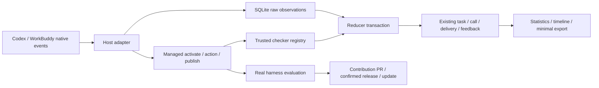
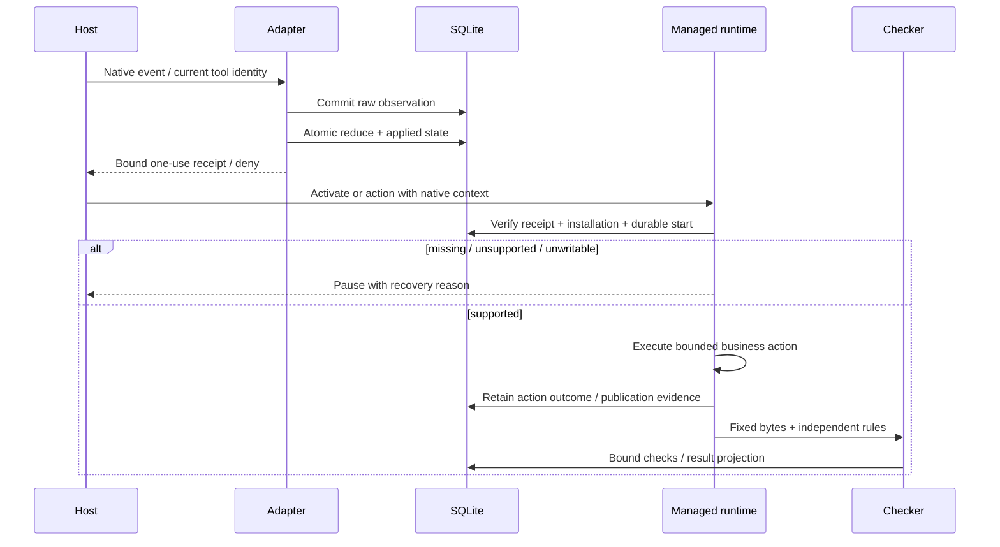

# 工程上下文：F-002 双端自动统计与真实生命周期

## 当前有效方案

### 架构设计

**关联产品上下文**：`.sdlc-v1/context/REQ-002.product.md`
**工程上下文**：`.sdlc-v1/context/F-002.engineering.md`
**已确认需求**：REQ-201–211；决定及授权来源见产品 SRC-201–208。
**创建日期**：2026-10-20
**状态**：当前方案；持久化协议经两轮有界复核后由主 Agent 接受，开始 T004。

#### 背景

现有 Python 标准库 runtime、SQLite、安装事务和贡献流程可复用。F-001 的 76 项本地检查不证明真实自动统计；历史探针只证明 Codex CLI 0.147 / WorkBuddy 桌面 5.7.6 的受管 Bash 路径及停用采集时暂停。当前要补齐实际入口、正式事件投影、双轴判定、独立验证器和真实远端闭环。

复用评估（2026-10-20，Plan 只读分析）：

| 候选 | 适用与成本 | 选择 |
| --- | --- | --- |
| 扩展现有 Python / SQLite runtime | `records.py` 已有身份、结果、反馈修订、汇总与删除；`install.py` 已有锁与 journal；portable runtime 自动包含 Python 模块 | 采用；新增 observation / checker 协议，复用现有业务事实 |
| 直接把实验 probe 接入 records | 固定 nonce、按最近 receipt 关联；不能证明任务起点、交付或旧 writer 兼容 | 不采用生产协议；原探针只保留证据 |
| 引入事件平台 / 新数据库框架 | 不能补足宿主激活及 actor 语义，增加 portable 依赖和迁移成本 | 不引入；当前标准库能力足够 |

代码依据：`manifest.py` portable 摘要及打包；`install.py` registry→suite 锁和活动会话；`records.py` task/call/delivery/feedback；`evolve.py` candidate / contribution / release。现有 evaluate 仅执行 renderer，必须增加真实 skill 正文执行，不能复用为效果通过证据。

README 是唯一全局 usage 入口。US-001–005 均受影响；新增自动运行、健康检查、时间线和 checker 入口由 README 导航，参数以 CLI help / manifest schema 为准。旧记录命令保留诊断及历史兼容用途，不作为正常使用步骤。

#### 架构与组件

##### Host adapter 与安装配置

- **职责**：生成项目级 Codex / WorkBuddy hook 配置和 discovery stub；保留用户已有配置；核验实际宿主能力与安装身份。宿主版本不能只依据 Agent 自报。
- **接口**：将 native payload 归一到 observation v1；接收能力状态为 supported / unverified / unsupported，并保留版本、surface、原生字段依据。
- **覆盖**：REQ-201、202、204、205、210。

##### Observation store 与 reducer

- **职责**：同一本机 `.selc/records.sqlite3` 保存最少原始事件、处理状态、关联、完整性和既有业务投影。先保全事件，再以原子事务投影；重放不执行业务。
- **接口**：`ingest` / `replay` / `timeline` / `assessment` 内部 Python API；正常宿主调用不要求 Agent 执行 task/call/delivery 记录 CLI。
- **覆盖**：REQ-203–206、211。

##### Managed runtime

- **职责**：验证安装摘要、当前 native 调用 receipt、collector 和必要事件能力；启动事件投影成功后才开始业务。脚本入口和纯指令内容供给都使用此 runtime；记录用业务执行与发布事实自动生成。
- **接口**：受管 activate / action / publish；具体 CLI 名称由实现中实际 help 固定。discovery 读取不产生 invocation，真正激活才产生调用。
- **覆盖**：REQ-201–205、208。

##### Checker registry 与证据绑定

- **职责**：独立验证固定字节的输入和业务产物，输出逐项 pass / fail / unknown，保存规则与摘要依据；扩展不修改 renderer。
- **接口**：checker protocol v1；内置可信实现和维护者明确注册且摘要固定的扩展。结构校验与业务验证分开。
- **覆盖**：REQ-207、208、211。

##### Harness evaluation 与现有贡献 / 发布流程

- **职责**：同条件真实执行完整 baseline / candidate skill，使用候选不能改写的 oracle，保留预算 / 版本 / 结果；已有 contribute / release / update 绑定接入真实评估类型。
- **接口**：真实 executor adapter、固定评估报告；GitHub PR 和可审阅发布计划。发布外部操作由主 Agent 在维护者最后确认后执行。
- **覆盖**：REQ-208–210。

图只表达组件职责；receipt、事务和不支持的宿主路径按下文约束。

#### 关键设计决定

##### 决定 1：原始耐久保存与业务投影分两次事务

- **背景**：现有 records 的公开方法会自行 commit，不能直接嵌套为原子 reducer；投影失败不应丢掉已接收事件。
- **决定**：adapter 在接收时完成保守分类；ingest 首次短事务同时保存归一化最少 envelope、payload 摘要、identity，以及不可变的分类结果 / 分类器版本 / 结构化事实 / 必要依据。聊天正文不落库，摘要不用于恢复语义分类；reduce 只消费这些已保存事实，不在重放时用新版分类器重新猜测。reduce 的业务修改、处理状态和消费位置在同一 `BEGIN IMMEDIATE` 事务提交。提取 records 内部不自行 commit 的操作，原公开 API 保持原事务行为。事务中不执行 checker、模型或网络。
- **恢复**：缺依赖事件保持 pending；逐事件重放，不用单一 high-water mark 跳过乱序。副作用不由 replay 再执行。故障注入证明 raw 留存、投影全有或全无、重复计数为零。
- **交付顺序**：受管 publish 以 task 为单位串行，runtime 在副作用前分配不可变 publication ordinal 与 predecessor，完成发布后耐久记录结果；业务参数不能任意指定顺序。首次序号从1开始，后续依赖前驱闭合。D2先到时保持pending，D1到达后按权威序号投影；未完成的预留位置成为gap，不能跳过推导first成功。只有native消息、没有可验证顺序/起点时，相关first/final顺序判断unknown，不使用received_at或当前 `MAX(sequence)+1` 冒充真实顺序。旧手工记录的既有sequence保留，不补造新顺序证明。
- **覆盖**：REQ-203、204、206。

##### 决定 2：数据库版本独立，迁移后拒绝旧 writer

- **背景**：公共 `SCHEMA_VERSION=1` 同时用于 manifest / export，旧 portable runtime 的 open_database 会重算投影。
- **决定**：DB 使用独立 writer / schema protocol（首版 2），不修改 manifest / snapshot 公共版本；支持旧库事务化迁移，未来不支持版本在任何 DDL / DML 前拒绝。迁移、回填、触发器安装与版本标记一次提交。
- **旧 writer 保护**：受保护业务 / observation 表的写触发器调用新连接注册的 writer-protocol SQLite 函数；旧 runtime 未注册，写入失败，不能覆盖新投影。新 runtime 注册协议后再迁移 / 写入。旧 runtime 的读取或 open 可能报错，提示更新框架；不承诺双向写兼容。
- **边界**：保护针对未升级的正常 runtime，不声称抵御具有同 UID、可删除数据库触发器的恶意进程。旧数据库保留身份、unknown 和反馈，不补造新完整性。迁移失败保留原库可重试，不执行破坏性 downgrade。
- **删除范围**：raw 保留已核验的 source installation/context epoch 及已知suite/原始事件时间归属；suite未知只能pending，关联后先检查删除范围再投影。按suite/time删除除subject tombstone外，还保存最少范围拒绝规则和删除epoch；清除相关pending与证据，ingest/reducer/import统一核验。没有稳定ID/可信旧事件时间的重投不能因新arrival时间逃过删除：旧source context失效；无法证明在范围之外的事件quarantine，不重新投影，提示从新的可验证native请求上下文启动。新上下文由adapter重新观测并分配，不能接受业务自报时间或epoch。代价是部分不明迟到事件保持unknown而非自动补齐。
- **覆盖**：REQ-203、206、211。

##### 决定 3：可信身份来自 adapter 与安装，不来自业务参数

- **决定**：installation + host + session + turn/generation + native tool-call + phase 确定事件和 receipt 范围；相同身份同载荷为 replay，异载荷为 conflict，保留原件、增加 gap。没有稳定 native ID 时保留 arrival，去重确定性 unknown，不能仅用 payload hash 合并两个实际请求。
- **receipt**：一次消费、短时有效、绑定安装 / session / turn / tool-call / 请求摘要 / 动作；不按“最近待消费命令”选取。native hook 的 `updatedInput` 可将 opaque receipt 注入受管命令，或使用已实际验证的宿主进程上下文。是否可用由版本探针确认；未验证不启用正式支持。
- **信任**：宿主 hook 配置本地受信，适配器记录来源；普通业务 CLI 不能凭 `--source native` 获取完整性。该机制防误关联 / 重放，不构成同 UID 恶意代码的密码学隔离。WorkBuddy 的 `agent_type=cli` 不是桌面 surface 判据。
- **覆盖**：REQ-201、203、204、205。

##### 决定 4：受管业务边界与 capability 明确

- **决定**：生成 SKILL discovery stub 不包含可直接绕开检查的业务正文；实际 activate 健康检查和耐久登记后供给正文 / 运行入口。所有支持的业务 action / publish 在副作用前再次校验采集和当前 receipt；失效后停止新增动作，已发生动作保留 interrupted / unknown。
- **纯指令**：以实际 native 激活 / 内容供给及最终交付捕获为支持前提。仅写“先运行 activate”不足以强制暂停；没有可验证的供给与输出路径时，报告 unsupported / unverified，不把提示词约束当访问隔离。不能靠缩减产品验收宣称完成。
- **限制**：native hooks 可能错误时继续工具，hosted tools 也可能不经过 hooks；因此自有受管 action 自检是必要条件。对不受支持路径不声称零漏记或能撤销副作用。原生 hook deny 不自动批准本来需要用户批准的动作。
- **覆盖**：REQ-201、202、204；待 T010 真实证据收敛具体 host 支持范围。

##### 决定 5：分类和完整性分别保存

- **决定**：只处理结构化事实和有独立样例的保守规则；保存分类器版本、依据、原因。必要客观输入 / 纯权限 / 自动续跑 / 自动重试 / 业务纠错 / 业务审核 / 自愿反馈 / 新要求 / unknown 分开。UserPromptSubmit 不能直接证明真人，Stop 不能直接证明交付成功。
- **任务**：task 身份来自原始业务请求与受管上下文；session 或 turn 不直接等同 task。恢复不新建 task，实际重新激活增加 call；无法关联的目标不能强行合并或自动新建 task 隐藏介入。
- **首次**：固定首次用户可见交付及产物摘要；内部草稿 / retry 不算。one-shot pass 要求输入就绪、原业务根请求及起止区间和必需事件观测足够、独立检查通过、无业务介入或相关未知变化。初始发起方unknown独立保留，不要求原请求者必须为human；只有原请求已被可信adapter确认为预先声明的纯客观输入、根请求与激活前历史完整时，该初始actor未知才不影响one-shot。后续来源或介入性质不明的输入、起点缺失、resume/fork/compact/handoff归属未恢复仍影响相关first；不能只删除human检查或按“没收到事件”补pass。缺证据只影响相关轴；最终产物明确通过仍可 final pass。
- **结果**：在 records 中新增正式 observation assessment 的读取；继续支持旧 test fixture 但仅 test 数据。不得让公开布尔参数、Agent 自报、好评或终止事件把生产 one-shot 升成 pass。
- **覆盖**：REQ-205、206。

##### 决定 6：checker 与候选的信任分开

- **决定**：固定请求含 protocol、run ID、task/call/delivery、checker identity/version/digest、输入 / 产物 / 规则摘要、必需项。逐项结果与相同摘要绑定；全部必需项 pass 才 pass，明确失败为 fail，其余 unknown。错误格式、超时、缺项、摘要变化 / 不支持协议不继承旧 pass。
- **实现边界**：先固定临时字节快照再检查并绑定摘要，持久记录只保留必要元数据 / 摘要 / 依据。可信内置 checker 至少包含一个独立 JSON/CSV 业务计算 / 格式核验；维护者可显式注册摘要固定的本机扩展。业务 Agent 和候选不能任意替换 checker 或 oracle。
- **运行限制**：有界输入、stdout、执行时间和进程组清理。标准库 subprocess 的 cwd / env / timeout 不等于 OS 沙箱；外部 checker 属显式受信代码，没有可验证禁网能力时拒绝要求强制禁网的配置，不声称已隔离恶意同 UID 代码。
- **覆盖**：REQ-207、208、211。

##### 决定 7：完整正文真实评估与公开交付分步验收

- **决定**：固定完整 baseline / candidate 快照、同一 host/model/tools/budget；回归与 holdout oracle 在候选写范围外。真正执行各版正文，不使用 renderer 自比。报告标识真实 / fixture 执行类型，生产发布要求真实类型与精确 candidate / commit 绑定。
- **预算**：本轮最大 24 次顶层 harness 请求尝试（失败 / 超时 / provider 拒绝也计）；串行、每次最多 180 秒、合成输入、既有账号、不购买额度。provider 内部推理轮次如不可观测，单独写 unknown，不把其误称为 24 次 provider 推理。历史探针 6 次单独保留。
- **公开**：仓库为 `https://github.com/arnow117/skill-evolving-life-cycle`；公开源码、合成案例、脱敏评估摘要，不推 SQLite / 原始对话 / 本机路径 / 凭据。初始基线与开发分支使用 `codex/` 分支，PR 对精确基线；不绕过 main/master 当次确认。正式 Release 保留最后确认。
- **覆盖**：REQ-208–211。

#### 数据模型 / 关键实体

| 实体 | 关键字段 | 不变量 | 覆盖 |
| --- | --- | --- | --- |
| observation | protocol、adapter/version、host/version/surface、installation、source context/epoch、suite归属、session、turn/generation、native event/tool ID、kind、received/occurred、actor/source、causation、payload digest、不可变classification/version/facts/evidence | 首事务保存恢复所需事实；稳定身份唯一；冲突不覆盖原件；非稳定身份不假装精确去重 | REQ-203、205 |
| reduction | event ID、pending/applied/conflict、dependencies、reason | 处理结果和业务投影原子提交；pending 可重放 | REQ-203、204 |
| managed invocation / publication | 安装摘要、task/call、native关联、receipt consumption、activity；publication ordinal/predecessor/side-effect outcome | receipt一次消费；task发布串行、顺序由runtime分配；更新与启动复用registry→suite锁 | REQ-202–205 |
| observation assessment | task/call/delivery、区间、required/observed events、gap、actor/边界/介入分类、version/evidence | one-shot 只读取正式充分证据；缺证据 unknown | REQ-205、206 |
| checker run | input/artifact/rule/checker 摘要、逐项结果、总体三态 | 产物修改后旧结果不适用；候选不能覆盖 oracle | REQ-207、208 |
| suppression | 已有subject身份、observation关联tombstone、suite/time范围、删除epoch和失效source context | 覆盖pending及迟到无ID重投；不确定归属先quarantine；删除后import/replay不复活；不保留已删除业务正文 | REQ-211 |

#### API / 接口契约

- observation v1 是内部 Python DTO 与 hook JSON 归一化契约；adapter 拒绝超限、路径不归属及协议不支持输入；不执行 payload 提供的命令。默认只持久化allowlist字段、摘要和接收时生成的不可变分类事实/决定，聊天正文仅在内存分类；不得读取其他聊天。新分类器只能产生显式新修订，不能改变旧事件重放含义。
- reducer 只消费已保存事件；正常 records API 兼容原有 CLI，内部事务 API 不承诺对外公共兼容。完整性来自 store 的证据关系，不接收业务 `complete=true`。
- managed activation 检查 capability、安装身份、native request receipt、健康；启动事件提交成功才返回业务指令或执行。health/readme 的 ready 必须有实际宿主证据，不能仅检查文件存在。
- checker protocol 独立于 manifest schema；维护者的 registry 中固定 checker identity / digest / capabilities。不能让候选提供任意 argv、环境或规则文件获得可信 pass。
- 错误保留既有结构化 code / message / recovery；扫描、预检失败不增加业务分母。启动后中断样本不能删除或视为尚未启动。

#### 时序与数据流

raw 提交后投影失败仍保留待处理事件；投影恢复不再次执行 M 的副作用。外部副作用不能事务回滚，只保留已知 / unknown 结局和恢复提示。并发锁顺序固定 registry→suite→SQLite，SQLite 事务不反向取文件锁。更新等待受影响活动结束；时间过期不等于活动完成。

#### 横切质量设计

- SQLite writer 串行、有界 busy timeout；hook 同步短事务，不持锁等待模型 / checker。DB connection / cursor 在失败路径关闭，错误保留原始数据。
- 有界 envelope / 文件大小，拒绝 symlink 逃逸和不归属安装；不打印 receipt 或凭据；本机文件最小权限。hook 不根据输入执行任意代码。
- 导出保留旧格式最少字段；raw / checker payload 不进入汇总。按套件 / 时间删除扩展到 observation / checker / 临时持久快照，并保留最少 suppression 身份；不删除源业务产物。
- 历史 DB/portable runtime、双进程写、崩溃注入、重复 / 乱序 / conflict、反馈重算和删除后重放是必要测试；避免只测实现函数自证。

#### 风险与取舍

| 风险 | 影响 | 缓解措施 |
| --- | --- | --- |
| Codex 桌面 Computer Use 被拒绝 | 不能由本 Agent 直接取得该桌面证据 | 准备可审阅隔离案例由用户运行；CLI 独立标记；不绕过拒绝 |
| 原生 skill 激活 / actor / 输出事件未充分提供 | 纯指令或 one-shot 支持不足 | T010 静态核对后有限真实取证；保持 unverified，缺口阻止最终通过 |
| hook 错误时 fail open | 单靠 hook 无法保证暂停 | 受管 action 自检当前 receipt；不支持动作拒绝支持声明 |
| 同 UID 代码可篡改本机证据 | 无法提供恶意进程隔离 | 明确信任范围；不声称 nonce 或 subprocess 为安全沙箱 |
| 发布资源和业务套件许可混淆 | 框架许可不能替代业务内容许可 | 用户已选 SELC MIT，根 LICENSE 已添加；业务套件分别声明 |

#### 需求覆盖

| 规格需求 | 设计 / 契约 | Task | 计划验证 |
| --- | --- | --- | --- |
| REQ-201、202 | adapter / managed runtime、决定 3–4 | T010 | 两端真实发现、显式 / 自动、扫描负例、安装冲突 |
| REQ-203、204 | store / reducer、决定 1–4 | T004、T010 | raw / projection 崩溃、乱序重放、并发、失效暂停 / 恢复 |
| REQ-205、206 | assessment、决定 2、5 | T004、T010 | 正常双轴 pass、纠错 first fail / final pass、缺证据 unknown、旧库 / 旧 writer |
| REQ-207 | checker、决定 6 | T008、T009 | 独立扩展 pass/fail/unknown、缺项 / 超时 / 篡改 / 产物变化 |
| REQ-208、210 | harness eval、决定 7 | T011 | 真实正文 baseline/candidate + 固定回归/holdout，24次总预算 |
| REQ-209 | 现有贡献/发布/更新集成 | T011 | 真实 PR、发布计划 / 最后确认、Release 安装升级 / 冲突 |
| REQ-211 | suppression / 最少汇总、决定 2、6–7 | T004、T008、T009、T011 | 导入去重、反馈修订、删除不复活、公开内容核验 |

### 实施计划

**关联产品上下文**：`.sdlc-v1/context/REQ-002.product.md`
**关联设计**：以上架构设计
**已确认需求**：REQ-201–211
**创建日期**：2026-10-20
**状态**：依次实现；真实宿主和最终发布的依赖保持明确。

#### 背景

用四个可独立验证增量补齐框架，先固定持久化投影，再接 checker、host runtime 和真实生命周期。验证 / 评审按 SDLC 绑定最终集成 commit，真实桌面缺口不能用局部通过替代。

#### 目标 / 非目标

**目标**：自动统计无需手工登记；双端可追溯调用与双轴结果；扩展 checker；真实改进与公开贡献 / 发布 / 升级。

**非目标**：AiTaxs、dsh、SELC 本体 WorkBuddy、云统计、自动语义 LLM judge、购买额度、无人确认发布、恶意同 UID 隔离、新建完整事件平台。

#### 技术栈

- Python >=3.11 标准库、SQLite、Git、uv；保留现有 CLI / portable runtime。
- 当前可用 Python：`/opt/homebrew/bin/python3.11`；uv 测试环境使用项目已验证 3.12。
- 宿主候选：Codex CLI 0.147、桌面随附 0.163 alpha、WorkBuddy 桌面 5.7.6；具体 supported 由真实结果决定，不因列表而承诺支持。

#### 实施层决定

##### 决定 1：共享集成点串行，真实模型请求由主 Agent 串行调度

**实际候选**：多 writer 同改 records/CLI/manifest；或依赖顺序内每个增量单一 Terra writer。

**选择**：共享集成点仍串行；验证器纯模块提取为T008，与T004有限并行，T009在两者接受后做集成，之后T010→T011。原T005由T008/T009覆盖，取消原Task不取消任何验收条件。每个增量保持同一实现者直到接受；T008的实现者继续承担T009。

**理由**：SQLite/CLI/manifest仍共享且串行。纯checker模块只处理固定字节、可信registry和三态结果，接口由决定6及下面契约固定，不依赖records DTO；写范围仅新模块和独立测试，可以单独验收。

**并行资格与隔离**：T008仅写`src/selc/checkers.py`、`tests/test_checker_engine.py`，不改现有模块或README/上下文。使用独立worktree`workspace/20261020-selc-checker-engine`，从8d8328c开始；工具的managed-worktree入口绑定父级hansen仓库，不能指定该嵌套SELC仓库，因此使用其原生Git worktree。两个worktree使用已登记的同一`codex/auto-observation`分支，只有主Agent可提交；两worker都禁止Git写入，主Agent在T004和T008均返回并完成文件集成前冻结HEAD为8d8328c，防止共享ref变化影响另一checkout。测试用各自独立temp目录，不运行模型。此安排满足稳定纯模块接口、不重叠写范围、独立验收和实际worktree/资源隔离；一旦需要修改records/CLI等共享点，停止并行，交T009串行实现。

**纯checker接口**：内部Python API `check_artifact(request, registry)`；request含protocol1、run/subject IDs、checker identity/version/digest、规则version/required项/config，以及可信调用者提供的input/artifact bytes和composite/resource摘要；注册项由可信调用者提供并固定实现digest。结果含相同身份/摘要、逐项规则的pass/fail/unknown和依据、总体三态/原因。所有摘要由受信runtime对实际读取的固定bytes计算，不接受checker自报hash证明。至少提供JSON条目汇总的独立count/sum规则，与业务生成代码无依赖；配置选择是否按id去重。外部扩展为维护者显式信任的固定digest Python脚本，stdin/stdout JSON，有限输入/输出/时间；要求强制OS隔离但当前不具备能力时返回unknown且不执行。具体Python类型/字段命名由实现者在以上固定语义内选择，T009适配不改变业务结果语义。

**覆盖**：REQ-203、207、208、210；设计：store / checker / host / eval。

##### 决定 2：有限真实验收分配

计划从 24 次总上限分配：两端各一次显式正常调用，同时核验原生receipt/环境身份（2）；两端自动选择各一次（2）；每端纠错案例明确包括初次错误请求和同task纠正请求两次（4）；每端已启动unknown各一次（2）；采集失效每端一次（2）；baseline/candidate各在两端执行一次，每次请求包含独立回归与holdout输入、各自产物与oracle检查（4）；真实creator改进一次（1）；正式发布后两端各一次安装升级调用（2）；余5次用于能力取证或有因果依据的修复复测。合并仅减少顶层请求，不混并两个案例的产物、预算和结果；holdout预期不提供给creator或候选，评估结果不回流修改oracle。若实际executor必须拆开回归/holdout，则从余量扣除，不能遗漏纠错第二次请求或升级验收。失败也消耗预算，剩余不足停止新增请求。Codex桌面用户实际请求同样计入，CLI额外验证也计入。

具体运行前记录实际命令 / UI 入口、模型、fixture 身份、开始结束、请求累计与资源归属；原始证据用本轮 `/private/tmp/selc-*` 测试目录，汇总引用下方验证记录，不新增 lifecycle registry。

**覆盖**：REQ-210；设计：决定 7。

##### 决定 3：T010 前核对原生身份与分类能力

**原因与边界**：当前 Codex 桌面执行工具已实际暴露 session/tool-call/version 环境，但这不证明 hook 回执与该身份一致，也不证明 UserPromptSubmit 的 actor、任务边界或最终消息属于业务交付。由既有架构分析 Agent 做一次只读增量分析：只回答两端 native receipt 关联、原始请求/自动续跑/纠错的可证明分类、正文供给与最终产物发布的最小路径，不重复整仓盘点，不改代码/状态，不启动模型或操作 UI。

**汇总点**：主 Agent 在 T009 接受后、T010 派工前，将分析结论与真实能力取证一起核对；未经验证的能力保持 unverified。该分析不替代后续实现、正式 Validate 或 Review，也不能改变未知分类保留 unknown 的产品要求。

**已核定契约**：native子进程session/tool-call可精确匹配唯一receipt，turn从该receipt继承；成功hook不返回allow、不扩大权限。WorkBuddy实际Bash子进程是否暴露tool-call需实测，其静态注入取决于shell runtime路径。初始来源与介入判断分开，按架构决定5处理；T010负责从真实native来源建立根请求/客观输入/区间证明并接入assessment，不能接受普通业务参数自报或仅删除human条件。T004先验收既有可信分类DTO的持久化/重放及本轮已复现缺陷，不以其合成人工起点样例替代真实native证明。两端SessionStart本身都不能证明无既有业务历史。

##### 决定 4：T009声明与运行信任

manifest schema仍为1，新增可选`artifact_checks`对象，以check id为键；每项含`checker: {name, version, digest?}`、`rule_version`、`required_rule_ids`、`configuration`及可选`require_network_isolation`。skill条目可用`artifact_check`引用其中一项，引用必须存在。旧manifest不自动补业务检查或可信pass；内置checker由已选受信framework registry解析实际实现digest，并固定到本次CheckRequest/结果。显式digest若不匹配则unknown；framework更新后重新检查，不继承旧pass。外部扩展只来自维护者已显式注册且digest固定的项目级registry，manifest不能提供任意argv/env或以候选内容自动取得执行信任。

独立`check` CLI用于实际固定输入/产物检查和诊断，不创建业务task/invocation、不假装已发布。完整参数由实际help固定，至少包含project/suite/check-id/input/artifact；注册外部checker使用显式本机命令并核验digest，不自动修改全局配置。T010通过可信内部协调器把真实check与实际delivery同事务关联；T009提供并测试所需记录扩展，持久化最少逐项三态/版本/摘要/理由，不保存业务bytes，不以普通CLI的pass/complete字段提升one-shot。

校验输入/产物固定bytes，资源与安装组合分别绑定可复算的固定字节表示及实际安装identity；不能混用`CheckResult.composite_digest`与既有安装typed-tree digest。来源文件在运行前后变更则旧pass失效或unknown，调用方收到可解释结果；不修改/删除原产物。运行不持SQLite事务等待脚本。导出不携带checker payload/正文，删除清除相关checker明细并保留既有抑制身份；候选评估沿用独立固定oracle，不能信任候选自行重写的检查声明。

##### 决定 5：T010安装内容与受管入口的状态不变量

已选择的业务/框架组合内容保持原始固定bytes及digest，不能为插入discovery stub直接改写其SKILL正文。安装器单独生成自己拥有的宿主入口，记录入口identity/digest与所选组合；注册校验、更新和journal恢复都校验该映射。stub只路由activate，不包含可直接执行的业务正文；activate成功后供给原始业务正文，脚本action与正式artifact publish分别验证当前native receipt及安装状态。

更新继续复用registry→suite→SQLite锁序及现有journal；pending recovery或stub/组合不匹配即暂停，不能混用旧缓存正文和新活动版本。宿主缓存尚未刷新时用expected version/digest明确拒绝；不能靠“最新一条receipt”或sid单独关联。receipt的匹配和一次消费需覆盖安装、host/session/tool-call、唯一native turn及实际action/参数摘要；成功hook不改宿主权限决定。

T010先用本轮预算的真实最小案例核对上述native身份与完整观察窗口，再实现或启用positive assessment。原请求的固定客观输入、激活前历史、输入/工具变化、正式publish顺序和截止对账分别留证；初始来源unknown只保留在来源轴，后续相关不确定变化影响first。具体字段/分类版本须在真实能力结果后固定，旧raw分类不重写；不得以业务自报`complete`或泛化“没有事件”替代原生证明。仅通过受管正式产物发布的指令型skill可按该路径验证，自由inline聊天输出的控制能力保持单独未验证。

##### 决定 6：独立准备native context探针，先核对实际宿主身份

T009集成期间另行准备T012最小实验工具，作为独立可验证交付：仅生成隔离fixture、接收本目录native hook的最少元数据、从真实shell子进程采集allowlist身份环境并对照；不导入生产records/checkers、不改变生产协议、不计业务成功。写范围仅`experiments/native_context_probe.py`及`experiments/host_observation/tests/test_native_context_probe.py`，保持旧probe和其原件不变。真实请求仍只由主Agent串行启动、计入同一24次上限。

使用独立原生worktree`workspace/20261020-selc-native-context-probe`、同一已登记分支`codex/auto-observation`，基于61a8569；T009/T012均禁止Git写入，主Agent在两者返回集成前冻结HEAD。各自测试temp隔离；T012不修改生产或共享文档。先尝试WorkBuddy最小身份对照，Codex实际身份对照尽量与后续正常入口案例合并；不以新探针替代发现/自动选择/one-shot验收。T010仍等待T009和实际能力结果，不降低前置条件。

##### 决定 7：按实际缺失身份验证本地command hook回执传递

请求2的WorkBuddy原生前后事件包含session/generation/tool-use身份，但实际Bash子进程只有session，直接环境关联不可用。只读增量分析定位本地command hook与SDK路径不同：本地parser和执行器允许不带permissionDecision的updatedInput；缺省时仍走原checkPermission，随后应用modifiedInput。采用T013先准备最小实验：仅对严格解析的固定探针命令追加opaque receipt，不改变程序、业务参数、shell结构或其他tool_input字段，不返回allow/decision/continue/updatedPermissions；原审批仍有权拒绝。

主Agent按本机已核对的SessionStore路径算法，仅检查本轮自己创建的探针对话结构与合成命令形状，未读取其他聊天或输出正文/身份值。实际请求2使用`cd <同一fixture> && <固定run>`，解释了与纯run字符串的digest不同；因此严格parser支持且仅支持这一个同目录前缀并原样保留，其他组合仍拒绝。当前会话原件有session-meta、用户message、conversationRequestId/startsNewUserRequest、function_call/result和parent关系；这些字段只是后续完整起点分析候选，未据此宣称actor或one-shot已证明。

receipt由真实PreToolUse生成并绑定安装/fixture、session、native generation/tool-use及原命令和规范参数摘要，子进程用本次注入值精确一次消费；缺失、过期、冲突、已消费或参数变化保留unknown，不找latest。业务自选nonce不是本轮启用方案：当旧未消费receipt与关闭采集后重跑相同命令并存时，缺少当前native身份仍可能误认，不能靠时间窗口补足。Codex继续按实际CODEX_TOOL_CALL_ID路径验证，不能把WorkBuddy改写条件套用到Codex。

真实运输验收预留普通执行与原权限拒绝两个隔离案例；使用项目级`permissions.deny`对固定probe脚本设规则，不添加allow或修改全局配置。规则结构及Bash glob语义依据[CodeBuddy官方权限文档](https://www.codebuddy.ai/docs/cli/permissions)并与本机路径区分；是否确实执行hook、保持拒绝、没有子进程run报告需实际核验，不能据配置文件存在就宣称通过。此两次仍计同一24次总上限，先普通路径成功再启动拒绝案例。

T013仅扩展既有两项实验文件，沿用T012实现者、主worktree串行写；不修改生产/配置状态，不启动实际宿主。默认旧探针行为不变，新隔离fixture显式选择改写运输，合成注入始终candidate。主Agent接受工具后再按同一24次预算与界面代码信任要求验证真实传递及审批保留；无真实结果仍不启动T010正式支持。SessionStart/完整起点缺口独立保留，运输成功不等于one-shot通过。两次本轮真实尝试及T012修正历史保留，不因新Task重置。

##### 决定 8：原生请求前置锚点与交付后对账

增量只读分析确认WorkBuddy fork会重写历史IDs/父链，而JSONL元数据白名单不保留forkedFrom/forkedAt；因此事后“首条无parent、父链完整”不能证明新根。Plan不采用这个推断。可信producer在首次native UserPromptSubmit回调中，按固定版本已核对的addHistory先hook后append顺序，读取native提供且路径/session/cwd均核验的本会话prefix；只有明确非业务元数据的prefix可建立新根候选。有业务历史时只恢复已有task及其证据，无法恢复就保留unknown或在业务启动前提示修复，不新建task隐藏介入。

内部接口为`observe_request_boundary(native_payload)`与`verify_publication_window(native_receipt, managed_publication)`；业务CLI不能提交complete/newtask。producer保存proof/serializer版本、native request与正文摘要、预声明客观输入schema版本、起始文件身份/字节范围/摘要/业务历史数量、已有task映射及继承/压缩/恢复处理、发布截止点与必需事件对账、具体gap及证据引用；不落正文。reducer检查这些关系及当前窗口的缺口，不能仅凭proof对象存在或布尔值判pass。原initiator unknown独立保留；后续未分类相关变化仍影响first。

首次publish时自己的工具结果尚未进入native历史，故只能先记录业务产物与provisional判断；待真实PostToolUse/后续可核验截止点后，确认对应结果已追加、起始prefix未替换/截断、父链与必需事件一致，再自动重算first。checker成立的final轴独立。版本未知、路径越界、过大文件、fork/compact/resume证据不足、并发输入或未归属变化均不补完整性。只读源码顺序还需T010真实normal案例验证，不能据静态分析启用supported；Codex按自己版本的SessionStart/请求与持久化顺序建立同等证据，不直接复用WorkBuddy时序。

#### 风险 / 取舍

| 风险 | 可能性 / 影响 | 缓解措施 |
| --- | --- | --- |
| 必需 native 能力不足 | 高 / 高 | 先最小能力核对，准备用户可执行案例；独立基础实现继续；不虚构完整验收 |
| 协议跨模块返工 | 中 / 高 | 持久化契约一次独立复核；完整有界 brief；同一实现者修正 |
| 24 次不足 | 中 / 中 | 尽量合并合法场景，先本地失败注入；到限报告，不 reset |

#### 实施阶段

1. T004：正式事件存储、投影、分类、兼容和删除；覆盖 REQ-203–206、211；设计：决定 1–2、5。
2. T008：checker纯模块，与T004有限并行；T009：manifest/CLI/records集成，在T004/T008接受后串行；共同覆盖原T005全部条件、REQ-207/211，设计决定6。
3. T010（替代T006）：双宿主安装、native receipt、受管激活与完整时间线；覆盖 REQ-201–205；设计：决定 3–5。
4. T011（替代T007）：真实正文评估、公开贡献 / 发布准备 / 更新、usage 全旅程；覆盖 REQ-208–210；设计：决定 7。
5. 独立 Validate / Review：全部Task的实现、发布前真实旅程与制品准备接受后绑定commit，检查可执行发布计划和制品；不提前声称正式Release或发布后smoke已完成。
6. Ship：对同一已验证/评审commit及制品完成最后一次维护者确认，再由主Agent执行正式GitHub Release；两端从正式Release安装/显式升级并真实调用，核验冲突停止与版本身份，记录smoke及实际缺口后才record-release和完成Goal。

#### 需求覆盖

以上“需求覆盖”表同时为阶段与场景映射；不得将T004或checker局部通过写成双桌面完整通过。

### 工程任务

**输入**：以上设计与计划；REQ-002 confirmed 场景。
**测试**：实现采用 TDD，记录最小失败原因；具体必要回归依据变更。源码保留可读缩进和控制流，运行可用 formatter/check。

#### 路径约定

单仓库 `src/selc/`、`tests/`、`scripts/`、README；项目 skill 正文 `.claude/skills/`、Codex 相对入口 `.agents/skills/`。所有真实验收用隔离合成 fixture，不改 root/global hook 配置。

#### T004 [故事 2、3] 正式 observation 存储和结果投影

- **范围**：`src/selc/records.py`、新 `src/selc/observation.py`（必要时拆同职责小模块）、`tests/test_records_contracts.py`、新 observation tests；README 的对应内部能力说明；本文件实际实现记录。CLI 集成留后续。
- **依赖**：无；持久化协议复核已解决后开始。
- **交付**：可从保存的 adapter DTO 驱动既有 task/call/delivery/feedback 投影；正式 assessment 控制 one-shot；事务、旧 writer、pending/conflict、恢复、删除与最少导出保持。
- **完成条件**：旧库升级无丢失；旧 runtime 不能覆盖；未知版本无写入；raw 先耐久、投影/消费原子；同 ID 异载荷保留 conflict；乱序重放唯一；已启动未知不从分母去掉；删除后 replay/import 不复活；独立标注正常/纠错/输入权限/自动续跑/未知样例符合产品规则。
- **必要验证**：新增失败测试→实现；records旧回归；真实SQLite+双进程/崩溃fixture；raw提交后立即退出仍恢复相同分类；D1fail/D2pass两种到达顺序和重启replay相同；pending删除后迟到依赖/无ID重投不复活；不启动模型、不改宿主配置。
- **覆盖**：REQ-203–206、211；计划阶段 1。

#### T005 [故事 4] 可扩展 checker 与产物绑定（由T008/T009替代）

- **范围**：新 checker/snapshot 模块、`manifest.py` checker 声明与校验、必要 `cli.py` 检查入口、tests、README；仅为此必要的 records/observation 接入。
- **依赖**：T004。
- **交付 / 完成条件**：至少一个非 renderer 的独立业务 checker；版本/digest/必需项固定；pass/fail/unknown、缺项/异常/超时/变更/超限/不支持协议均可解释；候选不能改 oracle；源产物不因验证/删除统计被删除。
- **必要验证**：独立预期的正确/错误数据；检查字节竞态；外部受信执行超时及所属进程清理；现有 manifest/records 相关回归。
- **覆盖**：REQ-207、211；计划阶段 2。

#### T008 [故事4] 独立checker引擎

- **范围**：独立worktree仅新增`src/selc/checkers.py`和`tests/test_checker_engine.py`；不修改其他文件或上下文，返回主Agent汇总。
- **依赖**：无；纯模块接口见实施层决定1，和SQLite/宿主无依赖。
- **完成条件**：至少独立JSON汇总checker和可由维护者显式注册的digest固定扩展；输入/产物固定字节摘要绑定、逐项必需项和三态；正确/错误/缺项/未知协议/异常/超时/超限/摘要不符/扩展试图更改临时快照均有独立预期；已知合法必需项fail不被另一项unknown抹去。外部子进程有界清理并核对，无OS沙箱能力不谎报禁网。
- **验证**：独立本地测试，不启动模型或网络，不导入records，也不调用业务renderer生成expected。实际源码/测试diff返回后集成主worktree。
- **覆盖**：原T005的checker核心；REQ-207/211。

#### T009 [故事4] checker在套件声明、CLI和记录中的集成

- **范围**：原T005所列manifest/CLI/README和必要records/observation接入与测试；T008引擎必要修正仍由同一实现者完成。独立Build检查发现的五项已定位核心缺陷一并由当前唯一集成writer处理：反馈缺前序修订的pending/replay、删除预览DTO、合法checker规则子集、错误格式status三态，以及辅助进程持有pipe时仍有界的I/O清理。该范围调整不新增产品能力，不与原T004实现者并行写同一文件，既有T004/T008验收与缺陷历史保留。
- **依赖**：T004、T008；T010启动前必须接受T009。
- **完成条件与验证**：原T005全部条件继续有效，增加实际CLI/manifest声明和输入/产物变更旅程；不以纯模块通过冒充正式调用已接入。
- **覆盖**：原T005余下集成；REQ-207/211。

#### T010（替代未实施T006）[故事 1–3] 双宿主受管安装、自动激活和时间线

- **范围**：新 host adapter/managed runtime、manifest/install/CLI、生成 skill 资源、必要 collector 集成、tests、README、已审阅 probe 的有限扩展。
- **依赖**：T004、T009；当前 tool-call receipt 和内容供给协议必须先有能力证据。
- **交付 / 完成条件**：项目配置保留已有 hooks；正确受信安装、自检、扫描不计调用；两端正常显式/自动入口使用，无手工登记；启动/途中故障暂停；真实 normal pass、纠错 first fail/final pass、已启动 unknown；身份和活动版本不混用。缺 Codex 桌面实际用户运行或其他能力证据时如实保留未完成。
- **必要验证**：静态 SDK / schema、最小真实能力案例、故障集成、本机数据对照 native 原件；只主 Agent 串行启动24次预算内真实请求。不要使用文件路径请求替代原生 discovery。
- **覆盖**：REQ-201–205、210；计划阶段 3。

#### T011（替代未实施T007）[故事 5] 真实评估、公开贡献及发布升级闭环

- **范围**：`evolve.py`、真实 executor、生成维护资源、tests、README、发布配置 / 合成示例；必要安装 / checker / CLI 接入。
- **依赖**：T010。
- **交付 / 完成条件**：完整baseline/candidate正文真实执行；固定oracle/holdout候选不可写；真实creator修改；预算/版本/介入/已知成本报告；真实公开贡献PR、可审阅发布计划、准确commit及可安装包；更新/冲突检查在发布前的隔离版本上实际验证；原始私密记录不公开。框架和生成套件携带的SELC runtime均包含用户已选的完整MIT声明，随runtime打包和摘要验证；业务套件自己的许可证独立，不用框架MIT覆盖业务内容。T011完成代表实现和发布准备完成，不能据此写正式发布成功。
- **必要验证**：本地fixture回归与真实旅程分开；预算内双端真实评估及真实GitHub贡献API/PR；独立Validate/Review核验同一实现和待发布制品。正式Release外部副作用及发布后两端安装升级调用归Ship，执行前最后确认不可省略；全部仍属于本Goal必需交付，未做完不record-release/complete Goal。这样避免Task必须先发布才能进入Validate、而发布又要求先Review的阶段循环。
- **覆盖**：REQ-208–211；计划阶段 4。

#### T012 [故事1、2] 最少native context实验工具准备

- **范围与隔离**：见实施层决定6；仅独立实验脚本与独立测试，不修改现有probe/生产模块/全局配置。
- **依赖**：无；只依赖标准库和已核对的宿主配置形状，与T009有限并行。
- **完成条件**：生成全新隔离目录与项目hooks；限定本目录、最少元数据/摘要、无prompt或结果正文落盘；run只保存allowlist宿主身份环境，报告唯一匹配/冲突/缺字段unknown；synthetic不能伪装实际native证明；本地测试及help可用，资源清理。真实host请求由主Agent后续执行，不凭工具测试置真实能力supported。

#### 依赖与执行顺序

T004与T008按实施层决定1有限并行；其后T009→T010→T011。T010由原T006替代、T011由原T007替代；原T005前置由T008/T009全部验收替代；状态仅由主Agent通过CLI调整，不能跳过工程前置。共享集成点单writer，真实模型仅串行。原T005/T006/T007均尚未实施且0失败尝试；原任务取消并分别由T008/T009、T010、T011接替，既有源码和历史不删除；T004的现有实现/修正历史保留。独立验证/评审保持只读；失败返回原实现者，非收敛规则不因拆分重置。

T013是T012工具准备后的实际能力增量，依赖T012：仅在原两文件内增加WorkBuddy本地updatedInput回执实验、纯解析/重放/冲突/隐私测试，保持无权限决定且默认模式不变。它不能接受生产宿主能力；真实执行仍由主Agent串行负责。

## 实现记录（实际）

- Plan 基于 `a311224513594a0a23c286b3b5b7458f3fca0fe5`，实际分支 `codex/auto-observation`；T004 为待主 Agent 接受的未提交实现候选，本任务未实现 T008–T011。
- Spec 主 Agent 已接受，REQ-002已进入F-002交付；进度以state为准。MIT许可证提交`8d8328c`；实现前的基线源码未改动。
- T004 未提交实现候选：`records.py` 保持公开 manifest / snapshot `SCHEMA_VERSION=1`，新增独立 SQLite writer protocol `2`。打开数据库先注册 `selc_writer_protocol()`，在一个 `BEGIN IMMEDIATE` 内完成旧库增量列、feedback revision 回填、observation 表、protocol 标记和受保护表的 writer trigger；未来 protocol 在任何 DDL/DML 前拒绝。旧 runtime 未注册该 UDF 时无法写入。raw observation、conflict/gap、task/call assessment、删除 tombstone/range/source epoch 均只在 records DB 内保存；不把正文、prompt 或业务产物写入这些表。
- T004 内部 API（非 CLI / 非稳定外部接口）：`selc.observation.ingest(database, envelope)` 先提交 raw 再 replay；`replay(database)` 只消费已持久化 pending 事件并返回 applied/pending/quarantined 数，结束时还按 task 重刷已持久化 pending、quarantined 和 native conflict 的 assessment，因此 raw 写入后崩溃不依赖后续 applied event 才能反映 first-result 不确定性；`timeline(database, task_id)` 返回最小事件和 gap；`assessment(database, task_id)` 返回 formal first/final result。`records.projection_transaction` 和 `_project_*` 只供 reducer 将业务 projection 与 applied 状态同一事务提交，公开 records API 保持既有行为。
- T008纯checker模块已由主Agent验收，两文件已核对SHA-256并集成主worktree，HEAD仍冻结8d8328c。内部API为`check_artifact(CheckRequest, CheckerRegistry) -> CheckResult`；结果绑定run/subject/checker/rule/resource/composite和实际bytes摘要、逐项三态。内置`json-item-summary@1`独立核验count/sum，按id去重可配置，十进制求和使用局部精度且最大支持8192位对齐跨度，超限unknown。维护者注册的Python扩展校验digest后执行私有固定副本；stdin/stdout/stderr/时间有界，核对进程组和线程清理；当前内置实现均不具备强制OS禁网，要求该能力则unknown且不执行。
- T009未提交实现候选：schema-1 `artifact_checks` 与 skill `artifact_check` 引用均在 seal/install 前校验；`selc check` 按已安装typed-tree加载受信checker、绑定输入/产物/suite manifest bytes并在执行后复核源文件和安装树，诊断不写task/call/delivery或统计。`selc checker register-script` 仅把维护者显式给出的digest-pinned脚本登记到项目本地 registry，manifest不能提供路径/argv/env。内部`CheckerExecution`及`records.record_checked_delivery`在执行结束后以短SQLite事务绑定实际task/call/delivery、安装版本/tree digest、engine composite digest及逐规则三态，不保存业务bytes或原始stdout；delivery删除通过外键清除这些元数据。内置checker只输出所请求的count/sum子集；脚本I/O改为非阻塞deadline循环，辅助进程逃出原进程组并持有pipe时按`process-cleanup-incomplete`返回unknown，不宣称已清理该后代。
- observation v1 DTO 的顶层字段固定为 `protocol: 1`、`adapter: {name, version}`、`identity`、`source_context`、`kind`、`occurred_at`、`classification`。`identity` 固定含 `installation_id`、`host`、`surface`（非空），`session_id`、`turn_id`、`native_event_id`（字符串或 null）及 `phase`（`pre_delivery`、`post_delivery`、`lifecycle`）；稳定 identity 是 installation/host/surface/session/turn/native tool-call/semantic kind/phase 的 canonical tuple hash，任一 native component 缺失即不假精确去重。同一 native callback 的 `task_started`、`call_started` 等派生事实因此各自幂等，而不伪造不同 native ID。`source_context` 为 `{id, epoch}`，epoch 为正整数。`classification` 固定为 `{version: "observation-v1", facts, evidence}`；facts 只接受 task/suite/call/delivery/feedback ID 与版本、hash、checker、result、publication ordinal/predecessor、actor/origin/causation/delivery-role 等列出的标量事实，拒绝 body/prompt/content/message/complete/complete_fixture 和未知键；evidence 仅为有界字符串引用。
- v1 kind 固定为 `task_started`、`call_started`、`input_ready`、`permission_granted`、`automatic_retry`、`business_intervention`、`delivery_published`、`call_completed`、`feedback`、`task_interrupted`、`task_closed`。reducer 对 start/call/delivery/feedback 各自要求已有 records 身份字段；delivery 的 runtime publication ordinal 和 predecessor 是顺序依据，不能由 arrival/id/time 推断。input/permission/automatic retry 不构成 intervention；执行区间的 business correction/audit 构成 intervention；post-delivery 事件不倒灌为执行介入。formal first pass 要求 effective pass、formal managed start、input、checker pass 的 formal delivery，且该 call/task 范围内无 gap/未决/冲突/未知执行分类；独立已知 first/final fail 即使有无关不完整证据仍保留 fail。formal final pass 只由当前 effective pass 的 formal delivery、连续发布链和该 delivery 自身无 native conflict 确立，因此无关执行区间的 unknown、pending 或 conflict 不抹去已验证产物结论；unknown checker 及冲突的当前 delivery 均不能建立 pass。两轴都不读取 `complete_fixture`。
- 删除扩展为 suite/time range、stable tombstone、source epoch 和本地 subject suppression：`before=None` 在写锁内捕获有限 boundary，不生成无限 future 范围；已删除 task/call 即使用新 source/epoch/arrival 也不得重建，旧 pending、迟到和无 native ID 的 source 不得在 replay/import 时复活；boundary 之后的已验证新 context 可投影。unknown suite 保持 pending 直到受信 task 归属后再作 scope 检查。最小 snapshot 格式和 feedback revision 仍由既有 records export/import 管理。

## 验证记录（实际）

- 本 Feature 新 Goal 真实模型请求启动数：2/24。历史探针6次保持在产品证据中，不计入该新预算。
- 请求1：WorkBuddy桌面5.7.6、官方GLM-5.3、串行、隔离native context fixture。界面多行键入提前发送了不完整请求，主Agent在显示28s时停止；界面确认“已取消”，只显示读取本目录RUNNING.txt，未取得身份对照结果。此取消计入预算，不作为接入通过。用户已在执行时确认本目录新探针正常打开及运行；没有扩大宿主权限或更新应用。最少原件保留在本轮私有fixture，不公开身份值。
- 请求2：同一WorkBuddy隔离目录和官方GLM-5.3；整段粘贴后核对完整输入，于2026-10-20 10:10:49 UTC之后发送，单次180秒上限。实际收到UserPromptSubmit 10:10:53、PreToolUse 10:11:00、私有run报告10:11:01、PostToolUse 10:11:02、Stop 10:11:08（UTC）。子进程allowlist实际只有`CODEBUDDY_SESSION_ID`，没有tool-call/request/message环境；run返回`unknown/missing_child_identity`。native receipt有session/generation/tool-use身份，但没有SessionStart证据；不能接受child身份直接关联或完整起点。Mac随后锁定，Computer Use要求用户手动解锁；未绕过锁屏或重复发送。该请求为能力取证，不是正常skill发现或业务成功率样本；最少原件及hash已保全到`/private/tmp/selc-auto-20261020-evidence/workbuddy-context-request2/`。剩余22次预算，不重置失败。
- 用户解锁后，主Agent通过WorkBuddy界面确认请求2“已完成15s”、退出码0及`missing_child_identity`，与本机run报告一致；没有继续运行中的探针任务。进程退出0仅证明实验命令完成，不改变identity unknown或业务统计结论。
- 历史有限探针原件 `/private/tmp/selc-host-probe-20261020-evidence/`；不替代 F-002 验收。尚无 F-002 通过验证 commit。
- 2026-10-20 静态核对：OpenAI 官方 hooks 文档提供 PreToolUse updatedInput、UserPromptSubmit 和 Stop 字段；本机 WorkBuddy 5.7.6 headless 实现包含 updatedInput，以及 CODEBUDDY_SESSION_ID / TOOL_CALL_ID / CONVERSATION_REQUEST_ID 的受管进程环境。仅作为实现候选，不当作真实运行通过。
- T008修正后验证：隔离worktree、分支`codex/auto-observation`、HEAD`8d8328c0313a231f194191d6e12e89f10b4cc128`加两项未提交新文件；`/opt/homebrew/bin/python3.11 -m unittest tests/test_checker_engine.py`为25 tests/exit0；`/opt/homebrew/bin/python3.11 -m py_compile src/selc/checkers.py tests/test_checker_engine.py`及whitespace检查exit0。新增回归覆盖六项首验发现，包括200KB不读stdin请求的超时/线程清理、大整数精确求和、源码替换窗口和拒绝未落实的隔离要求。Ruff不可用。主Agent复核修正实现及独立预期后接受纯模块；不是T009集成或正式Feature验证。
- T009候选验证：主集成worktree、分支`codex/auto-observation`、HEAD`61a8569f642a6b05668b5355906aba9a6c28b1a6`加未提交候选；`/opt/homebrew/bin/python3.11 -m unittest tests/test_checker_engine.py tests/test_checker_integration.py tests/test_records_contracts.py tests/test_observation_contracts.py -v` 为70 tests/exit0，覆盖真实installed `selc check` 的builtin pass/fail/unknown、显式脚本登记/identity drift、input/artifact晚变更、无诊断分母、持久化/删除及五项Build回归。`/opt/homebrew/bin/python3.11 -m unittest discover -s tests -v` 为131 tests/exit0。候选仍待主Agent diff/独立验收，不能当作Feature正式Validate或Review通过。
- T004 实际本地验证：先以缺失 `selc.observation` 的 observation contract 测试失败，再实现最小 store/reducer；首次候选的 `/opt/homebrew/bin/python3.11 -m unittest tests/test_observation_contracts.py -v` 为 14 tests / exit 0，`/opt/homebrew/bin/python3.11 -m unittest discover -s tests -v` 为 90 tests / exit 0。首次 focused final-format 命令为 `/opt/homebrew/bin/python3.11 -m unittest tests/test_records_contracts.py tests/test_observation_contracts.py tests.test_boundary_contracts.BoundaryContractTests.test_delete_cannot_orphan_a_session_started_during_its_lease_recheck -v`，当时为 30 tests / exit 0；此前补齐验收回归后以同一命令重跑为 34 tests / exit 0，之后新增 durable gap recovery 覆盖。当前 observation contracts 为 20 tests / exit 0，集成 T008 checker tests 后完整 suite 为 121 tests / exit 0。`/opt/homebrew/bin/python3.11 -m compileall -q src tests` 与 `git diff --check` 均为 exit 0。observation contracts 覆盖 raw-first crash/reopen replay、projection failure raw retention、旧库 protocol-0 migration/idempotency、以冻结 `a311224` runtime 的真实 writer 拒绝、future protocol pre-write refusal/connection cleanup、stable replay/conflict、shared native callback 的 semantic kind、delimiter-safe identity、无 native ID、D2-before-D1 deterministic replay、task/call 独立 assessment、unknown checker、permission/retry、post-delivery interval closure、started interruption unknown、两个 SQLite writer 的 250ms busy failure、delete source/range/epoch、minimal snapshot import suppression 和 fresh source；首次候选验收后另覆盖 unknown execution 不抹去 checked final/known fail、冲突 call 的即时/replay/reopen 局部失效、冲突 current delivery 不建立 pass、无时间 delete 的有限 boundary 与 fresh context，以及 raw-conflict crash/reopen、未解析依赖和 quarantine 的 durable assessment refresh。`ruff` 未安装；尝试 `UV_CACHE_DIR=/private/tmp/selc-uv-cache uv run --no-project --python 3.11 ruff check ...` 以找本地可用 binary，结果为 executable missing，未安装依赖来伪造该检查。后续独立 review/真实 host/checker 验证仍未执行，不能据此声称 T008–T011 或任一桌面 host 已通过。

## 评审记录（实际）

- 持久化协议独立复核第一轮：发现3个P1契约缺口（raw缺分类恢复事实、交付缺权威顺序、删除未覆盖pending/无ID重投），均接受并修改决定1–2及数据/接口契约、T004必要验证；未发生代码实现/纠错尝试。第二轮只复核修订，不替代实现后独立Review。
- 第二轮`/root/selc_observation_protocol_review`仅复核上述修订，未发现剩余可操作问题；主Agent接受。只读输入源码仍为a311224（8d8328c仅新增LICENSE），无代码测试或宿主通过推论。协议复核到此结束。
- T004 首次实现候选验收：90项本地测试通过后，主Agent以临时SQLite复现三个未覆盖条件：unknown执行分类使已验证final pass变unknown；同一call native identity的异载荷冲突后task/call仍保留first pass；无时间条件删除将所有后续新任务永久quarantine。每个复现均有确定输入和实际结果，已交原实现者补齐回归与修正；未接受Task或Feature。
- T008 首次实现候选验收：17项纯模块测试通过后，主Agent复现大整数求和因Decimal默认精度产生false pass、无效规则配置被算业务fail、未强制OS隔离却接受隔离要求、stdin阻塞超出执行超时；另定位实现digest漏掉计算helper及校验脚本路径存在检查后替换窗口。原实现者继续处理同一两文件范围并补回归；未集成、未接受Task。两项均为首次返回后的有因果证据修正，不因Task拆分重置失败历史。
- T010前增量架构分析：WorkBuddy源码证明UserPromptSubmit可能接收Stop反馈及定时自动消息，不能按事件名认定真人；工具call环境注入有条件，须真实对照。主Agent与分析者进一步按既有产品DEC-004–006确认：原始发起方unknown只影响来源，可信业务根边界、客观输入和完整区间才决定是否足以判断无人工介入。已修改架构决定5；不是放宽证据条件，也不补造初始human。T004首次修正派工因Terra容量失败，非代码测试失败，保留工作树并继续原实现者。
- T008第二次返回已解决六项首验发现，主Agent接受该独立模块并通过lifecycle CLI将T008置done；同一实现者将在T004接受及文件集成后承担T009。后续正式独立Review仍对应最终集成验证commit，不用本次Build验收替代。
- T004第二次实现返回已解决首验三个复现；随后主Agent用raw-only conflict提交后关闭/reopen/replay，以及新pending依赖事件，分别复现已有first pass未失效。定位为非applied证据的assessment恢复缺失：仅ingest内存分支或成功apply触发重算。原实现者继续修正这一有新因果证据的恢复问题；不接受Task，不丢弃原工作树或失败历史。
- T004第三次返回解决持久化gap的恢复：replay在消费稳定后按受影响task重算pending/quarantined/conflict证据；正常冲突/隔离也立即重算。新增两项回归均exit0，observation20 tests及集成121 tests exit0（包含T008的25项），compileall/diff检查exit0。主Agent核对恢复实现、前述三个修正及调用隔离回归后接受T004，lifecycle CLI置done。此为Build增量验收，不是Feature正式Validate/Review。
- T004/T008均已返回并接受；主Agent核对checker隔离worktree仅有两项新文件且与集成副本逐项SHA-256一致，随后清理该任务创建的原生worktree。共享HEAD冻结到此结束，后续T009使用主集成worktree，由原checker实现者串行执行。提交前扫描新增上下文/实验源文件，未发现凭据样式、用户home绝对路径或原生会话UUID；私密SQLite与宿主原件仍在独立临时证据目录。
- T009实施期间并行做一次独立只读Build代码质量检查：原因是核心持久化、恢复和有界子进程具有时序风险；输入固定为已接受`61a8569`的records/observation/checkers及相关测试，不读取正在变化的T009实现，不修改源码/状态、不启动模型或宿主。主Agent在T009返回时汇总发现；如需修改仍交有写范围的原实现者，不与其并行写同一文件。该检查不是正式SDLC Review，最终Validate后仍按对应commit独立评审。
- 独立Build检查返回五项具体发现，主Agent接受：P1反馈revision2先到使全队列replay停在REVISION_CONFLICT；P1脚本新session辅助进程持有pipe使buffered close超时后仍阻塞；P2删除dry-run暴露sqlite3.Row不能JSON序列化；P2内置provider多返回未请求规则使合法子集unknown；P2错误格式status列表/对象引发未捕获TypeError。审查只读固定61a8569，最小实验不足5秒且资源已清理，无正式Review状态变更。当前T009原checker实现者作为唯一writer补齐这些集成回归；缺前序修订是待依赖，已有同修订异载荷仍冲突，不能泛化吞掉所有REVISION_CONFLICT。
- T009主Agent复核声明校验、受信实现解析、源文件变更检测、metadata绑定与事务归属；`record_delivery`复用调用者事务，不在projection内提前commit。主Agent另跑`PYTHONDONTWRITEBYTECODE=1 /opt/homebrew/bin/python3.11 -m unittest tests/test_checker_integration.py -v`，5 tests/exit0，与实现者131项本地通过证据对应相同代码及环境。五项独立Build发现均有回归，接受T009并通过CLI置done。此接受不表示真实宿主、权威publication顺序或整体Feature已验收；T010仍负责受管发布协调。
- T012首次返回10项本地测试通过，但主Agent发现实际Codex环境为`CODEX_TOOL_CALL_ID`等命名，工具读取的裸`TOOL_CALL_ID`会漏掉身份；thread也不能当turn比较。生命周期配置还错误复用Bash matcher。已交同一实现者在原两文件范围修正命名空间、仅工具事件使用matcher，并用文件锁防止并发arrival覆盖。仍保持HEAD冻结，未运行新的真实宿主请求。
- T012第二次返回解决上述问题，11项定向测试exit0。主Agent核对修正源码、两个文件SHA-256一致后集成，并在主worktree实际重跑`PYTHONDONTWRITEBYTECODE=1 /opt/homebrew/bin/python3.11 -m unittest discover -s experiments/host_observation/tests -p 'test_native_context_probe.py' -v`，11 tests/exit0；包括8进程arrival保全、实际CODEX环境名、thread/turn区分及stdout隐私。接受工具准备并通过CLI置done；真实宿主仍未验证，0/24预算不变。该实验不替代生产SQLite或业务调用采集。
- T013首次返回19项实验测试通过，主Agent复核并用临时fixture定位：CLI将updatedInput打印在顶层，而实际宿主parser只读取hookSpecificOutput；同一native身份异载荷冲突后，旧receipt仍可消费为matched。另确认strict shell parser会接受末尾换行，追加参数因此变成第二条shell命令，空native ID也不应发receipt。交原实现者在原两文件范围补真实parser形状、冲突后原token/replay/reopen失效及严格拒绝回归；未接受T013，未发起请求3。子结果还把F-002写成F002，要求按allowed transition返回正确ID后再推进，不由主Agent代填错误请求。
- T013后续返回先通过20项测试；主Agent另复现同一session/tool身份但缺generation的冲突，以及新增tool_call_id别名掩盖既有tool_use_id冲突，原token仍matched，交同一实现者修正。24项版本解决这两种条件并加入实际同目录cd前缀；主Agent再定位正常PostToolUse被误与Pre载荷比较而taint，要求按事件类型区分。25项版本修正普通Pre→consume→Post→Post replay，主Agent复核源码并实际重跑定向suite（25 tests/exit0、3.460s）和diff检查（exit0），接受T013并通过正确F-002/T013请求置done。各返回解决前述已定位条件，失败及新增因果证据保留，没有重置为新问题；尚未发起请求3，不是生产接入或正式Feature验证。
- 本轮原生历史只读分析：完整事后父链仍不能证明新根，因为fork重写IDs而JSONL不保留forkedFrom；已将请求回调前prefix锚点及交付后截止对账写入当前有效方案决定8。源码顺序是候选能力，实际桌面顺序与完整窗口仍需T010真实案例核验；本次16行事后样本不补造empty-prefix或one-shot证明。

## 发布与观察记录（实际）

- 产品观察计划引用：REQ-002“发布后观察计划”。
- 公开仓库已创建并配置 origin；初始基线及MIT许可证`8d8328c`位于`codex/design`。T004/T008基础实现及上下文`61a8569f642a6b05668b5355906aba9a6c28b1a6`已推送到`codex/auto-observation`，创建并附加[Draft PR #1](https://github.com/arnow117/skill-evolving-life-cycle/pull/1)。该PR明确标注T009–T011和正式验证/评审未完成，是框架开发PR，不替代T011实际生成套件的使用者贡献验收。尚无正式Release；最终发布确认和实际升级均待执行。
