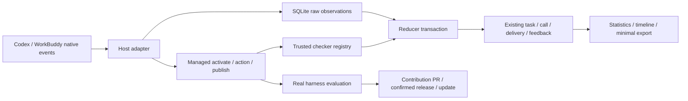
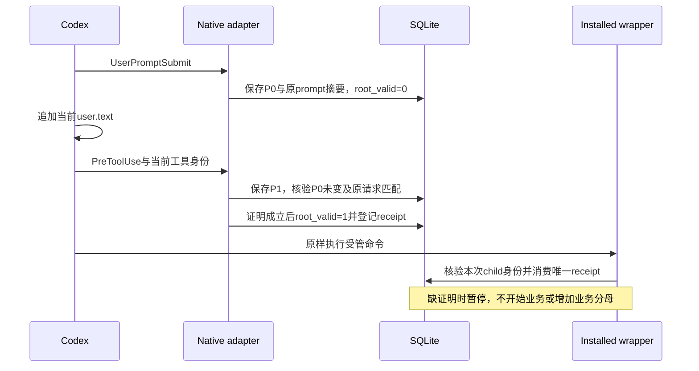

# 工程上下文：F-002 双端自动统计与真实生命周期

## 当前有效方案

2026-10-26 用户进一步要求先发布基础可用版并同步 GitHub/Gitee，自动统计标实验。本次基础版由 REQ-003/F-003 独立跟踪源码/制品分发；不恢复 T011 模型测试、不重置旧失败与诊断额度、不将 F-002 或 T011 标完成。T015 已接受的 basic 能力纳入首发。

### T015 当前优先方案：基础安装与自动统计分离（2026-10-26，SRC-212）

新增 T015，依赖已完成 T010，独立交付目标为普通 WorkBuddy skill 的无 hook 安装/调用。它不修正或重试 T011 的 Codex 事件接入问题；T011 原失败、未知状态、诊断额度和原件保留，模型请求维持停止。本轮只有离线验证，不操作桌面、不提交推送或发布。

复用 install.py 的注册、不可变 contents/current、registry 锁、active lease 和 journal/recover，以及现有 portable run/业务脚本。无新服务、数据库或通用 executor。安装 API/CLI 新增 mode=basic|observed；新安装省略时 basic，已有安装省略时保留，旧登记缺字段按 observed。mode 是 suite 安装级选择，所有已注册 harness 一致；显式切换和版本更新沿用同一锁/事务/恢复，活动任务/执行不能被模式切换绕过。同 digest 模式切换也需保护。

basic 注册直接指向 current 中的普通 skill 目录，不生成 managed invoke 包装，不新建 hooks，不依赖已有 settings/hooks.json 可用。切换时只移除本 suite 精确拥有的 hook 命令，保留其它用户配置；未知损坏配置不擅自覆盖。新安装 basic 遇到无关损坏 hook 配置仍成功。返回模式和未启用自动统计状态；基本业务执行不写 production 观测成功/one-shot/评估资格。observed 显式启用后保持原 receipt、身份、writer6、publication 及四处真实资格校验，不新增隐式降级。真实 evaluator 必须显式安装 observed。

普通正文与受管正文分离：manifest skills 的可选 basic_path 为安全相对 skill 目录，按同一 name/frontmatter/路径/portable hash 规则验证并打包。无 managed action 的普通 skill 缺 basic_path 时直接使用 path；managed action skill 缺 basic_path 时在修改安装前明确拒绝 basic 并提示补齐普通正文，不猜测/改写业务 Markdown。create 生成普通正文；有 managed action 时同时给出独立普通入口，普通入口使用现有 run 或声明脚本，不需 native 身份。旧包在 observed 模式可继续读取，不改写历史制品或回填评估成功。

实现者范围：install/manifest/CLI、必要 evaluator observed 显式接线、README/作者 skill/生成 MAINTENANCE 和受影响测试。主 Agent 维护产品/工程/checkpoint/state，并在独立工作区用新 runtime 准备普通 item-summary 演示包；不改旧 source commit、creator 产物、plan/attempt 或失败证据。必要验证：新/旧省略默认、WorkBuddy 基础注册与实际文本/JSON产物、缺失/无关损坏 hooks、无生产记录、observed 保守拒绝、双端模式切换/lease/恢复、便携安装与更新；最后一次累计本地回归及格式检查。源码不变不重复测试。本地结果不能冒称新的 WorkBuddy 模型/桌面验收，T015 可按此离线范围接受；T011/Feature 不因此完成。

接受前由一个独立 Sol reviewer 只读复核本 T015 增量的安装 mode 持久化/恢复兼容、hook 精确清理和普通正文路径；不运行模型、不写文件、不重复累计回归。主 Agent 汇总其发现与同一 Terra 实现者的必要检查结果后最终接受，不能用这次定向检查冒充 F-002 正式 Review。

### T015 离线交付接受（2026-10-26）

同一 Terra worker 完成代码及必要测试，main 接受此 Task 的离线范围。新增安装 mode、manifest basic_path、直接普通注册、显式 observed、已有选择保留、更新/恢复兼容及 README/作者/生成维护说明均已接线；真实 evaluator 明确选 observed，未降低任何真实资格判断。独立 Sol 发现并由同一 worker 修复：部分 hook 写入的耐久 ownership/回滚、发现链接的物理路径解析、basic_path 必须属于 portable skills/；复核又定位“新增宿主同时切换模式”的旧新 harness 并集清理分支，已追加精确回归并修复。main 最终只读核对该并集清理、已登记新端精确所有权预检及仅恢复旧端，不做未观察的成功推断。

最终 focused 命令 `PYTHONDONTWRITEBYTECODE=1 /opt/homebrew/bin/python3.11 -m unittest tests/test_install_modes.py -v` 13 passed；`PYTHONDONTWRITEBYTECODE=1 PYTHONPATH=src /opt/homebrew/bin/python3.11 -m unittest tests.test_install_contracts -q` 37 passed，py_compile/Ruff/diff 检查通过。一次累计本地回归 279 passed/64.281s（正确 outer escalation）；该累计发生在最后新增端回滚修正之前，最终修正后只复跑上述受影响 50 项，不虚称完整累计覆盖最终 hash。早期累计 275 中一个 existing process-group 检查因 sandbox 的 killpg EPERM 出错，准确外层执行后通过；execution_lease.py 未修改，不隐藏此历史。无真实模型/桌面/provider/远端调用。

最终 src/selc/install.py SHA256 2c77e7347cb1a621cfdf66a1b6371cd39f92427831541fa7f8bffcd301b3b5f6；manifest.py c18686ae199a94b11939fa86ef2e01c4037a1f7b079969396143a817af96297d；tests/test_install_modes.py abfafea328d7b4096bee06f3a282a1f7035d30ce770136b52b81fa36823a967d。主仓 HEAD/分支不变，所有修改未提交，不写远端。作者 skill 的 .agents 相对链接保持。

main 先交付独立普通 skill ZIP（仅 SKILL.md/原样整数业务脚本/MIT）：workspace/20261026-selc-basic-workbuddy/item-summary-basic-skill.zip，SHA256 024fd8b9f5b2e8eb6b161f1a21284d6e6a7f7edfa9542b7f9fb061206886d81a，quick_validate/本地脚本通过。再以最终 runtime create/seal/package 新 preview 1.0.1-basic-preview，普通及受管两正文均 quick_validate 通过；simple-item-reports-1.0.1-basic-preview.zip SHA256 506f764148a8e8b217da91ae468c8a93584c6610a5119fac416ce0a100e1ed8f。旧 source/creator/评估原件不改；业务整数脚本逐字复用。

最终 ZIP 解压后的 install.py 实际从独立工作区运行 `--project-root <workspace>/project --harness workbuddy`，省略 mode 得 basic/observation.enabled=false/owned_hooks={}，`.codebuddy/settings.json` 未创建。main 从实际发现 symlink 指向的 SKILL.md 解析物理目录，保持 project cwd，运行请求 input=items.json 的真实脚本；报告 count=3,sum=18，task/call/delivery/native/receipt/publication 六生产计数均0。原始命令、退出码、hash、结果在同工作区 portable-basic-verification.json，普通 ZIP 证据在 standalone-verification.json。实际 WorkBuddy 模型/桌面未重跑；不据离线事实扩大该声明。T015 可 done；T011 真实资格/贡献/Release 仍未完成，失败/诊断额度不重置，正式 Validate/Review/Ship 尚未进行。

### 当前停止点：T011真实评估未通过（2026-10-26）

T010已完成；T011仍in_progress，未完成真实资格、贡献PR或正式发布。main已按不收敛规则停止这一评估段，不再发送provider、派修正或做第二次诊断；代码/所有计划/原件保留，没有reset/清理数据/停止共享服务。不是用户暂停Goal，也不把Task或Feature记done。

已交付真实creator的初版、managed使用说明补齐和精确Decimal改进（请求54/55/56），原始隔离证明通过、业务产物hash固定。正常信任继承实现经31项模块检查与语法修正后5项局部检查、Ruff/diff和定向Sol复核；公开CLI无模型RPC确认5个normal trusted/enabled hooks和5个sessionFlags覆盖值。但这只证明公共配置解析入口，不能代替exec --ignore-user-config的实际回调。

真实评估57与58分别23.225s/48.637s返回exit0，都在业务前RECEIPT_UNAVAILABLE，task/call/delivery/native/receipt/publication六计数均0，原件collect均unknown/production-proof-not-unique。58仍相同，因此“只继承hooks.state即可恢复”没有满足真实验收；缺失状态不能继续宣称完整根因。后续5个比较单元和新WorkBuddy业务使用未启动，不能创建合格贡献/发布计划。一次有限诊断已用，恢复后再次出现同问题未收敛，按AGENTS及SDLC protocol停止并等待用户给出新方向，不借r2/r3新资产重置计数。

准确source基线分支codex/item-summary-v1已保存/推送0be51d3，初版完整snapshot8beaf0933fef2b88de138e1f1b2224ef7932448763d97cf9a7d8d2450af2e47d，改进snapshotdb349ecee5560f412ffd720b4ef5689a8957a7d75212ab0f5a5f19a990d9d2ad，最终plan3c8583c323ae7c29df190be2a86dda62927474b62f97502e834d592e01c7c7e6。只读预检r2零模型；53会话前失败保留。累计真实观察模型57、面向模型的CLI启动尝试58；本轮新增5个实际模型请求（3creator+2评估），没有其余模型批量请求。58自有执行组cleanup_verified=true；同一writer中断检查返回previous_status completed，无活动writer/test job需杀，未碰共享宿主。

证据workspace/20261025-selc-real-lifecycle/evaluation-segment-stop.json，58原件在~/.codex/sessions/2026/10/26/rollout-2026-10-26T00-29-59-01a173e5-c092-7161-a13d-2fa99d414c32.jsonl；请求57和两版creator原件引用见同workspace各native-evidence.json。保存开发预览包simple-item-reports-1.0.0-preview-runtime-fix.zip，SHAa89419828f009ff69c0e5a7360a6777297cd140d4d760a119911a0f7b126b9ac，未取得正式资格，不能称Release或稳定版。main core repo HEAD4df9b7e不变、所有本地修改仍未提交；原PR1不代表业务贡献PR。

下一步需要用户方向：建议只读重审隔离配置与正常宿主接入方案，先不新增模型请求；或先交付当前开发预览并保留T011未完成。不能继续循环修补同一方案。

### T011当前实现合同（2026-10-25；依赖T010已接受）

这是原T011的首次完整代码实现，独立于T010宿主适配修正；原T010失败记录及诊断额度不变。保持同一repo/branch/HEAD，不新建Feature/worktree，不回退已有修改。主Agent负责方案、集成接受、真实provider/GitHub操作及state；一个Terra实现者负责本Task完整代码、必要测试及修正，不再拆出其他代码writer。

**可复用入口与范围。** 扩展现有evolve.py贡献/发布工作区、精确计划与确认、manifest/install/checker/native records，不另建服务或数据库。新真实执行/资格逻辑放职责单一的模块；只需最少只读复用T010证明关系，原writer6、serializer、receipt消费、publication恢复/锁序不改。原evaluate fixture继续可作显式诊断，并在报告标识fixture/legacy，不能授权贡献或正式release；不以tests构造的test记录冒充real。

**版本化文件合同。** 新真实报告schema_version2，execution_type为明确real-harness，fixture和缺类型旧报告分别标诊断/legacy。报告仅为索引与摘要，不是资格的信任根。不可变plan先固定case ID/collection、业务request/input字节摘要、checker/rules/oracle摘要、完整baseline portable snapshot、候选预算、各required host/surface/model/tools-policy/executor组合及每次/总时限；creator后独立bind候选业务摘要和完整可安装候选snapshot，不能改case/oracle。host矩阵由维护者显式选定并固定，报告/公开支持声明限该矩阵；已豁免Codex桌面不得冒充已评估surface。完整snapshot包含skills/resources/manifest/framework/runtime及SELC许可，排除.git/.selc/日常产物。baseline/candidate必须分别执行完整正文，不由同一renderer生成expected或两次返回同一结果冒充执行。

**既有两稳定版本要求的范围细化。** 真实示例初版只声明整数/空集合，新版增加精确小数/正负抵销；维护者plan在creator之前固定每个version/variant的必需case集合及对应scope，而非把新增能力的holdout强加给初版自身的发布资格。baseline与candidate分别真实执行各自全部必需单元；全部相同回归仍可用于比较，新能力scope不伪造baseline退步。共享资格验证可从同一不可变矩阵中选择与待贡献/发布完整snapshot精确相同的version/variant并验证其全部必需单元；不能把candidate pass授权给不同baseline，也不要求对同一已执行组合仅为初版发布重复模型请求。报告明确每版适用范围、未验证与可选诊断；范围之外的结果不隐瞒、不作通用支持声明。

**执行与幂等。** 只提供固定Codex CLI adapter（维护者选择并绑定实际二进制digest/version、固定公开exec参数和明确profile）及external-driven Codex/WorkBuddy桌面adapter；禁止任意argv插件、shell字符串或候选指定executor。桌面prepare只生成待执行请求，collect不能启动模型。每个plan/组合/variant/case/attempt对应独立project/SQLite/session，attempt先以现有锁+原子no-clobber文件持久化再启动，状态prepared/launched/returned/timed_out/unknown含明确来源；同run键重复collect只读取同证据，不重复业务计数。未知/崩溃/超时均消耗已启动预算且不自动重发；恢复只对账原执行。总预算覆盖失败/provider拒绝，单次真实请求<=180秒；有限清理只针对已核验owned执行组，身份不明保留unknown，不杀宿主或共享服务。普通字段/CLI参数命名由实现者保持现有风格并提供实际help，不引入新进度平台。

**资格验证。** 一个共享validate-real-evaluation函数被contribution prepare/execute、release prepare/execute四处实际调用。它重新读取plan/binding/attempt及实际production SQLite receipt→call/task→closed proof/window→recorded publication，核对非test、原生session/turn/tool/版本/模型/policy归属、原件/截止摘要、唯一run及完整矩阵、独立input/oracle/checker和固定artifact字节，重新跑已有独立checker。不能只比较报告status/hash/eligible或自填execution_type。缺run、缺原件/字段、uncertain/未recorded、tamper、错参数/版本/runtime/suite、fixture/legacy、过期证据均拒绝生产资格。one-shot unknown与business pass分开；模型自报、exit0、存在输出不算pass。资格绑定完整可执行snapshot而非仅candidate业务hash；后续Git commit只有在其portable tree/manifest/runtime与实际被评估snapshot逐项相等且来源可恢复时才可关联，记录真实commit及内容等价关系，不伪造模型曾在未来commit执行，也不引入必须先公开PR才能评估的循环。代码/运行组合改变则重新评估，不因commit metadata变化机械重跑相同代码。

**Creator与通用创建。** creator入口使用固定CLI/profile和正常skill-creator能力，编辑范围只candidate/skills、candidate/resources；完整baseline与assembly、oracle/holdout/expected、runtime/checker registry/records/results在实际OS profile的读写拒绝范围，断网/不提权/无关工具禁用。只提供regression/缺陷，不提供保留集及其路径；须核对生效policy与完整前后摘要，0400或提示词不能冒充隔离。worker只实现和本地验证，不启动实际模型；真实creator由main按授权调用。既有create增加显式受管声明输入，复用managed protocol1的actions/native_hosts和artifact_checks校验，支持任意命名skill的instruction-staging-v1/python-script-v1，不能只特殊处理text-report；未知业务checker保持unknown。业务脚本可置于resources，避免要求creator修改受保护bin/runtime。README/作者skill/MAINTENANCE要给出实际可验证的新路径，不能让使用者手工登记task/call/delivery。

**许可与源码。** 新framework和embedded runtime均逐字携带框架完整MIT为runtime/SELC-LICENSE，哈希和打包覆盖，portable重新create、framework组合/更新也保留；业务根LICENSE独立，不能拿业务许可代替框架许可。新正式发布资格核对许可存在/内容且与实际组合相同；旧包仍可读取，不能据旧评估授权新runtime。Git baseline只在保存commit中确有可恢复的suite/声明及对应内容时生成；ignore/untracked/无效祖先不能冒认来源，仍可打包为无Git baseline，本轮真实示例需独立Git有效初始commit。保留不可变tests/fixtures/c20-protocol5-runtime.*作为旧runtime迁移证据，不为新模块数改写它。

**交付和验证。** 一个完整实现增量包含上述API/CLI、四个消费者接线、通用创建、完整MIT/Git来源修正、必要测试和README/作者维护说明。先跑能区分目标行为的失败检查，再跑变更相关检查；最后一次项目累计回归用于确认集成，源码无变化不重复。旧贡献/发布测试可mock共享资格validator以独立验证其原安全语义，但须另有四入口拒绝fixture/自报real/缺证据的实际测试，不能通过删除检查或生产fixture override使旧测试通过。真实provider、OS profile实效和公开PR/Release准备由main在代码接受后串行完成；正式Release由后续Ship且最后确认。T011只有真实旅程和发布准备条件也完成才done，worker本地实现通过不代替这些外部事实。

### T011首轮实现审查与同一实现者修正（2026-10-25）

首轮Terra增量报告244项本地检查通过，但尚未接受；主Agent及独立Sol只读审查定位了实际生产接口与执行准备缺口，没有启动新的provider请求。真实native payload不含model/tools_policy_digest，不能要求不存在字段或补填声明；真实资格须从匹配实际session/turn的保留原生文件及有效权限上下文只读复核，保持writer6/既有receipt与发布语义不变。官方adapter必须真正安装同一snapshot、生成发现/hooks、绑定有限生效profile与冻结的业务request/input、保留native session；禁止ephemeral或只发input hash。未知版本/缺实际attribution维持unknown，不能把不支持的组合写成pass。

所有attempt派生case/matrix、suite/project/session路径和安装身份均从plan/binding及唯一run重新导出，不能信任可编辑state副本；资格须重验原件/截止digest、root/window、receipt/context/call/task、installation/composite、checker及recorded publication完整关系。复用现有锁，在plan本地耐久保存唯一reservation/launch claim及累计预算，不新建服务或全局数据库；同run并发只启动一次，候选数、总次数/时长和未知失败均有约束，恢复仅对账不重发。超时须有限核对owned group全部消失，不能只等leader。

Creator准备必须绑定可执行的固定CLI/native权限配置；verify要有同一实际运行的原生权限/工具证据和受保护内容前后摘要，普通不受限编辑不能声称隔离已验证。保护整个plan及实际oracle/holdout/records/runtime/assembly，creator仅编辑skills/resources并只收regression说明；不把声明JSON或0400当OS隔离。具体受限CLI沿用已验证公开能力与有限参数，不绕开hook信任。

主Agent两个最小本地复现另证明：(1)便携bin/selc-suite.py再次create会查找业务根LICENSE并exit2；应复制嵌入runtime/SELC-LICENSE，不能混用业务许可，且框架根源码安装仍取完整框架MIT。(2)plan improved版本1.1.0的绑定snapshot仍为1.0.0；维护者固定的variant.version须进入完整manifest且贡献应用同一受评版本，后续release绑定该完整内容，baseline版号须与初始snapshot相符。两者均无模型调用、无旧测试重放。私有证据t011-main-preparation-20261025/first-review.json。原首轮检查保留；同一实现者按完整当前合同修正，主Agent再次审查必要变更。T011保持in_progress，正式验证/评审及真实旅程未完成。

### T011修正轮审查与生产形状正向检查（2026-10-25）

修正轮256项本地检查通过，预算reservation、并发launch claim、case/matrix一致性和完整manifest版号已有实质改进；不因此接受整个T011。第二次只读审查得到新的可定位生产接口证据：CLI新HOME/CODEX_HOME目录与既有原生store约定冲突；发送给模型的JSON被额外footer破坏；成功发布会删除prepared staging而评估器仍读它；action request digest使用既有canonical action公式，不是evaluation-request文件SHA；creator真实tool字段为response_item/custom_tool_call/name而非tool_name。便携create仍失败，因license只复制到runtime根而下一次从runtime/selc查找。

本轮继续同一实现者，依据上述真实定位修正，不是无新事实重跑。优先形成一个无需provider的、生产形状的installed native lifecycle→checked recorded publication→finalize→shared qualification正向检查，再做针对性反例；不能只造SQLite状态或mock共享验证器返回pass。可复用tests/test_managed_runtime.py中已接受的隔离Codex/WorkBuddy原生serializer模拟及实际managed invoke/action/publish/Post/Stop，测试身份明确为合成模拟，不能成为正式发布证明。独立检查真实原件关系仍是必要条件，不为正向测试引入生产fixture override。

固定runner保持现有collector的native path合同与已有账号认证；每个run逻辑session唯一即可，不强制为其创建不兼容或无认证的全新CODEX_HOME。实际发送必须逐字等于冻结的完整业务JSON/skill前缀；附加说明只可放预先固定的非业务上下文。重建读取并核验保留的action artifact（或完整核验真实target），按现有action kind公式重算request摘要并另核对原始prompt/DTO。原始native文件须采用已观察的有限host record schema，关联同一session/turn/tool和原件dev/inode/path/prefix长度/摘要/cutoff，复用现有只读证明方法；禁止递归寻找任意同名键接受自填JSONL。Creator对实际protected集合的读与写均须拒绝，额外read评分材料也不得通过；工具/权限以同一原生session/turn实际记录为准。WorkBuddy external attempt应安装其自己的harness入口。保留原失败/检查证据；无新模型请求，实际总数仍52。

### T011生产正向增量及最后定位项（2026-10-25）

同一实现者交回259项累计检查（65.789s/OK），main已读实际日志并核对完整source hashes；Ruff check/format-check及diff-check通过。便携create的实际subprocess正例、正确manifest版号、精确原prompt、保留action artifact、既有action摘要、原生store环境和按host安装已落实；生产形状正例经过实际installed hooks和managed invoke/action/publish/Post/Stop生成SQLite，不直接填库。此增量仍不是实际模型/OS权限或正式发布证据，T011不置done。

独立Sol最终核对进一步定位：(1)真实Codex outer custom_tool_call.call_id与hook/内部tool_use_id不同，正向fixture不应强行设相同；资格复用已接受T010只读工具结果/CommandExecution关系，不能新增二者相等条件。(2)root/pre prefix须对原件字节重算各自SHA，并关联唯一matched native turn与generation/request，不能仅检查字符串和长度顺序。(3)WorkBuddy external准备仍可生成正确注册/请求，但当前仅Codex有限parser不能声称WB资格支持：准备时明确显示当前未验证的qualification支持，绝不把WB raw套进Codex parser后才静默发现unknown；本轮真实比较矩阵限实际支持且被执行的surface，桌面豁免不改。

main实际作者旅程还发现creator只输出固定泛化prompt、未接收改进目标/回归brief，不能通过编辑已冻结JSON补传。creator prepare须接受维护者明确的brief输入并绑定其实际bytes/hash到request/run身份；仅传明确regression/目标，不传holdout/oracle位置。该补齐是原creator输入合同，不增加新评分依据或creator修改权限。只读skill-creator与解释器依赖须有可执行的受限读取路径；实际有效权限、认证与hook trust在main真实运行前核验，不用临时放宽整个目录。继续同一实现者做上述定位明确的修正和必要检查，保留之前全部历史；没有新增模型请求，累计仍52。

### T011真实准备发现的权限模板合同（2026-10-25）

260项/63.967s/OK及定向Sol复核已关闭前述ID与原件P1；main已进入真实准备，CLI登录/PyYAML可用，尚未发模型请求。随后主Agent从实际参数准备定位，独立Sol只读确认：旧matrix.tools_policy_digest直接比较完整原始native policy hash，其中包含每个隔离project绝对路径与每次随机Codex arg0只读目录；单一creator前固定摘要不可能同时匹配多个隔离单元。该问题是实际可执行合同缺口，不以运行后填入期望值或复用旧session解决，也不因此重跑T010。

采用有限、版本化的tools policy template：creator前固定所有权限、network、approval、工具面及依赖roots；只允许把canonical attempt project和本机可信账号的已观察Codex bootstrap完整只读路径参数化。bootstrap路径来源复用T010的OS账号与alpha.11有限形状依据，但XML helper不直接充当结构化policy验证。结构化profile和file_system_sandbox_policy中的重复FS表示必须一致、无重复/冲突；可在验证后按canonical entry排序，绝不删除额外读写root/flag或放宽权限。受支持alpha.11原件实见为账户/.codex/tmp/arg0-macos/codex-arg0[A-Za-z0-9]+，只读，不能泛化任意tmp或HOME路径。不同版本/未知shape维持unknown。

每个attempt在启动前保存从冻结template导出的实际project映射和有限CLI配置摘要；运行后从同一原生turn复核实际policy、核对所有非参数化字段，分别保留raw policy hash、已验证映射和template hash。不存在先运行再补全未经校验的期望。CLI adapter须像creator一样ignore-user-config，避免未固定的MCP/插件/config；已有认证保持，正常hook信任不得绕开。需要的Python只读依赖显式固定，业务写只允许本次project。使用公开的独立进程配置可以避免共享配置混入，但不能声称argv已证明实际生效；actual policy仍必须相符。旧raw-digest-only计划保持诊断/未验证，不自动变成新资格。

交付须有可实际构造的template API/CLI/JSON说明及测试：两个不同project/arg0路径的合规记录可验证同一冻结template，任何额外读/写root、approval/network/tool变化、不一致重复表示、非本账号/错误bootstrap形状均拒绝；同时保留原始摘要差异。仍由同一worker实施这一定位明确的模板修正及必要本地检查，不增加服务/DB，不改writer6或已接受native证明。main准备的初始作者旅程与正式比较分开，任何仅authoring/scaffold计划都不声称产生评估资格；实际模型总数保持52，planned53桌面已取消不复活。

### T011本地实现接受及真实启动定位（2026-10-25）

权限模板增量263项/64.792s/OK，Ruff与diff检查通过；同一独立Sol定向复核无阻断，接受本地实现范围，不代表真实OS/provider/贡献/发布完成。main创建独立业务源码clone与仅作者用途的scaffold plan，尚无评估资格，不将placeholder当稳定版本。固定实际alpha.11二进制摘要50ab38ba21d0d9f8346f32f41848382f15b556190f3c7a07e885a4fb73e379c8，既有账号登录有效，实际总数仍52。

main真实无模型启动准备定位到exec-only参数--ignore-user-config置于exec之前会exit2；同一worker已修正creator/evaluator顺序，2项针对性检查及两个实际生成argv的--help均exit0，不重跑全套。继续native权限预检时，creator遗漏: minimal系统只读依赖，连echo/Python在dyld初始化exit134；仅加入: minimal后Python可启动但cwd导入PermissionError；再仅加入candidate根只读后原生预检完整通过（两个子树写入、trusted skill-creator读取允许；protected及外部source读取拒绝；网络拒绝）。这是有限单变量诊断的实际因果定位，未发provider。有效creator合同补齐`:minimal=read`及仅含skills/resources的candidate cwd只读；写权限仍只有这两个子树，所有protected拒绝不变。实际alpha.11原生只读arg0 bootstrap继续按本OS账号、固定版本和完整有限形状核验；重复FS列表须一致唯一，不能泛化额外root。

本次native启动诊断已使用一次有界诊断机会，各最小实验<=15秒，无模型/远端/共享服务操作，完整失败历史保留在独立旅程workspace的creator-os-preflight*.json。同一实现者按上述新观察因果证据修正，main继续真实旅程；后续相同问题若再次不收敛，不重置此诊断机会。T011仍in_progress。

### 2026-10-25 用户取消Codex桌面追加验收，T010接受并推进T011

用户最新指示取消Codex桌面实测，不再要求人工发送。产品SRC-211记录测试豁免，功能目标不删，不创建新Requirement/Feature。main核对新Codex23四计数仍0，planned53标为cancelled_by_user_before_send；真实请求总数52。按已完成WB真实矩阵及已有CLI/本地协议证据接受T010，Codex桌面始终未验证，支持声明不能扩张；本次不是正式Validate/Review。私有23/t010-user-waiver-and-acceptance.json保存接受范围和新授权。使用当前lifecycle CLI将T010置done后进入T011，不再让无变化的桌面测试阻塞开发。原T010失败历史与已用诊断额度完整保留；T011是原计划中尚未开始的独立交付，不能借它重置T010段。

T011实施继续以决定7/14/16为合同：统一真实评估资格验证覆盖贡献/发布prepare和execute，旧renderer fixture仅诊断，完整baseline/candidate正文及runtime组合绑定，plan/attempt启动前耐久、取消/超时不自动重试；固定CLI适配器和external-driven桌面collect，不能任意argv或自报real字段授权发布。creator只能编辑隔离skills/resources，不接触oracle/holdout/runtime/正式records；公开摘要无本机路径/原始记录。实现通用受管创建配置、runtime完整MIT打包和真实可恢复Git baseline校验，并更新唯一README及作者/维护说明。生产SQLite writer6/native parser及T010已接受协议不在一般改写范围，必要接入先报具体合同冲突。当前Code桌面实测豁免照常适用；本地新代码必要测试、T011真实业务改进与发布准备仍是交付条件，正式Release最后确认不省略。

### 2026-10-25 请求52通过，WorkBuddy矩阵收尾及Codex桌面交接

用户同意精确候选23并要求直接试、不重复确认。主Agent经官方UI正常信任新workbuddy-c23，核对包/14runtime/AGENTS/settings冻结值及四计数0后只发出一个pathless goal（实际52），75秒结束。原生Skill保留相同业务JSON，所选item-summary；invoke→Read固定input→Write顶层count/sum草稿→stage→publish真实完成，独立count/sum均pass，1task/1call/1delivery/12native，trigger automatic、原input_skill为空、selected_skill独立绑定、root_valid1、intervention0、Stop/window closed。实际模型在publish后另作Bash mkdir及Write项目内工作日志，故unknown_change1、first_result unknown、final_result pass；保留该one-shot unknown，不能相信最终文字所称“未额外操作”。AGENTS/settings未变。私有t010-candidate-23/workbuddy-automatic/{attempt,summary,acceptance}.json及native.jsonl保留真实原件；累计52，不再为相同WorkBuddy代码/已通过案例增加模型请求。

按原T010完成条件重新逐项核对：故障必要项是“启动/途中故障暂停”和“已启动unknown”，没有新增“必须显示MANAGED_ACTION_TIMEOUT”这个错误码条件。请求51的持久化runner identity、release与config token相等，留存heartbeat为token/running/epoch纯文本、token一致且时间落在该真实请求内；接受的runner源码只在业务child Popen后写此心跳，足以证明业务已启动。原生错误保留EXECUTION_IDENTITY_UNAVAILABLE，unknown没有从分母移除，Stop后window closed、execution terminated且组absent，故已启动unknown/暂停/回收条件满足；不冒称正常timeout响应，也不再跑同环境。主Agent先前观察器错误假定heartbeat是JSON，且没有保存失败读取时的字节，因此把解析失败归为空文件的记录不准确，已在原observer-error追加更正；原失败不删除。新的只读留存证据为22/workbuddy-controlled-delay/started-unknown-acceptance.json，不涉及新进程、信号或诊断实验，原一次诊断已用保持。

WorkBuddy5.9.2/GLM5.3的显式normal、同会话fail→pass、pathless自动业务pass、停采集业务前暂停并精确恢复、已启动unknown及回收现已分别有原件（46–52；51非正常timeout响应）。汇总为23/workbuddy-acceptance-summary.json。只接受这些真实版本/入口及保守判定，不扩推其他harness/版本；本轮未改生产源码或重复代码测试。T010仍in_progress的剩余是Codex桌面实际用户运行；不能用已有CLI37/38或WorkBuddy替代。

已在全新/private/tmp/selc-managed-codex-synthetic-20261025-c23/project官方安装同一23包，14runtime匹配、四计数0。AGENTS9bae58ae、config4c6d5686、hooks4227774d；配置仅把22 owner path改23并静态解析，不重复旧权限对照，不声称桌面信任/配置自动加载/实际policy已生效。私有23/codex-desktop-preparation.json和codex-desktop-run-instructions.md为本地准备；code-use访问限制仍禁止主Agent代操作Codex桌面。用户已有执行授权继续有效，只请求用户真实打开/选择skill并发送首个standard业务JSON；main已提前冻结0计数attempt，不要求额外“就绪”或批准。下一计划序号53尚未发生，send时刻仍NULL，后续只能据实际回调记为其接收时间，不能伪造UI点击时间。显式取证后再pathless自动选择；全部继续串行、180秒/165秒Stop。T011仍todo，等T010完成才派同一协议下的完整实现；正式Validate/Review/Release仍未发生。

### 2026-10-25 请求46–51实测结果与自动报告格式补充

用户已手动正常打开workbuddy-c22，主Agent从官方UI核对5.9.2/GLM-5.3并串行发出候选22的全部6个请求；累计实际请求由45到51（历史6探针仍另计）。46/47同会话受控配对分别64秒/39秒：首次count fail、sum pass；第二次同task、新call、同target ordinal2/predecessor1，input/checker/composite/resource与marker均相同，first fail保留、final pass、纠错root_valid0及intervention1。48新会话standard48秒，first/final pass、explicit。46此次实际wrapper没有cd前缀，因此不单凭46声称观察到了带前缀的真实正链；前缀能力的证据仍为45原命令及已接受的定向parser/installed链。

49新会话只发送pathless goal，76秒完成真实native Skill→invoke→Read固定items→Write scratch→stage→publish。call正确为automatic，原input_skill为空、selected_skill单独绑定item-summary，root_valid1；固定checker input摘要仍ac16e73b。但原生Write明确写入了含action/proposal的嵌套JSON，stage按合同原样保存，检查器顶层count/sum均invalid，task first/final诚实为unknown。没有把发布成功或模型自报当成业务检查通过。该原件直接定位业务正文缺少输出JSON形状约束，不涉及新一轮生产协议诊断，不改变已用诊断额度。后续只补正文：scratch路径与最终目标不同，但内容已符合最终business schema，恰顶层count整数、sum数值，按固定input推导，无action/proposal封装、无预填期望值；检查器和runtime继续原样工作。

50临时仅移除六个精确owner hook，在新会话收到INSTALLATION_HOOK_DRIFT后27秒停止，task/call/delivery/native四计数均无增量。240秒有界watchdog的finally已提前恢复原配置完整字节，SHA仍539ab037；私有原件含settings backup/toggle、独立新native会话和summary，不伪造停用期间的Stop回调。51新会话controlled-delay52秒结束，再现既有42的EXECUTION_IDENTITY_UNAVAILABLE（cannot inspect managed process group），并非正常10秒timeout已通过；未publish，task unknown，Stop后窗口closed且组absent。只读观察器遇到刚创建的空heartbeat而JSON解析退出，未抓到running heartbeat，保留该观察缺口及source/error，不声称其证明了live监督。环境/进程检查未变，不重跑51或再做诊断，不停止宿主/共享服务。

候选22最终4task/5call/4delivery/50native；全部窗口closed、全部执行组absent，14安装runtime模块和AGENTS未变、配置已精确恢复。新原件集中私有t010-candidate-22/matrix-results.json、correction-pair-acceptance.json及六案例目录；未修改任何旧业务事实/marker补成功，未运行未变化代码测试。

主Agent按简单Markdown修改路由准备候选23，唯一业务正文差异是上述输出格式句子；ZIP逐项比较仅skills/item-summary/SKILL.md及suite.json content_hash不同，manifest其他内容、14runtime、业务脚本、输入与检查器均相同。官方create/seal/validate/package/validate全部exit0，不重跑代码回归。新包SHA ea6a82c60e8b46c16dd2ad2cf00511ee422c05fe5a8f2781f4ee5c1793c785d3；全新workbuddy-c23安装digest6673499f5de53b81c8ed86d15c82799b288ec214ae656d2c04e73bd327b1a669，四计数0、marker absent、14模块匹配。新helper仅固定项目/证据路径22→23，不重复旧helper检查。已就该精确新制品请求当次CUA执行确认，仅1次pathless automatic案例，180秒/165秒Stop；其他已通过案例不重放，进程检查环境未变的delay也不重跑。候选23尚未在UI打开或发送52。T010仍in_progress；Codex桌面实测、WB正常timeout条件及automatic业务通过尚缺，T011继续todo，原失败历史/一次诊断已用均保持。

### 2026-10-25 候选22授权已收到，桌面输入暂不可用

用户已明确回复“允许执行候选22”，覆盖包SHA674319434340153faf2c28fe9975a835719ab58d62172eb8f352d76118099f32及最多6条串行WorkBuddy5.9.2/GLM-5.3合成请求，单次180秒、165秒UI Stop。该当次授权已具备，不重问。候选22的首次请求尚未发送；累计实际请求仍45。当前已进入WorkBuddy新任务页，但工作空间选择器的AX点击未展开，坐标输入明确返回noWindowsAvailable；已请用户解锁并保持窗口可见，没有改变制品、配置或验收条件。当前新项目task/call/delivery/native均0、marker不存在；未重跑未变化代码的测试。私有原件为t010-candidate-22/execution-authorization-and-ui-blocker.json。恢复窗口后沿用授权选择workbuddy-c22，再实际发送46；不把这次输入失败计作模型请求。T010仍in_progress、T011仍todo，原失败历史和已用诊断额度保持。

### 2026-10-25 用户恢复执行与请求45的同目录 shell 前缀

用户明确要求先完成T010再完整实现T011，允许候选21，代码未变化且证据仍适用的测试不重复运行。main已核对候选21包、14模块、AGENTS/settings全部等于冻结值，WorkBuddy5.9.2/GLM-5.3且实际解锁；通过官方UI正常信任精确workbuddy-c21。真实请求45于本轮发送并63秒结束：原生Skill Pre锚点有效、invoke成功，1task/1call、Stop闭合；首次action为`cd <同一绝对项目目录> && <固定installed wrapper及完整参数>`，被当前生产parser归为unmanaged，未生成action receipt，子进程报RECEIPT_UNAVAILABLE。delivery/window/execution均0，任务first/final保持unknown；marker及正式报告未产生。原件为私有`t010-candidate-21/workbuddy-controlled-first/{attempt,summary,command-prefix-observation}.json`和native.jsonl。累计45，不把尚未发出的配对纠错计作46，也不重放45补结果。

这次真实命令与源码已明确定位：parse_installed_managed_command要求managed前恰两token，真实同目录cd前缀使其变为五token。停止依赖首次失败交付的纠错及会重复该阻断的后续案例；不再运行未变化的全量回归。该事实允许同一T010实现者做一项有限修正：仅在已提供且已核验project_root时接受一次`cd <绝对且canonical等于该项目的目录> && <原有精确wrapper>`；缺project_root、其他/相对目录、变量/命令替换、额外命令、管道、重定向和其他连接符均不得因该修正获接受。原wrapper/interpreter、选项集合、host/版本/组合、实际参数及child/native身份校验保持；raw tool_command_digest始终绑定完整原始shell文本，规范operation仍仅表示同一固定wrapper操作，不能把原生证据中的前缀剥掉后伪造匹配。不改变writer6、旧记录、分类或receipt消费语义。

写范围仅managed_runtime.py与必要的test_managed_runtime.py；沿用原Terra实现者、原Task/失败历史和已用一次诊断额度。只运行新前缀正负例、受影响的installed callback→child/action/publication链及格式检查，未变化的全量不重复。main核对差异和真实命令证据；因扩展shell识别范围，原Sol做一次窄只读安全复核。候选21包/项目均冻结，任何新runtime仅另准备新制品，实机执行需其准确当次确认；正式Release最后确认不变。T011仍等待T010实际完成，不以局部修正推进状态。

窄安全复核进一步给出实际路径语义反例：使用现有current symlink构造`<project>/.selc/installs/item-summary-fixture/current/../../../../..`，Path.resolve等于project，但bash/zsh的普通逻辑cd后实际cwd为project父目录。该反例不写文件、不运行wrapper，明确定位canonical路径相等不足以证明该shell前缀保持目录。接受原Sol发现，仍在同一修正内要求目录任一component含`..`即拒绝；无`..`的canonical symlink alias可保持原正例。原Terra补该负例及必要受影响检查，不扩为通用shell解析、不重跑全量。首版5项/4.121秒通过只保留首版范围，不据此接受含该缺口的runtime7262075c。

最终有限修正已接受：runtime `9c3f35e7d466e91b341bc73cc79dd62e2af98b448210819731adf4c64ff84381`、tests `150aa4bf83b3511be76386139c93dc2c733d2f7a934a6cf25352e47b3c90dcb1`，adapter41d2355a/recordsdf81未变。原Terra只重跑受影响parser0.058秒及prefixed installed链1.201秒，两项exit0，受影响静态检查0；main核对hash/窄diff而不重复测试。原Sol只读确认P1关闭，无剩余窄增量阻断。README同步有限语法。新包候选22由官方create/seal/validate/package生成，SHA `674319434340153faf2c28fe9975a835719ab58d62172eb8f352d76118099f32`，30 entries；正文/资源/业务script共11文件与21逐字节相同，manifest除content_hash外相同。全新workbuddy-c22安装digest `2544c90c363df6f4c663c2ec76b54174fe04a05af6759d48132ff3437b64f79f`，14runtime模块与接受源码一致、四计数0；AGENTS cb9e770c/settings539ab037，旧21及45原件不动。新快照helper67c0094c仅将固定目录/证据位置由21改为22，未重复旧helper测试。

候选22本地材料已完成后已向用户请求准确当次执行确认，尚未选入UI或发送新请求；最多6条串行、180秒/165秒Stop与整体预算保持。新Codex22也只做本地安装/静态配置准备，目录`/private/tmp/selc-managed-codex-synthetic-20261025-c22/project`，config49530f60/hooks772d064c；未重复旧显式权限对照，也未操作桌面/启动模型。实际桌面信任、配置加载和生效policy仍须用户正常操作并取证。私有`t010-candidate-22/{runtime-acceptance,asset-preparation,host-preparation,codex-desktop-preparation}.json`与accepted-source保存本次新原件，不伪造缺失的21历史验收文件。T010仍in_progress，T011仍todo。

### 2026-10-25 Goal续跑审计：补齐自动选择的正式路径

上一Goal turn完成了5.9.2兼容源码、验证与候选20准备，属于实际进展。当前Goal工具已恢复`active`，不是paused；候选20当次执行确认仍未收到，不能将自动续跑指令当作这次CUA执行确认。main复核state仍T010 in_progress/T011 todo、工作树9文件修改，未发送45；独立安全工作继续，不启动provider或改真实安装。

本轮源码与自动资产已本地接受，实际执行提案改为候选21，替代尚未执行的20；20包/安装/0事件及历史均保持。21现已全新安装并验证，但CUA明确返回Mac锁定，未选择21或发送45；需用户手动解锁及准确新制品当次确认后再继续。具体已接受hash、原件和6个有界实机案例见下方实现记录及私有t010-candidate-21/host-preparation.json；不重问整体预算，不改变失败历史和一次诊断额度。

审计T010687行及REQ-002 NEED-201/CON-201发现仍须分别证明正常显式入口和Agent自动选择。当前`_insert_managed_call`把全部受管调用硬编码`explicit`；WB首次Skill helper要求Prompt.skill非空，不能证明没有用户selector时的选择。现c17/c18/Codex c17事实库只有explicit调用，c19/c20均0；不把显式`@skill`、单纯自动执行wrapper或collector当作Agent自动选择。此前矩阵不能据显式样本置自动条件满足。

自动路径沿用现已接受的**无skill selector的单个JSON业务对象**，不引入统计登记或新用户字段。用户只给业务DTO，Agent通过正常宿主发现选择已安装skill，实际激活仍需原生Skill/精确installer-owned wrapper与child receipt证明。`trigger_kind`从不可变原Prompt和实际激活依据派生：已确认selector与实际选择相同才explicit；无selector、已确认结构化业务DTO且实际Agent激活已绑定才automatic；其他保持unknown。缺selector本身不证明发生了调用，扫描/读取和技术Skill Pre仍不计task/call/receipt/window/intervention。难判自然语言不通过词语匹配或LLM猜成known。

业务目标与选择分开：原Prompt的skill/原request_digest/raw摘要均保持，不将Agent所选名字回写成用户声明。新增最少的**规范化业务DTO摘要**（剥离selc后，仅hash，不存正文）作为独立目标身份；它必须由可信collector对真实Prompt解析得到，并在冻结当前user边界与实际选择/参数对账，不能接受业务Agent提供摘要或trigger_kind。动作仍绑定实际skill及完整业务输入，不能因selector缺失接受任意模型参数。纠错要求原owned publication的同业务目标摘要、实际skill/suite/安装/checker/输入字节、target版本及并发绑定均独立相符，root_valid仍0；新explicit与automatic形式切换不应单凭selector差异改变业务目标，证据缺失或旧记录没有新摘要则保守unknown，不回填/重放旧结果。

WB为selector-less JSON复用c20严格有限P0/P1/版本/parent/content/ID/args形状，并使用独立新规则版本，与explicit v3区分：首次真实pending Skill Pre证明所选已声明skill，原Prompt的业务DTO摘要与native Skill args独立相等；后续Bash只能复用该保存Pre，实际skill必须相同，版本三方同值。不能在较晚Bash跳过完成工具补anchor。Codex沿用真实alpha11/current-turn严格身份与child receipt，实际选择来自确认消费的installer-owned activation，不凭shell读取名称升级known discovery；原unmanaged观察及unknown_change保持，automatic调用分类不自动升级one-shot。

持久化边界：新规范化目标依据是新事件的正式证据，不作为可丢失的内存提示。实际源码`records.WRITER_PROTOCOL_VERSION`已为5（不是3/4）；本次新增必需目标/选择依据按现有原子迁移契约单调升6，旧writer在写前拒绝，迁移不重算已有task/call/classification。前一临时提议中的protocol4是过时编号，不得执行。原已应用事件及invalid/terminated不能借新增字段重新分类，legacy非技术payload摘要兼容必须保留。复用既有SQLite/native事件、context、anchor、receipt、action和correction绑定，不新增状态服务。T010原实现者继续有界实现与验证，复杂协议由main先定界、独立Sol只读复核后再交实现；原失败历史/已用诊断额度不重置。候选20冻结且等待原确认；后续源码只能生成新候选，不覆盖20，也不能据20实测声称自动路径已通过。

原`context.input_skill`与原Prompt selector保持；新auto路径不得沿用`_issue_receipt`把空input_skill回填为Agent所选名字的行为。所选skill及首次原生选择依据独立耐久绑定，WB来源为已核验首次pending Skill Pre、Codex为精确installer-owned activation Pre/实际child receipt消费；该技术scope绑定不等于实际调用，call只在原有确认消费/激活时建立。目标输入hash独立于selector，由不可变Prompt业务DTO派生；context/选定action/原owned publication的来源context及correction绑定可在同一锁序/短事务核对与冻结它，不依赖事后增长transcript或body重新解析。规范化动作仍保存实际skill+业务输入的原动作摘要，不能改旧显式动作摘要公式；新目标hash用于独立相等性，不清空原request_digest。旧记录没有新目标依据时保持缺证据，不从当前文件或后续callback补造。

派工前独立Sol只读复核已接受上述方向，main定稿最小持久化契约：新Prompt payload保存`business_dto_digest`与固定规则版本，context保存来源固定为原Prompt的nullable缓存，correction binding另存同目标摘要及规则版本；原`binding.input_digest`继续表示原action的skill+完整输入摘要。原publication的目标依据通过既有receipt→context→原Prompt关系取得，旧来源缺新依据不能参与跨selector纠错。摘要仅剥离顶层selc，其他业务键完整保留；trusted collector从实际Prompt计算，首次冻结user原文重新解析核对，native Skill args及action输入分别计算比较。内部unknown表示、解析失败、错误selc control均不能因selector为空进入automatic。业务方传入的hash/trigger字段不作为证据，原非technical payload摘要公式不变，重复ingest只能返回首次耐久事实，不能用新callback补旧行。

选择绑定复用原anchor/receipt/call，不新增选择服务；新context首个实际所选skill一旦由WB有效Skill Pre或Codex激活receipt确认，后续activation/action均保持，含并发首激活。明确selector A与实际B必须业务前拒绝，不能只降为unknown后继续执行。calls.trigger_kind只在实际activation receipt消费、创建call的同一事务中派生，技术Pre或仅ready receipt为零调用。新protocol6列对旧行NULL，原子迁移不重算，已打开的writer5连接也由新触发器拒绝。必要本地验收覆盖两宿主automatic正链、explicit↔automatic及automatic↔automatic纠错、DTO/实际skill/原生scope漂移、并发选择、旧writer与旧applied/invalid/terminated不补证据；WB精确5.8.3/5.9.2、Codex现有alpha11规则和one-shot保守边界保持。本地通过后由main接受、独立复核及生成新候选；这些仍不能替代真实自动选择与Codex桌面证据。

摘要含义按原action类型保持：script action原摘要是skill+规范化完整业务输入；`instruction-staging-v1`原摘要是artifact/checker-input摘要组合，也不改成目标摘要。统一跨selector纠错比较使用独立原Prompt业务目标依据，并继续固定实际skill和原action/输入/checker依据；纯指令stage仍走同subject的消费receipt及checker输入字节对账。不能为统一字段名而改旧action摘要公式，或把纯指令供给绕过选择守卫。

真实自动选择案例还必须满足产品US-1的请求约束：只给业务目标，不点名skill、不粘贴文件路径。现冻结item-summary DTO含安装input路径，可继续用于本地参数绑定和显式实测，但不能直接把去掉`@item-summary`后的同一路径请求计作SCN-202完成。新自动案例使用普通pathless业务DTO（例如已声明string业务目标）并由正常宿主索引选择入口；不发预构造managed命令、不把统计字段写进请求。按已有有限JSON parser识别业务目标字段，不新增自然语言猜测；其真实fixture及安装须在本地源码接受后另行有界准备，旧c20的业务script/input/checker不变。

在原Terra实现这一源码增量期间，main安排原Sol一次独立只读的实机自动案例准备分析：只看冻结c20的manifest/业务正文/输入/checker及当前stage接口，回答如何用pathless业务目标与正常发现选择证明SCN-202，避免试跑时才发现资产不支持。此分析不改源码/安装/状态、不启动模型、不接触T011 holdout；返回main汇总为后续单独有界的验收资产合同，不能抢写Terra的当前实现或替代实机。

该只读分析已返回，main接受最小新候选资产方案（源码增量本地接受后才实施）：单个全新item-summary包扩展正文与manifest，不另建auto专用安装。原script、items、所有explicit request cases和artifact-check声明字节保持c20；description说明可统计附带样本。精确自动业务请求为`{"goal":"Count the provided sample items and sum their values."}`，没有selector或路径。manifest新增`item-summary-auto` action，skill为item-summary、kind为instruction-staging-v1、唯一必需业务字段goal类型string；正文goal分支激活后读固定resources/items.json、自行计算并写project scratch proposal，使用该proposal和固定items文件执行stage，之后只用stage返回的owned artifact path发布。不预置正确答案，不直接写最终report，不在用户请求放managed命令。stage没有--request且需要现存--artifact-bytes文件，因此正常业务工具生成scratch是必要动作，按实际unmanaged事实保留one-shot unknown。AGENTS移除点名skill的路由，只保留一般正常发现/隔离/禁止改安装与统计事实，并明确scratch可写。

此自动案例的独立接受依据除native Skill→实际invoke消费→stage→publish→Stop外，还须核对stage私有input及checker记录的input digest等于冻结items SHA；不能只信模型自报或checker pass。新增action会改变整个suite.json/resource digest及composite，固定新候选自己的这些摘要；只可称checker实现、artifact-check声明及input字节未变，不能称所有checker摘要沿用c20。准备及本地installed goal-only→stage→checker正链由同一Terra在当前源码接受后另一个完整有界brief执行；不抢写当前实现，候选20保持原状。实机最少新增每宿主一条automatic正常请求，Codex桌面仍由真人操作；全部请求与新制品确认将同显式/纠错/停collector/故障矩阵一起准确展示。

### 2026-10-25 WorkBuddy宿主版本变化与有限兼容

用户已明确解锁并允许候选19，且Codex桌面尚未开始。main在发送任何请求前，官方UI、Info.plist和包package.json均确认WorkBuddy已从5.8.3升级为5.9.2。候选19包/14模块/AGENTS/hooks均与已接受值相符，task/call/delivery/native全0、marker不存在；未发送45，累计仍44。当前候选19的chip adapter与首次Skill Pre helper均硬编码5.8.3，原fixture native_hosts也只有5.8.3，因此不发送必然因版本不符而暂停的验收请求；不改宿主版本或伪造callback版本。候选19保持原包/安装，不称实机通过。

main只读检查本机5.9.2发布源码：`app.asar` SHA `0b79c0358c129749bc3355f52bbae13f115577ab37c082a76dfdc54f66fd3f79`，CLI mjs SHA `29a2e96949fd85143f85c9fa31ae036657a15c351e847c7944b53a218c850a4d`且与ASAR声明的该JS完整性一致。doExecuteToolWithHooks仍await通用Pre后执行工具，Pre仍含session/transcript/cwd/tool_name/tool_input/call_id/tool_use_id，generation仍由session.conversationRequestId给出、client/version仍取平台/productVersion，Skill仍读取skill/args。5.9.2新增外层执行日志/继承限制校验及Post producedArtifacts参数，不作为成功或兼容性实测。REA6.7.0/registry6.7.0只选择package.json；其他unpacked原生文件声明hash不一致均记录为untrusted，未执行它们；本次JS单独核对匹配，完整export在`workspace/20261024-selc-managed-host-acceptance/workbuddy-5.9.2-rea-evidence.json`，session已关闭。静态调用路径不证明5.9.2真实callback/P0/P1 serializer或进程绑定，仍须新配对实测。

在同一T010段内做有限兼容增量：明确支持集合仅`5.8.3`和`5.9.2`，保持既有c19所有有限native grammar和身份/时序/业务限制。两版本共享相同严格chip解析与pending Skill grammar；当前event.client_version与同请求Prompt.client_version必须精确相等且在集合内，不能因分别命中集合而混用版本。未知/相近/空/错类型版本、跨版本Prompt/Pre、错surface及旧invalid/terminated replay保持拒绝。不要通用semver范围、跳过版本检查、从UI替代callback版本、改旧事件或放宽P0/P1/content/IDs/parent/args字段。原5.8.3与Codex行为不变。若真实5.9.2出现未观察serializer，保守暂停并保存原证据，不事后增长重建anchor。

独立Sol补充的同请求版本不变量同时适用于耐久anchor复用/业务receipt复核：当前event、保存的原Prompt、保存的首次Skill Pre三者client_version必须精确相同且在显式集合内。现`_issue_receipt`优先复用耐久anchor，不能仅在首次helper校验版本后遗漏较晚Bash/消费路径的版本冲突；同请求Prompt/Skill Pre=5.8.3而后续Bash=5.9.2必须拒绝，反向同样拒绝。不同新request可正常用另一支持版本，旧digest公式及原持久化事件结果不改。回归需覆盖两方向混合版本的saved-anchor→later-Bash路径，不能只测试首次helper。

同一Terra只改native_adapter/managed_runtime及相关tests，完成两版本定向正负链、5.9.2 installed callback→wrapper→checker→publish→Stop本地fail→pass与必要回归，main最终接受。私有新候选包可仅扩展manifest.native_hosts.workbuddy的精确版本列表，业务资产/input/checker不变，新的runtime按接受hash封装、全新安装；不覆盖候选19。当前无provider运行，新请求仍由main独占45/46、GLM-5.3/串行/180秒/165秒Stop，正式新制品执行当次确认保持。失败历史及一次诊断额度不重置，T010仍in_progress、T011未推进。

候选20本地增量已接受：runtime `ffe0a69ca320b3a8dd02fb959857cb6cbcafd88d3785f9080957a01d904322f7`、adapter `41d2355aa851fd817e834d960a67bf2eb73aceef25d6fa6fe5ce1bf4409ba27f`、tests `a53fdc0904ce3643a5f610a744ec63c4556869d1c2701ca3852939bbc2a5d343`。首版定向5项/1.617s；完整首跑217项/42.488s exit1为既有group-fence测试killpg0 PermissionError，隔离0.624s及随后完整217项/41.942s均exit0，原失败保留。独立Sol与main指出首版installed链为5.9.2→5.8.3，只证明新request换版本；补纯测试增量后定向新旧6项/3.037s及测试Ruff/format/diff均0，未机械重复未变产品源码的全量。两个turn均5.9.2的完整installed fail→assistant correction/pass、same task/new call/root0/two closed和原跨版本链均覆盖；独立复核无剩余阻断。repo-wide既有8 lint/7格式文件问题未扩范围处理，不称全部仓库lint通过。静态、本地正负链均不等于真实5.9.2宿主通过。

候选20已官方create/seal/validate/package并全新安装workbuddy-c20：包SHA `9ce2adf3038d6ad328a01bea9f56c6c1860d519a4c67548ae9fb7c646641286d`，14模块精确匹配，所有skills/resources/业务script与冻结c17字节相同，只扩manifest精确宿主列表；AGENTS保持61428df7...，hooks `75fdda2d3e7b9fd230dc21c37f6b636818fe1eb8553359357875fdef32bdc7c8`。task/call/delivery/native均0、marker absent，旧17–19未改。官方UI已选精确workbuddy-c20目录，停在“选择打开方式”modal、正常打开尚未点击（AX20）；当前5.9.2/GLM-5.3、任务0。需要用户准确允许新制品执行，预算整体已授权，不重复申请预算。

由于宿主环境变化，候选20当次确认将一次覆盖最多5个串行合成请求：45首次controlled-correction独立fail；46同session结构化纠错，同input/checker/组合/marker；47新session standard正常first/final pass；48项目内暂时停collector、业务前暂停后恢复精确hook字节；49 controlled-delay核对已启动执行与实际故障/超时、闭窗和组回收。均GLM-5.3/单次180秒/165秒UI Stop，不与Codex桌面并发；若前项暴露使后项无意义的共同阻断则停止，不机械耗尽次数。仍累计44、未发送45。私有`t010-candidate-20/{acceptance,first-submission-review,package-preparation,fresh-installs,host-preparation}.json`为具体证据；T010及正式生命周期状态不变。

### 2026-10-24 候选18真实WorkBuddy配对与候选19本地修正

用户当次明确允许候选18并确认Codex桌面未开始后，main串行执行43/44，未并发。43在5.8.3/GLM-5.3实测首次Skill Pre冻结pending call并保存`current-request-v3-workbuddy-skill-pre` anchor；一次task/call/delivery，独立checker count fail / sum pass，任务first/final fail，68秒UI完成、Stop闭窗、execution terminated且进程组absent。首次marker检查仍为unmanaged，unknown_change=1，不称干净one-shot。44同native session、相同DTO加原目标结构化纠错，在首次Skill Pre被保守拒绝；main约60秒UI Stop，未新增task/call/delivery或binding，旧报告/marker/input/checker/install均未变。累计真实请求44（更早6探针另计）。原43/44不得replay或用新版本升级分类。

44提供新的冻结原件因果：P0共28条，P1追加5条为user、snapshot、reasoning、同请求assistant output_text message、pending Skill。user.parent准确指向P0 tail；assistant.parent=reasoning.id，Skill.parent=assistant.id，三者provider conversationRequestId/messageId/model/stepSeq一致。当前代码把第三条reasoning误当可选title，`_workbuddy_ai_title_is_verified`返回false，拒绝点为runtime3687；不是冻结时pending call未落盘。只读helper校验P0/P1原始长度/SHA，无事件重放或数据库写入；第一次临时helper漏传collector cwd导致3613的提取错误已纠正，不据此归因。私有`t010-candidate-18/workbuddy-structured-correction/first-pre-localization.json`为纠正后的权威证据。

在规则10原限制上新增一个有限位置：`user, snapshot, [ai-title], reasoning, [assistant-text], pending Skill`。assistant-text最多一条，仅允许44实际观察到的message/assistant/completed、单个output_text字符串与空annotations形状及实际外层字段/metadata形状；显式同session/cwd、非空唯一native id、parent紧连reasoning，且与reasoning和Skill的request/model/message/整数stepSeq一致，Skill.parent改为该assistant id。缺少assistant时保持原直接parent要求。文本为不透明模型输出，不从文本推断用户声明、路径、任务或成功；不能接受function result、额外user、任意message/类型、额外assistant、多段/工具/图片content或跳链。可选title仍只位于snapshot与reasoning之间，不能按长度猜位置；所有当前native id纳入全范围唯一检查。首次invalid持久暂停、技术事件零业务事实、Bash引用原anchor、固定input/checker/install/owned target及旧hash/重放/Codex约束全部不变。

同一Terra负责这个有界修正、installed callback→wrapper→checker→publish→Stop本地正负链和必要回归，main最终验收；不修改任何真实安装/原事件、不启动provider，不重置失败次数或已用诊断额度。T010仍in_progress，T011及正式Validate/Review/Release未推进。新源码接受后才准备新候选/新安装/新配对，正式新制品执行按当次准确确认。

本次首版runtime `a78431fd` / tests `0ad65ab9`虽217项/44.045s及actual44纯函数通过，未接受：独立Sol对44原件仅在assistant.providerData增加`toolResult={status:completed}`或删除`traceId`，完整helper仍True，证实未实现实际metadata形状限制。同一实现者做一次有限纠正：仅新增assistant分支要求providerData字段集合精确为`agent, conversationRequestId, messageId, model, requestModelId, requestModelName, stepSeq, traceId`，字符串字段非空、stepSeq为非bool整数，继续原同请求/消息/model/step绑定；fixture带完整实际metadata，增加混合未知字段/缺失及类型错误负例。原直接路径及reasoning/Skill旧字段约束不扩大；不要求把不透明模型名称映射或telemetry内容作为业务证明。保留此次失败和新因果证据，不重置次数/诊断额度。

候选19最终本地增量已由main接受：runtime `8cd23149950a8b4b7ce4cdf1a31f731ac332dcf0f35b17d26004a3595fa5c80e`、tests `14a55d5fd4a6d197372574169d89a1d6776b8b5573f50e2819c2b8e79dfbc184`，其余adapter/install/records保持c18。原实现者定向4项/1.596s、全217项/44.912s及Ruff/format/pycompile/diff0；独立Sol对44原件True、added toolResult/missing traceId/wrong agent type/bool step均False，无剩余阻断。main独立使用43/44各自实际callback P0/P1原始长度/SHA调用纯helper均True，原c18数据库SHA未变；这不是事件重放或实际新宿主成功。

候选19已通过官方create/seal/validate/package并安装到独立`workspace/20261024-selc-managed-host-acceptance/workbuddy-c19`，冻结c17业务资产、14模块精确匹配、无虚假Git baseline，合成AGENTS字节保持。新包`item-summary-candidate19-1.0.0.zip` SHA256 `24097abddde9cd135315dc888775a61af92a535ab404b248a6df2b59961507b5`；hooks SHA `9e8104982555f463055e0d4dee7985c63c91dbb2e61e88343ad17addbda6c137`，Pre/Post含Skill；task/call/delivery/native均0，marker不存在，未执行45。准备切换UI时CUA返回Mac locked且自动解锁失败；实际界面仍c18请求44已取消，未打开c19。等待用户解锁并准确允许新制品执行，两请求GLM-5.3串行、180秒/165秒Stop；整体预算不重复申请。下一编号45/46，Codex桌面仍由用户实际操作且不能并发。私有`t010-candidate-19/{acceptance,first-submission-review,main-real-prefix-readonly,package-preparation,fresh-installs,host-preparation}.json`为准确范围；T010/T011/Feature状态不变。

### 2026-10-23 恢复索引与执行收敛

进度仍为 REQ-002 / F-002 / Build：T010 in_progress，T011 todo；不选择 F-001 的旧 Ship。恢复先读本节和唯一检查点，再按具体问题定向读取决定，不重放全部候选历史。下列是现状和执行方法，不改变产品验收、Task ID、既有失败历史或已用诊断额度。

- 当前已接受本地基线为候选20：runtime `ffe0a69c`、adapter `41d2355a`、tests `a53fdc09`，install `d11400e5`、records `e4ea95c6`保持c18。产品源码完整217项通过后补同版本测试，当前定向6项通过，独立Sol无剩余阻断；准确失败/重试及覆盖范围见最顶部。宿主已5.9.2，c19未运行；c20已打包/全新安装并停在UI正常打开前，等待精确新制品当次确认，真实累计44。前面未接受快照及旧41/43/44不重放。T010/Feature及正式Validate/Review/Release未完成。
- 生产接口按决定13/15/17/19–23：原生身份直接绑定；统一invoke/action/publish；SQLite最少事实；独立checker；P0/P1初始请求与交付截止对账；执行组/发布/删除/更新互斥。旧updatedInput路线和早期失败候选不是当前接口。
- 真实宿主尝试累计44，另有更早6探针分开，无活跃请求。当前CLI0.163.0-alpha.11；候选17请求37/38同native session两个turn，一个task、两call/两delivery，checker fail→pass，task first fail/final pass，纠错root_valid=0，anchor/binding为v3；固定输入/checker/组合/marker不变，全部closed/terminated、组absent。原32–36及更早事实保留准确范围；34不重放升级，35/36实际错误EXECUTION_IDENTITY_UNAVAILABLE，不称正常超时返回。
- 用户已解锁并明确允许候选17；WorkBuddy5.8.3/GLM-5.3在workbuddy-c17完成39–42。39正常count2/sum5、独立checker和task first/final均pass；40首次控制错误count3/sum5、checker/task fail，保留此前一次组合摘要误输及模型自行重试；41同session结构化纠错业务前暂停，主Agent在1m21s点击停止，没有新增task/call/delivery，原fail/fail及marker保持；42有实时匹配token/heartbeat/PID组的已启动动作，随后实际EXECUTION_IDENTITY_UNAVAILABLE，unknown闭合且无交付，组absent。项目3task/3call/2delivery、34native callbacks均applied，无活跃宿主请求。私有t010-candidate-17四个WorkBuddy案例目录保存原件和限定接受范围。
- 请求41的冻结P0/P1身份与前缀摘要有效，追加六条为当前user、file-history-snapshot、reasoning、Skill call、已完成Skill result、当前Bash call；v2只接受一条user，因此拒绝。此新定位支持规则10的首次Skill Pre技术观察，不允许在较晚Bash Pre跳过完成工具。候选17包/安装不修改；新源码须本地验收后生成新候选和全新纠错配对，不能拿新安装纠正40或重放41。Codex桌面实际用户操作已发准确目录/standard原文请求，尚无新native事件，不能用CLI代替。
- 固定两端矩阵及剩余请求/纠错接口见下一节；独立reviewer的四项契约缺口已收窄并交同一Terra完整实现。请求25新增的WorkBuddy原生skill chip JSON传输形状以安全原件和规则7补充，已发送完整supersedes brief；不按serializer单个差异扩成整个T010重做。
- 每次源码变化只验证受影响条件；既有证据仅在代码、配置、环境和义务均适用时复用。完成全部Task后再执行正式Validate/Review，不用局部测试当Feature通过。
- 跨请求纠错以当前请求锚点、明确结构化纠错声明、原目标/输入/checker绑定及publication版本互斥分别证明；当前Plan已确定、实现及真实验收仍未完成。不能凭同session/最近task/相似文字合并，也不能把含历史的请求直接提升为初始root。
- T011仍按决定14实施：真实creator/正文评估、独立oracle、可贡献Git基线、任意skill受管生成、runtime完整MIT、真实GitHub贡献与发布计划；正式Release最后一次精确制品确认保持。父仓库中未跟踪目录不能冒充可恢复Git基线。

### 2026-10-23 两端验收矩阵与剩余接口

以下矩阵固定T010验收路径，不新增Task、不重置失败历史/已用诊断额度。真实请求只由主Agent串行发起，单次180秒。旧版证据保留其准确runtime，代码变化后仅重验受影响条件。

| 条件 | Codex CLI 0.163.0-alpha.10.2 / 当前alpha.11 | WorkBuddy 5.8.3 / GLM-5.3 | 剩余验收方式 |
| --- | --- | --- | --- |
| 按名称发现及自动受管调用 | 请求22已见entry→invoke/action/publish | 请求24已见原生Skill(item-summary)→三次wrapper；slash搜索无匹配 | 保留实际入口区分，不把文件绝对路径请求当发现 |
| 正常产物final pass | 已有真实样本 | 请求24 count=2/sum=5，final pass | 候选变化后复验受影响路径 |
| 任务首次one-shot pass | CLI发现用shell读取仍保守unknown | 候选17请求39独立checker及任务first/final均pass | WB任务条件已满足；CLI不能代替桌面真实用户操作，旧unknown保留 |
| 独立checker final fail / unknown | 请求19/22各一，checker独立于exit0 | 请求25/26各一；窗口closed | 代码变化后复验受影响路径；不把模型声称预期一致当pass |
| 纠错first fail / final pass | 候选17请求37/38实机通过：同task、一变两call、first fail/final pass，纠错root_valid=0 | 43首次Skill Pre有效且独立fail；44因assistant-text形状业务前暂停 | 本地有限修正接受后，新候选/新安装/新配对；40/41/43/44原事实不改 |
| 停采集时业务前暂停 | 请求21已通过并恢复原hooks字节 | 请求27已通过并恢复原hooks字节 | 新版本仅重验受影响安装/入口契约 |
| 已启动后的采集/执行故障 | 候选16请求36实时身份匹配后实际进程组检查不可用，unknown闭合/无交付，Stop后组absent | 候选17请求42实时身份匹配后同类故障，unknown闭合/无交付、组absent | 两端只接受已启动故障及回收范围，不称正常超时返回 |
| 原生Stop闭窗与释放占用 | 请求22已通过 | 请求24 window/task/call closed、execution terminated | 每次真实请求检查原件与SQLite对应关系 |
| Codex桌面真实用户操作 | CLI不能替代，尚缺 | 不适用 | 准备准确受管入口后由用户在Codex桌面实际调用；不控制Codex桌面UI |

剩余实现先解决以下请求证明与纠错接口，再派同一Terra完成有界代码与回归；不逐个serializer差异分派整个T010。2026-10-24接受独立reviewer发现的四项契约缺口，以下收窄规则替代上一版宽泛前缀关联和shell读取推断；不改变已观察结果，不新增诊断额度。

1. **当前请求证明与初始任务根分开。** Codex新turn的P0可以含先前业务。保持`root_valid`只表示无先前业务的初始根；另持久化最少的当前请求锚点依据，引用首次成功验证的Pre事件，不保存聊天正文。P0/P1必须同path/device/inode、完整长度及sha256，P1包含原P0逐字节前缀，且追加的唯一当前`user.text`与Prompt callback的raw UTF8摘要相符。续接P0在相同session/cwd/version的完整历史中，按**精确当前turn ID**定位唯一`task_started`；当前turn初始化suffix仍限定task_started、environment_context、world_state、turn_context四项。原full=true规则及初始root helper保持；请求34观察到alpha.11续接只写filesystem delta，以下仅接受该已证明变化：session metadata、Prompt与Pre版本全部精确为0.163.0-alpha.11；从同一冻结完整P0确定性选择最近合法full基线，要求已有字符串state.environments.filesystem；基线后每个world_state严格只能是full=false且state仅有environments、environments仅有filesystem字符串。前后filesystem各恰有一个当前用户目录下已观察的CLI arg0临时路径，替换该路径后其余UTF8字节完全相同，当前新字符串在同turn且正确metadata kind的environment_context正文中精确出现一次。无基线、额外字段、第二处路径、任何非路径字节变化、错误版本或环境不符均暂停；不实现任意filesystem替换或通用delta合并。专用证明使用新rule version `current-request-v3-codex-alpha11-arg0`，原v2证明继续按原规则复用，WorkBuddy规则不变；纠错binding保存实际持久化anchor的版本，不能用全局常量误标。先前业务不变成初始根，当前suffix若含其他业务/用户、未知形状、矛盾归属或未恢复history_base/fork/compact则暂停。首次锚点成立后重放使用持久化首次Pre，不能用后来增长的文件重新定界；原已应用、无效或终止请求不因新规则重新锚定、补receipt或改分类，请求34保持业务前暂停事实。字段绑定依据为私有t010-candidate-16/codex-structured-correction/world-state-field-binding.json，独立reviewer已确认这个有限契约；失败历史及已使用诊断额度保持。
2. **纠错必须唯一归属且保持原要求。** 已有真实native root/parent关系仍独立核验，关系本身不证明业务口径未变。自然语言“纠正刚才生成的 <relative-target>：…”只产生candidate，不能单凭前缀和路径关联或倒判first fail。最窄可执行入口沿用`@skill <JSON>`，在业务DTO同级增加有限结构化声明`"selc":{"intent":"correct_delivery","target":"<project-relative-owned-target>","preserve_goal":true}`；它不是task/call登记，不接受用户提供统计ID或receipt。`selc`不混入业务DTO摘要。只从已证明的当前原始JSON读取该声明；缺失/错误类型、混合新目标或新输入、仅反馈评价均保持unknown。运行时以原publication的固定业务输入摘要、checker ID/version/digest、rule/resource及安装组合为原目标依据，独立核对本次输入与检查依据一致；无法核对时暂停，不把`preserve_goal`自报当证明。目标须唯一映射到同suite/skill/host/session的原task，活动安装组合一致，原窗口closed，无在途执行/发布，当前canonical目标的目录/对象身份、hash与最新耐久owned publication一致。零个/多个目标或task、漂移、跨suite/session/skill/组合、任一原生关系冲突均不关联、不新建task。最小真实纠错验收使用已独立判fail的原产物与不变输入/检查目标；旧请求23保持原未关联事实，不重放补成功。
3. **新请求与原task行为及版本绑定。** 纠错context保留`root_valid=0`，通过独立请求锚点加唯一task关联允许领取本次receipt；不能以此创建新task。关联时在registry→suite锁与短事务中持久化所引用publication ID/ordinal、target对象/目录身份、hash及固定业务目标绑定；receipt消费、action开始前和publish交换前在同一锁序下原子重验该绑定，不能在中间出现新publication后重新选“最新”基线。一个task同一时刻只允许一个活动纠错context拥有执行权；另一个针对旧publication预先到达的请求不得覆盖后来版本，确定的冲突暂停并保留原事实。重复callback沿用首次绑定。已核验纠错才记业务介入；first fail保持，final只由本次独立checker与recorded publication决定。继续复用执行存活保护、owned exchange及Stop对账。旧context/结果不因新版重放改分类或补pass；必要SQLite新增最少派生字段遵循现有版本迁移和旧writer拒绝契约。
4. **发现读取的证据边界。** 本次不实现基于shell文本的known discovery升级。仅命令名/参数和stub当前摘要不能证明shell启动文件、函数/别名、PATH或实际执行器；现有Codex shell发现路径继续unknown，不据此补one-shot。未来新增known事实须有执行前固定的执行器/启动方式/环境解析、目标身份/摘要，以及同一tool ID完整Pre/Post结果，不能事后根据文件现状补证。当前优先使用已观察的WorkBuddy原生Skill路径及明确结构化业务输入进行one-shot验收；宿主memory命令不因“日志”名称自动排除。Codex桌面原生skill入口另需真实用户操作；缺证据仍保留未完成。
5. **验收分工与边界。** 实现者负责完整installed callback→wrapper→checker→publish→Stop本地正负链、旧schema/重放/漂移/歧义反例及必要格式检查；主Agent复核diff和证据，保留真实宿主请求所有权。WorkBuddy已授权候选12安装在本轮正常验证后仍保持不动，真实替换只在明确接受候选及确有需要时进行。T010全部条件满足前不推进T011、正式Validate/Review或Release。
6. **执行时点与重放。** 当前请求锚点必须在本请求首次实际工具执行前的Pre建立。P0→P1完整追加记录沿用已验证的有限当前turn serializer集合：唯一raw匹配user.text、当前归属的reasoning/commentary及必要原生记录；业务结果/CommandExecution完成记录、额外user、未知记录或归属冲突均拒绝，不能在较晚Pre中跳过这些记录再建锚点。持久化首次边界、验证结果与规则版本；Post/Stop已到或请求终止后的迟到/重复事件只能恢复原有事实，不能首次发receipt、重新关联、重新分类或升级one-shot。增加“两次纠错Pre先到、中间发布新版本”和“终止后重放原本不可用Pre”反例。
7. **WorkBuddy原生skill chip的有限输入传输。** 请求25已观察到UI输入`@item-summary <JSON>`经宿主序列化成`@//item-summary/<JSON>`；当前native user_query的UTF8 SHA256与UserPromptSubmit callback的raw摘要精确相等。当前adapter只识别空格分隔前缀，因此把原本结构化业务输入记unknown。在WorkBuddy5.8.3上有限支持这个真实传输形状：从固定`@//`后读取已声明skill名及其后单一`/`分隔的完整JSON对象，业务DTO与`selc`声明的语义规则不变；不URL解码、不递归去包装、不支持其他宿主或任意前缀/尾部文字。Codex的`@skill <JSON>`保持。raw摘要始终来自完整宿主原文，不用解析后的JSON重编码替代。必要正负回归覆盖两种原文、错skill/分隔符/非对象/额外尾部及raw不匹配。安全结构证据为私有`managed-host-business-20261023/workbuddy-native-skill-json-serialization.json`；这只确认传输形状，不代表one-shot或纠错已通过。
8. **剩余实机验收的有限夹具。** 原`controlled-fail`模式会永久产生错误，切换到`standard`又改变业务DTO，不用于证明固定要求的纠错。仅扩展现有私有`item-summary`验收夹具：增加`controlled-correction`模式，以项目内独立fixture控制文件的原子首次创建区分首次错误与后续正确输出；文件不是输入、oracle或生命周期记录，不读取task/call数据库，不接受用户统计ID。配对请求间不修改输入字节、DTO、checker、安装组合或该控制文件；首次必须独立fail并Stop闭窗，下一真实user turn才纠正同一owned目标。另增加20秒有界`controlled-delay`模式，给主Agent在实际动作进程启动并出现匹配token的running heartbeat后，核对执行行、PID/进程组及子进程身份。当前runtime固定执行期限为10秒，因此本轮默认观察其自动超时终止和回收，不额外发送信号；只有确需手动故障时才可终止这个已核对的任务自有执行组，不停止宿主、共享服务或其他请求。结果必须保留实际unknown/gap及回收状态，不补成功。新增模式只属于隔离合成验收资产，不作为一般业务效果或T011正文改进证据；真实请求仍由main串行发起，单次180秒，WorkBuddy界面约165秒提前停止。实现者只准备夹具与本地验证，不更新实际安装或启动宿主。
9. **实机环境与制品来源保持明确。** 外层public CLI启动器不得把父会话的`CODEX_SESSION_ID`、`CODEX_THREAD_ID`、`CODEX_TOOL_CALL_ID`、`CODEX_VERSION`传给新CLI；由实际宿主建立新身份，collector继续拒绝矛盾。请求31已在当前0.163.0-alpha.11证明会话/工具/版本对应、四回调及P0/P1根，不代表业务验收；有限fixture声明可加入这个精确版本，其他版本不推定支持。候选16以当前生成器在临时非Git目录生成portable支持文件，再覆盖已核对的合成业务资产、seal和package；不得携带父ignored目录的虚假Git baseline。剩余新样本使用全新隔离项目：Codex `/private/tmp/selc-managed-codex-synthetic-20261024/project`，WorkBuddy `workspace/20261024-selc-managed-host-acceptance/workbuddy`。旧项目及六个业务样本完整保留；不修改其source身份或重放补成功。新CLI目录仍显式禁读内部workspace/Documents、project_doc_max_bytes=0并单独审阅精确hook信任；WorkBuddy仍为5.8.3/GLM-5.3。main可准备这些配置/制品和安装，实际UI执行遵守CUA当前规则及用户手动解锁条件。
10. **WorkBuddy首次Skill Pre仅证明当前请求。** 新增5.8.3专用规则版本，独立技术分支只处理精确原生`Skill` Pre；安装hook仅为WB扩展此matcher，Codex规则及shell路径不变。沿用冻结P0/P1同path/device/inode、完整长度/SHA、raw摘要、session/cwd/request、未恢复历史拒绝与首次边界终止检查。P0→P1只能是唯一raw匹配的当前user、绑定该user messageId的已观察file-history-snapshot、当前request的连续reasoning、末尾唯一同call ID/参数的未完成Skill call；完整parent链和native身份无冲突，不能有已完成工具、额外user或未知类型。Skill参数为已声明skill及单个JSON args，业务DTO和selc声明独立匹配原Prompt，拒绝别名/command回退、错名/错参数/版本与scope冲突。若真实Pre冻结时pending call未落盘则拒绝并保留实际证据，不根据事后增长补证明。
    技术分支在业务投影和`_issue_receipt`之前返回：可耐久保存首次请求anchor/规则及失败结果，不建task/call/receipt/window、不写业务intervention，不借用unmanaged shell动作。它不证明Skill实际入口、正文可信、known discovery或one-shot；resolved path、Post缺失/失败及输出转换不改变已经证明的用户身份事实。后续Bash必须引用并核验首次保存的Skill Pre ID和规则版本，不能以Bash自己的event ID替换、重扫或重选；纠错仍root_valid=0，原owned publication/input/checker/安装和并发版本绑定全部独立成立。首次无效Pre、Post/Stop已到、请求已终止及旧applied事件不得因后来字节或新版本首次锚定、发receipt或改分类。
    本机发布包只读证据确认通用executeToolWithHooks先await Pre再调用工具，Skill输入保留skill/args对象；generation processor使用session.conversationRequestId，client processor使用实际platform/productVersion。原生41证明pending Skill的scope/parent/参数serializer，但尚未直接观察Skill callback冻结时点；新候选真实验收须核对该正向事实，静态调用路径不冒充运行证据。独立Sol reviewer已确认这个请求身份契约无需known discovery的入口/输出证明。必要本地回归为installed Skill Pre→Bash纠错fail→pass、技术事件零业务计数、错参数/ID/版本/scope/parent、先前完成工具、缺失pending call、重复/乱序/Stop/首次无效后增长与旧事件重放；保留原Codex v2/v3及安装/迁移测试。失败历史和已用一次诊断额度不重置。

    规则10实现复核澄清：真实41的Prompt callback没有message_id，不能在fixture补造该字段并据此要求宿主提供。以冻结追加中的唯一raw匹配user确定其native id，snapshot.messageId和snapshot内部messageId绑定它，trackedFileBackups严格为已观察的空对象`{}`。reasoning与Skill的providerData.messageId为相同的独立模型消息标识，不等于user.id；同时保留request匹配、reasoning.parentId→user.id、Skill.parentId→reasoning.id。显式callback消息身份若提供则核对冲突，不根据省略字段补造宿主事实。user/reasoning/call的scope必须显式一致，native id非空且唯一，user.parentId与冻结P0已有尾链对应，pending call只接受已观察的未完成形状，completed或未知status拒绝；snapshot仅按实际缺省的session字段处理。首次技术Pre无效后，后续Bash即使原context.root_valid=1也不得领取凭据或执行，不只限制纠错。非technical事件的原payload digest公式保持逐字节兼容，不能无条件添加technical_skill:null，把旧applied重放误判conflict。候选18首版216项通过仅覆盖当时错误fixture，本地未接受；主Agent与独立reviewer已定位以上实际serializer、初始请求绕过和摘要兼容问题，原工作树和失败证据保留，同一Terra批量修正，未组装/安装/运行候选18。
    首次边界还须计入同请求此前非Skill Pre和不同tool ID的Post，不能在已执行或已有结束事实后第一次建立技术anchor。复用耐久anchor时核验所引用Pre事件与context的完整scope、native source、技术类型及对应实际规则身份，不能仅检查非空event ID和支持的规则字符串；继续复用已保存事实，不重新读取后来增长的日志。独立reviewer以纯内存SQLite复现初始root绕过，并以纯内存P1变体确认断链、重复ID、缺显式scope和completed状态错误接受，四项必修一次反馈同一实现者；这属于带新因果证据的当前修正，不重置原段失败历史或诊断额度。

    规则10的真实正文与初始profile补充（替代“整段native user文本直接等于callback raw”及“一律parent=P0尾ID”的假设）：主Agent用39/40/41原件及各自真实callback摘要逐项证明，native user文本恰为两个固定role的宿主block加唯一query，完整格式为`<system-reminder data-role="user-context">\n{opaque}\n</system-reminder>\n<system-reminder data-role="additional-data">\n{opaque}\n</system-reminder>\n<user_query>{RAW}</user_query>`，分隔符均单个LF，无其他前后字节。仅WB5.8.3新技术anchor可按此一有限envelope提取RAW的原始UTF8字节并核对已保存callback raw摘要；两个opaque body及RAW中出现额外/嵌套/重复system-reminder或user_query结构标签即拒绝，不trim/解码/递归/一般XML剥离/包含匹配。opaque内容不作为业务目标、known discovery或one-shot证据；整个native前缀SHA/身份和独立DTO匹配继续成立，旧v2不重解释。发布包renderer `common-DY2kXmis.js`的wrapHiddenContextXml及role常量、CLI原生命令拦截器的user_query末尾结构与三个实际原件相符；静态来源不冒充实际Skill callback。
    初始P0全为session-meta且通过原_metadata_only_prefix与scope检查时，当前user的parentId字段必须省略；显式null或任意父值均属未观察变体而拒绝，不改原root算法。主Agent先前将dict.get的默认None误读成显式null，逐项检查原键后已纠正：39/40省略，41续接显式指向P0尾消息。续接则显式parentId指向冻结P0唯一尾节点。允许在snapshot与reasoning之间出现零个或一个已观察ai-title，顶层键严格为id/type/aiTitle/timestamp/sessionId/cwd/_meta，id非空、aiTitle字符串、timestamp为非bool整数、session/cwd精确，_meta为含baggage/traceparent字符串的dict；未知键及parent/工具/消息字段拒绝。此标题只作宿主元数据。所有P0与追加记录的顶层native id不得重复，新增user/reasoning/call/title必须非空且不与P0碰撞；引用parentId/snapshot.messageId/模型messageId不作对象去重。当前Skill.callId不得在P0任何call/result中已存在，历史原call/result共享callId正常。必要正反例围绕实际callback摘要、初始省略/显式null或错误parent、可选title、envelope字节/结构及跨P0 ID碰撞；main再以39/40/41原件切至pending Skill作纯内存helper对照，不重放旧事件或改变旧结论。候选18第二快照217项/40.674s仍未接受，已修复首次失败约束及legacy摘要等部分；新增包装和初始profile定位及残留跨P0唯一性经独立reviewer确认后交同一Terra完整修正。原失败历史/已用诊断额度不重置。

规则1的实现细化（候选17独立复核后）：当前home使用可信OS账号信息，不硬编码本机用户名或依据业务输入选择；arg0路径须在已观察的`<path>完整路径</path>`边界内，前置其他目录或追加子目录均拒绝，不解析权限XML。最近full基线之后按文件顺序逐项比较每个delta与前一已验证filesystem，任一中间非路径字节变化立即拒绝，不能因末项恢复而通过。候选17首版仅验中间shape及硬编码子串，当时未接受；原reviewer纯内存复现这两项错误接受后交同一Terra批量修正，原段失败历史和诊断额度不重置。

候选17最终修正已按上述规则本地接受，真实CLI37/38也已通过；上段“不接受”指首版错误快照，不是最终源码。新包以候选16冻结业务资产和当前生成器在非Git临时目录重建，14模块与最终源码逐一相等、不带Git baseline；包SHA256为`69591caabdd27518aef214f40c742539530e99117ed6f702536aba5026b8dc68`。当前CLI项目为`/private/tmp/selc-managed-codex-synthetic-20261024-c17/project`，五个精确hook已经公开CLI正常信任，TUI退出0、无模型请求；未用bypass。请求38结束后才添加项目级桌面准备配置，project_doc_max_bytes=0、内部workspace/Documents deny、仅合成项目write及Homebrew必要read；本地prompt预览无soul/user正文，无模型的命名profile允许读写/内部canary拒绝对照exit0。该准备不证明桌面实际用户操作；不得把桌面准备配置变动反写成37/38当时环境。

候选18当前制品准备：最终14模块逐一与接受源码相等，从冻结候选17业务资产在临时非Git目录经create/seal/validate/package生成，包SHA256 `3610df9484c6e7c4b67a752ef0a88c56c99befca8cff200ae1c70417b28a4ade`。已安装到全新`workspace/20261024-selc-managed-host-acceptance/workbuddy-c18`；Pre/Post matcher含Skill、合成AGENTS摘要`61428df7`，任务/调用/交付/native均0，控制marker不存在。候选17安装/包/事实保持不变。准备本身不等于宿主执行；新的两次配对及CUA新制品确认尚待用户，整体预算授权不重问，Codex桌面并发状态须先明确。私有t010-candidate-18的acceptance/package-preparation/fresh-installs/host-preparation及历史字段定位保存准确范围。

### 架构设计

**关联产品上下文**：`.sdlc-v1/context/REQ-002.product.md`
**工程上下文**：`.sdlc-v1/context/F-002.engineering.md`
**已确认需求**：REQ-201–211；决定及授权来源见产品 SRC-201–208。
**创建日期**：2026-10-20
**状态**：当前方案；基础Task已接受，T010真实双端验收仍未完成，T011尚未实施。

#### 背景

现有 Python 标准库 runtime、SQLite、安装事务和贡献流程可复用。F-001 的 76 项本地检查不证明真实自动统计；历史探针只证明 Codex CLI 0.147 / WorkBuddy 桌面 5.7.6 的受管 Bash 路径及停用采集时暂停。当前要补齐实际入口、正式事件投影、双轴判定、独立验证器和真实远端闭环。

复用评估（2026-10-20，Plan 只读分析）：

| 候选 | 适用与成本 | 选择 |
| --- | --- | --- |
| 扩展现有 Python / SQLite runtime | `records.py` 已有身份、结果、反馈修订、汇总与删除；`install.py` 已有锁与 journal；portable runtime 自动包含 Python 模块 | 采用；新增 observation / checker 协议，复用现有业务事实 |
| 直接把实验 probe 接入 records | 固定 nonce、按最近 receipt 关联；不能证明任务起点、交付或旧 writer 兼容 | 不采用生产协议；原探针只保留证据 |
| 引入事件平台 / 新数据库框架 | 不能补足宿主激活及 actor 语义，增加 portable 依赖和迁移成本 | 不引入；当前标准库能力足够 |

代码依据：`manifest.py` portable 摘要及打包；`install.py` registry→suite 锁和活动会话；`records.py` task/call/delivery/feedback；`evolve.py` candidate / contribution / release。现有 evaluate 仅执行 renderer，必须增加真实 skill 正文执行，不能复用为效果通过证据。

README 是唯一全局 usage 入口。US-001–005 均受影响；新增自动运行、健康检查、时间线和 checker 入口由 README 导航，参数以 CLI help / manifest schema 为准。旧记录命令保留诊断及历史兼容用途，不作为正常使用步骤。

#### 架构与组件

##### Host adapter 与安装配置

- **职责**：生成项目级 Codex / WorkBuddy hook 配置和 discovery stub；保留用户已有配置；核验实际宿主能力与安装身份。宿主版本不能只依据 Agent 自报。
- **接口**：将 native payload 归一到 observation v1；接收能力状态为 supported / unverified / unsupported，并保留版本、surface、原生字段依据。
- **覆盖**：REQ-201、202、204、205、210。

##### Observation store 与 reducer

- **职责**：同一本机 `.selc/records.sqlite3` 保存最少原始事件、处理状态、关联、完整性和既有业务投影。先保全事件，再以原子事务投影；重放不执行业务。
- **接口**：`ingest` / `replay` / `timeline` / `assessment` 内部 Python API；正常宿主调用不要求 Agent 执行 task/call/delivery 记录 CLI。
- **覆盖**：REQ-203–206、211。

##### Managed runtime

- **职责**：验证安装摘要、当前 native 调用 receipt、collector 和必要事件能力；启动事件投影成功后才开始业务。脚本入口和纯指令内容供给都使用此 runtime；记录用业务执行与发布事实自动生成。
- **接口**：受管 activate / action / publish；具体 CLI 名称由实现中实际 help 固定。discovery 读取不产生 invocation，真正激活才产生调用。
- **覆盖**：REQ-201–205、208。

##### Checker registry 与证据绑定

- **职责**：独立验证固定字节的输入和业务产物，输出逐项 pass / fail / unknown，保存规则与摘要依据；扩展不修改 renderer。
- **接口**：checker protocol v1；内置可信实现和维护者明确注册且摘要固定的扩展。结构校验与业务验证分开。
- **覆盖**：REQ-207、208、211。

##### Harness evaluation 与现有贡献 / 发布流程

- **职责**：同条件真实执行完整 baseline / candidate skill，使用候选不能改写的 oracle，保留预算 / 版本 / 结果；已有 contribute / release / update 绑定接入真实评估类型。
- **接口**：真实 executor adapter、固定评估报告；GitHub PR 和可审阅发布计划。发布外部操作由主 Agent 在维护者最后确认后执行。
- **覆盖**：REQ-208–210。



图只表达组件职责；receipt、事务和不支持的宿主路径按下文约束。

#### 关键设计决定

##### 决定 1：原始耐久保存与业务投影分两次事务

- **背景**：现有 records 的公开方法会自行 commit，不能直接嵌套为原子 reducer；投影失败不应丢掉已接收事件。
- **决定**：adapter 在接收时完成保守分类；ingest 首次短事务同时保存归一化最少 envelope、payload 摘要、identity，以及不可变的分类结果 / 分类器版本 / 结构化事实 / 必要依据。聊天正文不落库，摘要不用于恢复语义分类；reduce 只消费这些已保存事实，不在重放时用新版分类器重新猜测。reduce 的业务修改、处理状态和消费位置在同一 `BEGIN IMMEDIATE` 事务提交。提取 records 内部不自行 commit 的操作，原公开 API 保持原事务行为。事务中不执行 checker、模型或网络。
- **恢复**：缺依赖事件保持 pending；逐事件重放，不用单一 high-water mark 跳过乱序。副作用不由 replay 再执行。故障注入证明 raw 留存、投影全有或全无、重复计数为零。
- **交付顺序**：受管 publish 以 task 为单位串行，runtime 在副作用前分配不可变 publication ordinal 与 predecessor，完成发布后耐久记录结果；业务参数不能任意指定顺序。首次序号从1开始，后续依赖前驱闭合。D2先到时保持pending，D1到达后按权威序号投影；未完成的预留位置成为gap，不能跳过推导first成功。只有native消息、没有可验证顺序/起点时，相关first/final顺序判断unknown，不使用received_at或当前 `MAX(sequence)+1` 冒充真实顺序。旧手工记录的既有sequence保留，不补造新顺序证明。
- **覆盖**：REQ-203、204、206。

##### 决定 2：数据库版本独立，迁移后拒绝旧 writer

- **背景**：公共 `SCHEMA_VERSION=1` 同时用于 manifest / export，旧 portable runtime 的 open_database 会重算投影。
- **决定**：DB 使用独立 writer / schema protocol（首版 2），不修改 manifest / snapshot 公共版本；支持旧库事务化迁移，未来不支持版本在任何 DDL / DML 前拒绝。迁移、回填、触发器安装与版本标记一次提交。
- **旧 writer 保护**：受保护业务 / observation 表的写触发器调用新连接注册的 writer-protocol SQLite 函数；旧 runtime 未注册，写入失败，不能覆盖新投影。新 runtime 注册协议后再迁移 / 写入。旧 runtime 的读取或 open 可能报错，提示更新框架；不承诺双向写兼容。
- **边界**：保护针对未升级的正常 runtime，不声称抵御具有同 UID、可删除数据库触发器的恶意进程。旧数据库保留身份、unknown 和反馈，不补造新完整性。迁移失败保留原库可重试，不执行破坏性 downgrade。
- **删除范围**：raw 保留已核验的 source installation/context epoch 及已知suite/原始事件时间归属；suite未知只能pending，关联后先检查删除范围再投影。按suite/time删除除subject tombstone外，还保存最少范围拒绝规则和删除epoch；清除相关pending与证据，ingest/reducer/import统一核验。没有稳定ID/可信旧事件时间的重投不能因新arrival时间逃过删除：旧source context失效；无法证明在范围之外的事件quarantine，不重新投影，提示从新的可验证native请求上下文启动。新上下文由adapter重新观测并分配，不能接受业务自报时间或epoch。代价是部分不明迟到事件保持unknown而非自动补齐。
- **覆盖**：REQ-203、206、211。

##### 决定 3：可信身份来自 adapter 与安装，不来自业务参数

- **决定**：installation + host + session + turn/generation + native tool-call + phase 确定事件和 receipt 范围；相同身份同载荷为 replay，异载荷为 conflict，保留原件、增加 gap。没有稳定 native ID 时保留 arrival，去重确定性 unknown，不能仅用 payload hash 合并两个实际请求。
- **receipt**：一次消费、短时有效、绑定安装 / session / turn / tool-call / 请求摘要 / 动作；不按“最近待消费命令”选取。native hook 的 `updatedInput` 可将 opaque receipt 注入受管命令，或使用已实际验证的宿主进程上下文。是否可用由版本探针确认；未验证不启用正式支持。
- **信任**：宿主 hook 配置本地受信，适配器记录来源；普通业务 CLI 不能凭 `--source native` 获取完整性。该机制防误关联 / 重放，不构成同 UID 恶意代码的密码学隔离。WorkBuddy 的 `agent_type=cli` 不是桌面 surface 判据。
- **覆盖**：REQ-201、203、204、205。

##### 决定 4：受管业务边界与 capability 明确

- **决定**：生成 SKILL discovery stub 不包含可直接绕开检查的业务正文；实际 activate 健康检查和耐久登记后供给正文 / 运行入口。所有支持的业务 action / publish 在副作用前再次校验采集和当前 receipt；失效后停止新增动作，已发生动作保留 interrupted / unknown。
- **纯指令**：以实际 native 激活 / 内容供给及最终交付捕获为支持前提。仅写“先运行 activate”不足以强制暂停；没有可验证的供给与输出路径时，报告 unsupported / unverified，不把提示词约束当访问隔离。不能靠缩减产品验收宣称完成。
- **限制**：native hooks 可能错误时继续工具，hosted tools 也可能不经过 hooks；因此自有受管 action 自检是必要条件。对不受支持路径不声称零漏记或能撤销副作用。原生 hook deny 不自动批准本来需要用户批准的动作。
- **覆盖**：REQ-201、202、204；待 T010 真实证据收敛具体 host 支持范围。

##### 决定 5：分类和完整性分别保存

- **决定**：只处理结构化事实和有独立样例的保守规则；保存分类器版本、依据、原因。必要客观输入 / 纯权限 / 自动续跑 / 自动重试 / 业务纠错 / 业务审核 / 自愿反馈 / 新要求 / unknown 分开。UserPromptSubmit 不能直接证明真人，Stop 不能直接证明交付成功。
- **任务**：task 身份来自原始业务请求与受管上下文；session 或 turn 不直接等同 task。恢复不新建 task，实际重新激活增加 call；无法关联的目标不能强行合并或自动新建 task 隐藏介入。
- **首次**：固定首次用户可见交付及产物摘要；内部草稿 / retry 不算。one-shot pass 要求输入就绪、原业务根请求及起止区间和必需事件观测足够、独立检查通过、无业务介入或相关未知变化。初始发起方unknown独立保留，不要求原请求者必须为human；只有原请求已被可信adapter确认为预先声明的纯客观输入、根请求与激活前历史完整时，该初始actor未知才不影响one-shot。后续来源或介入性质不明的输入、起点缺失、resume/fork/compact/handoff归属未恢复仍影响相关first；不能只删除human检查或按“没收到事件”补pass。缺证据只影响相关轴；最终产物明确通过仍可 final pass。
- **结果**：在 records 中新增正式 observation assessment 的读取；继续支持旧 test fixture 但仅 test 数据。不得让公开布尔参数、Agent 自报、好评或终止事件把生产 one-shot 升成 pass。
- **覆盖**：REQ-205、206。

##### 决定 6：checker 与候选的信任分开

- **决定**：固定请求含 protocol、run ID、task/call/delivery、checker identity/version/digest、输入 / 产物 / 规则摘要、必需项。逐项结果与相同摘要绑定；全部必需项 pass 才 pass，明确失败为 fail，其余 unknown。错误格式、超时、缺项、摘要变化 / 不支持协议不继承旧 pass。
- **实现边界**：先固定临时字节快照再检查并绑定摘要，持久记录只保留必要元数据 / 摘要 / 依据。可信内置 checker 至少包含一个独立 JSON/CSV 业务计算 / 格式核验；维护者可显式注册摘要固定的本机扩展。业务 Agent 和候选不能任意替换 checker 或 oracle。
- **运行限制**：有界输入、stdout、执行时间和进程组清理。标准库 subprocess 的 cwd / env / timeout 不等于 OS 沙箱；外部 checker 属显式受信代码，没有可验证禁网能力时拒绝要求强制禁网的配置，不声称已隔离恶意同 UID 代码。
- **覆盖**：REQ-207、208、211。

##### 决定 7：完整正文真实评估与公开交付分步验收

- **决定**：固定完整 baseline / candidate 快照、同一 host/model/tools/budget；回归与 holdout oracle 在候选写范围外。真正执行各版正文，不使用 renderer 自比。报告标识真实 / fixture 执行类型，生产发布要求真实类型与精确 candidate / commit 绑定。
- **预算**：本轮原计划24次顶层harness请求，2026-10-21用户已整体授权完成本Goal所需模型与测试预算（见实施层决定2）；失败/超时/provider拒绝均计入实际消耗，串行、每次最多180秒、合成输入、既有账号、不购买额度。provider 内部推理轮次如不可观测，单独写 unknown，不把其误称为 24 次 provider 推理。历史探针 6 次单独保留。
- **公开**：仓库为 `https://github.com/arnow117/skill-evolving-life-cycle`；公开源码、合成案例、脱敏评估摘要，不推 SQLite / 原始对话 / 本机路径 / 凭据。初始基线与开发分支使用 `codex/` 分支，PR 对精确基线；不绕过 main/master 当次确认。正式 Release 保留最后确认。
- **覆盖**：REQ-208–211。

#### 数据模型 / 关键实体

| 实体 | 关键字段 | 不变量 | 覆盖 |
| --- | --- | --- | --- |
| observation | protocol、adapter/version、host/version/surface、installation、source context/epoch、suite归属、session、turn/generation、native event/tool ID、kind、received/occurred、actor/source、causation、payload digest、不可变classification/version/facts/evidence | 首事务保存恢复所需事实；稳定身份唯一；冲突不覆盖原件；非稳定身份不假装精确去重 | REQ-203、205 |
| reduction | event ID、pending/applied/conflict、dependencies、reason | 处理结果和业务投影原子提交；pending 可重放 | REQ-203、204 |
| managed invocation / publication | 安装摘要、task/call、native关联、receipt consumption、activity；publication ordinal/predecessor/side-effect outcome | receipt一次消费；task发布串行、顺序由runtime分配；更新与启动复用registry→suite锁 | REQ-202–205 |
| observation assessment | task/call/delivery、区间、required/observed events、gap、actor/边界/介入分类、version/evidence | one-shot 只读取正式充分证据；缺证据 unknown | REQ-205、206 |
| checker run | input/artifact/rule/checker 摘要、逐项结果、总体三态 | 产物修改后旧结果不适用；候选不能覆盖 oracle | REQ-207、208 |
| suppression | 已有subject身份、observation关联tombstone、suite/time范围、删除epoch和失效source context | 覆盖pending及迟到无ID重投；不确定归属先quarantine；删除后import/replay不复活；不保留已删除业务正文 | REQ-211 |

#### API / 接口契约

- observation v1 是内部 Python DTO 与 hook JSON 归一化契约；adapter 拒绝超限、路径不归属及协议不支持输入；不执行 payload 提供的命令。默认只持久化allowlist字段、摘要和接收时生成的不可变分类事实/决定，聊天正文仅在内存分类；不得读取其他聊天。新分类器只能产生显式新修订，不能改变旧事件重放含义。
- reducer 只消费已保存事件；正常 records API 兼容原有 CLI，内部事务 API 不承诺对外公共兼容。完整性来自 store 的证据关系，不接收业务 `complete=true`。
- managed activation 检查 capability、安装身份、native request receipt、健康；启动事件提交成功才返回业务指令或执行。health/readme 的 ready 必须有实际宿主证据，不能仅检查文件存在。
- checker protocol 独立于 manifest schema；维护者的 registry 中固定 checker identity / digest / capabilities。不能让候选提供任意 argv、环境或规则文件获得可信 pass。
- 错误保留既有结构化 code / message / recovery；扫描、预检失败不增加业务分母。启动后中断样本不能删除或视为尚未启动。

#### 时序与数据流

```mermaid
sequenceDiagram
    participant H as Host
    participant A as Adapter
    participant D as SQLite
    participant M as Managed runtime
    participant B as Owned execution
    participant C as Checker
    H->>A: Native event / current tool identity
    A->>D: Commit raw observation
    A->>D: Atomic reduce + applied state
    A-->>H: Native success format or collector error
    H->>M: Managed operation with native identity
    M->>D: Verify current receipt, subject, installation
    alt missing / unsupported / unwritable
        M-->>H: Pause with recovery reason
    else durable collection available
        M->>M: Hold registry and suite execution protection
        M->>B: Prepare bounded child and wait for start handshake
        M->>D: Commit start and execution identity
        M->>B: Confirm durable identity before business execution
        B-->>M: Terminated execution and staged snapshot
        M->>D: Durable publication intent
        M->>C: Fixed bytes + independent rules
        C-->>M: Check result and source revalidation
        M->>M: Verified directory FDs; no-clobber or owned exchange; fsync
        M->>D: Recorded delivery or uncertain effect
        H->>A: Native Post / Stop cutoff
        A->>D: Reconcile window and recompute assessments
        A->>D: Close quiescent execution leases without changing result
    end
```

raw 提交后投影失败仍保留待处理事件；投影恢复不再次执行 M 的副作用。外部副作用不能事务回滚，只保留已知 / unknown 结局和恢复提示。并发锁顺序固定 registry→suite→SQLite，SQLite 事务不反向取文件锁。更新等待受影响活动结束；时间过期不等于活动完成。

图表示当前有效方案，非已实现声明；实现状态及实际证据见后文。每个受管操作分别消费自己当前native tool的receipt，hook不把token交给Agent、不返回allow或改写命令。文件执行保护覆盖真实子进程寿命，checker不持SQLite事务；最终业务检查与one-shot区间完成分别投影，不能因已写产物就补齐窗口。

#### 横切质量设计

- SQLite writer 串行、有界 busy timeout；hook 同步短事务，不持锁等待模型 / checker。DB connection / cursor 在失败路径关闭，错误保留原始数据。
- 有界 envelope / 文件大小，拒绝 symlink 逃逸和不归属安装；不打印 receipt 或凭据；本机文件最小权限。hook 不根据输入执行任意代码。
- 导出保留旧格式最少字段；raw / checker payload 不进入汇总。按套件 / 时间删除扩展到 observation / checker / 临时持久快照，并保留最少 suppression 身份；不删除源业务产物。
- 历史 DB/portable runtime、双进程写、崩溃注入、重复 / 乱序 / conflict、反馈重算和删除后重放是必要测试；避免只测实现函数自证。

#### 风险与取舍

| 风险 | 影响 | 缓解措施 |
| --- | --- | --- |
| Codex 桌面 Computer Use 被拒绝 | 不能由本 Agent 直接取得该桌面证据 | 准备可审阅隔离案例由用户运行；CLI 独立标记；不绕过拒绝 |
| 原生 skill 激活 / actor / 输出事件未充分提供 | 纯指令或 one-shot 支持不足 | T010 静态核对后有限真实取证；保持 unverified，缺口阻止最终通过 |
| hook 错误时 fail open | 单靠 hook 无法保证暂停 | 受管 action 自检当前 receipt；不支持动作拒绝支持声明 |
| 同 UID 代码可篡改本机证据 | 无法提供恶意进程隔离 | 明确信任范围；不声称 nonce 或 subprocess 为安全沙箱 |
| 发布资源和业务套件许可混淆 | 框架许可不能替代业务内容许可 | 用户已选 SELC MIT，根 LICENSE 已添加；业务套件分别声明 |

#### 需求覆盖

| 规格需求 | 设计 / 契约 | Task | 计划验证 |
| --- | --- | --- | --- |
| REQ-201、202 | adapter / managed runtime、决定 3–4 | T010 | 两端真实发现、显式 / 自动、扫描负例、安装冲突 |
| REQ-203、204 | store / reducer、决定 1–4 | T004、T010 | raw / projection 崩溃、乱序重放、并发、失效暂停 / 恢复 |
| REQ-205、206 | assessment、决定 2、5 | T004、T010 | 正常双轴 pass、纠错 first fail / final pass、缺证据 unknown、旧库 / 旧 writer |
| REQ-207 | checker、决定 6 | T008、T009 | 独立扩展 pass/fail/unknown、缺项 / 超时 / 篡改 / 产物变化 |
| REQ-208、210 | harness eval、决定 7 | T011 | 真实正文 baseline/candidate + 固定回归/holdout，按SRC-210授权有界执行并记录消耗 |
| REQ-209 | 现有贡献/发布/更新集成 | T011 | 真实 PR、发布计划 / 最后确认、Release 安装升级 / 冲突 |
| REQ-211 | suppression / 最少汇总、决定 2、6–7 | T004、T008、T009、T011 | 导入去重、反馈修订、删除不复活、公开内容核验 |

### 实施计划

**关联产品上下文**：`.sdlc-v1/context/REQ-002.product.md`
**关联设计**：以上架构设计
**已确认需求**：REQ-201–211
**创建日期**：2026-10-20
**状态**：依次实现；真实宿主和最终发布的依赖保持明确。

#### 背景

用四个可独立验证增量补齐框架，先固定持久化投影，再接 checker、host runtime 和真实生命周期。验证 / 评审按 SDLC 绑定最终集成 commit，真实桌面缺口不能用局部通过替代。

#### 目标 / 非目标

**目标**：自动统计无需手工登记；双端可追溯调用与双轴结果；扩展 checker；真实改进与公开贡献 / 发布 / 升级。

**非目标**：AiTaxs、dsh、SELC 本体 WorkBuddy、云统计、自动语义 LLM judge、购买额度、无人确认发布、恶意同 UID 隔离、新建完整事件平台。

#### 技术栈

- Python >=3.11 标准库、SQLite、Git、uv；保留现有 CLI / portable runtime。
- 当前可用 Python：`/opt/homebrew/bin/python3.11`；uv 测试环境使用项目已验证 3.12。
- 宿主候选：Codex CLI 0.147、桌面随附 0.163 alpha、WorkBuddy 桌面 5.7.6；具体 supported 由真实结果决定，不因列表而承诺支持。

#### 实施层决定

##### 决定 1：共享集成点串行，真实模型请求由主 Agent 串行调度

**实际候选**：多 writer 同改 records/CLI/manifest；或依赖顺序内每个增量单一 Terra writer。

**选择**：共享集成点仍串行；验证器纯模块提取为T008，与T004有限并行，T009在两者接受后做集成，之后T010→T011。原T005由T008/T009覆盖，取消原Task不取消任何验收条件。每个增量保持同一实现者直到接受；T008的实现者继续承担T009。

**理由**：SQLite/CLI/manifest仍共享且串行。纯checker模块只处理固定字节、可信registry和三态结果，接口由决定6及下面契约固定，不依赖records DTO；写范围仅新模块和独立测试，可以单独验收。

**并行资格与隔离**：T008仅写`src/selc/checkers.py`、`tests/test_checker_engine.py`，不改现有模块或README/上下文。使用独立worktree`workspace/20261020-selc-checker-engine`，从8d8328c开始；工具的managed-worktree入口绑定父级hansen仓库，不能指定该嵌套SELC仓库，因此使用其原生Git worktree。两个worktree使用已登记的同一`codex/auto-observation`分支，只有主Agent可提交；两worker都禁止Git写入，主Agent在T004和T008均返回并完成文件集成前冻结HEAD为8d8328c，防止共享ref变化影响另一checkout。测试用各自独立temp目录，不运行模型。此安排满足稳定纯模块接口、不重叠写范围、独立验收和实际worktree/资源隔离；一旦需要修改records/CLI等共享点，停止并行，交T009串行实现。

**纯checker接口**：内部Python API `check_artifact(request, registry)`；request含protocol1、run/subject IDs、checker identity/version/digest、规则version/required项/config，以及可信调用者提供的input/artifact bytes和composite/resource摘要；注册项由可信调用者提供并固定实现digest。结果含相同身份/摘要、逐项规则的pass/fail/unknown和依据、总体三态/原因。所有摘要由受信runtime对实际读取的固定bytes计算，不接受checker自报hash证明。至少提供JSON条目汇总的独立count/sum规则，与业务生成代码无依赖；配置选择是否按id去重。外部扩展为维护者显式信任的固定digest Python脚本，stdin/stdout JSON，有限输入/输出/时间；要求强制OS隔离但当前不具备能力时返回unknown且不执行。具体Python类型/字段命名由实现者在以上固定语义内选择，T009适配不改变业务结果语义。

**覆盖**：REQ-203、207、208、210；设计：store / checker / host / eval。

##### 决定 2：有限真实验收分配

**2026-10-21授权更新**：用户明确表示“无需再申请预算，全部授权”，本Goal所需模型调用与测试预算已获整体授权；24次保留为原计划及消耗对照，不再作为待追加审批的硬上限。真实评估将优先按每个固定输入、每个版本、每个宿主分别执行请求（baseline/candidate×regression/holdout×双端共8次），不再为凑原余量把两个业务目标挤进同一初始请求；各自有独立产物、任务关联和校验结果。此项只调整尚未运行的评估请求组织，不修改已固定oracle。仍按案例需要、串行、单次最多180秒、合成数据、既有账号、不购买额度执行，记录实际失败/取消/成功，不重复无新证据的失败。此授权不替代Computer Use对新的官方来源外代码的执行时确认，也不替代正式发布最后确认。WorkBuddy改用用户指定的已配置自定义模型`GLM-5.3:glm-5.3`（用户说明无用量限制）；不改认证或供应商配置。

**原始计划（保留对照，执行以本段最新授权更新为准）**：从24次分配：两端各一次显式正常调用，同时核验原生receipt/环境身份（2）；两端自动选择各一次（2）；每端纠错案例明确包括初次错误请求和同task纠正请求两次（4）；每端已启动unknown各一次（2）；采集失效每端一次（2）；baseline/candidate各在两端执行一次，每次请求包含独立回归与holdout输入、各自产物与oracle检查（4）；真实creator改进一次（1）；正式发布后两端各一次安装升级调用（2）；余5次用于能力取证或有因果依据的修复复测。合并仅减少顶层请求，不混并两个案例的产物、预算和结果；holdout预期不提供给creator或候选，评估结果不回流修改oracle。若实际executor必须拆开回归/holdout，分别记录消耗，不能遗漏纠错第二次请求或升级验收。失败也记录；按最新整体授权和场景需要有界执行，不再就原24次计划申请追加。Codex桌面用户实际请求同样计入，CLI额外验证也计入。

具体运行前记录实际命令 / UI 入口、模型、fixture 身份、开始结束、请求累计与资源归属；原始证据用本轮 `/private/tmp/selc-*` 测试目录，汇总引用下方验证记录，不新增 lifecycle registry。

**覆盖**：REQ-210；设计：决定 7。

##### 决定 3：T010 前核对原生身份与分类能力

**原因与边界**：当前 Codex 桌面执行工具已实际暴露 session/tool-call/version 环境，但这不证明 hook 回执与该身份一致，也不证明 UserPromptSubmit 的 actor、任务边界或最终消息属于业务交付。由既有架构分析 Agent 做一次只读增量分析：只回答两端 native receipt 关联、原始请求/自动续跑/纠错的可证明分类、正文供给与最终产物发布的最小路径，不重复整仓盘点，不改代码/状态，不启动模型或操作 UI。

**汇总点**：主 Agent 在 T009 接受后、T010 派工前，将分析结论与真实能力取证一起核对；未经验证的能力保持 unverified。该分析不替代后续实现、正式 Validate 或 Review，也不能改变未知分类保留 unknown 的产品要求。

**已核定契约**：native子进程session/tool-call可精确匹配唯一receipt，turn从该receipt继承；成功hook不返回allow、不扩大权限。WorkBuddy实际Bash子进程是否暴露tool-call需实测，其静态注入取决于shell runtime路径。初始来源与介入判断分开，按架构决定5处理；T010负责从真实native来源建立根请求/客观输入/区间证明并接入assessment，不能接受普通业务参数自报或仅删除human条件。T004先验收既有可信分类DTO的持久化/重放及本轮已复现缺陷，不以其合成人工起点样例替代真实native证明。两端SessionStart本身都不能证明无既有业务历史。

##### 决定 4：T009声明与运行信任

manifest schema仍为1，新增可选`artifact_checks`对象，以check id为键；每项含`checker: {name, version, digest?}`、`rule_version`、`required_rule_ids`、`configuration`及可选`require_network_isolation`。skill条目可用`artifact_check`引用其中一项，引用必须存在。旧manifest不自动补业务检查或可信pass；内置checker由已选受信framework registry解析实际实现digest，并固定到本次CheckRequest/结果。显式digest若不匹配则unknown；framework更新后重新检查，不继承旧pass。外部扩展只来自维护者已显式注册且digest固定的项目级registry，manifest不能提供任意argv/env或以候选内容自动取得执行信任。

独立`check` CLI用于实际固定输入/产物检查和诊断，不创建业务task/invocation、不假装已发布。完整参数由实际help固定，至少包含project/suite/check-id/input/artifact；注册外部checker使用显式本机命令并核验digest，不自动修改全局配置。T010通过可信内部协调器把真实check与实际delivery同事务关联；T009提供并测试所需记录扩展，持久化最少逐项三态/版本/摘要/理由，不保存业务bytes，不以普通CLI的pass/complete字段提升one-shot。

校验输入/产物固定bytes，资源与安装组合分别绑定可复算的固定字节表示及实际安装identity；不能混用`CheckResult.composite_digest`与既有安装typed-tree digest。来源文件在运行前后变更则旧pass失效或unknown，调用方收到可解释结果；不修改/删除原产物。运行不持SQLite事务等待脚本。导出不携带checker payload/正文，删除清除相关checker明细并保留既有抑制身份；候选评估沿用独立固定oracle，不能信任候选自行重写的检查声明。

##### 决定 5：T010安装内容与受管入口的状态不变量

已选择的业务/框架组合内容保持原始固定bytes及digest，不能为插入discovery stub直接改写其SKILL正文。安装器单独生成自己拥有的宿主入口，记录入口identity/digest与所选组合；注册校验、更新和journal恢复都校验该映射。stub只路由activate，不包含可直接执行的业务正文；activate成功后供给原始业务正文，脚本action与正式artifact publish分别验证当前native receipt及安装状态。

更新继续复用registry→suite→SQLite锁序及现有journal；pending recovery或stub/组合不匹配即暂停，不能混用旧缓存正文和新活动版本。宿主缓存尚未刷新时用expected version/digest明确拒绝；不能靠“最新一条receipt”或sid单独关联。receipt的匹配和一次消费需覆盖安装、host/session/tool-call、唯一native turn及实际action/参数摘要；成功hook不改宿主权限决定。

T010先用本轮预算的真实最小案例核对上述native身份与完整观察窗口，再实现或启用positive assessment。原请求的固定客观输入、激活前历史、输入/工具变化、正式publish顺序和截止对账分别留证；初始来源unknown只保留在来源轴，后续相关不确定变化影响first。具体字段/分类版本须在真实能力结果后固定，旧raw分类不重写；不得以业务自报`complete`或泛化“没有事件”替代原生证明。仅通过受管正式产物发布的指令型skill可按该路径验证，自由inline聊天输出的控制能力保持单独未验证。

##### 决定 6：独立准备native context探针，先核对实际宿主身份

T009集成期间另行准备T012最小实验工具，作为独立可验证交付：仅生成隔离fixture、接收本目录native hook的最少元数据、从真实shell子进程采集allowlist身份环境并对照；不导入生产records/checkers、不改变生产协议、不计业务成功。写范围仅`experiments/native_context_probe.py`及`experiments/host_observation/tests/test_native_context_probe.py`，保持旧probe和其原件不变。真实请求仍只由主Agent串行启动、计入同一24次上限。

使用独立原生worktree`workspace/20261020-selc-native-context-probe`、同一已登记分支`codex/auto-observation`，基于61a8569；T009/T012均禁止Git写入，主Agent在两者返回集成前冻结HEAD。各自测试temp隔离；T012不修改生产或共享文档。先尝试WorkBuddy最小身份对照，Codex实际身份对照尽量与后续正常入口案例合并；不以新探针替代发现/自动选择/one-shot验收。T010仍等待T009和实际能力结果，不降低前置条件。

##### 决定 7：按实际缺失身份验证本地command hook回执传递

请求2的WorkBuddy原生前后事件包含session/generation/tool-use身份，但实际Bash子进程只有session，直接环境关联不可用。只读增量分析定位本地command hook与SDK路径不同：本地parser和执行器允许不带permissionDecision的updatedInput；缺省时仍走原checkPermission，随后应用modifiedInput。采用T013先准备最小实验：仅对严格解析的固定探针命令追加opaque receipt，不改变程序、业务参数、shell结构或其他tool_input字段，不返回allow/decision/continue/updatedPermissions；原审批仍有权拒绝。

主Agent按本机已核对的SessionStore路径算法，仅检查本轮自己创建的探针对话结构与合成命令形状，未读取其他聊天或输出正文/身份值。实际请求2使用`cd <同一fixture> && <固定run>`，解释了与纯run字符串的digest不同；因此严格parser支持且仅支持这一个同目录前缀并原样保留，其他组合仍拒绝。当前会话原件有session-meta、用户message、conversationRequestId/startsNewUserRequest、function_call/result和parent关系；这些字段只是后续完整起点分析候选，未据此宣称actor或one-shot已证明。

receipt由真实PreToolUse生成并绑定安装/fixture、session、native generation/tool-use及原命令和规范参数摘要，子进程用本次注入值精确一次消费；缺失、过期、冲突、已消费或参数变化保留unknown，不找latest。业务自选nonce不是本轮启用方案：当旧未消费receipt与关闭采集后重跑相同命令并存时，缺少当前native身份仍可能误认，不能靠时间窗口补足。Codex继续按实际CODEX_TOOL_CALL_ID路径验证，不能把WorkBuddy改写条件套用到Codex。

真实运输验收预留普通执行与原权限拒绝两个隔离案例；使用项目级`permissions.deny`对固定probe脚本设规则，不添加allow或修改全局配置。规则结构及Bash glob语义依据[CodeBuddy官方权限文档](https://www.codebuddy.ai/docs/cli/permissions)并与本机路径区分；是否确实执行hook、保持拒绝、没有子进程run报告需实际核验，不能据配置文件存在就宣称通过。此两次仍计同一24次总上限，先普通路径成功再启动拒绝案例。

T013仅扩展既有两项实验文件，沿用T012实现者、主worktree串行写；不修改生产/配置状态，不启动实际宿主。默认旧探针行为不变，新隔离fixture显式选择改写运输，合成注入始终candidate。主Agent接受工具后再按同一24次预算与界面代码信任要求验证真实传递及审批保留；无真实结果仍不启动T010正式支持。SessionStart/完整起点缺口独立保留，运输成功不等于one-shot通过。两次本轮真实尝试及T012修正历史保留，不因新Task重置。

##### 决定 8：原生请求前置锚点与交付后对账

增量只读分析确认WorkBuddy fork会重写历史IDs/父链，而JSONL元数据白名单不保留forkedFrom/forkedAt；因此事后“首条无parent、父链完整”不能证明新根。Plan不采用这个推断。可信producer在首次native UserPromptSubmit回调中，按固定版本已核对的addHistory先hook后append顺序，读取native提供且路径/session/cwd均核验的本会话prefix；只有明确非业务元数据的prefix可建立新根候选。有业务历史时只恢复已有task及其证据，无法恢复就保留unknown或在业务启动前提示修复，不新建task隐藏介入。

内部接口为`observe_request_boundary(native_payload)`与`verify_publication_window(native_receipt, managed_publication)`；业务CLI不能提交complete/newtask。producer保存proof/serializer版本、native request与正文摘要、预声明客观输入schema版本、起始文件身份/字节范围/摘要/业务历史数量、已有task映射及继承/压缩/恢复处理、发布截止点与必需事件对账、具体gap及证据引用；不落正文。reducer检查这些关系及当前窗口的缺口，不能仅凭proof对象存在或布尔值判pass。原initiator unknown独立保留；后续未分类相关变化仍影响first。

首次publish时自己的工具结果尚未进入native历史，故只能先记录业务产物与provisional判断；待真实PostToolUse/后续可核验截止点后，确认对应结果已追加、起始prefix未替换/截断、父链与必需事件一致，再自动重算first。checker成立的final轴独立。版本未知、路径越界、过大文件、fork/compact/resume证据不足、并发输入或未归属变化均不补完整性。只读源码顺序还需T010真实normal案例验证，不能据静态分析启用supported；Codex按自己版本的SessionStart/请求与持久化顺序建立同等证据，不直接复用WorkBuddy时序。

##### 决定 9：T010生产集成契约（条件支持与真实验收分开）

请求3已证明WorkBuddy 5.7.6本地command-hook的无权限决定updatedInput运输可达真实子进程。请求4的拒绝规则未阻止执行，原因仍在只读定位。因此允许开始同一T010的条件式生产集成，不能把任一宿主标记为最终supported或置Task done；权限、正文发现、完整窗口和双桌面业务验收仍是原完成条件，不以本地测试替代。实际版本未知或当前receipt/耐久采集不可验证则在业务前暂停；分类证据不充分与采集失败分开，前者保留unknown，不伪造first成功。

- **安装与配置所有权**：复用选定不可变组合和既有registry→suite→SQLite锁序/journal。每套件拥有独立生成的discovery入口，位于安装器管理的entries目录，宿主skill链接指向该入口；业务SKILL原字节不改。入口保存suite/skill/expected version及组合摘要，只供给activate路径。每套件项目hook仅改写匹配自己固定runtime命令的输入；其他命令不改写、不改变权限。保留项目已有hooks和非SELC配置；不写全局配置、不添加allow、不切换权限模式。journal包含入口和owned hook映射，更新/恢复校验映射摘要，非本次owned配置变化必须保留，owned配置冲突停止。旧原正文链接的迁移需显式识别原拥有者，不能覆盖同名外部skill。旧缓存入口/回调指向错误摘要时暂停。
- **native producer与receipt**：新生产模块复用实验中的严格解析原则，不把JSON实验存储当生产实现。native raw allowlist先提交SQLite；同一可信native身份同载荷幂等、异载荷durable conflict，缺ID不可假精确去重。WorkBuddy绑定session/generation/tool-use/call以及严格原始命令/规范操作摘要，注入短期opaque receipt；Codex优先按本机真实CODEX_SESSION_ID/CODEX_TOOL_CALL_ID与native回执精确对账。receipt绑定installation/host/session/request/tool/action及参数，一次消费须和启动/动作预留在同一短事务中，过期/重放/冲突/缺采集拒绝；不按latest/session单独匹配。原始native身份值不进入model stdout或导出。
- **业务协调器**：公开正常使用仅需skill选中后的activate、受管action及publish，不调用旧task/call/event/delivery记录命令。activate验证当前组合、owned入口/配置和本次receipt，耐久启动投影完成后才供给原SKILL正文；扫描入口不建样本。task由可信原始请求上下文映射，call由实际激活分配；同会话后续纠错/不明请求不能新建任务掩盖介入，跨会话不凭相似内容合并。脚本action只执行manifest预声明的安装内固定Python脚本与有限input/staging参数，不接受业务传入任意argv/env。纯指令可在该call私有staging中生成产物后publish；不宣称自由inline聊天输出已受控。
- **输入和分类扩展**：manifest可声明managed协议1的固定action与客观输入契约；首版采用有限JSON对象字段/类型/枚举规则，初始文本必须整体匹配契约（可有宿主明确skill调用前缀），任意自然语言不猜作纯客观输入。初始actor可unknown但根边界、输入与窗口须证明；后续明确输入准备/纯权限/自动重试分别记录，明确纠错/审核计介入，其他保留unknown。反馈按当前原生请求与交付归属作带修订的保守分类，歧义不改写成好评或成功。对外不提供complete/newtask/actor/first-pass布尔开关。
- **根与窗口证据**：实现决定8的内部producer接口，保存版本固定的serializer、native transcript路径归属、session/cwd、回调前prefix文件身份/范围/hash、输入schema与正文hash及原请求关联；仅非业务元数据prefix可建立新根候选。含业务历史要恢复已有映射，不能把fork后的闭合父链当空历史。publish先provisional；真实PostToolUse/可对账截止包含自身result后才闭合窗口，检查prefix未替换截断、请求/父链/全部必需工具事件对应、输入和组合未变。未知版本/compact/resume/未归属变化/漏事件影响相关first；checker final独立。真实桌面采样前不以合成proof宣称已支持。
- **持久化兼容**：新native receipt、request/window proof、managed action/publication等关系同属records SQLite，由records.open_database统一事务化迁移。writer protocol升级为3以拒绝已冻结protocol2 writer重算新assessment；公共manifest/export schema和portable runtime协议仍为1。迁移按BEGIN IMMEDIATE原子替换writer触发器，失败回滚保留旧库；future版本写前拒绝。既有classification observation-v1不重写；新managed-v2只消费producer保存并可相互核验的关系，不以proof存在或公开布尔值为真。老raw仍按原语义重放，不自动补新完整性。
- **正式发布顺序与故障**：runtime在用户可见发布前耐久分配task publication ordinal/predecessor（独立counter/reservation，不用已存在delivery的MAX推断），固定checker bytes后在不持DB事务时检查，复核绑定后按下述跨资源状态机供给用户目标并登记结果，不宣称文件与SQLite原子提交。私有staging与正式目标分开，外部非owned目标冲突暂停；预留后崩溃保留gap，replay不重执行业务动作。T009检查明细与正式delivery同subject/安装/产物绑定，保留已知fail和final pass；receipt、action、proof和所有新增明细纳入套件/时间删除与source suppression，迟到/replay不能复活。真实Stop可关闭本次执行的活动lease，聊天继续不等于执行仍活动；缺Stop/未知在途状态不能靠超时假装完成。

T010实现者负责完整代码、必要本地故障/兼容/并发回归与README操作；主Agent单独持有24次真实请求预算、UI授权及实际宿主验收。实现候选返回不自动推进Task。没有发现新产品选择，不新增逐阶段审批。

##### 决定 10：WorkBuddy权限等价是启用生产handoff的必要条件

源码进一步确认：ToolManager先应用modifiedInput，Bash.execute再把同一改写后command作为command/originalCommand传给Center；该originalCommand名称不代表PreToolUse原文。因此决定7的“无permissionDecision即可保留原审批”只在已核对的legacy分支成立，不能泛化到当前沙箱。请求3仍证明运输到达，请求4仍是拒绝验收失败；不更改历史事实或把新分支推断成request4已证实原因。

T010继续实施共享store/install/runtime/Codex，但WorkBuddy生产handoff及正文供给在此契约收敛和验证前保持暂停/unverified。只有能对同一有效策略revision下的原始与回执改写命令核验权限决定一致，且原生响应有效（排除allow/ipc_fail回退）时才可启用。若没有受支持的只读接口或可验证上下文，不能私建bridge、导入App运行时、强制allow/弱化权限或用猜测规则继续；明确缺口并保留采集不可用前暂停行为。接口可行性由本轮有界只读源码分析返回后主Agent固定，再给原T010实现者完整supersedes brief；不重置Task或失败历史，未解决前实现者不启用该WB路径。

新增project command组会整体替换继承command组，现有接口无append；不安装猜测的Center规则或空file/network组来制造拒绝案例。若需新的实际验收，必须先准备可审阅的有效规则与保持证明，沿用20次剩余预算和当次UI授权要求。本次只读检查未改任何宿主权限。

##### 决定 11：assessment写入归属与跨资源publication状态机

一次有界独立Sol设计复核发现两个P1契约缺口，主Agent接受修订。protocol3只能拒绝旧连接，不能防止新进程内legacy replay/open/feedback重算覆盖managed-v2；SQLite也不能和文件rename共同原子提交。不是已发生的T010实现失败，保留原Task，原实现者继续。

- **结果归属**：在managed启动事务中耐久固定task/call的assessment owner/version；历史v1 subject不自动转成v2或补证明。所有v3重算入口（open迁移、public records、反馈修订、observation replay、managed reducer）统一按owner分发。managed-v2正式assessment与共享task/call结果仅由同一个纯持久化数据reducer更新，不回退v1算法或因为reopen覆盖为legacy unknown。旧raw分类仍按原语义保存/重放；不能绕过owner写正式结果。旧手工证据不能提升managed first成功；不允许的直接修改清楚拒绝，已经确认的反馈更新则交owner reducer重算，不能静默丢弃负反馈或维持陈旧pass。
- **publication状态**：`reserved → prepared → supplied → recorded`，任意无法证明阶段转为`uncertain`并保存gap。reserved在副作用前分配不可复用ordinal/predecessor。prepared须耐久绑定固定bytes私有快照、input/resource/installation/checker结果、目标及之前状态；临时快照先fsync。供给从同一快照原子rename到本publication拥有的目标并fsync目录，之后才能写supplied并提交正式delivery/checker/events为recorded。rename与SQLite提交之间崩溃不能预先留下pass；不把目标恰好同hash当作已经完成的充分证据。
- **恢复与先后**：自动replay只恢复有充分持久证据的元数据，不再次rename、覆盖用户文件或执行业务。无法证明已供给保留uncertain，即使文件可见也不虚构正式pass；不复用ordinal。仍有可能供给的旧worker/在途操作时暂停后续发布；只有旧操作已终止且被fence或已有确定结局，才允许新ordinal执行，避免旧worker晚到覆盖新产物。早期不确定性影响first；当前产物的final可由自身已确认供给/检查和权威最新顺序独立成立，不能仅因无关旧执行unknown而抹去。
- **必要回归**：protocol3同进程legacy/open/feedback/replay不覆盖v2；迁移中触发器替换失败整库回滚；preparation、rename前、rename后/DB提交前、正式event投影前各处崩溃保持上述结果；旧worker晚到、同task两publish、删除后迟到closure均不重复供给/恢复已删subject。

##### 决定 12：核正WorkBuddy原生环境白名单，优先直接身份关联

主Agent对照本机bundle的buildChildContextEnv(:1955)和broker环境构造(:1606)，确认现有探针只列bare TOOL_CALL_ID/CONVERSATION_REQUEST_ID/SANDBOX_BROKER_TOOL_CALL_ID，漏了实际CODEBUDDY_前缀。真实请求2–4“名单内只有session”仅是受限观测，不证明完整环境中没有tool/request身份。[官方macOS broker设计](https://staging-codebuddy.tencent.com/docs/cli/brokered-shell-macos)检索摘要亦列CODEBUDDY_SANDBOX_BROKER_TOOL_CALL_ID（正文抓取超时，未当作完整API保证）；以本机精确源码为当前候选依据，实际可见性仍需下一次受限请求，不先升supported。

T014修正原T012工具的字段遗漏，沿用同一Terra实现者；只改原两项实验文件与本地测试，增加已核验CODEBUDDY_TOOL_CALL_ID、CODEBUDDY_CONVERSATION_REQUEST_ID/MESSAGE_ID、CODEBUDDY_ROOT_REQUEST_ID、CODEBUDDY_SANDBOX_BROKER_SESSION_ID/TOOL_CALL_ID，区分root/request/message/tool及broker session命名空间，冲突alias保持unknown；不增加完整环境dump，不改权限或命令。默认context模式直接按native session/tool身份对账，保留原改写实验以说明历史，不再把它作为优先生产方案。

尝试通过CLI重开T012被invalid-task-transition:done->in_progress拒绝，未手改state；因此以T014记录接受后发现的同一工具遗漏，不重置T012/T013评审修正历史、4/24实测历史或非收敛计数。新Task不是新问题的失败豁免。T010唯一代码writer继续共享生产部分；T014独立可验证两文件在原生隔离worktree`workspace/20261020-selc-native-env-correction`、同登记分支、冻结HEAD d17d7bd实施。主Agent在两者返回/集成前不改共享HEAD，两worker禁止Git写；测试各自temp，无模型。无写范围重叠或未定生产接口，满足有限并行条件。

主Agent接受工具后准备一个新context-only fixture，默认不改写命令、不改permissions，最多一次真实请求计入同一24预算，按当前CUA要求确认执行。如果能用真实完整前缀身份精确匹配native回执，则生产走无命令改写的直接绑定，Center策略比较依赖不再适用；如果不能，WB仍暂停，不重试旧glob或接受latest/transcript未完成项方案。后者已因SDK入队与独立历史消费者之间无持久化确认而被否定，旧receipt可能匹配落后的历史前缀。

##### 决定 13：WorkBuddy 5.8.3实测直接身份绑定，取消生产命令改写

请求5使用用户指定的自定义`GLM-5.3:glm-5.3`、当前5.8.3桌面、默认权限、全新context fixture，单次113秒完成，exit0。实际子进程可见全部七项完整前缀session/request/message/root/native-tool/broker-session/broker-tool字段；session/tool与唯一原生PreToolUse精确匹配，generation/message对账一致。观察到UserPromptSubmit→PreToolUse→PostToolUse→Stop，未改写原命令、未改permission配置；最少原件保存`.selc/evidence/native-context-prefixed-20261021/`（私有、Git忽略），摘要含SHA，不含公开身份值。累计5次；预算授权已按决定2更新。

这是直接身份通道的实际接受证据，不是业务skill发现、生产SQLite、完整窗口或one-shot成功证明。T010现采用原生直接关联：WorkBuddy用完整CODEBUDDY_前缀和broker alias，Codex用自身CODEX_身份；alias冲突保留unknown/暂停。两端原生hook仅durable记录并在不可用时停止业务，成功输出不包含updatedInput、permissionDecision、allow或权限变更。runtime将本次环境身份与同安装/版本/host/session/request/tool/规范操作摘要的唯一SQLite原生receipt一次消费；缺ID、失配、重放、写入失败及未核验版本在业务正文供给前暂停。

本决定取代决定9关于WorkBuddy注入opaque参数和每套件改写命令的当前实现选择；决定10的Center原始/改写权限等价要求只适用于历史改写方案，不再是本次直接绑定方案的依赖。保留请求4拒绝验收失败及旧实验源码，不能据此声称旧方案通过。正式支持仍须真实业务入口/发现/正常/纠错/unknown/采集失效验收及完整窗口证据，未知分类不补成功。决定8、9其他契约及决定11全部保持约束。

##### 决定 14：T011真实评估资格与旧fixture报告分离

独立只读复核确认旧评估用同一renderer生成baseline/expected，报告仅status/candidate hash，且贡献/发布只固定报告文件摘要，无法证明模型执行或当前runtime适用。主Agent接受：T011复用现有候选目录、贡献工作区与精确commit/package/确认机制，但增加统一的生产评估验证；contribution prepare/execute、release prepare/execute均调用同一验证器。缺execution type的旧报告只能是legacy_fixture，fixture及自填real字段不能授权正式发布。测试仍可显式运行本地fixture路径，不把它自动升级为真实证据。

评估plan先固定cases/input/oracle/checker及必需规则、验收条件，再绑定真实creator完成后的candidate。两个完整可安装执行版本分别固定正文、资源、manifest、framework/runtime组合，逐端固定host/version/surface、model、工具/权限与executor版本、单次/总时限。run按plan+host/surface+版本+case+attempt唯一，独立干净session/project/SQLite，不混入日常业务分母。结果从已发生的可信SQLite receipt/task/call/proof/publication关系重建，对recorded的固定产物快照再用独立checker检查；记录完整度、介入、实际耗时、可得用量，未知成本明确unknown。正常exit、文件存在、导入JSON不构成真实pass。

只内置固定公共Codex CLI执行适配器及明确externally-driven桌面适配器，不接受任意argv插件；后者collect/finalize仅核验已发生的本机原生证据，不宣称启动模型。CLI与desktop分别标记；Codex桌面仍需真实用户操作，不绕过已拒绝的CUA访问。启动前记录尝试、超时后有限清理、状态不明不自动重发；重复collect不重复计数。任何缺矩阵单元、失配、尚未recorded/uncertain publication或相关证据过期不得通过生产资格。目标commit/runtime/manifest与评估组合不同则重新核对并拒绝不适用证据，不仅比较业务hash。

真实creator只得到回归输入/缺陷和可编辑skills/resources，不提供holdout/expected或其路径；oracle/registry/runtime/正式SQLite与评估结果在creator写范围外，前后校验摘要并复核实际工具范围。0400与路径外置不是同UID读隔离保证，不能声称OS沙箱已隔离读取；有泄漏/越界或范围无法确认须标明污染/unknown并拒绝复用。baseline意外通过如实写未观察到改善，不制造提升。维护指南与作者skill同步切换到受管执行流程；完整MIT随framework/runtime包和digest分发，业务许可证独立。

**T011接口与持久化细化（尚未实施）**：生产评估报告采用明确的新schema，分别表示legacy fixture、显式fixture和真实harness执行；缺类型的旧报告只按legacy处理，不迁移成生产证明。一个共享内部验证函数负责贡献prepare/execute与发布prepare/execute四个消费点，返回复核后的版本组合和逐单元证据，不能仅接受报告中的status、execution_type或eligible布尔值。

评估目录为项目私有文件资产：不可变plan及每个run的attempt记录通过现有原子文件工具持久化，不新增第二个全局进度服务。attempt必须在启动前落盘，记录固定adapter、case、版本组合、独立project/SQLite及实际启动结果；未完成/超时/结果不明保留原attempt，恢复只核对原执行，不自动重发。外部桌面adapter仅生成待执行请求和收集实际结果，其collect不能把本地文件写入声明成模型已运行。重复collect的run键不变。

共享验证函数从各run实际SQLite与原生归属证明重新读取非test任务、调用、receipt、区间和recorded publication，并对固定产物快照运行独立checker；核验case/input/oracle、完整安装组合、host/version/surface及模型执行原件的对应关系。缺失、替换、跨任务、过期或不适用证据均拒绝生产资格，未知用量不补零。公开摘要只含合成案例、版本摘要、结果及已知耗时/用量，不含本机路径、原生身份或原始对话；私有证据不可用的另一台机器须重新评估，不能用导入的汇总JSON代替本机真实执行证明。沿用决定14的全矩阵与无退步条件，不要求虚构baseline改善。

T011的MIT打包实现复用既有runtime surface：在新生成的framework及嵌入式runtime中加入`runtime/SELC-LICENSE`，逐字复制框架仓库的完整LICENSE；既有runtime_hash、套件content hash及portable打包均已覆盖runtime树，无需另建许可证状态服务。独立framework组合/升级继续复制完整runtime树，不能漏掉该文件。业务套件根目录许可证仍独立；新增发布产物验证须核对完整声明存在、内容及摘要覆盖，缺失/被篡改的目标不得据旧评估发布。该段是T011待实现方法，不表示候选4已携带许可证。

T011的作者流程还须覆盖任意业务skill的生成：作者skill先明确各入口的输入、执行方式、交付物及可用checker，再通过真实skill-creator形成正文、资源和对应的受管声明，之后seal、validate、package。每个可发布入口必须有可执行的受管绑定和适用宿主版本依据；不能只生成SKILL.md或沿用仅识别`text-report`名称的示例分支便称完整套件。指令型与脚本型入口分别复用既有`instruction-staging-v1`和`python-script-v1`，不添加需要使用者手工登记task/call的流程。不具备业务语义checker时结果保留unknown，不能由通用模板的格式检查补pass。上述是原SCN-221创建到自动统计旅程的待实现范围，不能以当前本地创建/打包测试代替。

创建/打包时的Git来源必须对应实际可恢复的业务套件。当前私有T010 fixture在父仓库ignore的workspace下，旧package入口自动生成了父仓库commit/subdir的baseline，但该commit不包含此套件；它不能作为贡献证明。T011真实业务套件采用独立Git仓库及有效初始commit，且通用package入口仅在已保存commit中确有该suite子目录/声明时附带可恢复baseline；未跟踪的新目录仍可本地打包，但不得冒认父仓库来源，后续贡献须先建立真实基线。复用既有可选descriptor和来源校验，不新增来源状态服务，不据此更改GitHub发布目标。

SCN-225的升级验收须有两个不同且各自满足已声明范围的稳定版本；相同版本重装或从未发布候选目录替换不能算稳定版升级。T011准备前后版本、各自精确commit/package与适用评估，初版仅声明其已验证能力，不能为了制造提升而公开已知不满足自身范围的版本。若本次需要发布两个示例稳定版本以完成该验收，最后一次确认同时展示两个准确发布计划及顺序；Ship先发布并安装初版，再发布新版并通过每日缓存检查/显式应用升级核对。正式确认前不创建任何Release或用“测试发布”绕过确认；baseline意外通过仍如实报告，无需强造质量提升。

为保持首批用例简单，T011材料采用`items`的count/sum报告：初始范围为整数与空集合，预声明改进点为精确小数和大额正负抵销。已在实际creator之前固定两条regression与两条holdout、独立手写expected，并用标准Decimal复核手算值；复用T009的`json-item-summary@1`及count/sum必需规则，不用业务renderer生成expected。私有`t011-case-materials-20261023/materials.json`保存原始输入/expected摘要；它仅为不可变案例材料，尚无候选组合、模型run或评估资格。creator只接收regression/缺陷说明，oracle与holdout及其位置均不提供；实际原生权限profile仍须针对最终运行验证，0400不冒充读隔离。若首次creator已正确处理小数，按实际无改善报告，不故意改坏baseline。

##### 决定 15：候选2验收后的具体宿主接口与执行互斥

候选2已有可执行activate stub、raw先提交、owner分发和protocol2迁移等局部进展，但入口/原生证明及六项持久化反例仍不满足决定8/9/11/13。以下收敛实现方法，不改变产品范围、失败历史或真实验收要求。

- **正常调用接口**：invoke、固定action、指令staging及publish均从当前子进程身份自动选择唯一Pre事件/receipt，不要求用户或skill搬运opaque token。CLI参数、shell parser和生成stub使用同一有限operation schema；显式包含host、expected version/composite及业务参数摘要。旧缓存stub携带旧预期值时必须拒绝，不能仅验证磁盘上的新stub。receipt消费事务校验context所属task、call及实际规范操作/参数；不能把另一任务的同输入receipt用于当前subject。fixture DTO只能产生test证据，不能通过改入口或source字段提升。
- **宿主适配分开**：Codex callback使用session_id/turn_id/tool_use_id；其子进程只有session/thread/tool时，先按session+tool匹配唯一Pre，再从该事件继承turn/request，不能把tool ID填成request ID。Codex common hook字段不要求WorkBuddy专有client/version，实际版本由当前CODEX_VERSION或归属核验后的session_meta.cli_version交叉核对，surface从原生metadata取得或unknown。WorkBuddy5.8.3使用callback generation和完整CODEBUDDY_ child aliases，实际generation等于历史providerData.conversationRequestId；root/message缺省不臆造。按host/phase输出受支持hook格式，Codex Stop成功返回有效空JSON，保持无allow/命令改写。文档依据为[官方Hooks](https://developers.openai.com/codex/hooks)，当前版本仍须实测，文档不直接赋予supported。
- **版本化历史读取**：用小型host adapter解析本机已核验serializer。路径须属于该host原生存储、对应session及canonical cwd；只读取callback指向的本任务记录，不枚举其他聊天。WorkBuddy路径按原生home/projects/compress(canonical cwd)/session.jsonl核验，flat session-meta/message/function_call/function_call_result的session、request、call及父链相互核对。Codex使用session_meta/turn_context/response_item/event_msg及原生ordinal/turn/call关系；history_base、fork/compact/resume未恢复既有映射时保留gap。任意空文件不构成原生证明。metadata-only前缀可建立根；WorkBuddy实际UserPrompt不含root_request_id，不能依赖该缺失字段拒绝合法根。原始回调摘要与已冻结派生prefix分开保存，重放不能拿当前增长后的文件替换原prefix。
- **完整区间与分类**：读取起始精确字节范围（不是多读一字节后要求相等），核验文件身份及hash；从当前request到发布截止点检查原请求、输入/组合、所有相关工具和自己的publication result。Post回调发生在结果追加前时保留pending，在Stop或后续可证明cutoff自动对账，不用任意追加字符代替tool result。非managed工具、后续用户输入和未归属变化仍需最少记录/保守分类；unknown影响first，不作为collector不可用或新建任务的借口。明确纠错、输入准备、权限、自动续跑和反馈由带版本保守规则/原生关系处理，不接受业务DTO自报。一个request内多次activation各计call；该request的真实Stop关闭它拥有的全部已终止调用lease，不能因call数大于1永久活动。
- **执行与恢复互斥**：action/publish/recover/delete/安装更新共用既有registry→suite锁序。一个执行者从预留至最终状态持续持有相应执行互斥；checker不持SQLite事务，也不重入相同锁。必要时把T009封装拆为锁内固定可信检查快照和无锁执行部分，继续复用同一checker引擎。recover不能把仍持有执行锁的publisher宣布已终止；所有重新进入副作用点仍复核reservation/action执行身份与状态，旧执行者被终止/fence后不能供给。新目标用原子no-clobber供给；owned替换在执行互斥内复核先前文件身份/字节，发现外部漂移即冲突，异常阶段保留uncertain。针对恢复/新发布/旧发布晚到与并发用户创建/改写做实际交错回归，不用顺序mock通过替代。
- **删除闭包**：先按套件/时间选择task，再扩展其全部关联contexts/native events/receipts/proofs/actions/publications及context suppression；不能按每条事件时间截断一个已选择任务。删除核验归属的整个runtime私有action目录（含input/request、失败预留目录），保留用户原件和正式交付文件；迟到未见tool也不能复活已删上下文。

##### 决定 16：T011 creator使用原生Codex权限profile隔离评分依据

本机0.147.0已有可验证的命名权限profile与filesystem deny能力；[官方插件评估案例](https://developers.openai.com/cookbook/examples/partners/harness_aware_plugin_evals/harness_aware_plugin_evals)亦明确将答案目录设deny。T011优先复用该能力，profile将creator编辑副本设write、固定oracle/holdout和正式评估记录设deny，其余必要路径只读；通过本次CLI配置选择，不改用户全局配置。creator禁用与任务无关的MCP/插件/搜索等旁路工具、禁止提权，记录实际工具和生效policy摘要。launch前用同一版本/profile检查允许读取和写入、禁止读取/链接/移走保留集及禁止外部写入；不具备能力时不能把0400或提示词当隔离成功。实际模型run仍须核对生效profile和工具范围、creator只得到回归材料，不得到保留集/评分文件或路径。

不采用给整个Codex进程再套外部sandbox-exec的方法：本机对照证明其子工具的第二层sandbox_apply失败，即使允许的合成文件也不可读。原生profile只创建一层工具sandbox，允许路径读写与保留集拒绝的对照均成立；这只是本机工具能力接受，不是实际creator、模型评估或跨平台支持证明，不改变T011依赖T010。

实际exec配置选择补充：当前0.147.0公开exec支持`--ignore-user-config`，只为本次运行排除含旧sandbox_mode的用户配置，保留现有账号认证；以严格检查的内联default_permissions/permissions配置固定profile，禁用无关apps/plugins/搜索/多Agent/浏览器等工具，不修改全局文件。2026-10-22真实合成权限检查已核对原生turn_context：managed profile具候选目录write、受保护目录deny、网络restricted，approval_policy=never；允许cat与写入均exit0，实际受保护cat为exit1/Operation not permitted。只证明实际CLI生效与直接读写控制，实际creator完整允许/拒绝集合仍须按同一最终profile核验。当前CLI账号拒绝gpt-6.1-sol，实际列表支持且本次成功执行的是gpt-5.6-terra；评估/creator必须记录实际模型，不能冒称当前会话模型已在CLI可用。

##### 决定 17：候选3反例后的T010恢复方法（不重置失败历史）

候选3通过168项本地检查，但自然语言请求、真实Stop时序、完整历史/重放、指令staging、跨call归属、失败目录清理及共享执行互斥仍未满足决定15。保留原任务及所有修正历史；本次只依据实际反例收敛执行方法，不缩小到fixture或仅新路径发布。

- **未知语义允许执行**：原始prompt的hash与已提取业务输入分开保存。只有可直接核验的原请求字段参与输入一致性检查；未提取字段或分类不足记unknown，不能把prompt_hash当业务DTO导致正常自然语言请求在action前失败。真正字段失配继续拒绝。显式/自动发现仍沿用原生入口，不要求用户填写统计数据。正向one-shot必须另有已确认输入和完整区间，不能由未知语义补pass。
- **历史与回调分开**：保存原始callback的稳定摘要及首次冻结prefix；原callback重放不以已经增长的历史改写旧prefix/制造conflict。版本化serializer核对session/cwd、当前请求、工具/结果及父链；history_base/fork/compact映射不完整保留gap。Post先于自己的result时保持pending；Stop使用各window绑定的publication tool ID对账，不能使用Stop本身不存在的tool ID。非managed相关工具、后续输入及其保守分类/反馈仍纳入时间线；同目标纠错通过真实原生父链/产物关系归属，不依赖WorkBuddy缺省不存在的root_request_id。指令产物提供同一有限schema的实际CLI staging路由，绑定native receipt/当前call/输入/安装组合，不能只留可直接调用的Python helper。
- **恢复原有锁序**：执行互斥复用registry→suite，持续覆盖action/publish/checker至最终状态；SQLite事务只包短写入。拆出T009可信检查快照/引擎执行供已有锁的runtime复用，避免checker重入锁；公开独立check仍自己取得锁。delete、install/update/recover已使用这套锁序，不能以它们不取得的新私有锁替代共享互斥。执行前检查task/call仍active，receipt还须匹配call的原生激活归属；仅同task不够。
- **owned目标更新**：新目标继续原子no-clobber。已有、未漂移的owned目标必须允许正常纠错；本机Darwin已实际验证renameatx_np/RENAME_SWAP可在替换时保留被换出的对象，采用窄范围原生exchange适配，不把它称作CAS。先持久化意图及新/旧对象身份、摘要和保留位置，再在共享锁内校验目标并exchange；复核被换出对象与预期旧owned一致、可见目标与预期新对象一致，之后才记录交付。已知漂移在副作用前拒绝；exchange时才发现漂移或中断则uncertain，保留双方字节，不盲目交换回去或删除换出的用户对象。恢复/删除先识别该持久化意图：仅可自动清理身份/摘要确认的owned旧对象；未知或用户对象须以no-clobber方式保存为用户可访问的冲突产物，排除普通私有staging清理。能力不支持的文件系统明确报错，不退化为stream copy或一律拒绝本机正常更新。路径/目录身份继续核验，外部漂移不被记为成功。
- **失败目录也属于删除闭包**：依据经过校验的suite/action_run_id派生并核验私有目录，包含artifact_path仍NULL的reserved/failed action。用户原件、正式产物及上述用户冲突对象不随统计明细清除。

本机exchange能力实验仅用临时合成数据，45秒上限，实测0.0015秒：正常owned、最后时刻用户替换、用户改写三例均保留换出字节；后两例可据换出对象身份/摘要发现不符。它只证明原语可用，不证明完整发布状态机。依据为当前SDK sys/stdio.h、sys/fcntl.h及[Apple卷能力文档](https://developer.apple.com/documentation/foundation/urlresourcevalues/volumesupportsswaprenaming)；私有摘要`publication-exchange-capability.json`。后续实际实现、崩溃/并发检查与双宿主业务验收仍不可省略。

一次只读恢复方法复核补充并接受如下不变量：共享锁/有界执行须覆盖实际受管子进程寿命，持久化可核验执行身份；不能因父runtime死亡、锁可重新取得就宣称仍可能存活的旧脚本已fenced。不能确认终止时继续暂停后续副作用。公开delete API自身取得共享锁，另设内部已持锁实现供CLI/runtime复用，不能只有CLI取锁。exchange后DB记录前崩溃时，文件由runtime创建的所有权证据与assessment分开：可根据durable intent/对象身份和已终止执行确认当前新对象归属并允许新ordinal纠错，但旧publication保持uncertain/first gap，不补造pass。新快照/intent先耐久、交换相关目录耐久后才可recorded；清理前先no-clobber耐久保存未知对象，保存失败即保留intent/原对象并停止删除，恢复不再次exchange。

T009内部拆分保留原检查准备、引擎执行及来源漂移复核三段，独立check仍有取锁包装。并发collector遇执行锁争用不能把LOCKED当成功；Pre不可耐久时暂停业务，已经发生的Post/Stop缺口须在可用后对照原生历史保留并恢复，缺证据不补one-shot成功。raw短事务可与受管副作用互斥分开，但投影、receipt消费与安装关联仍受同一共享协议约束，不引入第二个事件/进度服务。

权限边界的静态补充（不作实测支持声明）：同一SHA的WorkBuddy5.8.3 bundle有executePermissionRequestHooks/executePermissionDeniedHooks，包含session/transcript/cwd/tool及可选call/tool_use_id；Codex[当前官方Hooks](https://learn.chatgpt.com/docs/hooks)有PermissionRequest，其字段未保证tool_use_id，不能复制ToolUse的必填规则。只记录技术审批请求/可确认的结果，不返回decision/allow/retry或改变权限；请求发生不等于真人已点击，匹配不足时actor/结果保留unknown。该记录仍属于原有“纯权限单独记录、不算业务介入”的范围，不能只注册四个事件再宣称权限统计已覆盖。

**候选4之后的执行方法细化**：共享执行保护必须在业务子进程开始前建立可耐久核验的执行身份，并覆盖实际受管执行树；只有父进程PID/锁存在过或退出过不够。恢复、删除、安装替换和新动作均不能穿过尚存活或状态不明的旧执行。启动交接中的崩溃不得留下已经执行却没有身份记录的子进程；按本机POSIX能力用有限监督/启动握手及进程身份核验实现，无法确认时暂停，不能冒充fenced。

任务/call的active表示执行占用，与pass/fail/unknown分开。经核验的Stop在所属调用都已终止、没有在途action/publication/其他关联活动时自动关闭该request的call；同task无其他活动时关闭task占用，不能要求使用者手工task close才能安装更新。未知业务结果仍留分母；有可靠原生关系的后续纠错在同一task继续，重新建立活动占用并保留首次结论，不借新task隐藏纠错。不能由任意Stop或仅收到工具结果就关闭仍在执行的受管脚本。一个request有多个activation时，后续操作通过已解析CLI里的准确task/call及原生receipt关系选择，不能只因该request曾有多个call就永久拒绝其余合法执行，也不能放宽为任意同task receipt。

候选6的全范围删除反例进一步固定该方法：`suite_id=None`和按时间选择也必须先在registry锁内确定实际受影响套件，再按稳定顺序取得suite锁，对所有被选中任务关联的执行逐一做同样的存活检查；公开records API与CLI都不得因`None`或`_locks_held=True`跳过检查。预览无写入，apply在保护成立前不能删除任务、执行身份或私有产物；局部失败不得留下部分删除。Stop也须先核验本request各call关联的真实execution及在途操作，不能先无条件close calls再只查action/publication状态。存活或不确定的execution保留占用和原Stop事实；执行确认结束后，恢复/对账复用已接收Stop完成关闭，不要求用户手工登记，也不能阻塞同套件其他独立且已结束request的正常关闭。

Stop终结还须覆盖已finished但未publish的action：已记录该request的真实Stop、执行组确定结束且无在途publication后，该调用未发布的内部产物转为既有fenced终态并保留原件/unknown，不重跑动作或补交付。然后才能关闭call/task占用；恢复同样复用原Stop完成此处理。不能先关闭call却遗留finished action，使原call无法publish、新call无法action而永久占用。存活、身份不明或在途publication继续原有保护；已recorded的交付不被这条规则改写。

历史证明必须核验实际serializer字段而非仅见某条匹配callId的result：WorkBuddy的sessionId、cwd、providerData.conversationRequestId、callId及id/parentId链；Codex当前session_meta与turn/ordinal/call映射。递归检查实际metadata的history_base等未恢复关系，缺失身份的metadata不建立根。窗口只在同归属的原请求、工具输入/组合和匹配结果都可对账时closed；错session/cwd、孤立result、断父链或缺请求保持gap/unknown。自然语言分类使用固定保守规则及经核验目标/父链，不能只等待实际宿主未提供的is_business_correction标记。

候选5后的具体方法补充：监督器/业务主进程退出和heartbeat文本都不是整个执行组终止的证据。启动前握手、执行中、正常返回、监督器被杀和超时finally均使用同一可核验执行身份及整个受管组的存活判断；组仍有成员或归属不明时继续保护，不把row标terminated。超时的SIGTERM→SIGKILL及确认按整个已确认归属的组执行，不以组长PID消失就停止。握手阶段和业务实际开始分开观察，状态及测试须对应该阶段；不靠额外sleep消除竞争。

dirfd供给后、记录交付前还须复核请求路径仍指向同一经核验目录和目标对象；发现目录被移走/路径换向则保留uncertain，不能因为旧FD位置写入成功就宣称原请求路径成功。owned intent用publication的耐久ordinal确定最新顺序，不用秒时间排序；删除在执行已结束、未知换出对象已保全后同步清理intent/execution关联，不留路径和身份孤儿。

窗口对账从原Pre事件取该工具的命令/参数与安装组合，Stop只提供当前已核验的截止点，不要求它携带tool/command。WorkBuddy父链终点须属于当前原始request并核对输入，Codex须核对当前turn/cwd及call输入，不能以任意同call ID的成对记录替代。原始callback不提供root或parent request时，关系由冻结prefix与当前request对应的真实历史记录、明确原产物引用推导；serializer的parentId属于message命名空间，须解析后映射到request，不能直接当parent_request_id。无唯一可证关系时保留unknown，不以新增假字段的fixture冒充接入。

保守分类先处理可信的原生automatic continuation标记，包括UserPromptSubmit，再使用上下文内的有限文本规则。词句“修正/准备输入”等只是线索：首次原始编辑请求不能算纠错介入，含业务口径判断的输入准备不能直接算纯客观输入。只有已确认原目标/执行区间关系才记业务介入；自愿晚反馈仍不算执行介入。原始分类事实持久化，重放不借新的代码规则悄悄改旧判断。必要本地验收增加两端实际形状callback→安装wrapper→SQLite的完整正/负链，helper测试不能代替入口至闭窗的连通验证；真实宿主支持仍单独验收。

##### 决定 18：Codex CLI 0.147.0 的真实身份能力与后续适配边界

2026-10-23原样命令对照已确认：经官方CLI逐条审阅并信任的本地hook可以实际收到UserPromptSubmit、PreToolUse、PostToolUse、Stop。工具回调为`Bash`，`tool_input.command`携带shell命令；Stop只有session/turn，无tool/command/version。正常嵌套启动时child的CODEX_SESSION_ID与本次hook session不同，CODEX_TOOL_CALL_ID也不匹配；移除父进程四个CODEX上下文字段后，同一代码/命令/权限的child只有CODEX_THREAD_ID。不能把父环境的旧值当当前CLI自行提供的per-tool身份。CLI的custom_tool_call/exec保存JS封装，其call_id与hook tool_use_id不同，本次原生rollout亦无后者的字面映射。

因此决定15中的Codex直接身份路径只在实际原生身份已经核验的宿主上适用，不能凭带完整假字段的fixture开启本机CLI支持。保留采集缺失时暂停；无版本字段时仅复核本次session_meta，而不是填入父CODEX_VERSION。CLI与desktop分开验收，不能把本次CLI缺口推广成桌面已证实不支持，也不能绕过先前桌面CUA拒绝。后续接入只考虑宿主公开支持的hook/工具接口，并须证明原命令、调用身份、参数/安装组合及原权限仍成立；不自建宿主私有IPC、执行JS记录、伪造环境或强制allow。

主Agent在派下一份接入实现brief前，复用同一Sol reviewer进行一次窄只读方法复核：比较公开PreToolUse回传的自动receipt运输与当前thread加唯一命令匹配是否能满足已有归属及权限契约，指出不可证明项和最小能力检查；不改业务代码、不启动宿主或模型、不重审整个Feature。聚合点为主Agent确定具体适配契约并写回方案，再由原Terra实现者继续；现有候选6先完成已定位且独立于此宿主能力的修正。所有失败与一次诊断历史保留，不以此复核重置。原件为私有`codex-native-hook-capability-20261022/summary.json`及其attempt/native摘要；本Goal累计请求10，三次CLI组均已退出，业务样本没有增加。

主Agent接受该窄复核的方法结论：thread加唯一命令只作诊断，不能消费receipt或启动业务。旧调用被权限拒绝后遗留ready receipt、本次漏采集又重试同命令，是该降级方法的具体反例。下一步仅准备Codex专属`updatedInput`能力实验，不先开启生产适配。复用已有实验工具的耐久receipt、冲突检测与固定命令解析；原操作O和附带一个内部token的O′分别保存摘要，解释器、脚本、业务参数及其他tool_input字段保持，非本探针命令不改写。身份来自原生Pre而非child自报；先落盘再输出运输token，同一Pre重放不发新执行身份，缺失/重复/失配/已消费token拒绝，不退回thread匹配。child最多用本次CODEX_THREAD_ID与receipt session交叉核对，不声称取得原生per-tool ID。

能力实验须通过最多三个串行、有界真实请求分别证明运输/相关性、同策略权限允许与拒绝、停采集与重放；无法核验权限等价则保持不支持。Post究竟返回O还是O′由原件核验，Stop不携tool ID，闭窗另按真实证据独立验证；运输成功不等于one-shot。WorkBuddy继续现有直接环境策略。生产API、生成stub、records消费及两端业务验收须等这些前提成立再给原实现者完整brief，本次实验准备不悄悄引入生产`--receipt`回退。

候选6核心源冻结后，复用同一Sol reviewer另做一次只读增量检查：仅执行寿命、目录换向后冲突对象保全、ordinal顺序与删除闭包，并核对189项测试的环境适用范围；不重复主Agent的Codex能力分析。主Agent负责真实native和最终聚合验收。其间原实现者只可准备实验工具/对应工具测试，冻结的核心五文件不写，避免评审输入变化；这不是正式Feature Review，状态不推进。

##### 决定 19：依据0.163.0-alpha.10.2实测采用Codex直接身份与CommandExecution对账

决定18的updatedInput能力实验已执行，不能启用：请求11在全局CLI0.147.0、请求12在本机已安装的较新CLI0.163.0-alpha.10.2中，均是两份不同原生Pre receipt已耐久写入、child未收到追加token、Post输入仍为原命令O。没有继续启动这两版的改写权限/故障实验，亦不输出allow补救。源码`b201563c`、配置、原/改命令摘要及原始结果保留，历史不重置。

请求12同时提供了新的直接绑定能力证据：该CLI由`/Applications/ChatGPT.app/Contents/Resources/codex-cli/bin/codex`公开exec启动；四个父CODEX上下文字段已移除，实际child仍自行提供SESSION_ID、THREAD_ID、TOOL_CALL_ID和VERSION，两次执行各自唯一匹配真实Pre，版本与本次session_meta.cli_version均为0.163.0-alpha.10.2。全局CLI0.147.0的THREAD-only事实保持；不更换全局安装，不把较新CLI执行称为桌面交互验收。真实请求累计12，相关进程组均已退出，仍无新增业务样本。

Codex适配保持原本无命令改写、无用户/Agent搬运receipt的生产接口，仅在已核验版本上使用当前child session/tool唯一选择Pre，再继承其turn/request并校验安装组合及规范操作/参数；父字段冲突、不匹配、旧版缺身份仍暂停，不能按thread+同命令降级。直接binding得到的是原生工具身份，不使用外层code-mode的custom_tool_call.call_id替代。

当前0.163契约还要求child SESSION与THREAD一致、child VERSION与所选Pre及已核验session_meta版本一致；读取到这些字段而不比较不算完成身份核验。metadata须属于该callback的精确session/cwd和原生路径，id/session_id若并存须一致。只有已核验的source=exec可记CLI surface，其他未经实测来源保持unknown，不从CLI二进制位置推导桌面支持。所有prompt均保留逐字节单向摘要用于native request对账，业务输入的语义摘要仍独立，不能因为JSON格式或规范化后相等就替代raw prompt匹配。

该版本的闭窗原件为`event_msg.payload.type=item_completed`且`payload.item.type=CommandExecution`：`item.id`实际等于hook tool_use_id，`payload.thread_id/turn_id`、`item.cwd`和`item.command`均有。当前观察到的command为三元素`[/bin/zsh, -lc, 原命令]`；status为completed并有整数exit_code。适配器须在冻结的Pre字节前缀之后、已捕获的截止点以内验证精确session/thread、turn、tool、canonical cwd和原命令/安装组合；复用有限shell操作解析，不执行或猜测JS。Post尚未追加completed item时保持pending，真实Stop后可据已追加匹配item闭窗；重复/冲突/孤立或跨请求item、不支持形状、未恢复的history_base均保持gap。工具完成只证明窗口可对账，产物结果仍来自当前task/call绑定的独立checker与recorded publication，不能从exit0补业务pass。

候选9反例固定了具体复验方式：闭窗读取截止点的完整有限字节一次，同时核验对象身份、截止长度/sha256和其中Pre前缀长度/sha256；后续解析与匹配使用同一已验证buffer，不能只核验Pre后另开文件重读。截止快照捕获后发生同inode/同长度的历史改写也须invalid/unknown。exit_code使用严格整数类型，False/0.0不接受为0。

同一实际轨迹的user-role message还包含宿主注入内容，不能一律算人工输入。已核验`internal_chat_message_metadata_passthrough.content_item_kinds`：一条为`agents_md.instructions`和`environments.environment_context`，实际原请求为`user.text`且正文与发送prompt逐字节相等，均有turn_id。原请求验证结合raw prompt摘要、实际content kinds与turn，不用正文前缀猜上下文；新增/不支持kind保留unknown。`user.text`仅表示输入内容类型，仍不能单独证明真人或排除自动续跑。安全结构摘要为`new-cli-root-message-shapes.json`和`new-cli-user-origin-kinds.json`。

同一原件的初始serializer结构已单独核验：session_meta中的id与session_id一致，cwd为本次fixture、cli_version精确匹配；history_mode实际为paginated，source为exec、thread_source为user，后两者不能补成人工或完整历史证明。初始化还含本turn的task_started、带content kinds的developer与注入user消息、world_state、turn_context及thread_settings_applied。实现不得仅因存在这些宿主上下文就算业务介入，也不得因允许这些type便宣称新根；根边界仍须核验实际回调冻结前缀、原请求摘要/turn、无先前业务及未解析history_base，未知形状保留unknown。`new-cli-initial-serializer.json`仅为本次自身轨迹的安全结构证据，不把事后文件代替回调前缀。

初始化白名单同样核验归属：task_started及其原生turn/root/attribution、turn_context的turn/root/canonical cwd、thread_settings_applied的thread须与当前请求一致，矛盾或缺少支持形状不能仅凭type跳过。world_state仅处理实际观察到的初始化结构，不能作为真人或完整历史证明。原请求是否已在UserPromptSubmit冻结前缀中出现由实际回调时序核对，不把事后已含user.text的本地夹具假定为真实时序。

WorkBuddy窗口对账保留同样的请求隔离：从当前function_call沿parent回溯至当前user boundary的区间，每个中间业务节点都须有与当前request一致的原生归属；同session/cwd但另一request或缺失必要归属的桥接节点不能闭窗。当前user本身的parent可指向上一request结果，用于独立核验纠错关系；不能把这一合法后续关系扩大为允许当前call到当前user区间跨request。候选7增量复核已给出矛盾assistant节点的最小因果反例，原Task/失败历史保留，由原实现者修正。

后续由原实现者在当前删除/Stop有界修正返回后接受完整Codex适配brief；本段不是源码已实现或真实业务已验收。必要回归使用上述实际serializer形状，覆盖正确链、Post前置、错误thread/turn/cwd/命令/组合、截断/重复/缺失及0.147拒绝；最终仍需真实正常发现/自动选择、one-shot/纠错/unknown、采集故障和Codex桌面用户操作。能力原件仅私有`codex-updated-input-capability-20261023/`中`transport-new-cli-*`、`new-cli-direct-identity.json`、`new-cli-native-mapping.json`与`new-cli-command-items.json`，不读其他聊天、不公开原始身份。

公开CLI续接请求13进一步确认：同一自身轨迹追加新turn，UserMessage的user.text及turn与发送原prompt字节精确一致，CommandExecution仍有当前turn和原命令；但task_started的root_turn_id指向本轮，turn_attribution.parent_turn_id为空。它没有提供前一业务task的原生父关系。不得把resume/same session或新的root_turn_id冒充原task归属；Codex后续纠错只能复用决定17中可独立核验的明确原产物引用/已存在可信关系，否则unknown且不新建task隐藏介入。私有`codex-followup-capability-20261023/native-shapes.json`是自身追加记录的安全结构证据。

##### 决定 20：真实pre-append回调采用两阶段根证明

请求14使用冻结候选9的独立安装与正式native collector，公开CLI0.163串行30.084s/exit0，相关执行组absent。实际UserPromptSubmit冻结110403字节，摘要与该次自身原生文件精确一致；包含session_meta、当前task_started、宿主注入消息、world_state、turn_context和thread_settings_applied，尚无user.text。后续Pre冻结119518字节，原请求已追加。四类回调及一份receipt已自动落SQLite，因root_valid=0返回ROOT_PROOF_UNAVAILABLE，task/call/publication均0。它证明采集和暂停生效，也证明候选9本地夹具把正文预先写入UserPrompt前缀的时序不适用；本次是能力检查，不是业务成功样本。私有`codex-root-boundary-capability-20261023/summary.json`保存安全结构与摘要，未扫描其他会话。

**当前有效根方法替代决定19要求UserPrompt前缀已含正文的实现选择**：UserPromptSubmit先保存原prompt的raw UTF8摘要及初始化前缀P0。P0须核验原生path/对象、session/canonical cwd/version、当前turn的实际初始化结构，且无先前业务、其他用户请求或未恢复history_base/fork/compact；它只证明请求前锚点，root_valid先保持0，不能单凭P0发业务正文或新建task。

后续同session/turn/request的真实Pre保存P1。只有在同一份长度、sha256、path/device/inode均已核验的P1 buffer中，P0的全部字节仍精确匹配原冻结摘要，且P0之后唯一的当前原请求`response_item.message role=user/content_item_kinds=[user.text]/input_text`逐字节摘要匹配P0回调记录，才把该context的root_valid提升为1。核对原请求出现前没有其他业务/用户边界、归属矛盾或未解析历史关系；正文之后当前turn的已观察工具/模型项不是另一个新根。Pre继承P0的原请求摘要，不能使用Pre自己`source=user-prompt`对象的摘要代替。业务语义摘要、介入分类和actor仍独立，promotion不得清掉已有unknown_change或intervention。



复用既有native event/context/prefix持久化，不新增进度服务或用户登记参数。证明必须可从P0原事件与P1原生事件关系重建；缺任一事件、截断/改写/换对象、多个原请求、错turn/cwd/raw bytes、缺必要初始化字段均保持unknown/暂停。原callback重放沿用首次P0/P1快照，不能因后续文件增长重定锚或撤销已成立的证明；冲突继续保留gap。WorkBuddy已验证的metadata pre-append/parent-chain方法、直接身份和两端publication/checker协议均不变，不把Codex缺失的跨turn业务父关系补造出来。

Codex所有生产根路径均执行上述两阶段证明，包括Pre payload携带旧`managed_request`的分支；不能从Pre独自建立root_valid=1，fixture也不授予生产资格。请求14实际P1追加段的`item_completed`具有thread_id/turn_id，reasoning及custom_tool_call具有metadata.turn_id，token_usage_record具有session_id/thread_id/turn_id/root_turn_id，均须按当前session/turn核验；已带归属的矛盾记录不能只按type跳过。原件安全字段结构为`p1-append-identity-shapes.json`；未知形状或缺必要归属暂停，不推断JS关系。

原Prompt重放按首次持久化Prompt事实判断，不把后续Pre派生补齐的input_skill与首次Prompt空skill比较为业务变化。合法重放保留已有标志而不新增unknown_change；真实不同payload继续记录conflict。正向安装链须明确使用不同session/turn标识；显式结构化输入可核验的first pass与自然语言输入不能确定时的unknown分别覆盖，不改案例描述来暗示自然语言已完整判定。

下一次原实现者本地验收须使用真实顺序：初始化P0→UserPromptSubmit→追加当前user.text及其已观察原生项→Pre→实际installed wrapper→action/独立checker/publish→Post早于结果追加→CommandExecution→Stop。同时准备仅本地的合成JSON items业务套件供真实两端验收；正文、manifest与脚本都标明测试用途，结果不冒充T011 creator/评估或公开分发。后续真实Codex调用必须重新安装接受后的准确runtime，不能用本次候选9副本声称新方法通过。原Task、失败与一次诊断历史不重置。

##### 决定 21：兼容真实当前turn的assistant commentary

实际请求15的P0与首次Pre的P1摘要均精确匹配，P0初始化验证通过，P1原请求及必要归属匹配。首次Pre之前模型另有一对已观察的commentary表示：event_msg/item_completed的item.type=AgentMessage、item.phase=commentary、content为Text/text列表，payload具有当前thread_id/turn_id；随后response_item/message role=assistant、phase=commentary、status=completed、content为output_text列表，metadata.turn_id为当前turn、content_item_kinds=[unknown]。它们是assistant输出，不能仅因content kind unknown便当成人工请求，也不能当作新的root。原P1校验只允许UserMessage/Reasoning及reasoning/custom_tool_call，因而拒绝了合法当前turn的这两类消息。

当前有效方法在决定20的完整P0/P1核验中，有限支持上述实际commentary形状，继续核验其thread/turn/cwd及内容结构；不解析或信任输出文字中的业务指令，不放宽user唯一性、跨turn、未解析历史、raw prompt匹配或完整缓冲校验。对实际P1只在内存移除这两个assistant记录，原校验即由false变true，原始文件及SQLite未改变；这是一份实际序列的差分因果证据，不是绕过生产校验。未知新形状继续暂停。现有父级启动指令和普通skill发现可产生只读工具调用，保持原有保守分类，不为了制造first pass抹去unknown。相关私有原件/安全结构为`managed-host-business-20261023/codex-standard-root-localization.json`及`codex-standard-assistant-localization.json`。

后续实现仍由原Terra在原边界完成，并刷新独立本地业务fixture runtime；WorkBuddy已准备并等待执行时确认的候选12安装保持不动。真实宿主调用先使用准确已接受的相应runtime，不以较旧包替代新格式能力验收。原Task及失败/一次诊断历史保持。

#### 风险 / 取舍

| 风险 | 可能性 / 影响 | 缓解措施 |
| --- | --- | --- |
| 必需 native 能力不足 | 高 / 高 | 先最小能力核对，准备用户可执行案例；独立基础实现继续；不虚构完整验收 |
| 协议跨模块返工 | 中 / 高 | 持久化契约一次独立复核；完整有界 brief；同一实现者修正 |
| 真实宿主超时或账号不支持所选模型 | 中 / 中 | 串行、单次180秒，先检查本机能力，保留失败与实际消耗；按SRC-210执行，不重复无新证据的失败 |

#### 实施阶段

1. T004：正式事件存储、投影、分类、兼容和删除；覆盖 REQ-203–206、211；设计：决定 1–2、5。
2. T008：checker纯模块，与T004有限并行；T009：manifest/CLI/records集成，在T004/T008接受后串行；共同覆盖原T005全部条件、REQ-207/211，设计决定6。
3. T010（替代T006）：双宿主安装、native receipt、受管激活与完整时间线；覆盖 REQ-201–205；设计：决定 3–5。
4. T011（替代T007）：真实正文评估、公开贡献 / 发布准备 / 更新、usage 全旅程；覆盖 REQ-208–210；设计：决定 7。
5. 独立 Validate / Review：全部Task的实现、发布前真实旅程与制品准备接受后绑定commit，检查可执行发布计划和制品；不提前声称正式Release或发布后smoke已完成。
6. Ship：对同一已验证/评审commit及制品完成最后一次维护者确认，再由主Agent执行正式GitHub Release；两端从正式Release安装/显式升级并真实调用，核验冲突停止与版本身份，记录smoke及实际缺口后才record-release和完成Goal。

#### 需求覆盖

以上“需求覆盖”表同时为阶段与场景映射；不得将T004或checker局部通过写成双桌面完整通过。

### 工程任务

**输入**：以上设计与计划；REQ-002 confirmed 场景。
**测试**：实现采用 TDD，记录最小失败原因；具体必要回归依据变更。源码保留可读缩进和控制流，运行可用 formatter/check。

#### 路径约定

单仓库 `src/selc/`、`tests/`、`scripts/`、README；项目 skill 正文 `.claude/skills/`、Codex 相对入口 `.agents/skills/`。所有真实验收用隔离合成 fixture，不改 root/global hook 配置。

#### T004 [故事 2、3] 正式 observation 存储和结果投影

- **范围**：`src/selc/records.py`、新 `src/selc/observation.py`（必要时拆同职责小模块）、`tests/test_records_contracts.py`、新 observation tests；README 的对应内部能力说明；本文件实际实现记录。CLI 集成留后续。
- **依赖**：无；持久化协议复核已解决后开始。
- **交付**：可从保存的 adapter DTO 驱动既有 task/call/delivery/feedback 投影；正式 assessment 控制 one-shot；事务、旧 writer、pending/conflict、恢复、删除与最少导出保持。
- **完成条件**：旧库升级无丢失；旧 runtime 不能覆盖；未知版本无写入；raw 先耐久、投影/消费原子；同 ID 异载荷保留 conflict；乱序重放唯一；已启动未知不从分母去掉；删除后 replay/import 不复活；独立标注正常/纠错/输入权限/自动续跑/未知样例符合产品规则。
- **必要验证**：新增失败测试→实现；records旧回归；真实SQLite+双进程/崩溃fixture；raw提交后立即退出仍恢复相同分类；D1fail/D2pass两种到达顺序和重启replay相同；pending删除后迟到依赖/无ID重投不复活；不启动模型、不改宿主配置。
- **覆盖**：REQ-203–206、211；计划阶段 1。

#### T005 [故事 4] 可扩展 checker 与产物绑定（由T008/T009替代）

- **范围**：新 checker/snapshot 模块、`manifest.py` checker 声明与校验、必要 `cli.py` 检查入口、tests、README；仅为此必要的 records/observation 接入。
- **依赖**：T004。
- **交付 / 完成条件**：至少一个非 renderer 的独立业务 checker；版本/digest/必需项固定；pass/fail/unknown、缺项/异常/超时/变更/超限/不支持协议均可解释；候选不能改 oracle；源产物不因验证/删除统计被删除。
- **必要验证**：独立预期的正确/错误数据；检查字节竞态；外部受信执行超时及所属进程清理；现有 manifest/records 相关回归。
- **覆盖**：REQ-207、211；计划阶段 2。

#### T008 [故事4] 独立checker引擎

- **范围**：独立worktree仅新增`src/selc/checkers.py`和`tests/test_checker_engine.py`；不修改其他文件或上下文，返回主Agent汇总。
- **依赖**：无；纯模块接口见实施层决定1，和SQLite/宿主无依赖。
- **完成条件**：至少独立JSON汇总checker和可由维护者显式注册的digest固定扩展；输入/产物固定字节摘要绑定、逐项必需项和三态；正确/错误/缺项/未知协议/异常/超时/超限/摘要不符/扩展试图更改临时快照均有独立预期；已知合法必需项fail不被另一项unknown抹去。外部子进程有界清理并核对，无OS沙箱能力不谎报禁网。
- **验证**：独立本地测试，不启动模型或网络，不导入records，也不调用业务renderer生成expected。实际源码/测试diff返回后集成主worktree。
- **覆盖**：原T005的checker核心；REQ-207/211。

#### T009 [故事4] checker在套件声明、CLI和记录中的集成

- **范围**：原T005所列manifest/CLI/README和必要records/observation接入与测试；T008引擎必要修正仍由同一实现者完成。独立Build检查发现的五项已定位核心缺陷一并由当前唯一集成writer处理：反馈缺前序修订的pending/replay、删除预览DTO、合法checker规则子集、错误格式status三态，以及辅助进程持有pipe时仍有界的I/O清理。该范围调整不新增产品能力，不与原T004实现者并行写同一文件，既有T004/T008验收与缺陷历史保留。
- **依赖**：T004、T008；T010启动前必须接受T009。
- **完成条件与验证**：原T005全部条件继续有效，增加实际CLI/manifest声明和输入/产物变更旅程；不以纯模块通过冒充正式调用已接入。
- **覆盖**：原T005余下集成；REQ-207/211。

#### T010（替代未实施T006）[故事 1–3] 双宿主受管安装、自动激活和时间线

- **范围**：新 host adapter/managed runtime、manifest/install/CLI、生成 skill 资源、必要 collector 集成、tests、README、已审阅 probe 的有限扩展。
- **依赖**：T004、T009；当前 tool-call receipt 和内容供给协议必须先有能力证据。
- **交付 / 完成条件**：项目配置保留已有 hooks；正确受信安装、自检、扫描不计调用；两端正常显式/自动入口使用，无手工登记；启动/途中故障暂停；真实 normal pass、纠错 first fail/final pass、已启动 unknown；身份和活动版本不混用。缺 Codex 桌面实际用户运行或其他能力证据时如实保留未完成。
- **必要验证**：静态 SDK / schema、最小真实能力案例、故障集成、本机数据对照 native 原件；只主 Agent 按SRC-210授权串行启动必要真实请求、单次最多180秒并记录实际消耗。不要使用文件路径请求替代原生 discovery。
- **覆盖**：REQ-201–205、210；计划阶段 3。

#### T011（替代未实施T007）[故事 5] 真实评估、公开贡献及发布升级闭环

- **范围**：`evolve.py`、真实 executor、生成维护资源、tests、README、发布配置 / 合成示例；必要安装 / checker / CLI 接入。
- **依赖**：T010。
- **交付 / 完成条件**：完整baseline/candidate正文真实执行；固定oracle/holdout候选不可写；真实creator修改；预算/版本/介入/已知成本报告；真实公开贡献PR、可审阅发布计划、准确commit及可安装包；更新/冲突检查在发布前的隔离版本上实际验证；原始私密记录不公开。框架和生成套件携带的SELC runtime均包含用户已选的完整MIT声明，随runtime打包和摘要验证；业务套件自己的许可证独立，不用框架MIT覆盖业务内容。T011完成代表实现和发布准备完成，不能据此写正式发布成功。
- **必要验证**：本地fixture回归与真实旅程分开；预算内双端真实评估及真实GitHub贡献API/PR；独立Validate/Review核验同一实现和待发布制品。正式Release外部副作用及发布后两端安装升级调用归Ship，执行前最后确认不可省略；全部仍属于本Goal必需交付，未做完不record-release/complete Goal。这样避免Task必须先发布才能进入Validate、而发布又要求先Review的阶段循环。
- **覆盖**：REQ-208–211；计划阶段 4。

#### T012 [故事1、2] 最少native context实验工具准备

- **范围与隔离**：见实施层决定6；仅独立实验脚本与独立测试，不修改现有probe/生产模块/全局配置。
- **依赖**：无；只依赖标准库和已核对的宿主配置形状，与T009有限并行。
- **完成条件**：生成全新隔离目录与项目hooks；限定本目录、最少元数据/摘要、无prompt或结果正文落盘；run只保存allowlist宿主身份环境，报告唯一匹配/冲突/缺字段unknown；synthetic不能伪装实际native证明；本地测试及help可用，资源清理。真实host请求由主Agent后续执行，不凭工具测试置真实能力supported。

#### 依赖与执行顺序

T004与T008按实施层决定1有限并行；其后T009→T010→T011。T010由原T006替代、T011由原T007替代；原T005前置由T008/T009全部验收替代；状态仅由主Agent通过CLI调整，不能跳过工程前置。共享集成点单writer，真实模型仅串行。原T005/T006/T007均尚未实施且0失败尝试；原任务取消并分别由T008/T009、T010、T011接替，既有源码和历史不删除；T004的现有实现/修正历史保留。独立验证/评审保持只读；失败返回原实现者，非收敛规则不因拆分重置。

T013是T012工具准备后的实际能力增量，依赖T012：仅在原两文件内增加WorkBuddy本地updatedInput回执实验、纯解析/重放/冲突/隐私测试，保持无权限决定且默认模式不变。它不能接受生产宿主能力；真实执行仍由主Agent串行负责。

## 实现记录（实际）

- 2026-10-25等待候选21人工确认的Goal续跑：上一turn完成源码/测试/资产属于progress，本turn未把自动续跑指令当执行确认。state仍T010 in_progress/T011 todo，WB21四计数0、包d9314411不变。main为后续真人桌面另建/private/tmp/selc-managed-codex-synthetic-20261025-c21/project并官方安装同包、14模块相同/validate0、writer6/四计数0；旧c17未改。复制既有隔离配置到新路径（config69118f23、hooks46ad0312），未操作Codex桌面、未写信任记录、未发模型请求。PATH codex实际仍0.147.0；经本机官方包路径与--version确认/Applications/ChatGPT.app/Contents/Resources/codex-cli/bin/codex为0.163.0-alpha.11，binary SHA50ab38ba。新目录配置检查最初报未加载permissions表；沿用同一表的显式CLI参数后，外层原生sandbox对照exit0，允许样本读/本目录临时写、内部合成canary读拒绝。该结果只证明权限定义和新路径行为，不能称项目文件自动加载或桌面policy已生效；这些及hook trust保持pending。私有codex-desktop-preparation/desktop-permission-control及手动操作材料保留失败与正向结果，当前真实请求仍44，后续继续先WB、再用户桌面。

- 2026-10-25候选21资产及实际准备接受：新包SHA `d9314411381cb71166712471680f210de9a738b23d500c3018ffa12374bbb45c`，suite content acb3fbd4、framework runtime f3542cad；14模块精确匹配接受源码，9资源/script8f4b4737/原explicit action/artifact-check声明/native_hosts与c20相同，新增goal-only正文/description和stage action。包只从非Git临时authoring官方生成，最终30 entries无Git baseline/.git/.selc/bytecode；早期两个不合格自建中间产物保留在tmp，未改17–20。临时5.9.2 native-shaped Skill→invoke→stage/action→checker→publish→Post/Stop的auto与explicit各1task/1call、trigger正确、技术receipt0、window closed、input ac16e73b/final pass；3.11验证2.36s exit0及准备/静态/zip audit0，main又逐字节对照包并审正文/模板接受。main正式新装workbuddy-c21，installed digest fded7ddb，validate exit0，AGENTS5805661c/settings8136ac91、writer6、task/call/delivery/native0、marker/scratch absent。实际App Info仍5.9.2；CUA随后报Mac locked，不绕过/不选21/不发45。拟用户一次允许最多6条45首次fail、46同session纠错、47standard、48pathless auto、49停collector后精确恢复、50已启动delay故障回收，GLM-5.3/串行/180秒/165秒UI Stop，公共阻断使后项无意义则停。这里只接受本地制品与准备，真实WB及桌面/T010/T011/正式Release均未完成。

- 2026-10-25自动选择源码增量本地接受：产品hash保持修正版runtime953938a3/recordsdf81/adapter41d2355a，最终tests `26a8666ec2bff9167cc47fd815b90efdf82d63dfb8174b8260dfa60469656ba6`。最后纯测试增量使用两个连接均预读NULL、A提交后B旧snapshot走UPDATE-CAS重读拒绝且业务计数0；冻结5真实normalize/store的applied/invalid/terminated在新6再次ingest及日志增长后均replayed，旧payload/status/NULL目标与选择/anchor/receipt/call数保持。原Terra5项/1.804s exit0，main独立同5项/1.782s exit0并读diff接受；scoped checks0。产品完整234证据仍对应先前tests4d1521，不冒称最终新增测试已全量跑过。私有t010-candidate-21/runtime-acceptance.json保留实际输出及限定范围。后续同Terra准备顶部已定稿的新自动业务资产与候选包，不改已接受产品源码、不覆盖c20；实机/桌面、T010和后续生命周期均未完成。

- 2026-10-25同一自动选择增量修正版：runtime `953938a3aa7134e148a1e65408bf558ac3ef6f3c1bcb5f0842b0890b48175fa8`、records `df81f1f21088869578d5717da1644c051d49d858c229145a1fd807fe27b48516`、tests `4d1521f705ab1b13fb9e75194e27429c2a6c2c81c9f85e4275ddc32442965976`；full234/56.551s exit0，scoped Ruff/format/compile/diff通过。main及独立Sol确认missing/conflicting目标fallback与malformed control两项代码问题关闭，未发现新源码阻断；Codex双向mixed selector/pathless stage、WB5.8.3 installed automatic与漂移链补齐。冻结c20 protocol5 ZIP `ac59b794e0485c52f43b9c60126b4215746d50b4cd4c48f5f55b0ec0c833d9d7`恰14个第一方源码、逐字节匹配、无私有身份/DB/日志/业务输入，仓库相对引用；真实5→6保持旧payload/trigger、NULL、新旧连接明确协议拒绝及回滚/reopen已证明。仍有两项原必要test未覆盖：首次双方都读NULL的选择竞争交错，以及真实缺新字段的旧事件再次ingest/replay不补证据。已交同一Terra仅补tests；若产品hash不变只跑相关聚焦，不机械重复full，不称新tests全部full通过。全增量暂未打包/实机，T010状态保持。

- 2026-10-25自动选择首版交回：runtime `6c33a211ff10686e16c98b914160be0af802e1e3780f9be483063966d413daac`、records `df81f1f21088869578d5717da1644c051d49d858c229145a1fd807fe27b48516`、tests `68740a81a225c4bf4b153a2d5d5ed9e610718299ddb11aa5fa32cd4533a656c3`，full224/47.704s exit0，尚未接受或打包。main纯函数检查证明目标摘要helper对None/bool/string/list类型的correction仍产生有效hash；正常adapter已拦，但helper有限校验有缺陷。独立Sol在临时WB auto→explicit installed链中只清空来源context目标依据，原Prompt selector仍空，证明旧action摘要fallback仍关联并fail→pass，1.165s/exit0；真实安装/事件未改。必须要求跨selector双方新目标依据有效相同，legacy fallback独立证明原不可变Prompt与当前同为相同显式selector，不能用旧context曾回填的input_skill冒充用户声明。真实protocol5 managed事实→6保留/NULL、Codex双向mixed selector等验证仍缺；整批意见交原Terra修正，原首版源码及检查事实保存在私有t010-candidate-21/first-submission-*，失败历史/诊断额度保持，无provider/安装/state写入。

- Plan 基于 `a311224513594a0a23c286b3b5b7458f3fca0fe5`，实际分支 `codex/auto-observation`；T004 为待主 Agent 接受的未提交实现候选，本任务未实现 T008–T011。
- Spec 主 Agent 已接受，REQ-002已进入F-002交付；进度以state为准。MIT许可证提交`8d8328c`；实现前的基线源码未改动。
- T004 未提交实现候选：`records.py` 保持公开 manifest / snapshot `SCHEMA_VERSION=1`，新增独立 SQLite writer protocol `2`。打开数据库先注册 `selc_writer_protocol()`，在一个 `BEGIN IMMEDIATE` 内完成旧库增量列、feedback revision 回填、observation 表、protocol 标记和受保护表的 writer trigger；未来 protocol 在任何 DDL/DML 前拒绝。旧 runtime 未注册该 UDF 时无法写入。raw observation、conflict/gap、task/call assessment、删除 tombstone/range/source epoch 均只在 records DB 内保存；不把正文、prompt 或业务产物写入这些表。
- T004 内部 API（非 CLI / 非稳定外部接口）：`selc.observation.ingest(database, envelope)` 先提交 raw 再 replay；`replay(database)` 只消费已持久化 pending 事件并返回 applied/pending/quarantined 数，结束时还按 task 重刷已持久化 pending、quarantined 和 native conflict 的 assessment，因此 raw 写入后崩溃不依赖后续 applied event 才能反映 first-result 不确定性；`timeline(database, task_id)` 返回最小事件和 gap；`assessment(database, task_id)` 返回 formal first/final result。`records.projection_transaction` 和 `_project_*` 只供 reducer 将业务 projection 与 applied 状态同一事务提交，公开 records API 保持既有行为。
- T008纯checker模块已由主Agent验收，两文件已核对SHA-256并集成主worktree，HEAD仍冻结8d8328c。内部API为`check_artifact(CheckRequest, CheckerRegistry) -> CheckResult`；结果绑定run/subject/checker/rule/resource/composite和实际bytes摘要、逐项三态。内置`json-item-summary@1`独立核验count/sum，按id去重可配置，十进制求和使用局部精度且最大支持8192位对齐跨度，超限unknown。维护者注册的Python扩展校验digest后执行私有固定副本；stdin/stdout/stderr/时间有界，核对进程组和线程清理；当前内置实现均不具备强制OS禁网，要求该能力则unknown且不执行。
- T009未提交实现候选：schema-1 `artifact_checks` 与 skill `artifact_check` 引用均在 seal/install 前校验；`selc check` 按已安装typed-tree加载受信checker、绑定输入/产物/suite manifest bytes并在执行后复核源文件和安装树，诊断不写task/call/delivery或统计。`selc checker register-script` 仅把维护者显式给出的digest-pinned脚本登记到项目本地 registry，manifest不能提供路径/argv/env。内部`CheckerExecution`及`records.record_checked_delivery`在执行结束后以短SQLite事务绑定实际task/call/delivery、安装版本/tree digest、engine composite digest及逐规则三态，不保存业务bytes或原始stdout；delivery删除通过外键清除这些元数据。内置checker只输出所请求的count/sum子集；脚本I/O改为非阻塞deadline循环，辅助进程逃出原进程组并持有pipe时按`process-cleanup-incomplete`返回unknown，不宣称已清理该后代。
- observation v1 DTO 的顶层字段固定为 `protocol: 1`、`adapter: {name, version}`、`identity`、`source_context`、`kind`、`occurred_at`、`classification`。`identity` 固定含 `installation_id`、`host`、`surface`（非空），`session_id`、`turn_id`、`native_event_id`（字符串或 null）及 `phase`（`pre_delivery`、`post_delivery`、`lifecycle`）；稳定 identity 是 installation/host/surface/session/turn/native tool-call/semantic kind/phase 的 canonical tuple hash，任一 native component 缺失即不假精确去重。同一 native callback 的 `task_started`、`call_started` 等派生事实因此各自幂等，而不伪造不同 native ID。`source_context` 为 `{id, epoch}`，epoch 为正整数。`classification` 固定为 `{version: "observation-v1", facts, evidence}`；facts 只接受 task/suite/call/delivery/feedback ID 与版本、hash、checker、result、publication ordinal/predecessor、actor/origin/causation/delivery-role 等列出的标量事实，拒绝 body/prompt/content/message/complete/complete_fixture 和未知键；evidence 仅为有界字符串引用。
- v1 kind 固定为 `task_started`、`call_started`、`input_ready`、`permission_granted`、`automatic_retry`、`business_intervention`、`delivery_published`、`call_completed`、`feedback`、`task_interrupted`、`task_closed`。reducer 对 start/call/delivery/feedback 各自要求已有 records 身份字段；delivery 的 runtime publication ordinal 和 predecessor 是顺序依据，不能由 arrival/id/time 推断。input/permission/automatic retry 不构成 intervention；执行区间的 business correction/audit 构成 intervention；post-delivery 事件不倒灌为执行介入。formal first pass 要求 effective pass、formal managed start、input、checker pass 的 formal delivery，且该 call/task 范围内无 gap/未决/冲突/未知执行分类；独立已知 first/final fail 即使有无关不完整证据仍保留 fail。formal final pass 只由当前 effective pass 的 formal delivery、连续发布链和该 delivery 自身无 native conflict 确立，因此无关执行区间的 unknown、pending 或 conflict 不抹去已验证产物结论；unknown checker 及冲突的当前 delivery 均不能建立 pass。两轴都不读取 `complete_fixture`。
- 删除扩展为 suite/time range、stable tombstone、source epoch 和本地 subject suppression：`before=None` 在写锁内捕获有限 boundary，不生成无限 future 范围；已删除 task/call 即使用新 source/epoch/arrival 也不得重建，旧 pending、迟到和无 native ID 的 source 不得在 replay/import 时复活；boundary 之后的已验证新 context 可投影。unknown suite 保持 pending 直到受信 task 归属后再作 scope 检查。最小 snapshot 格式和 feedback revision 仍由既有 records export/import 管理。

## 验证记录（实际）

- 2026-10-24候选17 WorkBuddy实机请求39–42：用户解锁并明确允许本包后，在5.8.3/GLM-5.3、全新workbuddy-c17目录串行执行。39正常47秒、count2/sum5，独立checker与任务first/final均pass，task one-shot条件首次满足；发布后host仍有Read及项目local memory Write，不采用模型“无额外操作”的自报。40控制首次错误97秒、count3/sum5，独立checker/task fail，保留组合摘要误输导致INSTALLATION_IDENTITY_DRIFT及模型自行重试，不能称clean one-shot。41同session新turn的固定DTO/输入/checker/组合/marker不变，但当前请求证明失败，未新增task/call/delivery，主Agent在81秒点击Stop；原任务fail/fail保持。冻结追加六条的定位及只读发布包片段见规则10和私有对应案例，不称纠错成功。42控制延迟59秒，实时观察到匹配token、running heartbeat、PID/PGID及子进程、固定script/input摘要，随后实际EXECUTION_IDENTITY_UNAVAILABLE；task unknown闭合、无交付，进程组absent，不称正常MANAGED_ACTION_TIMEOUT。四项全部有原生Stop；最终3task/3call/2delivery、34callbacks applied、3execution terminated且组absent，无手工登记。原件、bounded-acceptance及脚本身份仅保存在私有`.selc/evidence/t010-candidate-17/workbuddy-{standard,correction-first-fail,structured-correction,execution-fault}/`。累计42次真实请求，早期6探针另计；本轮没有正式Feature验证或发布结论。

- 2026-10-24两端已安装公开CLI的`stats --project-root <各自项目>`分别实际exit0。隔离合成套件的task/call最终轴均为N=3/S=1/K=2/U=1；task one_shot均S=0/K=1/U=2。WorkBuddy调用轴one_shot为S=1/K=2/U=1，Codex CLI调用轴one_shot为S=0/K=1/U=2，不能将调用轴成功补成任务轴成功。各自宿主/套件分组及统计原输出保存在私有`managed-host-business-20261023/native-stats-20261024.json`。这些是隔离原生验收数据，不表示生产业务质量或F-002通过。

- 2026-10-24请求25/26：WorkBuddy5.8.3 / GLM-5.3，候选12不变。请求25通过原生skill chip输入controlled-fail；runtime自动发布count=3/sum=5并独立判fail，task首次/最终均fail。模型发布后额外查找并执行check，主Agent在AX显示2m59时点击停止，返回取消3m3；实际183秒如实记录，后续停止阈值提前至165秒以留UI延迟。取消后原生Stop仍使window/task/call closed、无活动execution。请求26按名称调用controlled-unknown，95秒完成，产物count=2/sum=not-computable、checker artifact-sum-invalid/unknown，首次/最终unknown，Stop闭窗。无手工生命周期记录；私有`managed-host-business-20261023/workbuddy-controlled-{fail,unknown}-c12-{attempt,summary,observation}.json`及对应native原件保留。两端当前各有最终pass/fail/unknown三个样本，均不是one-shot整体通过。
- 2026-10-24请求27：仅暂时停用WorkBuddy本目录自有6个SELC hook phase，官方UI单次调用原生Skill→一次managed invoke；34秒完成，native原件含INSTALLATION_HOOK_DRIFT、未执行action/publish。task/call/delivery各3、native events42均前后不变，原有3个报告hash不变；原hooks字节已恢复，SHA256 `2d36832814a37f84e11d63e0a1d564e75ef704406da7ab4fe03110eed35d76f2`。另设有限恢复保护进程，若主Agent中断仍仅在配置保持本次停用字节时恢复，不覆盖外部编辑。原件为私有`workbuddy-collector-off-c12-{attempt,summary}.json`、原hooks及本次自身native文件；不公开。这只接受启动时采集不可用暂停，不代替途中故障。

- 2026-10-23真实请求24：WorkBuddy5.8.3 / GLM-5.3，沿用已授权候选12（runtime16f1dc39 / packageeee1b984），官方UI正常打开指定目录。CUA坐标报windowNotFoundAtPosition且编辑框/发送状态不同步，用户在准备好的输入框手动发送一次；未重复发请求。实际原生Skill(item-summary)按名称发现，随后三次独立Bash执行invoke/action/publish均完成；产物count=2/sum=5、SHA256 `1c80d48e83b60f8cc48bacae6c1a80be84b52b8fe50a76e1dbe01303eed46b66`，独立checker final pass。UI耗时149秒，原生Stop后publication window、task、call closed，execution terminated，无手工生命周期记录。自然语言输入未知，另有宿主追加memory的unmanaged shell，first仍unknown；slash搜索/item无匹配，不声称slash或one-shot通过。私有原件仅`.selc/evidence/managed-host-business-20261023/workbuddy-normal-{attempt,summary,observation}.json`及`workbuddy-normal-native.jsonl`；包含宿主上下文，不得公开或提供给creator。F-002仍Build/T010 in_progress。

- 本 Feature 新 Goal 真实模型请求启动数：4/24。历史探针6次保持在产品证据中，不计入该新预算。
- 请求1：WorkBuddy桌面5.7.6、官方GLM-5.3、串行、隔离native context fixture。界面多行键入提前发送了不完整请求，主Agent在显示28s时停止；界面确认“已取消”，只显示读取本目录RUNNING.txt，未取得身份对照结果。此取消计入预算，不作为接入通过。用户已在执行时确认本目录新探针正常打开及运行；没有扩大宿主权限或更新应用。最少原件保留在本轮私有fixture，不公开身份值。
- 请求2：同一WorkBuddy隔离目录和官方GLM-5.3；整段粘贴后核对完整输入，于2026-10-20 10:10:49 UTC之后发送，单次180秒上限。实际收到UserPromptSubmit 10:10:53、PreToolUse 10:11:00、私有run报告10:11:01、PostToolUse 10:11:02、Stop 10:11:08（UTC）。子进程allowlist实际只有`CODEBUDDY_SESSION_ID`，没有tool-call/request/message环境；run返回`unknown/missing_child_identity`。native receipt有session/generation/tool-use身份，但没有SessionStart证据；不能接受child身份直接关联或完整起点。Mac随后锁定，Computer Use要求用户手动解锁；未绕过锁屏或重复发送。该请求为能力取证，不是正常skill发现或业务成功率样本；最少原件及hash已保全到`/private/tmp/selc-auto-20261020-evidence/workbuddy-context-request2/`。剩余22次预算，不重置失败。
- 请求3：用户确认依次执行normal/deny两个新目录的验证后，主Agent核对脚本SHA-256为`2a72fc5328f498cf4c50d31186fc9d3526662d1ec7b40eb31bc038091dfe4080`，正常打开`/private/tmp/selc-updated-input-20261020-workbuddy-normal`；WorkBuddy桌面5.7.6、官方GLM-5.3、默认权限，2026-10-20 11:04:36 UTC之后发送。完整单行请求粘贴并核对，限定一次Bash命令、不重试、180秒上限。实际收到UserPromptSubmit 11:04:49、PreToolUse 11:05:03、run报告11:05:05、PostToolUse 11:05:05、Stop 11:05:09（UTC）；唯一receipt已消费且无invalidated，run为`matched/updated_input_receipt_consumed`，child仍仅有`CODEBUDDY_SESSION_ID`。UI确认“已完成28s”、退出0、matched。最少文件及hash保全于`/private/tmp/selc-auto-20261020-evidence/workbuddy-updated-input-request3/`。证明本地command-hook无allow改写运输实际可用；不等于权限拒绝、业务skill发现或one-shot验收。
- 请求4：用户同批授权内，正常打开`/private/tmp/selc-updated-input-20261020-workbuddy-deny`，配置仅增加`permissions.deny=["Bash(*native_context_probe.py*)"]`，无allow及全局变更。2026-10-20 11:06:24 UTC之后发送一次请求；WorkBuddy桌面5.7.6、官方GLM-5.3、默认权限、180秒上限、不重试/改权限/换工具。实际UI“已完成22s”，命令退出0、matched；私有记录确认唯一receipt已消费且生成run报告，拒绝验收失败。最少文件及hash保全于`/private/tmp/selc-auto-20261020-evidence/workbuddy-updated-input-request4/`。仅能证明配置存在；不能据此认定Desktop加载该permissions规则或保留拒绝已通过。停止新增真实请求，先只读定位配置加载/匹配与hook执行链，未更改权限或重试。剩余20次预算。
- 用户解锁后，主Agent通过WorkBuddy界面确认请求2“已完成15s”、退出码0及`missing_child_identity`，与本机run报告一致；没有继续运行中的探针任务。进程退出0仅证明实验命令完成，不改变identity unknown或业务统计结论。
- T011评估预声明：主Agent在任何真实creator/candidate改写之前，于`/private/tmp/selc-auto-20261020-evidence/evaluation-plan-v1/`固定两份简单合成input及独立expected（regression/holdout），每份400权限、目录700；plan SHA-256为`7b948ed0af0ef6348dfed6f936c05f246170141d6138448a2e1d073c005b61b5`。规则为现有独立`json-item-summary@1`的count/sum、重复id仅首条贡献。已知baseline缺陷预设为按所有记录计数/求和；真实结果不保证失败，若baseline已正确则如实记无改善，不改oracle。creator只获取回归信息，不提供holdout/expected；评估执行时固定oracle和输入bytes，候选只能改允许的业务正文/资源，任何oracle变更使证据失效。要求两端candidate固定案例全pass、已测介入不回退，未知成本明确unknown；不把fixture或固定renderer当实际正文执行。此为验收资产准备，尚无T011代码/真实评估结果，不变更任务依赖。
- 历史有限探针原件 `/private/tmp/selc-host-probe-20261020-evidence/`；不替代 F-002 验收。尚无 F-002 通过验证 commit。
- 2026-10-20 静态核对：OpenAI 官方 hooks 文档提供 PreToolUse updatedInput、UserPromptSubmit 和 Stop 字段；本机 WorkBuddy 5.7.6 headless 实现包含 updatedInput，以及 CODEBUDDY_SESSION_ID / TOOL_CALL_ID / CONVERSATION_REQUEST_ID 的受管进程环境。仅作为实现候选，不当作真实运行通过。
- T008修正后验证：隔离worktree、分支`codex/auto-observation`、HEAD`8d8328c0313a231f194191d6e12e89f10b4cc128`加两项未提交新文件；`/opt/homebrew/bin/python3.11 -m unittest tests/test_checker_engine.py`为25 tests/exit0；`/opt/homebrew/bin/python3.11 -m py_compile src/selc/checkers.py tests/test_checker_engine.py`及whitespace检查exit0。新增回归覆盖六项首验发现，包括200KB不读stdin请求的超时/线程清理、大整数精确求和、源码替换窗口和拒绝未落实的隔离要求。Ruff不可用。主Agent复核修正实现及独立预期后接受纯模块；不是T009集成或正式Feature验证。
- T009候选验证：主集成worktree、分支`codex/auto-observation`、HEAD`61a8569f642a6b05668b5355906aba9a6c28b1a6`加未提交候选；`/opt/homebrew/bin/python3.11 -m unittest tests/test_checker_engine.py tests/test_checker_integration.py tests/test_records_contracts.py tests/test_observation_contracts.py -v` 为70 tests/exit0，覆盖真实installed `selc check` 的builtin pass/fail/unknown、显式脚本登记/identity drift、input/artifact晚变更、无诊断分母、持久化/删除及五项Build回归。`/opt/homebrew/bin/python3.11 -m unittest discover -s tests -v` 为131 tests/exit0。候选仍待主Agent diff/独立验收，不能当作Feature正式Validate或Review通过。
- T004 实际本地验证：先以缺失 `selc.observation` 的 observation contract 测试失败，再实现最小 store/reducer；首次候选的 `/opt/homebrew/bin/python3.11 -m unittest tests/test_observation_contracts.py -v` 为 14 tests / exit 0，`/opt/homebrew/bin/python3.11 -m unittest discover -s tests -v` 为 90 tests / exit 0。首次 focused final-format 命令为 `/opt/homebrew/bin/python3.11 -m unittest tests/test_records_contracts.py tests/test_observation_contracts.py tests.test_boundary_contracts.BoundaryContractTests.test_delete_cannot_orphan_a_session_started_during_its_lease_recheck -v`，当时为 30 tests / exit 0；此前补齐验收回归后以同一命令重跑为 34 tests / exit 0，之后新增 durable gap recovery 覆盖。当前 observation contracts 为 20 tests / exit 0，集成 T008 checker tests 后完整 suite 为 121 tests / exit 0。`/opt/homebrew/bin/python3.11 -m compileall -q src tests` 与 `git diff --check` 均为 exit 0。observation contracts 覆盖 raw-first crash/reopen replay、projection failure raw retention、旧库 protocol-0 migration/idempotency、以冻结 `a311224` runtime 的真实 writer 拒绝、future protocol pre-write refusal/connection cleanup、stable replay/conflict、shared native callback 的 semantic kind、delimiter-safe identity、无 native ID、D2-before-D1 deterministic replay、task/call 独立 assessment、unknown checker、permission/retry、post-delivery interval closure、started interruption unknown、两个 SQLite writer 的 250ms busy failure、delete source/range/epoch、minimal snapshot import suppression 和 fresh source；首次候选验收后另覆盖 unknown execution 不抹去 checked final/known fail、冲突 call 的即时/replay/reopen 局部失效、冲突 current delivery 不建立 pass、无时间 delete 的有限 boundary 与 fresh context，以及 raw-conflict crash/reopen、未解析依赖和 quarantine 的 durable assessment refresh。`ruff` 未安装；尝试 `UV_CACHE_DIR=/private/tmp/selc-uv-cache uv run --no-project --python 3.11 ruff check ...` 以找本地可用 binary，结果为 executable missing，未安装依赖来伪造该检查。后续独立 review/真实 host/checker 验证仍未执行，不能据此声称 T008–T011 或任一桌面 host 已通过。

## 评审记录（实际）

- 2026-10-24同一增量修正后仍未接受：runtime `1c81a7f1`、adapter `78745ad1`、records `e4ea95c6`、tests `d850491e`对应worker完整210项/39.310s通过；主Agenthash、Ruff check/format、完整py_compile和diffcheck均exit0。独立reviewer五项定向/2.579s通过，确认原五项修复及protocol5投影/迁移未见其他阻断；但最小并发复现发现输入校验与暂存之间重读会先执行不同字节，主Agentparser反例另确认`selc:null`被丢弃后走普通请求。两项残留与规则8有限夹具准备已通过完整supersedes交同一Terra；固定快照执行及错误控制类型条件不放宽，原失败历史/诊断额度保持。宿主安装未变，Mac锁定已向用户请求手动解锁。

- 2026-10-24请求绑定增量未接受：同一Terra返回208项本地回归通过，主Agent核对runtime `0d50e2b5`、adapter `8d302a94`、records `a9644a1b`、tests `6070babc`；独立Sol只读复核以局部反例确认五项P1：WB纠错被Codex专属anchor拒绝、同路径换输入字节仍继承原task、纠错可发布到不同目标、Post后首次发receipt/Stop后消费重开、raw已提交但投影失败时重复事件无法恢复。protocol4完成纠错后的删除及FK检查通过。主Agent实跑缓存Ruff0.15.6，四文件lint两项失败、runtime/tests格式检查失败。全部意见已一次交回同一实现者，维持原Task、授权、失败历史与已用诊断额度；没有更新宿主安装或推进生命周期。此为Build增量复核，不是正式Feature Review。

- 2026-10-24 T010局部代码独立复核：因本轮新增writer protocol4、请求锚点及跨callback/publication互斥，主Agent复用`/root/t010_contract_review`进行只读独立复核；聚合点为主Agent核对diff/真实测试证据后向原Terra一次性反馈。该复核不写Feature正式review状态。实际源码候选runtime0d50e2b5、adapter8d302a94、recordsa9644a1b、tests6070babc；实现者报告208项本地回归通过，真实宿主尚未测试这个候选。

- 候选9新增0.163版本化native serializer后，主Agent冻结六项相关源码hash（私有`t010-candidate-9/source-hashes.json`），复用原Sol reviewer作一次窄只读复核：仅Codex直接身份/版本对账、Pre至截止点的CommandExecution范围与冲突处理、raw prompt和注入内容的根证明；持久化、删除、WorkBuddy等未变模块不重审。主Agent独立核对完整installed-wrapper正链及实际宿主准备，汇总后才接受当前候选。无模型/宿主/代码/state写入，该增量不替代正式Feature Review。

- 候选7返回后，主Agent冻结当前六项相关源码hash（私有`t010-candidate-7/source-hashes.json`），核对原实现者193项通过证据。由于本轮改变全范围删除的registry→suite锁与Stop后的持久化恢复，复用原Sol reviewer做一次只读增量复核：只核对候选6已复现的全局/时间删除绕过、按request保持执行占用及恢复闭合，并检查新WorkBuddy纠错窗口的边界；不复审未变化模块、不跑完整测试或真实宿主、不写代码/状态。主Agent负责本地端到端证据和后续Codex版本接口的最终聚合；该复核不是正式Feature Review，T010仍in_progress。

- 持久化协议独立复核第一轮：发现3个P1契约缺口（raw缺分类恢复事实、交付缺权威顺序、删除未覆盖pending/无ID重投），均接受并修改决定1–2及数据/接口契约、T004必要验证；未发生代码实现/纠错尝试。第二轮只复核修订，不替代实现后独立Review。
- 第二轮`/root/selc_observation_protocol_review`仅复核上述修订，未发现剩余可操作问题；主Agent接受。只读输入源码仍为a311224（8d8328c仅新增LICENSE），无代码测试或宿主通过推论。协议复核到此结束。
- T004 首次实现候选验收：90项本地测试通过后，主Agent以临时SQLite复现三个未覆盖条件：unknown执行分类使已验证final pass变unknown；同一call native identity的异载荷冲突后task/call仍保留first pass；无时间条件删除将所有后续新任务永久quarantine。每个复现均有确定输入和实际结果，已交原实现者补齐回归与修正；未接受Task或Feature。
- T008 首次实现候选验收：17项纯模块测试通过后，主Agent复现大整数求和因Decimal默认精度产生false pass、无效规则配置被算业务fail、未强制OS隔离却接受隔离要求、stdin阻塞超出执行超时；另定位实现digest漏掉计算helper及校验脚本路径存在检查后替换窗口。原实现者继续处理同一两文件范围并补回归；未集成、未接受Task。两项均为首次返回后的有因果证据修正，不因Task拆分重置失败历史。
- T010前增量架构分析：WorkBuddy源码证明UserPromptSubmit可能接收Stop反馈及定时自动消息，不能按事件名认定真人；工具call环境注入有条件，须真实对照。主Agent与分析者进一步按既有产品DEC-004–006确认：原始发起方unknown只影响来源，可信业务根边界、客观输入和完整区间才决定是否足以判断无人工介入。已修改架构决定5；不是放宽证据条件，也不补造初始human。T004首次修正派工因Terra容量失败，非代码测试失败，保留工作树并继续原实现者。
- T008第二次返回已解决六项首验发现，主Agent接受该独立模块并通过lifecycle CLI将T008置done；同一实现者将在T004接受及文件集成后承担T009。后续正式独立Review仍对应最终集成验证commit，不用本次Build验收替代。
- T004第二次实现返回已解决首验三个复现；随后主Agent用raw-only conflict提交后关闭/reopen/replay，以及新pending依赖事件，分别复现已有first pass未失效。定位为非applied证据的assessment恢复缺失：仅ingest内存分支或成功apply触发重算。原实现者继续修正这一有新因果证据的恢复问题；不接受Task，不丢弃原工作树或失败历史。
- T004第三次返回解决持久化gap的恢复：replay在消费稳定后按受影响task重算pending/quarantined/conflict证据；正常冲突/隔离也立即重算。新增两项回归均exit0，observation20 tests及集成121 tests exit0（包含T008的25项），compileall/diff检查exit0。主Agent核对恢复实现、前述三个修正及调用隔离回归后接受T004，lifecycle CLI置done。此为Build增量验收，不是Feature正式Validate/Review。
- T004/T008均已返回并接受；主Agent核对checker隔离worktree仅有两项新文件且与集成副本逐项SHA-256一致，随后清理该任务创建的原生worktree。共享HEAD冻结到此结束，后续T009使用主集成worktree，由原checker实现者串行执行。提交前扫描新增上下文/实验源文件，未发现凭据样式、用户home绝对路径或原生会话UUID；私密SQLite与宿主原件仍在独立临时证据目录。
- T009实施期间并行做一次独立只读Build代码质量检查：原因是核心持久化、恢复和有界子进程具有时序风险；输入固定为已接受`61a8569`的records/observation/checkers及相关测试，不读取正在变化的T009实现，不修改源码/状态、不启动模型或宿主。主Agent在T009返回时汇总发现；如需修改仍交有写范围的原实现者，不与其并行写同一文件。该检查不是正式SDLC Review，最终Validate后仍按对应commit独立评审。
- 独立Build检查返回五项具体发现，主Agent接受：P1反馈revision2先到使全队列replay停在REVISION_CONFLICT；P1脚本新session辅助进程持有pipe使buffered close超时后仍阻塞；P2删除dry-run暴露sqlite3.Row不能JSON序列化；P2内置provider多返回未请求规则使合法子集unknown；P2错误格式status列表/对象引发未捕获TypeError。审查只读固定61a8569，最小实验不足5秒且资源已清理，无正式Review状态变更。当前T009原checker实现者作为唯一writer补齐这些集成回归；缺前序修订是待依赖，已有同修订异载荷仍冲突，不能泛化吞掉所有REVISION_CONFLICT。
- T009主Agent复核声明校验、受信实现解析、源文件变更检测、metadata绑定与事务归属；`record_delivery`复用调用者事务，不在projection内提前commit。主Agent另跑`PYTHONDONTWRITEBYTECODE=1 /opt/homebrew/bin/python3.11 -m unittest tests/test_checker_integration.py -v`，5 tests/exit0，与实现者131项本地通过证据对应相同代码及环境。五项独立Build发现均有回归，接受T009并通过CLI置done。此接受不表示真实宿主、权威publication顺序或整体Feature已验收；T010仍负责受管发布协调。
- T012首次返回10项本地测试通过，但主Agent发现实际Codex环境为`CODEX_TOOL_CALL_ID`等命名，工具读取的裸`TOOL_CALL_ID`会漏掉身份；thread也不能当turn比较。生命周期配置还错误复用Bash matcher。已交同一实现者在原两文件范围修正命名空间、仅工具事件使用matcher，并用文件锁防止并发arrival覆盖。仍保持HEAD冻结，未运行新的真实宿主请求。
- T012第二次返回解决上述问题，11项定向测试exit0。主Agent核对修正源码、两个文件SHA-256一致后集成，并在主worktree实际重跑`PYTHONDONTWRITEBYTECODE=1 /opt/homebrew/bin/python3.11 -m unittest discover -s experiments/host_observation/tests -p 'test_native_context_probe.py' -v`，11 tests/exit0；包括8进程arrival保全、实际CODEX环境名、thread/turn区分及stdout隐私。接受工具准备并通过CLI置done；真实宿主仍未验证，0/24预算不变。该实验不替代生产SQLite或业务调用采集。
- T013首次返回19项实验测试通过，主Agent复核并用临时fixture定位：CLI将updatedInput打印在顶层，而实际宿主parser只读取hookSpecificOutput；同一native身份异载荷冲突后，旧receipt仍可消费为matched。另确认strict shell parser会接受末尾换行，追加参数因此变成第二条shell命令，空native ID也不应发receipt。交原实现者在原两文件范围补真实parser形状、冲突后原token/replay/reopen失效及严格拒绝回归；未接受T013，未发起请求3。子结果还把F-002写成F002，要求按allowed transition返回正确ID后再推进，不由主Agent代填错误请求。
- T013后续返回先通过20项测试；主Agent另复现同一session/tool身份但缺generation的冲突，以及新增tool_call_id别名掩盖既有tool_use_id冲突，原token仍matched，交同一实现者修正。24项版本解决这两种条件并加入实际同目录cd前缀；主Agent再定位正常PostToolUse被误与Pre载荷比较而taint，要求按事件类型区分。25项版本修正普通Pre→consume→Post→Post replay，主Agent复核源码并实际重跑定向suite（25 tests/exit0、3.460s）和diff检查（exit0），接受T013并通过正确F-002/T013请求置done。各返回解决前述已定位条件，失败及新增因果证据保留，没有重置为新问题；尚未发起请求3，不是生产接入或正式Feature验证。
- 公开资料核对：WorkBuddy官方更新日志当前列5.7.7（2026-10-08），只说明成长计划体验优化，未证明修复本轮身份/权限问题；未更新或重启应用来猜测解决。CodeBuddy官方hooks为Beta，正文未承诺向Bash子进程传递本次tool-call的通用hook输出。实际能力继续以当前5.7.6本机源码和后续正确前缀实测为准。来源：[更新日志](https://www.codebuddy.cn/docs/workbuddy/Changelog)、[hooks](https://www.codebuddy.ai/docs/cli/hooks)。
- 请求4只读诊断：独立分析用bundle内实际picomatch及同选项匹配own原始命令，结果true，排除cd/glob差异。源码表明Bash.needsApproval在sandbox路径可跳过旧ToolPermissionService；新Center从sandbox.orderedRules.command加载，未直接继承permissions.deny，且IPC错误可能allow/ipc_fail。现有own结果无route标记、精确默认session debug文件ENOENT，不能把候选分支写成实际原因。UI仅查看默认权限说明（安全沙箱）后关闭，未切换权限。无新增真实请求/配置变更；完整拒绝验收仍未通过。
- T010设计增量独立复核（已返回两个P1，主Agent接受决定11）：writer protocol3与跨SQLite/文件publication涉及持久化兼容和崩溃时序，主Agent派一个只读Sol reviewer，仅核对实施层决定9中的迁移/旧writer、消费/预留、删除/恢复不变量；不作实现diff评审、不写代码/状态、不运行宿主。汇总点为主Agent在实现候选返回前处理可证伪的设计冲突；有重大变更先修当前有效方案，再对原实现者给完整supersedes brief，原Task/失败历史不重置。此复核不替代正式Validate/Review。
- 本轮原生历史只读分析：完整事后父链仍不能证明新根，因为fork重写IDs而JSONL不保留forkedFrom；已将请求回调前prefix锚点及交付后截止对账写入当前有效方案决定8。源码顺序是候选能力，实际桌面顺序与完整窗口仍需T010真实案例核验；本次16行事后样本不补造empty-prefix或one-shot证明。

## 发布与观察记录（实际）

- 产品观察计划引用：REQ-002“发布后观察计划”。
- 公开仓库已创建并配置 origin；初始基线及MIT许可证`8d8328c`位于`codex/design`。T004/T008基础实现及上下文`61a8569f642a6b05668b5355906aba9a6c28b1a6`已推送到`codex/auto-observation`，创建并附加[Draft PR #1](https://github.com/arnow117/skill-evolving-life-cycle/pull/1)。该PR明确标注T009–T011和正式验证/评审未完成，是框架开发PR，不替代T011实际生成套件的使用者贡献验收。尚无正式Release；最终发布确认和实际升级均待执行。

- 2026-10-21执行环境恢复：上一wait被工具/环境切换中断，主Agent一次权威runtime tree检查只返回/root，原T010/T014句柄均不存在。Git仍d17d7bd；T010留下records/manifest与新managed测试草稿，尚无managed_runtime模块或完整返回/测试证据；T014隔离worktree干净、未留下修正。保留全部文件，不reset/clean，不把中断计作新代码失败或抹去既有历史。最少hash快照`.selc/evidence/recovery-20261021/snapshot.json`（忽略目录、600权限）。当前文件系统视图看不到旧/private/tmp实测原件目录，先前观察与预算历史仍保留，但不能据不存在的原件作当前完整验收；后续新证据改存项目私有忽略目录。按缺失实现者规则使用新的Terra接手相同完整契约，主Agent仍冻结HEAD并独占状态；4/24实测预算不变。

- 恢复时另核对：WorkBuddy本身仍在/Applications且运行中，原headless.js路径不可见由资源结构改变造成，不能说App缺失。CUA当前明确路径实例与Info.plist均为5.8.3；之前真实证据为5.7.6，不能套用旧version支持。恢复后的新probe须记录实际5.8.3版本；未更新/重启应用，未发新请求。

- WorkBuddy5.8.3只读复核：当前bundle为`cli/dist/codebuddy-lite-wb.mjs`；buildChildContextEnv(:1819)仍赋值CODEBUDDY_CONVERSATION_REQUEST_ID/MESSAGE_ID/ROOT_REQUEST_ID，broker(:1805)赋值完整前缀session/tool-call，language shim(:1762)另注入CODEBUDDY_TOOL_CALL_ID。源文件hash及标记位置保存`.selc/evidence/recovery-20261021/workbuddy-5.8.3-source.json`，不保存账户或聊天。证明当前源码有候选身份通道，仍不代替实际Bash可见性/唯一回执/业务入口验收。

- 2026-10-21恢复评估资产：旧/private/tmp中evaluation-plan当前不可用；按预声明的相同合成内容在`.selc/evidence/evaluation-plan-v1/`重建，plan SHA-256严格复算仍为`7b948ed0af0ef6348dfed6f936c05f246170141d6138448a2e1d073c005b61b5`。input/expected均400权限、目录700；未发生creator/评估请求，不改变oracle或用结果挑数据。后续使用持久私有目录。

- T014恢复后首次候选30项本地检查通过；主Agent用临时fixture实际复现历史updatedInput消费者忽略完整前缀generation而消费错误回执，交同一实现者修正。修正统一使用alias解析器，generation/tool/session冲突在消费前拒绝并保留token；增加3项定向测试、33 tests/exit0。主Agent逐项SHA核对集成原两文件并在主worktree重跑同suite，33 tests/exit0（5.820s），接受工具准备并通过CLI置T014 done。源SHA e33d6827e7ad830ba92422def6dcae2607a6195d1f2a9187cd3b67eaddebb588；测试SHA 71ac4a42d91800a320e6ee5abfe6854e5513195d7b11f5d1b5c2c8b9277b5ce4。HEAD仍d17d7bd、生产writer在运行，不提交或宣称宿主支持。

- 请求5已按当次CUA确认执行新context fixture：WorkBuddy5.8.3、自定义GLM-5.3:glm-5.3、默认权限，UI显示113秒完成/exit0，unique_pretooluse_match。四类实际hook和七个完整前缀字段已保存私有原件；主Agent核验唯一原生Pre身份和无配置/命令改写。按新因果证据更新决定13、向原T010实现者给完整supersedes，不重置Task、探针或修正历史。未据此置T010 done或宣称one-shot通过。

- T010生产实现期间，主Agent并行安排一次独立只读的T011评估契约复核：真实harness执行、固定oracle及正式发布准入涉及候选隔离与兼容性风险。输入固定d17d7bd的evolve/manifest/CLI与当前工程决定7、9、11、13，不读取正在变化的T010源码、不改代码/状态、不运行模型或宿主。只返回可复用入口、真实执行证据/防伪造绑定、最小接口与必要负例建议；汇总点为主Agent制定T011当前有效方案和完整brief之前。不是正式Feature Review，不改变T010 writer或共享接口。

- T011只读契约复核已返回，固定输入d17d7bd、无源码或状态变更。主Agent接受三个具体缺口：fixture可授权生产、未绑定完整执行组合、旧超时只在调用返回后检查。已写决定14，后续T011完整brief按此实施；这不是T010实现失败或正式Review记录。

- T010恢复实现首次完整候选返回：149项本地测试exit0，18项新增managed契约测试。主Agent开始验收；全体source writer均已返回，源码暂不改动，HEAD仍d17d7bd，当前候选hash保存私有`.selc/evidence/t010-candidate-1/source-hashes.json`。主Agent核对真实adapter/入口/action；因protocol3 owner和publication故障时序风险，并行安排同一Sol reviewer独立只读核对records迁移/reducer/publication/deletion，不重复主Agent的入口分析，汇总后批量交原Terra修正。不是正式Feature Review，不推进Task。

- T010首次候选主Agent验收定位（不接受）：临时合成目录的最小实验实际得到real_shell_command_recognized=false、plain_object_prompt_recognized=false；按已观察payload字段重建的本地UserPrompt fixture在仅保留session环境时被NATIVE_CONTEXT_UNAVAILABLE拒绝；这是最小接口反例，不是新一次真实宿主运行，也不声称已测得真实hook完整环境。另将公开observe DTO的source改成任意非synthetic字符串，不启动宿主即可创建生产非test任务并在Post后得到first=pass/final=pass；action可消费与原始输入不一致的receipt；普通固定Python kind被INVALID_MANAGED_ACTION拒绝。源码还表明stub无可执行路由/当前receipt自动解析，源码将transcript强制限于project且只接受空字节根（外部临时文件拒绝仅作路径条件反例；不能据此允许任意外部文件，修正仍须验证真实host/session/cwd归属），checker绕开T009仅自比text renderer。最少复现结果在私有`.selc/evidence/t010-candidate-1/entry-repros.json`。这是原契约未落实，不把149项fixture通过当作真实接入，不增加真实模型请求；待独立持久化复核一起批量交原实现者修正。

- T010首次候选独立Build复核已完成：9项有最小实际复现的P1，全部接受并交原实现者修正。包括legacy observation绕过owner覆盖、首次fail被后续pass抹成unknown及call隔离、最新uncertain错误继承旧final pass、冻结d17d7bd真实v2历史feedback库迁移失败（事务回滚保留v2）、raw被投影异常同事务回滚、reserved action崩溃永久阻塞、delete后未见tool的同request迟到重建任务、删除遗留runtime私有input/artifact、owned目标无法纠错替换及非原子fallback。独立实验各不足1秒、无实际模型、临时目录已清理、7项源码hash前后一致。与主Agent入口/权威/参数/通用action/checker发现合并成一次完整纠正，不新增Task、不重置历史；原有效方案9/11/13仍约束，@skill专用限制不予追认为产品决定。T010保持in_progress，正式Validate/Review未发生。

- 用户旁路咨询CN访问下Gitee是否适合context/skill的Git托管。主Agent查官方帮助与当前evolve provider限制，并用decision-context只读召回（Gitee选型NO_MATCH；Cloudflare分发卡非本场景验证）。已答适合作为Git来源候选，PR/Release/附件与鉴权须独立adapter验收、单一发布权威；这是建议而非用户选择迁移。未改remote、创建Gitee仓库或扩展T010；本Goal既有GitHub真实交付继续。私有调查摘要`.selc/evidence/gitee-assessment-20261021.md`。

- 2026-10-21用户暂停时，T010原实现者已返回第二份完整候选，报告161项本地测试通过；主Agent验收未完成，独立只读复核被按用户要求中断，Goal置paused，未提交或推进Task。后续Goal实际状态已恢复active；恢复时权威runtime tree仅有/root，原实现和复核句柄均不可用。当前branch/HEAD仍为codex/auto-observation、d17d7bd，17项tracked修改和3项新文件保留；23项生产/测试/README文件快照组合SHA-256为`0fc6579ac55da23505295a1bc01c35b63ed5c5907a5c4c23448c2721d5e59c97`，私有摘要在`.selc/evidence/t010-candidate-2-resume/source-hashes.json`。这是恢复既有候选验收，不重置修正次数或诊断历史。主Agent负责入口/native proof/真实调用契约；因protocol3迁移、owner reducer和publication恢复风险，另派一个替代Sol reviewer只读复核持久化、原九项发现及新增回归，聚合后才决定修正或接受。source暂冻结，review不运行宿主/模型、不写state，不替代正式Validate/Review。

- 候选2恢复验收：主Agent在上述冻结快照实际重跑`PYTHONDONTWRITEBYTECODE=1 PYTHONPATH=src /opt/homebrew/bin/python3.11 -m unittest discover -s tests -q`，161项/31.470s/exit0；本地最少反例0.054s/exit0、源hash不变，得到Codex turn与tool分离时receipt已生成但invoke报RECEIPT_UNAVAILABLE、metadata-only根false而任意empty文件根true、合法append后closure false、正常action缺手传receipt报INVALID_ARGUMENT而带receipt合法CLI不被hook识别。摘要为私有`entry-proof-repros.json`。只读复核另外实际复现六项P1：recover后旧publisher覆盖新ordinal、用户并发创建的新目标被replace覆盖、receipt跨task、两activation后Stop不关call、删除遗留input、按时间删任务后较晚context迟到复活；67项定向测试exit0不证明这些交错正确，23/23文件hash不变。均接受为阻塞项，原候选2不接受。

- 宿主证据增量（无新模型请求）：只读取请求5自己创建的WorkBuddy会话，实际JSONL首两行均session-meta，随后message/function_call/function_call_result；session/cwd/request/tool及父链均能与原probe相互核验；原四类callback均无root_request_id，只有UserPrompt无tool。当前5.8.3 bundle SHA为`9eacdcdaaf3d53877ca4eac53836a446770b9a40f5dc6382b43230c73fdc5448`，源码SessionStore(:2381)和UserPrompt-before-append(:2380)与该记录格式吻合，Post工具hook在返回工具结果前执行(:1854)。本Goal当前Codex自身两份rollout仅做有界字段形状读取，存在session_meta/history_base及独立turn/call，未读取其他聊天或输出正文。私有形状/关系摘要在`t010-candidate-2-resume/`。当前CLI仍0.147.0，help检查未启动模型。按这些新因果证据固定决定15；替代实现者仅因旧句柄消失而接手，保留原问题和修正历史，不重置Task或缩小完成条件。

- T011独立准备的本机隔离能力检查：普通执行环境不能嵌套sandbox；在已授权、自动审核允许的最小外层执行中，sandbox-exec直接/descendant/symlink/hardlink/rename拒绝均成立，但再启动Codex工具sandbox时allowed control也exit71，故不采用该嵌套路线。按实际`codex sandbox --help`和官方profile结构，使用CLI内联`permissions.<name>.filesystem`及`--permission-profile`：允许文件cat/touch exit0、保留集合成文件cat exit1；子进程、symlink、hardlink、rename及editable之外写入六项均denied、检查脚本exit0。所有文件为临时合成数据并清理，未改用户配置、未联网或启动模型，真实请求仍累计5次。私有摘要`creator-native-permissions*.json`及`creator-cli-nesting.json`；实际creator未运行，不能据此记评估pass。

- 后续只读准备：GitHub API确认公开仓库默认分支仍为codex/design，PR #1为OPEN/Draft、head仍d17d7bd；没有推送、合并或发布，框架PR不作为业务贡献证据。WorkBuddy界面实际显示5.8.3，技能页及添加菜单可达；未上传/安装技能或发送请求，不能据此接受原生发现。私有摘要为`delivery-readiness.json`。另按[官方权限说明](https://learn.chatgpt.com/docs/permissions)核对旧sandbox设置优先级：本机用户配置有sandbox_mode；在0.147.0的sandbox子命令中，对内联default_permissions与显式selector分别做允许/拒绝对照，四项符合预期、exit0，合成文件已清理；摘要`creator-config-selection.json`。该子命令证据不能替代实际creator exec的生效profile与工具核验，决定16保持。

- 候选3返回后主Agent冻结23文件，bundle为`9c3c9f9dd8956e17e832ee19683589d9147afde9fffe7e9da091797d915341c6`，HEAD仍d17d7bd。主Agent实际重跑完整suite168项/32.324s/exit0；独立复核74项/5.777s/exit0。实际双进程检查已确认recover/新action不能穿过旧publisher执行、新目标并发创建无覆盖；多call Stop、完成action私有目录及按task时间删除闭包亦通过。仍不接受候选：owned目标一律PUBLICATION_REPLACEMENT_UNSUPPORTED、同task跨call receipt仍可用、失败action input遗留、closed subject可启动且delete能穿过私有执行锁；四项均有实际反例。不是正式Feature Review。

- 主Agent同快照的本地native反例0.281秒/exit0，无实际模型：仅把已有正常shell测试的prompt换为自然语言即RECEIPT_ARGUMENT_MISMATCH；实际形状Stop无tool ID时，即使publication result已追加仍pending；相同callback在history增长后重放变conflict；未解析history_base仍root=true；非managed业务命令ignored、明确自然语言纠错仍unknown，且源码仍只靠缺省不存在的root_request_id链接纠错。指令staging仅有Python helper，action路径明确拒绝该kind而CLI无staging入口。私有`native-counterexamples.json`记录实际结果。按这些因果证据更新决定17；同一Terra保留，原Task和修正历史不重置，源码先冻结供一次有界恢复方法审查。

- 候选4已由同一Terra返回，明确incomplete；23项文件组合摘要为`84c7c2baf0eb50b913a0f5772d461dfee9788aaf6fa5729dfa37eee7610f8672`，HEAD仍d17d7bd，尚未接受。实现者报告173项本地测试通过，主Agent尚未独立复核该结果。执行树存活恢复、完整原生历史核验、无root ID的纠错归属及exchange故障回归仍缺。源码暂冻结；主Agent核对native/入口，复用同一Sol reviewer只读检查候选3的四项持久化反例修正及新增exchange状态机，原因是文件交换与SQLite不能共同原子提交，汇总点为下一次完整修正派工之前。不重复正式Validate/Review，不新增任务或重置失败历史。

- 候选4局部验收：主Agent实际运行managed suite，42项/5.370s/exit0，确认自然语言入口、staging、重放和Stop对账已有进展。独立复核五项定向回归/0.763s/exit0，候选3四项P1已实际解决，包括closed subject拒绝、真实checker阻塞时delete/recover/install不能穿过共享锁。候选4仍不接受：同内容不同inode的用户替换对象在真实exchange后误记published；真实swap后中断，recover再delete丢失换出的未知用户字节并遗留intent；预检后目录替换为symlink使绝对路径exchange实际写到项目外。三项均为临时合成目录的实际反例，非仅缺测试；源hash前后23/23一致，无宿主/模型请求，独立复核不是正式Review。

- 主Agent候选4最小检查0.887秒确认：父runtime被kill、共享锁已可重新取得后，子脚本仍实际写入；metadata内嵌history_base仍被当新根、缺sessionId的WorkBuddy metadata亦被当根。另有孤立result的session/cwd/parent均不符却将window从pending改closed的helper反例；正常installed wrapper Stop后tasks=1/calls=0/sessions=0，新版安装报ACTIVE_LEASE；同request两次activation后，携带准确task/call的合法action CLI仍recorded_unusable、无receipt。均只用隔离合成数据并清理，私有摘要为`t010-candidate-4/`下对应JSON。按决定17细化执行寿命、任务占用自动结束及serializer核验方法，保留同一Terra、原任务和全部失败/诊断历史；不得把这些已定位问题描述成后续增强。

- 2026-10-22独立creator前置检查实际启动两次Codex CLI、均串行且180秒上限：第一次gpt-6.1-sol在任何工具执行前被ChatGPT账号400拒绝；按本机账号模型目录改为gpt-5.6-terra/xhigh，第二次22.278秒/exit0。主Agent不采信最终文字自报，核对该次自身原生工具调用与输出：允许读取/写入exit0，受保护读取实际exit1，canary未暴露；原生turn_context确认受限managed profile、network restricted及never approval。临时合成目录已清理，原件仅存私有`creator-exec-capability-20261022/`。累计本Goal真实宿主/模型请求现为7（此前5，加本次2；另6次更早历史不混算）；业务调用样本仍0，不作为T010双端业务或T011真实评估通过。本次CLI原生序列含code-mode `exec`输入，内嵌tools.exec_command；其输出不总投影成外层command_execution JSON事件，后续核对依据原生关系而非只看JSON事件类型。

- 候选5由同一Terra返回，报告182项本地通过和local contract awaiting_acceptance，未发宿主请求。主Agent冻结24项文件（新增execution_lease.py），bundle为`835951d2f5f384c3c55156c16bb8b14b1d3779d9e265c039c353624edea1e521`、HEAD仍d17d7bd。因新增进程监督和目录FD发布路径，复用同一Sol reviewer对照候选4的三个已证实exchange反例及执行寿命保护做只读复核，主Agent负责native/任务结束/多call和真实接入条件；聚合后决定接受或给原实现者修正。不是正式Review，不推进Task；新输入和已满足的局部条件不抹去原失败/诊断历史。

- 候选5主Agent完整复跑182项/35.175s/exit1，唯一失败为执行握手测试预期ACTIVE而实际UNCERTAIN；该状态仍拒绝，不伪称保护穿透。独立真实进程实验另外确认监督器被杀、普通同组后台后代及忽略SIGTERM的后代三例均仍存活/写入而execution已terminated，recover/新action/delete/install可放行；最后一例10.083秒后仍更新pulse，均已清理。exchange已保全同bytes新inode及swap崩溃的用户字节，但目录被移走后仍误记published；同秒连续第三版owned更新错误冲突；delete遗留两intent和两execution。六项定向/1.049s/exit0不代表这些反例通过，前后24/24 hash一致；候选5不接受。

- 主Agent候选5本地正向复核0.703秒确认正常Stop全部占用为0、新版本可安装，多activation准确subject能领receipt，audit不被标为业务介入。native helper反例确认：实际形状WB Stop因命令摘要为空仍pending，给Stop补一个宿主并不提供的摘要才closed；WB父链根request不符及Codex不同turn/无关输入的成对call仍被接受；原生automatic continuation的UserPrompt被判unknown，若其文字以纠正开头则反被判business_correction；含业务判断的“准备输入”被判input_preparation。实际请求5四种callback均无root/parent request，候选只新增这些callback假字段的直连，没有落实真实历史关系推导。证据在`t010-candidate-5/`；均无新模型/宿主请求，不因局部进展重置失败或诊断历史。

- 2026-10-23候选6：同一实现者返回incomplete，核心五文件hash与主Agent冻结24项快照一致，bundle `e08a2482ef68761c0a8c2c4e229b47c399447cc6adede85969603ac68c083a41`。主Agent独立完整复跑189项/36.558s/exit0，未据此置T010 done。原Sol增量复核确认监督器被杀、目录换向字节保全、同秒ordinal和正常删除闭包均有实测进展；发现suite_id=None全范围删除跳过执行保护，可删仍存活组的记录，按suite同例则拒绝。主Agent核对Stop源码也未查真实execution而先关闭call；按决定17补充完整修正方法，不以新brief重置历史。
- 主Agent单个自有忽略TERM子进程的正向终止检查exit1/EXECUTION_IDENTITY_UNAVAILABLE，测试child已kill/reap且PID absent。独立复核另实测SIGKILL生效、poll回收-9、随后组为false；因此不宣称后代逃逸，亦不把环境EPERM断言当正常返回路径通过。原Sol定向8项/2.762s、两项/1.530s与各有界真实进程/文件实验均保留其实际范围；核心五文件前后hash不变。接受上述局部进展但候选6整体仍未接受，私有验收摘要为`t010-candidate-6/acceptance.json`。
- Codex CLI能力请求8/9/10分别为最小权限启动拒绝、正常原生hook到达但身份不匹配、清除父上下文后仅THREAD_ID。真实模型调用均串行/低于180秒、三组退出，累计本Goal10请求，业务样本未增加。原生hook通过官方TUI逐条按来源信任；自动审批拒绝的批量信任未执行，其他已有hook未改。只读方法复核接受决定18的条件式updatedInput能力验证、拒绝thread+同命令降级；公开execpolicy check的离线单规则O/O′均forbidden、无关命令不匹配，但不是实际宿主权限等价证明。实验工具准备与核心review写边界分离；生产支持未开启，未产生正式发布、提交或推送。

- 2026-10-23Codex运输实验准备经主Agent验收：实现者最终38项/1.302s/exit0，主Agent前版38项/1.196s及最终两项精确摘要/重放0.056s均exit0；工具源码b201563c、工具tests ba63a6ef。准备不表示宿主支持。请求11/0.147和请求12/已安装0.163公开CLI分别45.332s、47.137s/exit0，实际两次业务命令均missing_probe_receipt；两版Pre各有不同receipt、未消费、Post保持O。未继续对已不成立的改写路线跑权限/故障请求。
- 请求12在父四字段清空后却有完整原生child身份，两次各唯一匹配Pre；原生CommandExecution完成项提供真实相同tool ID、thread/turn/cwd/命令，另有content_item_kinds区分宿主上下文与原请求字节。主Agent按这些已观察因果更新决定19，恢复较新版本的直接身份方案；旧0.147事实及失败历史保持，未将任何探针算业务成功。私有summary与原件在codex-updated-input-capability-20261023/；累计12请求，所有该轮组退出；无全局CLI更新、桌面自动化、Git写入或正式发布。
- 候选7主Agent定向2项/1.172s/exit0；独立复核6项/2.131s/exit0，真实后台组2.235s/exit0确认全局/时间/私有flag/CLI删除均拒绝、另一选中闭合任务也未部分删除、组结束后原Stop可恢复关闭。原六文件hash不变；仍复现finished未发布action在Stop后永久占用及WB跳过另一request user boundary两项P1，整候选未接受，批量交原实现者在原范围内修正；不是新增Task或新的失败豁免。私有`t010-candidate-7/acceptance.json`保留边界。
- 候选8两项限定修正已由主Agent接受：原实现者12项定向/2.931s/exit0及Ruff/format/compile/diffcheck通过；主Agent核对两文件hash及控制流，独立4项Stop未发布/恢复/矛盾WB请求/实际wrapper纠错正链3.098s/exit0。仅接受这两项本地修正，不重复193全套，不置T010 done；下一步按决定19给原实现者完整Codex版本适配brief。私有`t010-candidate-8/acceptance.json`包含相关六文件hash及明确未完成范围。
- 候选9已实现0.163本地直接身份、raw prompt根解析及CommandExecution对账；原实现者报告202项/39.291s/exit0及Ruff/format/compile/diffcheck通过，主Agent两端wrapper定向2项/1.743s/exit0。原Sol六项0.213s/exit0后，隔离反例0.0011s/exit0发现未复验已捕获截止摘要、初始化记录跨turn/cwd仍获root及非整数exit_code三项具体缺口；六文件hash前后一致。按决定19批量交原实现者修正，整候选未接受，T010不推进；私有`t010-candidate-9/acceptance.json`记录实际范围。主Agent另准备固定候选9副本的真实初始边界能力检查；不运行action/publish、不算业务成功，不读取正在改写的源码。
- 公开CLI续接能力请求13串行18.894s/exit0，限定一次合成printf，执行组absent；原生新turn的parent_turn_id为空，不能据此补造纠错父关系。累计本Goal13次实际请求，业务样本仍0；无桌面控制、全局配置、Git或发布操作。私有`codex-followup-capability-20261023/attempt.json`及native-shapes保存本次自身原件范围。
- 候选10三项限定修正由主Agent核对代码/hash并复跑相同5项/1.847s/exit0接受，原实现者同5项1.847s/exit0及Ruff/format/compile/diffcheck通过；未机械重跑202全套，整T010未接受。私有`t010-candidate-10/acceptance.json`记录准确hash及实际时序待修正。
- 实际请求14使用固定候选9安装和正式collector，四类回调自动耐久写入、原生工具身份与命令精确匹配，因UserPrompt前缀没有尚未追加的正文而暂停；tasks/calls/publications为0，不能把该预检称业务失败/成功。P1完整摘要、其中P0子前缀摘要、唯一当前user.text的原prompt摘要与turn均实际吻合。主Agent据此新增决定20并向原实现者给完整supersedes，原任务/诊断历史不重置。请求30.084s/exit0、工具自身exit2、组absent；仅CLI，无桌面控制。5个fixture hook经公开TUI逐项按来源信任，既有父级hook未改，TUI已关闭。累计本Goal14次真实请求，业务交付样本仍0；私有`codex-root-boundary-capability-20261023/summary.json`保留安全结构与native结果，未提交/推送/发布。
- 候选11已由同一Terra返回两阶段根证明与本地item-summary业务fixture。实现者报告205项/44.174s/exit0及三种checker结果；主Agent首先核对runtime `c0d7d022`、adapter `e33d3809`、tests `28380ceb`精确摘要一致，尚未接受真实宿主能力。因为本次新增持久化P0/P1提升及重放路径，复用原Sol reviewer只读复核该增量的归属、冲突和重放证明；主Agent独立检查业务fixture、安装与真实宿主，汇总后决定接受或原范围纠正。源码在此复核期间冻结；不重复未变的旧问题评审、不变更Task、不重置原失败和一次诊断历史。
- 候选11增量不接受：原Sol四项定向0.340s/exit0后，用实际native collector→SQLite反例0.301s及重放因果复现0.150s确认三项P1：旧managed_request的Pre缺P0仍激活、P1后续项矛盾thread/turn被跳过、正常原Prompt重放因派生skill补齐误置unknown_change。三文件hash前后一致；主Agent两端wrapper2项1.938s/exit0仅证明其受控正链。全部问题按决定20既有条件批量交同一Terra修正，不扩范围、不重置历史。业务fixture包已核对14份runtime源码与当前完全相同；其说明由原实现者补为真实action/publish模板并从project cwd读取已安装输入。该包仍是本地预备材料，修正核心后须刷新runtime再用于真实宿主。
- 候选12的三项局部纠正由主Agent接受：hash runtime `16f1dc39`/adapter `e33d3809`/tests `df9bedc7`一致，5项针对P0/P1/重放/缺P0/独立checker wrapper复跑0.973s/exit0；实现者最终205项/46.350s/exit0，Ruff/format/compile/diffcheck通过。新包`eee1b984`与源码14文件全部相同，已安装至隔离Codex和WorkBuddy目录。真实请求15串行65.389s/CLI exit0、组absent，原生10事件但0receipt/task/call/publication；实际activation工具exit2/RECEIPT_UNAVAILABLE，不能计业务失败/成功。P0初始化验证通过，因P1含此前未支持的当前turn assistant commentary而暂停，决定21记录实际差分因果证据；未修改真实日志/SQLite或伪造业务样本。累计本Goal15请求，业务交付样本仍0；WorkBuddy新目录确认待用户回复，不因旧预算全授权替代Computer Use执行时确认。
- 候选13commentary局部修正已接受：runtime `6ff5af0f`、adapter仍`e33d3809`、tests `8f40fa4e`，主Agent5项0.836s/exit0；实现者205项/45.287s/exit0及Ruff/format/compile/diffcheck通过。对请求15原始冻结P1使用新validator为true，原件/SQLite未改；准确新包源码14文件相同，Codex目录显式本地替换，hook定义摘要不变，不声称稳定版本升级。实际请求16串行26.471s/exit0、组absent，root_valid=1；随后model按父级启动规则读本cwd不存在的soul.md，实际工具exit1后停止，0业务任务。为补启动文件所准备的重跑被自动审核因内部文件可能外发而拒绝，未启动、未计真实请求；两份新复制的启动文件按精确内容核对后已移除，原始文件未改。
- 安全替代采用`/private/tmp/selc-managed-codex-synthetic-20261023`，仅复制portable套件/合成资源，不带个人启动文件或父仓库来源。按官方公开配置在单次运行设置project_doc_max_bytes=0；公开CLI debug prompt-input本机渲染确认无AGENTS正文及canonical soul/user正文，仅技能目录有一个soul.md文件名引用，无模型请求。named permissions仅允许合成项目写、系统最少读取，明确deny内部工作区和Documents；公开sandbox合成canary允许/拒绝对照成立，公开TUI /permissions实际显示selc-synthetic current，逐项信任5个本目录hook并退出，无模型请求。最初sandbox参数错误的失败记录保留，不算拒绝读取证明。
- 实际请求17使用该纯合成方案串行49.472s/CLI exit0、组absent，4事件/1receipt、root_valid=1且unknown_change=0，任务仍0；真实shell错误为Homebrew Python未获读/执行许可，未运行wrapper。仅对本次profile补充Homebrew运行依赖读取，保持内部deny；无模型的Python/SQLite/框架导入、自有子进程身份及组退出、内部合成canary拒绝三项均exit符合预期。
- 请求18以同一候选13和已验证profile串行执行67.550s/CLI exit0、组absent。真实非fixture任务、调用、action和publication均自动创建，标准产物为count=2/sum=5，独立checker的final_result=pass；首次仍unknown，不能因业务通过补造one-shot。模型在invoke之前读取discovery stub，unknown_change=1，且闭窗仍open。截止点完整hash、Pre子前缀hash、同thread/turn/tool、命令hash、completed和严格整数0全部符合；唯一已定位差异为实际CommandExecution.cwd是本地file URI，event.cwd是POSIX路径。安全结构证据为私有managed-host-business-20261023/codex-synthetic-publication-window-localization.json，原件和SQLite不改。累计本Goal18次真实请求；这仅是CLI业务交付局部通过，不是双端或桌面验收。用户随后确认候选12的指定WorkBuddy目录正常打开并执行整批合成验收；目录及包保持原授权摘要，不随Codex修正更换。

##### 决定 22：原生CommandExecution的本地file URI工作目录

请求18已提供决定19中canonical cwd比较所缺的真实序列化形状：`file:///private/tmp/.../project`。在原实现者的相同T010交付段内，只为Codex CommandExecution cwd比较支持已观察的本地file URI与绝对POSIX路径；不得更换tool/turn/request、命令、退出码、截止字节及Pre前缀证明。URI必须是file scheme、空authority、绝对路径、无query/fragment，并严格拒绝非法percent编码、NUL、非UTF-8或非本地authority；不扩为远端file host或其他scheme。解码后按既有canonical路径规则与当前项目比较，错目录仍拒绝。原始日志保留原值，不重写事实。必要回归使用真实形状正例及错目录/非本地host/编码异常负例，再以冻结真实请求18原件做只读核验；不为已存在unknown_change清零，也不把自然语言输入补为已确认业务输入。原失败和已用诊断额度继承；本次依据新的具体因果事实恢复实现，不重置历史。WorkBuddy候选12安装不在写入范围。

- 候选14的决定22局部修正已接受：runtime `85f1de4f`、tests `6b15fb70`，实现者206项/113.667s/exit0及Ruff/format/compile/diffcheck通过；主Agent四项URI/身份冲突/Pre范围/截止改写定向1.049s/exit0，核对准确hash与窄diff。解析前拒绝urlsplit会剥离的TAB/CR/LF；孤立surrogate按非UTF8拒绝。对请求18和19的原始同一Pre/Stop字节只读比较，旧候选13均pending、新候选14均closed；SQLite仍原状open，未篡改历史或补成功。包`46a4a830`为修正后最终包，旧file-uri-cwd包不使用。私有`t010-candidate-14/acceptance.json`及`candidate14-real-cutoff-readonly.json`记录局部接受；T010仍in_progress。
- 请求19仍使用冻结候选13与原纯合成权限配置，串行127.066s/CLI exit0、组absent；controlled-fail产物count=3/sum=5，实际所有shell退出0，但独立checker失败，自动记录新任务/调用的first=fail、final=fail。此前请求18的pass未被改写；无手工生命周期记录，累计本Goal19请求。该结果验证独立业务失败轴，不替代候选14的新宿主闭窗或纠错、unknown、原生发现与桌面验收。WorkBuddy点操作在用户恢复窗口后仍报noWindowsAvailable，键盘不能访问该目录菜单，已请求用户在官方UI手动打开同一授权目录、先不发消息；本轮没有WorkBuddy新请求。

- Codex纯合成安装已显式替换为候选14，hook定义摘要不变。首次使用新包路径被NAME_CONFLICT拒绝且未覆盖；按既有source身份保护保留原路径、原候选13归档字节有独立保存后，在同一已保存source路径提供新包，updates apply成功；此为相同suite版本的开发runtime替换，不算稳定版本升级。请求20以skill名称加有限JSON输入调用，不提供源码路径或activation命令，串行38.150s/CLI exit0、组absent。模型实际找到注册entry，先执行pwd与读取stub，随后invoke exit2/RECEIPT_UNAVAILABLE，未建task或业务产物，不能记unknown业务交付。只读私有codex-request20-root-localization.json确认原P0初始化有效，第一Pre的P1原请求证明有效，但声明input_skill=item-summary与unmanaged操作的空skill比较使_issue_receipt提前返回，未提升根；到第二次activation时P1已含先前CommandExecution，因此正确被初始区间验证器拒绝。原件和SQLite未改，累计本Goal20次真实请求。

##### 决定 23：显式skill输入的首个非受管工具边界仍可核验请求锚点

按请求20的新因果证据，同一T010段内修正_issue_receipt顺序：unmanaged事件不能因为没有业务skill名称就与原Prompt声明的skill冲突；它仍须在本次有效Pre冻结前缀上核验P0/P1并保持原Prompt的input_skill，不能把空值覆盖声明。该事件只用于锚点/保守unknown观察，不发业务receipt、不启动task/call或任何action；非受管操作继续原unknown分类，不因读取stub就补one-shot成功。真正的activate/action/publish仍严格匹配Prompt声明skill；另一声明skill、缺P0、跨thread/turn/cwd、原文/前缀变化、先前业务历史、原回调重放均保留既有拒绝与去重语义。必要回归走真实形状UserPrompt→首个非受管Pre/Post→后续activation及正式installed wrapper，证明有效锚点只在首个Pre建立、后续原始业务窗口不被放宽；保留错skill负例和原回放保护。原Task、失败历史和已用诊断额度继承；本次是新定位事实支持的实现纠正，不重置。已授权WorkBuddy候选12安装仍不改。

- 请求21在候选14纯合成Codex目录内，确认只含本目录五个SELC command hooks后暂改为空配置，串行20.580s/CLI exit0、组absent；实际唯一activation工具exit2/INSTALLATION_HOOK_DRIFT，在任何业务执行前暂停。native事件36、task/call/delivery各2均前后不变，不补造失败交付样本。finally按原始字节恢复hooks，摘要与原值一致；没有全局配置、其他项目或WorkBuddy安装变化。私有codex-collector-off-c14-{attempt,summary}.json记录真实故障案例；累计本Goal21请求。它只接受启动采集不可用时暂停，不替代途中故障或双端验收。

- 候选15的决定23局部修正已接受：runtime `4cc24e57`、tests `fc2e63de`，实现者相关9项6.812s和完整managed模块76项79.381s/exit0，Ruff/format/compile/diffcheck通过；主Agent四项新正负链/冻结重放/缺P0/installed wrapper回归8.013s/exit0，核对窄diff与准确hash。未机械重复其余未变模块的全套。原作者fixture包`f3b2947f`不覆盖旧包，纯合成目录外Git重包`423e9a1a`后保持保存的source路径显式应用；hook定义摘要不变，不算稳定版本升级，WorkBuddy候选12仍未动。私有`t010-candidate-15/acceptance.json`保留本地接受边界，T010仍in_progress。
- 请求22采用候选15，复用请求20相同的skill名称与有限JSON原文，不提供入口路径或activation命令，串行55.409s/CLI exit0、组absent。模型实际从本地注册entry发现skill，invoke/action/publish原生四个命令均0；自动新建task/call并发布count=2/sum=not-computable，独立checker为artifact-sum-invalid/unknown，first/final均unknown。原生Stop后本次publication窗口真实closed，context root_valid=1、输入schema已确认；非受管读取仍unknown_change=1，未清零补one-shot。前三个真实业务样本现在分别final pass/fail/unknown，统计N=3、S=1、K=2、U=1，不能推广为整体业务质量。私有codex-controlled-unknown-c15-{attempt,summary}.json记录原件范围；累计本Goal22次请求。这里只接受CLI名称发现/自动受管unknown与闭窗，不接受桌面、纠错或one-shot正常pass。

## 2026-10-23 执行方式盘点与会话移交

本次是用户要求的只读状态盘点和跨会话移交，停止继续实现/宿主请求；不改生命周期进度。当前仅两个本段子Agent，均已completed；没有活跃实现者。最近实际请求23串行50.664s/CLI exit0、执行组absent，明确引用请求22的同一已拥有报告；入口仍RECEIPT_UNAVAILABLE，task/call保持3/3，原产物不变。只读证明：同native session、不同turn，callback不提供root/parent request，原生parent_turn为空；P0含已有业务历史，P1当前原文证明有效；原报告inode/hash与原task一致、其publication窗口closed、当前组合与原call相同。现代码仅实现WorkBuddy历史父链推导，Codex对应关联仍缺。私有证据为managed-host-business-20261023/codex-request23-followup-localization.json及from22 attempt/summary。累计本Goal23次真实请求；6次更早历史探针不混入。

执行变慢的已知原因：T010同时承担宿主协议探索、生产协调器和双端全矩阵验收，交付单元过大；真实serializer/时序契约验证后置，早期native-shaped测试未覆盖真实差异；15个候选多次只接受局部条件，无法体现到Task闭合；实现增量长期未提交，旧检查点仍停在候选5/请求7，恢复需要阅读大量历史。局部测试有真实价值，不能仅凭候选次数断言全为盲改或违反止损；但执行缺少面向剩余验收矩阵的一次完整收敛。当前库仍有5283行managed_runtime与5381行单个managed测试模块，新会话不为此做无关重构。

修正执行方式：短检查点→真实双端能力矩阵→主Agent一次确定剩余契约/方法→同一有界交付由Terra实现并验证→主Agent聚合接受；仅在具体高风险或阶段要求时增加独立Sol评审。不要重跑未变全套或重新复核已解决问题；不要猜CLI参数；当前源码和环境适用的证据可复用。保留全部失败/已用诊断额度，换会话、改名或supersedes均不重置。用户已授权必要测试预算，不再申请追加；串行、每次180秒、仅合成数据、不购买额度、私密原件不公开。正式发布仍最后确认。

本次按既有提交授权保存开发分支及唯一检查点，代码仍是开发预览；不是完成T010或正式Validate/Review。原会话只完成交接，新的本地会话接管同一checkout，不复制整段聊天、不开新worktree、不新建Feature或重置任务。

### T011真实creator首个增量与作者指引补齐（2026-10-25）

CLI启动尝试53在thread创建前因读取父目录AGENTS而exit1，provider请求未观察到、候选未改、执行组已消失；同一worker补齐与evaluation相同的project_doc_max_bytes=0/project_root_markers=[]，2项针对性检查及实际argv解析通过。官方无模型prompt-input渲染通过，未带父项目指引或实际case名称/holdout路径。后续启动54真实gpt-5.6-terra在138.071秒exit0，actual native确认approval never、仅两子树可写、保护材料拒绝且网络restricted；creator verify实际通过。整数/重复ID和空集合脚本例通过；creator默认Python的quick validator缺PyYAML，main用已选Python3.11执行同一quick validator通过，保留原失败。

正文复核发现初版只描述内部业务script调用，缺少既有managed action→publish接口，不能直接当可用稳定初版。保留原始creator输出及实际证明，新增一次明确的纯文档creator修正，业务脚本必须逐字不变；提供已经实际验证的通用managed命令合同与所选验证解释器，不提供评分数据/路径，不先跑必然缺接口的评估。其后再做既定小数改进和2+4固定资格案例。本轮有限计划由8模型/8启动调整为最多9模型/10启动（1次已保留会话前失败），仍沿用SRC-210整体授权、串行/180秒/首错误停止，不复活Codex桌面或重跑T010。当前observed模型累计53，CLI启动累计54，成本仅保留原usage不估算。

### T011真实版本产物与首例正常信任冲突（2026-10-26）

初版文档修正真实请求55在123.525秒exit0，script逐字不变、所选Python3.11 quick validator通过、严格native creator verify通过。实际改进creator请求56在170.873秒exit0，精确Decimal实现及保留managed action/publish正文已形成，严格native verify通过；未提供任何实际holdout/oracle路径。初版整套源码保存90f083b（codex/item-summary-v1）并按已有公开/非默认分支授权推送，初包SHA5109920b334f791955cd94a2f82477fd2cccedd2abd9a41df99657668ad06c1f；不是Release。comparison-plan hash3c95e393053acf5aed0768b8263f79e1e3acd61d6873afe020234f88d95ad6e8冻结真实初版snapshot，改进binding完整版本1.1.0/snapshot7be3135b73f939f307626456529ff90d68d4551b17c0d23b1384fe028383b94d；尚无资格通过。

首个initial/integer实际evaluation请求57在23.225秒exit0，但native实际RECEIPT_UNAVAILABLE，DB task/call/delivery/native/receipt均0，已按原件collect为unknown并停止后续5例，不重发、不改库。main在发出前已用官方TUI /hooks正常信任5个精确已审阅定义并确认全部active1（含Stop），TUI session01a173c4-3034-7052-b6fd-f20d5425045a。只读核对证明正常信任存于真实账号config.toml的hooks.state五条trusted_hash，而固定exec --ignore-user-config也排除了这些已有信任，构成T011 adapter配置合同冲突，不是T010 receipt/parser根因。保留全部失败，actual模型累计56，CLI启动累计57（包括53的一次会话前失败）；没有其他评估请求或Release/新PR。

main已将“只继承本attempt已有正常信任、事前固定机制、启动前绑定定义/state/argv、保持其它user config隔离”的有限候选方案交同一Sol reviewer定向审查，未派代码修正，未发后续模型。不得绕过hook trust、自生成trusted_hash或人工写receipt；原plan预算和失败不改写。原生启动诊断额度已用，不借新plan/命名重置失败历史。

### T011正常hook信任的有限继承合同（2026-10-26）

同一Sol reviewer已只读核对alpha.11官方help、请求57的精确5条真实normal trust状态与定义摘要，接受有限只读继承的方向：它使用正常官方流程已经保存的trusted_hash原值，不能生成新信任、直接改state/DB或使用bypass。代码仍由同一Terra writer修正。保留ignore-user-config、原账号认证和native store；不加载整份user config、不改CODEX_HOME、不新增服务、DB、adapter或T010 writer/proof改动。

在creator前的冻结模板明确声明此有限继承机制。attempt prepare继续安装精确snapshot并生成待正常信任的五个installer-owned hooks；其后main通过官方CLI正常review/trust。launch在provider之前，只读真实OS账号/.codex/config.toml的hooks.state中本attempt精确canonical source对应的五项，要求完整定义/安装身份/所有已有hash一致且仅有trusted_hash原值；缺失、disabled、未知字段、错source、同一source额外entry均拒绝。别的project state与其它config完全不导入。固定runner用公开-c及正确引用的TOML key、独立argv传递已有原值，保留CLI自己的定义/hash校验，不声称这些参数本身证明hooks已运行。

启动前以现有耐久claim/锁保存所选来源路径和来源文件SHA、每个定义和原始信任项、机制/template/config/argv摘要；发送前复核。正常全局config后来因其它project trust产生变化，不应使旧已完成实际回调证据机械失效：保存的只含精确选中状态及来源摘要，不存其它config内容/凭据；最终资格核验冻结的选中定义/state/实际argv及原件链，不以当下全量user config SHA替代历史依据。若本次发送前定义/state变化则拒绝，必须重新正常review/trust；不在运行后补期望值。旧无继承机制/信任binding的模板、plan、attempt保留诊断读取与unknown事实，不能自动赋新默认或取得发布资格，不修改请求57或旧计划预算。

同一writer实现必要API/CLI接线与定向反例（缺失/disabled/错源/额外/改定义/改选中state/argv、原值复制与quoted path containing dots），保留原生产形状正向链；此前263累计及后续局部证据可沿用，仅对变化输入做必要检查，无代码变化不复跑整套。真实quoted-key与hook运行仍main串行验证，不由worker启动provider。main在接受后用同一immutable cases/creator业务产物和修正runtime形成新明确比较计划，保留旧57 unknown及53会话前失败、已用诊断机会及总计，不用新plan重置失败/预算。后续必要案例失败先停该系列，无未变输入的自动重发。

### T011后续比较的冻结材料沿用与次数（2026-10-26）

正常trust继承属于评估driver接入修正，不改变native工具/FS/network/approval权限或评分依据。新模板在后续执行前明确记录机制；不虚称它在已完成creator前就存在。已完成creator的原始受限profile、完整证据和业务输出hash保持，原四个input/request/checker/rules及各版本scope均在这些creator前已固定，原有隔离未破坏。只将修正后的framework组装到同样业务正文/资源，再冻结新的准确完整snapshot及评估计划；无需为collector配置修正重复生成相同业务代码。所有原计划/失败/原件只读保留，正式资格指向实际执行的新完整snapshot，不给旧包补成功。

有限次数按已观察事实更新，不申请重复授权、不重置失败：本段原计划8模型，纯文档补齐改为9，现已发生3次成功creator+1次unknown评估，外加1次会话前失败。后续准确资格还需6个实际单元（旧例无pass可复用），另有SCN-221新业务的WorkBuddy单次正常使用；本段最多11个实际模型/12个CLI或宿主启动，累计Goal最多63个观察到的模型/64个启动。保持串行、每次180秒、首错误停止；原整体授权SRC-210不因阶段新增重复确认。新比较各单元用全计划唯一attempt序号1..6，旧57 unknown及当前已用诊断机会完整关联，不改旧plan预算。未开始新的provider请求。

### T011实际公开CLI解析器定位的信任参数语法（2026-10-26）

同一writer的有限信任继承增量已通过31项本模块必要检查（含installed生产形状链），Ruff/diff通过；独立Sol定向代码复核无确定安全阻断，但指出quoted-key只有字符串测试、未证明实际CLI解析。main仅在无模型/无thread/无turn的官方app-server入口预检：原`-c hooks.state."<含点完整path:event>".trusted_hash=...`被严格解析器拒绝为unknown configuration field（在.codex/hooks.json的点拆断），并非普通TOMLquoted key规则直接适用于CLI dotted-key grammar。完整错误保留于comparison-plan-r2/attempts/initial-integer/quoted-trust-preflight-startup-diagnostic.json；未发provider。

同一有限诊断的单变量替代已实际exit0：使用一个公开`-c hooks.state={"<完整key>"={trusted_hash="<已有原值>"},...}`，仅简单key path为hooks.state，所有含点路径作为TOML值表中的quoted key。五条已有值原样不变，定义/绑定/正常CLI自身校验不变；原值表没有其它source/配置。实际严格app-server在stdin EOF下接受该完整固定配置且退出，不创建thread/turn；证据quoted-trust-whole-table-parse-preflight.json。将这一确定语法修正交同一writer，仅修改参数编码及相关针对性检查，无新增信任或权限。r2是只读保留的准备/语法预检资产、零模型，不作正式资格；接受后将精确最终runtime组装到准确真实比较snapshot，不覆盖原57 unknown或重置诊断/计数。actual仍模型56/启动57。
