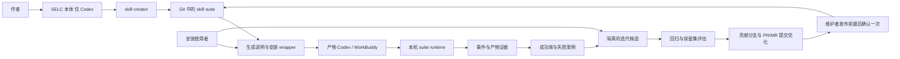

# Skill Evolving Life Cycle：方案讨论稿

初稿日期：2026-10-17；更新与迭代发布规则确认：2026-10-18；安装分发、使用者贡献、宿主范围与本机汇总规则确认写回：2026-10-19。简称暂用 SELC；用户原始名称是“skill evloving life cycle”。本文保留早期设计建议，不是已经批准的工程 Plan；与当前确认内容不一致时，以 [产品上下文](../.sdlc-v1/context/REQ-001.product.md) 中的 confirmed 条目为准，不能把本文旧建议当作当前产品约束。

2026-10-19，SRC-017、DEC-016 收敛两层宿主范围：**SELC meta skill / 创建脚手架本体仅支持 Codex；生成的业务套件及安装维护资源支持 Codex 和 WorkBuddy。** DeepSeek Harness 仅保留历史来源与研究背景，不在当前支持 / 首版验收范围，不承诺未来接入。此前三端基础或 Codex 优先完整验收是未确认建议，不是用户决定。WorkBuddy 产物仍可从内嵌入口改进贡献，不要求预装 Codex / 完整 SELC，也不把维护限定为必须回 Codex；两端资源装配实现仍待设计。

SRC-018、DEC-017 已确认默认仅本机保存统计；首版由使用者显式导出 / 导入文件汇总，只含套件 / skill 版本、harness、结果计数、统计时点及口径版本，不含业务输入、产物正文、对话或反馈正文。重复导入去重、迟到反馈可修订，保持双轴 / 独立分母 / unknown，不相加百分比。明细不自动过期，支持按套件与时间删除并告知统计影响；本地删除不自动追回已分享文件。具体文件格式、去重修订 / 冲突协议及删除后重导入处理仍待设计，不自动推回 Git，也未选定云端同步或远程删除。

SRC-021、DEC-020 已将当前交付改为 **先完成 SELC 可运行首版，用简单可复现样例验收**。工程可选择“校验 / 整理文本 → 生成报告”的两阶段文件处理套件；这只是工程样例，不是用户指定名称。临时本地 Git、可控 creator / harness / 发布适配器 fixture 可用于检验确定性 runtime 和本地接口，不启动真实模型评估或真实中心 Git 操作。具体命令、schema、固定案例、阈值与可配置预算由工程 Plan 决定，不继续为复杂税务预算阻塞实现。

SRC-020、DEC-019 的 AiTaxs 中国税务业务范围保留为后续试点：结构化税务参数、参数检查至报告的五步流程、参数 / 计算 / 规则依据 / 验证产物、两端相同四类案例及独立预期核验。按 DEC-020 当前不引入、修改或运行 AiTaxs。固定版本静态安全审查已完成且发现待处理问题，证据见 §12；没有正式税务、许可、两端兼容或全面安全通过结论。

DEC-009、DEC-010 已确认：按套件更新，业务与框架来源 / 版本分存，默认稳定发布；任务入口按每日缓存检查，不运行后台定时作业。用户显式应用后拉取、校验，等待受影响任务 / 会话结束才替换；失败保持当前，本地冲突停止覆盖，运行中不混版。不保留本地历史包或提供回滚，恢复旧内容由上游新发布版本表达；统计和 Git 版本身份历史保留。

DEC-011 已确认每 skill 维护入口、套件共享流程：显式发起迭代、隔离候选、检查 skill 本体，固定评估并保护评分器实现 / 规则 / 保留集，准备说明、diff、报告及完整套件包；首版维护者最后确认一次再整套发布，验证可读可安装。未达标、证据不足或预算耗尽保留候选报告并停止发布；测试与真实统计分开，发布与本机启用分开，应用仍依 DEC-010。

DEC-012、DEC-013 已确认：使用者一句话给仓库链接，harness 读取生成说明、执行随套件附带的安装 wrapper，准备独立环境、完整安装 suite 并注册 skills；生成资源包含说明、wrapper、manifest、依赖 / 适配资源，并支持后续维护。普通使用者无需先装 SELC meta skill、全局 CLI 或完整 SELC 开发工程。安装后也可从内嵌维护入口持续改进，将优化代码 / 资源回流所属 suite 的远端中心 Git 做发布，沿用 DEC-011；这条贡献路径与 DEC-010 消费上游分开。“升级仅指拉取 stable”是主 Agent 此前的误解，不是用户决定。

DEC-014 已确认默认通过贡献分支和 PR/MR 提交优化，由维护者在发布前最后确认一次；具有发布权限的安装使用者也可承担维护者角色、完成该次确认，不新增贡献者与维护者的双重强制批准。安装本身不授予权限，也未确认“有发布权限即可绕过 PR/MR 直推默认分支”的政策。

DEC-015 已确认安装分发：一句话给仓库或套件子目录链接，默认当前项目 / 当前 harness，可指定用户级 / 其他 harness；默认最新稳定版、可指定版本，记录实际 commit 和安装包摘要。Git tag 对应完整套件发布包，复用 GitHub Release / GitLab Release，首版暂不自建技能市场。完整安装 skills、共享 runtime、安装维护 wrapper 及依赖声明，自动准备独立依赖环境并注册；同源同版复用，其他版本转入既有显式更新，名称冲突或本地修改停止覆盖。完成后显示版本 / 位置 / 可调用 skills / 维护入口，并保存来源仓库 / 子目录 / 源码基线，支持后续贡献，不要求把 .git 安装到使用目录。

中心 Git 按一 Git 一 suite 理解，不推定全部套件一个 monorepo。具体 URL / 实际托管平台、账户权限映射、归档格式、release/provider adapter 与宿主接入实现仍未定或未验证；Codex 桌面 / CLI 和 WorkBuddy 的具体版本 / 入口、creator / 观测 / 维护资源装配及观测完整性仍待设计 / 验证，支持对象本身已由 DEC-016 确定。当前已授权本地实现及隔离临时目录中的简单验收；真实外部建仓、push / tag / release / 合并、模型批量评估和个人全局安装不随之自动授权，Git 提交仍遵守既有确认规则。产品文档 Agent 本轮只写文档并交 ready 验收；不推定上传原始业务材料、对话或 SQLite 明细。

## 1. 产品定位与已知边界

SELC 提供在 Codex 运行的 meta skill 与创建脚手架，生成面向 Codex / WorkBuddy 的 skill 套件及安装维护资源。套件具备调用观测、结果评估、同步、迭代发布与安装能力，安装使用者也可通过内嵌维护流程成为贡献者；WorkBuddy 产物不依赖预装 Codex 或完整 SELC。

用户已明确：

- 复用 skill-creator 创建 skill。
- 本体运行宿主仅 Codex；产物目标宿主为 Codex / WorkBuddy，记录实际执行方与发起方，unknown 和证据规则保留。DeepSeek Harness 不在当前支持范围。
- 根据交付产物及用户反馈统计成功率；一次交付、过程中无需人工判断是核心成功情形。
- 支持获取当前 skill 的上游版本，以及内嵌的迭代与发布流水线。
- 一套相关 skill 与工程脚本在同一 Git 中维护，可位于子目录；原请求用税务多阶段举例，当前中国税务优先方向由 DEC-018 另行确认，不预定具体拆分。
- 生成 Agent 可读安装说明、安装 / 维护 wrapper、manifest 和依赖 / 适配资源；仓库 / 套件子目录链接驱动完整安装，无需预装 SELC 或全局 CLI。默认当前项目 / harness、最新稳定版，可明确指定范围和版本；独立依赖环境自动准备并注册全部 skills。
- Git tag 对应完整套件发布包，复用 GitHub Release / GitLab Release，首版暂不自建市场。同源同版复用、其他版本走显式更新，名称冲突或本地修改停止覆盖；展示安装结果并保存实际 commit / 包摘要 / 来源仓库 / 子目录 / 源码基线。
- 安装使用者可从内嵌维护入口改进，默认通过贡献分支和 PR/MR 提交优化版本至所属套件中心 Git，按既有固定评估与整套发布策略由维护者最后确认；有发布权限的使用者也可承担维护者，其他用户仍显式接收更新。
- 默认仅本机保存统计明细，首版以显式文件导出 / 导入汇总最少统计；重复导入去重、迟到反馈可修订，保留双轴与独立分母 / unknown。明细不自动过期，按套件与时间删除并告知影响；源码资源贡献不自动带入统计或业务正文。
- DEC-018 的中国税务方向后由 DEC-019 收敛为用户点名 AiTaxs 及明确业务范围；原报销备选历史保留，不继续海外税务筛选。
- 不提供本地旧版本保留 / 回滚；上游恢复旧内容通过新发布版本表达，本地仍按更新处理。
- 按套件更新，业务 / 框架来源分存，默认稳定发布、入口每日缓存检查、显式应用；校验后等待受影响任务 / 会话结束才替换，失败维持当前，本地冲突停止覆盖。
- 显式迭代、隔离候选和固定评估；即使只改一个 skill 也整套发布，首版维护者在发布前最后确认一次，发布不直接启用本机。
- 依 DEC-020 先实现 SELC 可运行首版，以简单样例覆盖既有闭环；AiTaxs 延后，真实外部操作与模型批量评估不自动获得授权。

角色已覆盖作者、使用者 / 贡献者与有发布权限的维护者；个人 / 小团队规模仍是假设。中国税务优先方向已定，具体业务案例、真实基线、操作系统和账户权限等尚未确认。

用户此前已选定 [AiTaxs](https://github.com/XHJ2AIDEVS/aitaxs-assistant) 的中国税务范围，当前依 DEC-020 延后。REC-001 曾静态核对到四类计算、H5 与知识资源；后续固定版本审查已完成，发现文档 / 脚本接口、数值校验、供应链及税务公式等问题，见 §12。未引入、执行或修复，不能把源脚本输出当独立正确答案，也不因用户选择而宣称许可或宿主兼容通过。

本机 [travel-reimburse](/Users/arnow117/hansen_agent_team/.claude/skills/travel-reimburse/SKILL.md) 仅读正文、未执行，保留报销备选历史。真实样本、规模、税务规则与具体税务案例 / 预算均留后续，不是 SELC 首版的实现前置。

## 2. 推荐组成与依赖方向

| 组成 | 负责的事情 | 稳定边界 |
| --- | --- | --- |
| SELC meta skill | 仅在 Codex 编排创建与维护意图、调用 skill-creator、查看报告 | 本体不要求支持 WorkBuddy，不自行裁定统计事实 |
| Scaffold | 在 Codex 生成面向 Codex / WorkBuddy 的安装说明、wrapper、manifest、依赖适配与共享维护资源 | 两端产物支持直接安装和后续改进，WorkBuddy 不需先装 Codex / 完整 SELC；具体资源装配待设计 |
| Suite runtime | 事件持久化、产物验证调度、指标计算、版本定位、安装和更新失败处理 | 确定性逻辑由脚本实现 |
| Harness adapters | 来源身份、会话/任务关联、可用事件、发现目录和安装形式 | 每个适配器显式报告支持能力与版本 |
| Evaluation adapters | 文件、仓库变更、外部资源或纯文本交付的验证 | 验证器与规则版本参与结果归因 |
| Release/install pipeline | Git tag 对应完整套件包，复用 GitHub Release / GitLab Release；安装及显式更新，恢复内容也接收上游新版本 | 记录实际 commit 与包摘要；首版最后确认一次、整套发布已确认，具体归档 / provider 实现待设计 |

推荐 runtime 先用 Python，依赖以 uv 管理；harness 原生扩展可用其必需语言写薄适配器。它是工程候选，不代表已完成技术验证。首版不需要常驻服务、数据库服务器或自建 agent harness。



### skill-creator 的复用方式

让 skill-creator 处理领域指令、触发描述和所需资源；SELC 增加套件元数据、观测协议、评估配置和分发配置。复用其初始化及格式校验能力，但不能把格式校验通过当作行为正确。

不把 Codex 系统 skill 的绝对路径写进生成产物。SELC 本体在 Codex 编排 skill-creator；产物在 Codex / WorkBuddy 发起维护所需的 creator、观测 adapter 和维护资源装配仍待工程设计，`CreatorAdapter` 只是实现候选。缺少可用资源时如实报告缺失依赖，不把另装 Codex / 完整 SELC 或返回 Codex 当作 WorkBuddy 产物维护的产品前提；既有执行、观测和安装不依赖创建入口本体。

生成的每个 skill 有简短生命周期入口与按需加载的维护引用；同一套件只维护一份 runtime 与维护流程。作者或安装使用者均可从当前 skill 发起，由套件维护能力执行；`evolve`/`release` 是入口命名建议，未选定正式 CLI。保存来源仓库 / 套件子目录 / 源码基线已由 DEC-015 确认，如何据此准备可提交工作区、把局部改动映射回中心仍待设计，不要求在使用目录安装 .git。框架自己的 meta skill 也可以按同一协议观测；候选不得修改本次评价它的评分规则。

## 3. 仓库、版本和安装结构

区分 SELC 框架仓库与它生成的业务套件仓库。框架本体仅在 Codex 运行，维护 meta skill 与创建资源；业务套件携带面向 Codex / WorkBuddy 的运行、安装与维护资源，一 Git 管理一套领域 skill。两端产物不以另装完整框架为前置。

下面是**建议结构示例，不是已经生成的目录**。`suite_dir`、`skills_root` 可配置；默认自写 skill 正文遵循当前项目习惯放 `.claude/skills`，`.agents/skills` 作为 Codex 的相对链接入口。

```text
tax-skills-repo/
└── suite/                         # 也可以直接使用仓库根目录
    ├── suite.yaml                 # 套件身份、skills_root、流程与依赖
    ├── .claude/skills/
    │   ├── tax-intake/SKILL.md
    │   ├── tax-review/SKILL.md
    │   └── tax-deliver/SKILL.md
    ├── .agents/skills/            # 开发时的 discovery 链接
    ├── runtime/                   # 固定版本的共享运行支持
    ├── adapters/                  # 实际需要的适配资源
    ├── evals/                     # 脱敏样例、验证器与回归定义
    └── release/                   # 打包与发布定义
```

按 suite 更新由 DEC-010 确认，按 suite 整体发布由 DEC-011 单独确认，即使只改一个 skill 也发布新的整套版本。DEC-015 确认安装记录实际 Git commit 与包摘要；`suite_id`、runtime 版本和单 skill 内容 hash 等具体元数据表示仍是工程建议，用于分析变化并避免拼装不兼容阶段。

默认最新稳定版、可指定版本，Git tag 对应完整套件包并复用 GitHub Release / GitLab Release，来源仓库 / suite 子目录 / 源码基线及实际 commit / 包摘要保存已由 DEC-015 确认。具体中心 URL / 实际托管平台、归档格式、provider adapter 仍未选定或验证；声明 ref、适配器版本等额外身份元数据是工程建议。完整安装 skills、共享 runtime、安装维护 wrapper 与依赖声明，不能只复制 SKILL.md 而留下失效共享资源。

### 已确认安装与更新流程

安装体验依 DEC-012、DEC-015：使用者一句话提供仓库或套件子目录链接，harness 读取生成说明、执行安装 wrapper；默认当前项目 / 当前 harness、最新稳定版，可明确指定用户级 / 其他 harness / 版本。自动准备独立依赖环境，完整安装 skills / 共享 runtime / 安装维护 wrapper / 依赖声明并注册；无需预装 SELC meta skill、全局 CLI 或完整开发工程。

同源同版本重复安装直接复用，已安装其他版本转入下述显式更新流程；名称冲突或本地修改停止覆盖。完成后显示套件版本、安装位置、可调用 skills 与维护入口，保存实际 commit、安装包摘要、来源仓库 / 子目录 / 源码基线，以支持后续改进、贡献分支和 PR/MR，不要求在用户使用目录安装 .git。

更新产品规则依 DEC-009、DEC-010：

1. 任务入口按每日缓存检查稳定发布；复用检查缓存，不启动后台定时作业，检查不自动应用。
2. 用户显式发起应用后，按套件拉取候选；业务与框架上游的来源和版本分别记录。
3. 校验候选；拉取或校验失败保持当前安装，不提前替换。
4. 本地修改与更新冲突时停止覆盖、保留用户修改，不借更新 reset 未提交内容。
5. 拉取和校验后等待受影响任务 / 会话结束，才替换当前安装；运行中不混版。
6. 不保留本地历史安装包、不提供旧版回滚；上游发布新的恢复版本时走同一更新流程。更新记录、统计与 Git 版本身份历史可保留。

当前安装与候选的临时并存只服务于该更新流程，不形成历史包库。候选暂存可采用 staging；链接、复制、插件包等 harness 接入形式，以及包结构、原子替换、锁和中断恢复的具体实现仍待设计 / 验证，不影响产品流程已确认。

安装范围、版本、完整包与 GitHub Release / GitLab Release 分发产品选择已确认，首版暂不自建技能市场；“当前 / 其他 harness”限 DEC-016 的产物目标 Codex / WorkBuddy。具体中心 URL / 实际平台、归档、provider adapter、依赖装配与宿主注册待设计 / 验证，不能宣称 GitHub / GitLab 接入已成功。两端具体版本 / 入口、观测完整性和正式 CLI 命名仍未定或未验证；本文不提供未经验证的安装命令。

## 4. 观测协议与 harness 身份

当前观测设计面向产物 Codex / WorkBuddy；SELC 本体只有 Codex 运行宿主。标准 SKILL.md 不能单独保证宿主执行埋点，以下两层观测仍是待验证的工程设计：

- **通用层**：skill 入口声明开始、登记产物和结束记录；runtime 保存记录，显式参数传递 task/invocation 身份。它覆盖标准 skill 用法，但依赖 agent 实际执行，来源标记为 `agent-reported`。
- **宿主层**：有 hooks、扩展或结构化会话日志时，由 adapter 观察启动、输入、人工介入和结束。来源标记为 `harness-observed`，并报告具体覆盖范围。

识别优先级：宿主扩展注入 > 安装入口的显式配置 > 环境探测 > `unknown`。每条身份记录携带来源与可信程度；目录名、所选模型或 agent 自述不足以证明 harness。模型与 harness 分字段记录。

适配器声明能力，例如 `invocation_boundary`、`human_intervention`、`feedback`、`session_resume`、`artifact_reference`；能力声明不等于本次数据完整，单次执行另记录是否断流或缺失。完整性默认 unknown；只有适配器具备本次所需的观测能力、覆盖整个判定区间且事件连续性可验证时，才可判为 complete。`agent-reported` 的开始/结束单独不能证明“无人工介入”，也不能仅凭没有介入事件判定完整；它仍可提供产物结果，但不足以计入严格 one-shot 成功。来源冲突保留证据并记为 unknown。

| Harness | 已找到的官方线索 | 当前设计可承诺的边界 |
| --- | --- | --- |
| Codex | 标准 skills、本地发现目录、符号链接；官方还提供 hooks 文档入口 | 可设计 skill 安装和通用埋点；具体事件、桌面/CLI 差异和可靠性需实测 |
| DeepSeek Harness（仅历史线索） | 早期研究过 session event / telemetry | DEC-016 已排除当前支持 / 首版验收，不安排当前适配或承诺未来接入 |
| WorkBuddy | 官方说明插件可以包含 Skill、Hook 等组件 | 验证其实际版本和导入格式；不能从同站 CodeBuddy CLI 文档推定桌面 WorkBuddy 行为 |

官方 CodeBuddy CLI 文档特别注明 skill frontmatter hooks 仅在 fork 模式生效。这是说明“不同入口的观测能力不同”的证据，不是对 WorkBuddy 桌面端的兼容性结论。

## 5. 成功率：交付任务与 skill 调用分开计数

### 5.1 统计对象

| 对象 | 含义 |
| --- | --- |
| Delivery task / run | 一次有明确输入和交付目标的业务任务，是整体成功率的单位 |
| Skill invocation | 一个 skill 在任务中的一次实际执行，有独立 invocation_id 与父级关系 |
| Artifact | 首次或后续交付的文件、代码变更、远程资源或文本快照，附版本/摘要与验证结果 |
| Feedback | 关联 task、delivery 和 artifact 的用户评价及纠正证据 |

同一任务跨阶段、子 agent 或 harness 续接时传递同一 task_id；每次调用产生自己的 invocation_id。三阶段流程输出一份交付物，整体样本数为 1，阶段指标分别统计。独立调用某个阶段时，可以显式创建独立交付任务。无法关联的记录不靠时间邻近强行合并。

### 5.2 已确认的 one-shot 与反馈规则

任务的**首次交付**同时满足以下条件，记为自动判定的 one-shot 成功：

1. 有符合交付声明的产物，并通过预先配置的验证；仅有“完成了”的回答或空文件不够。
2. 初始输入就绪至首次交付之间，没有人工业务判断、方案选择、纠错或人工补做。
3. 对这一段的人工介入观测完整；缺事件或缺结束信号时为 unknown。
4. 截至统计时间，没有针对同一需求/交付的有效负面反馈。

agent 内部自动重试和自动校验不算人工介入，但保留尝试次数、耗时和成本。后续需要人修正后才成功的任务属于 assisted success，不能重新命名成新的 one-shot 样本。用户明确改变任务目标则是关联的新任务。

依 DEC-006，补齐预先声明的必要客观输入和纯工具权限点击不算人工介入，单独记录输入准备、点击与等待；方案选择、业务口径判断、人工定位纠错 / 补做和流程必需的业务审核算介入，即使发生在开头。任务从最初请求完整登记，输入就绪是同一任务内的里程碑；不得通过延迟登记、重开任务或移动起点隐藏介入。交付后的自愿反馈依 DEC-007 不追溯算执行介入；具体宿主事件识别与完整性机制交工程设计，不冒充已经验证。

后续反馈追加保存，结果可重算并标注 `as_of` 和评分规则版本。明确的同目标否定、错误产物证据可以推翻此前自动成功；新需求不能追溯判失败。反馈绑定具体交付 / 产物版本和验收项；模糊或无法解释的冲突为 unknown。已证实必需项失败不能仅凭一句好评改 pass。没有反馈不等于用户确认，保留已有自动结果并标明未用户确认，unknown 不因等待变成功。

**首次交付的 one-shot 结果**与**当前最终交付结果**是两个轴。反馈指向具体 delivery/artifact：首次产物被否定后，补救成功不会恢复 one-shot，但可以使最终交付变为成功。历史否定保留，不能永久阻止补救后的成功归类。

### 5.3 报表口径

文件汇总沿用已确认的产品 DEC-008。以整体业务任务为例，N 是全部已观测启动的任务样本数；首次 one-shot 与最终交付分别判成功 / 未达成 / unknown。对每个轴分别记录成功数 S、可判结果数 K 和未知数 U，保持 `N = K + U`；两轴的 S、K、U 各自独立，不共用覆盖率。调用报表使用独立调用分母，不与整体任务相加或混用。

```text
该轴成功率下界 = S / N
该轴已知结果成功率 = S / K
该轴结果覆盖率 = K / N
```

人工辅助 / 补救作为标签分项，最终成功不证明首次 one-shot。仍运行、取消、中断或证据缺失保留状态与原因，没有结论才为 unknown，已有明确结果按证据处理；分母为零显示“暂无样本”。例如 N=10，6 次 one-shot、1 次人工补救成功、1 次失败、2 次双轴未知：one-shot 为 60% / 75% / 80%，最终结果为 70% / 87.5% / 80%，依次对应下界 / 已知结果率 / 覆盖率。

DEC-017 的汇总保持这些计数和口径，去重与反馈修订后按相应计数呈现比例，不能直接相加百分比。展示样本数、统计时点、套件 / skill 版本、harness 与口径版本；具体如何用明细标识或来源快照处理重叠样本仍待设计，不以此要求导出原始事件或反馈正文。

### 5.4 产物验证扩展点

业务产物验证依 DEC-007：执行前确定验收项，绑定交付及规则版本，逐项保存结果和依据；必需项全部满足为 pass，明确必需项失败为 fail，检查未完成 / 验证器不可用 / 证据不足为 unknown。程序可查的优先程序检查，语义评价可配置独立评价源，执行 Agent 自述完成不直接算 pass。`ArtifactEvaluator` 是接口命名建议；自动验证与用户反馈分别保留，不允许一句好评覆盖已证实必需项失败。当前简单 fixture 用独立确定性预期，不启动 LLM judge。

## 6. 本机持久化与可选汇总

产品规则依 CON-002、DEC-017 已确认：默认仅本机保存明细；首版汇总由使用者显式导出 / 导入文件，不自动同步云端或推回公开 / 私有源码 Git。汇总只含套件 / skill 版本、harness、结果计数、统计时点及口径版本，不带业务输入、产物正文、对话或反馈正文。

重复导入去重，迟到反馈可修订汇总结果；首次 one-shot / 最终交付双轴、任务 / 调用独立分母、unknown 及覆盖率遵循 DEC-008，不能简单累加百分比。具体导出 schema / 文件格式、以明细标识或来源快照去重、修订和冲突协议均未选定。早期“脱敏事件包”只是旧建议，不是当前导出格式要求；本轮不选定完整事件包、hash / UUID 字段，也不以可修订为由要求导出原始业务或反馈正文。

本机明细不自动过期，使用者可按套件和时间范围删除，并明确获知统计影响。删除对象是统计明细，与业务产物和 skill 源码分开；本地删除不自动追回已导出 / 分享文件。删除后重导入、多份导出文件的处理及具体删除实现仍待设计，没有自动远程删除的选择。

本机 SQLite 可作为持久化候选，优先保存引用、摘要与必要元数据仍是工程建议；数据库结构、标识字段和去重实现尚未选定，也不绑定导出 schema。事实 / 验证规则可支持结果重算，反馈历史依 DEC-007 保留；崩溃和观测缺口不凭退出码或时间推定成功。统计写入异常需如实报告，宿主缺证据时保持 unknown。具体数据目录、正文最少化与恢复实现留待工程设计，本次不操作真实数据。

DEC-013、DEC-014 的中心 Git 贡献仍只针对优化代码 / 资源；本机统计、业务产物和对话不自动随贡献上传。将案例用于回归或远程评估需要适用的数据与授权边界；中国税务方向已确认，但未因此授权使用真实税务材料或导出案例正文。

## 7. 上游同步、skill 迭代与发布

### 7.1 已确认的两类上游与更新规则

| 上游 | 内容 | 已确认边界 |
| --- | --- | --- |
| Suite upstream | 领域 SKILL.md、资源和业务脚本 | 按套件接收稳定发布，来源和版本单独记录 |
| SELC scaffold/runtime upstream | 元数据约定、观测支持和流水线模板 | 与业务上游分开保存来源和版本，具体模板 / runtime 迁移实现尚未验证 |

业务与框架的来源和版本分存，默认检查稳定发布；开发仓库、fork 和安装副本如何表达来源身份仍需工程设计，不能把两类来源都默认为 origin/main。任务入口使用每日检查缓存，不启动后台定时；检查和显式应用是两个操作。

本地修改冲突停止覆盖已确认；三方比较可作为辅助建议，但不改变停止覆盖的规则。应用流程已确认是拉取 → 校验 → 等待受影响任务 / 会话结束 → 替换当前；拉取 / 校验失败保持当前。原子替换、锁、结束检测和中断恢复尚未验证。

恢复旧内容的已确认方式是上游发布一个新的版本，本地通过同一更新流程接收；不提供本机历史安装包选择。用于比较或记录的版本身份、摘要和运行统计，不等于保留可回滚的历史版本包。

### 7.2 已确认的迭代流水线

每个 skill 保留维护入口，套件共享流程；作者与安装使用者都能显式发起，不要求使用者先另装完整 SELC 开发工程。DEC-013 的改进回流与 DEC-010 拉取上游分开；以下流水线依 DEC-011 已确认。依 DEC-020，当前简单样例的固定案例、阈值和可配置预算由工程选择并验证，实际中国税务案例留后续，不阻塞 SELC 首版。

```text
日常业务积累可追溯证据
  → 作者或安装使用者从内嵌维护入口显式发起迭代
  → 独立工作区分析原因和修改范围
  → 调用 skill-creator 修改目标 skill 及必要资源
  → 检查 skill 本体格式、资源引用、脚本和行为测试
  → 固定回归集与未用于改写的保留集评估
  → 相同条件比较当前版和候选的业务产物、人工介入与成本
  → 准备变更说明、diff、评估报告和完整套件发布包
  → 首版维护者在发布前最后确认一次
  → 发布新套件版本并验证目标可读可安装
```

当前安装在候选改写和评估期间保持可用。比较固定任务及相同 harness/model、工具和环境条件，记录实际 revision，不用不同时期真实均值替代候选比较。评分器实现、评分规则和保留集从候选不可写范围使用；固定评价代码不能被候选修改，不能只保护配置却执行候选可改的评分器。计数、证据解释及评价依赖如何固定属于后续工程设计；若将来改动评价组件本身，需另行设计其验证，不能把这种扩展当本轮已授权的自动迭代范围。

未达标、证据不足或预算耗尽时保留候选和报告并停止发布；当前默认预算和量化条件由工程固定，预算可配置并有耗尽案例。测试调用与真实业务统计分开，不据测试样本抬高真实成功率。真实模型评估消耗配额，本次不启动；通过可控 creator / evaluator fixture 验证接入与隔离不等于真实模型效果证据。

贡献治理依 DEC-014 已确认：默认通过贡献分支和 PR/MR 提交，维护者最后确认发布；有发布权限的使用者也可承担维护者，不新增贡献者先确认、中心维护者再确认的双重强制批准。DEC-015 确认安装时保存来源和源码基线，如何从该基线准备可提交工作区、局部修改如何映射回中心、与中心并发改动如何合并并重新验证，仍待工程设计。具体平台 / URL / 账户权限映射仍待指定，未确认绕过 PR/MR 直推默认分支的政策。

### 7.3 已确认发布策略与未定分发实现

发布单位与首版授权模式依 DEC-011 已确认：准备完整套件包，即使只修改一个 skill 也整套发布；维护者审阅说明、diff、评估报告和发布包后，在发布前最后确认一次。DEC-014 进一步确认有发布权限的安装使用者可承担该维护者角色，完成最后一次发布确认，无需强制另一人再确认。

优化版本回流所属 suite 的远端中心 Git 做发布已由 DEC-013 确认，中心仓库沿用一 Git 一 suite，默认贡献分支 + PR/MR 依 DEC-014 执行。具体 URL / 实际托管平台、账户及权限映射仍未指定，安装者不自动取得中心权限；角色资格不等于可以绕过 PR/MR 直推默认分支。发布后验证目标可读可安装；依 DEC-015，Git tag 对应完整套件包，复用 GitHub Release / GitLab Release，首版暂不自建市场。归档格式、provider adapter、首版平台支持深度和 CLI 命名仍待设计 / 验证，产品选择不等于具体平台接入已经成功。

发布一致性的工程建议包括固定内容身份、重复发布处理、并发约束、完整内容上传后更新可见索引，以及打包路径 / 链接范围校验；这些实现尚未验证，也不替代维护者最后一次确认。

发布与本机启用分开；发布不会直接替换当前安装，本机与其他使用者仍按 DEC-010 显式更新并等待受影响任务 / 会话结束。DEC-009 无本地历史包 / 回滚继续有效。**DEC-020 已授权本地实现及临时本地 Git / 可控 provider 验收发布准备、确认校验和可读可安装结果；真实远程建仓、push / tag / release / 合并仍未授权，Git 提交仍须既有确认。** 没有最终确认时不得调用发布执行接口；一次授权确认不变成贡献者与维护者两次强制批准。

## 8. 复用评估 / Decision Context

以下是设计前的只读召回；没有据此安装或采用第三方工程。

### 候选方案

| 引用 | 候选 | 适用性 | 取舍 / 待核查 | 可信度 | 证据状态 |
| --- | --- | --- | --- | --- | --- |
| `patterns/private-skill-distribution.md#候选方案` | SkillsGist + Cloudflare Worker/D1/R2 | 将来需要私有目录、网页管理与成员权限时可比较 | 当前本机优先无需云端；卡片提示发布一致性、固定版本和目录适配缺口 | medium | external-claim |

### 匹配的决策记忆

`private-skill-distribution.md#DM-01` 只部分匹配：Git/CI 分发相关，但尚无 Cloudflare、团队权限或网页管理需求，不能据此选用。当前没有直接匹配且在本项目已验证的 DM。

### 不适用或冲突

不把私有注册中心作为首版前置依赖；它会扩大已确认的本机统计和 Git 套件管理范围。

### 旧卡片候选

- `patterns/hermes-agent-self-evolution.md`：`legacy-unstructured`；可参考真实历史、固定评估集与候选发布方式，卡片自己的适用边界也排除了缺稳定数据的早期项目。其效果与价格未在本次验证，不能作为收益承诺。
- `tools/cursor-agent-harness.md`：`legacy-unstructured`；按 harness/model 分组、结合真实用户结果的评估方式可以参考；并非可直接复用的开源 runtime。

### 未知项与结论边界

DEC-016 的两层宿主范围及 DEC-020 的当前首版目标已确定。两端具体版本 / 入口、资源装配、runtime 依赖、schema、归档 / provider、贡献工作区与并发合并等由工程 Plan 定义并验证，真实中心 URL / 平台 / 账户留作配置；缺少实际外部目标不阻断本地接口验收。AiTaxs 业务范围保留为后续试点，静态审查已完成并发现问题，未运行或通过正式许可 / 税务 / 兼容验证；不把税务案例数量或复杂预算作为当前实现前的用户决定缺口。

知识库根：`/Users/arnow117/Documents/nsync/ai_knowledge/`。读取日期为 2026-10-17，未修改知识库。

## 9. 当前首版与验收交接

用户已授权实现，主 Agent 已创建 F-001/T-001；当前有效工程方案见 `.sdlc-v1/context/F-001.engineering.md`，下表保留为产品交接的能力映射。当前样例由工程选择，可用简单两阶段文件处理套件，必须验证实际 runtime 和可调用接口，不能只交空接口或文档。产品验收映射见产品上下文 SCN-019、SC-001 至 SC-007。

| 切片 | 可独立验证的交付 | 验收要点 |
| --- | --- | --- |
| 1. Scaffold 与安装 | 在 Codex 创建入口生成简单 suite、独立 skill 入口及 Codex / WorkBuddy 安装维护资源；临时目录装完整包 | 默认 / 指定范围与版本、独立环境、同源同版复用、名称 / 本地修改冲突和来源基线；WorkBuddy 不要求预装 Codex / SELC；creator 接入可用可控 fixture |
| 2. 观测与结果 | 确定性本机 runtime 记录 task / invocation、产物、介入及反馈，输出双轴报表 | 执行 / 发起来源及 unknown；成功 / 失败 / 辅助 / 未知可解释；多阶段 / 重试 / 重放去重；产物逐项验证和反馈修订，两轴独立分母 / 覆盖率 |
| 3. 整套更新 | 临时本地 Git 来源分别提供业务 / 框架稳定版本，入口缓存检查与显式应用 | 拉取校验后等待受影响任务 / 会话结束再替换；失败保持当前，冲突停覆盖；并发 / 中断可恢复且不混版；远端恢复内容作新版本，无本地历史包回滚 |
| 4. 迭代与发布接口 | 两端内嵌维护资源接入隔离候选、固定评估、贡献准备和完整套件包；可控 provider 验证发布 | 评分实现 / 规则 / 保留集不由候选修改；失败 / unknown / 预算耗尽停止并留报告；未确认不发布、维护者最后确认一次后校验可读可安装；不操作真实中心 Git 或真实模型 |
| 5. 文件汇总与删除 | 对合成记录显式导出 / 导入最少统计文件并处理反馈修订和删除 | 重复导入去重，双轴 / 任务与调用独立分母 / unknown 保持；明细不自动过期、套件 / 时间删除告知统计影响；无业务正文 / 自动 Git 上传 / 已分享文件追回 |

真实 Codex / WorkBuddy 的宿主接入结果与可控 adapter fixture 验收分开报告，未验证的能力不报已通过；来源或介入证据不足继续 unknown。DeepSeek Harness 不列当前验收。工程 Plan 定义具体入口 / 依赖 / 协议版本、更新与并发恢复实验、固定独立预期和可配置预算；这些技术选择不需要重新逐段询问产品。当前不创建或修改 CLAUDE.md、soul.md、user.md、README。

## 10. 交工程规划的参数与后续事项

1. 主 Agent 验收产品规格并执行 ready 后，接续工程 Plan 与实现。具体命令、schema、文件 / 归档格式、可控 creator / harness / provider 接口、贡献工作区和去重 / 修订 / 删除 / 并发恢复协议在 Plan 中固定，保留所有已确认产品行为。
2. 简单 fixture 的样例、固定回归 / 保留编排、独立预期、量化阈值和可配置预算默认值由工程选择，覆盖耗尽停止；不启动真实模型批量评估，也不以真实中心 URL / 账户尚无或税务复杂预算未定阻塞本地实现。实际远程操作仍需目标及相应授权，Git 提交仍需确认。
3. AiTaxs 及其税务参数、具体案例 / 政策预期、真实样本 / 基线和规模均留后续；DEC-018、DEC-019 历史与范围保持，固定版本静态核查结果见 §12，不为本体实现引入它的依赖。

## 11. 已核对来源与未验证事项

- [Agent Skills 规范](https://agentskills.io/specification)：标准目录、元数据和资源约定；未定义本文的观测或评分协议。
- [OpenAI Build skills](https://learn.chatgpt.com/docs/build-skills)：本地 skill 发现与符号链接支持、创建和分发方式。
- [WorkBuddy 插件文档](https://www.workbuddy.cn/docs/workbuddy/From-Beginner-to-Expert-Guide/Function-Description/Plug-In)：插件可以包含 skills、hooks 等组成；未据此确认桌面事件 payload。
- [CodeBuddy CLI Skills](https://www.workbuddy.cn/docs/cli/skills)：其 frontmatter hooks 有 fork 模式限制；不等同于 WorkBuddy 桌面兼容保证。
- [DeepSeek Harness telemetry README](https://github.com/deepseek-ai/deepseek-harness/blob/master/packages/session/session-telemetry/README.md)：仅保留早期研究来源；DEC-016 已将该宿主移出当前支持 / 验收，无未来接入承诺。
- 本机 `/Users/arnow117/.codex/skills/.system/skill-creator/SKILL.md`：创建、渐进披露、资源与校验职责；已阅读，未运行创建/校验脚本。

截至本轮文档交接，尚未编写 runtime、安装 skill、运行真实任务、评估模型、验证真实跨 harness 接入、提交或发布版本。DEC-020 已授权下一步本地实现与简单样例验收；“尚未执行”不是继续限制为仅设计，实际外部操作边界仍依前文。

## 12. 讨论稿检查记录

2026-10-17 对方案做了一次独立只读复核，并由主 Agent处理四处文档契约问题：补救成功与首次失败分轴、观测完整性的可信来源、整套会话版本绑定、候选写入范围外的评价实现。修订只提高讨论稿的一致性，没有把推荐升级为用户已确认需求，也没有验证任何运行时能力。

2026-10-19，主 Agent 已验收 AiTaxs 固定版本的独立只读审查：

- **固定证据**：提交 `3db735e595267eb166912410700b1f19d3826e97`；临时快照 `/private/tmp/selc-aitaxs-review-20261019-_c3tiba0/source`；源指纹 `809f93397eb071e576c3d0a2712806e999ba5901eb869a7e2b0908e66eba6d3c`。Reviewer 读完 9 / 9 文件并作 AST / JSON / HTML 静态解析，未执行源码、HTML、CI 或模型。
- **安全与供应链**：未见隐藏外传、凭据窃取或任意执行路径。P2：`marketplace.json:13-16` 指向 main、`README:36` 使用 latest、CI `checkout@v4` 未固定 SHA；P3：`SKILL.md:99-106` 强制 QQ / 微信输出，属于输出污染，未证实外传。H5 无外部 JS、网络 API、上传或本地存储；`innerHTML` 仅受控值，未发现可利用自由文本路径，税务官网链接仅点击打开；README shields.io 徽章不携税务输入。
- **功能与税务**：P2：文档位置参数与脚本第 232 行必需 `--type` 不符，float 缺范围 / 有限值校验，VAT 缺税率打印错误但 exit 0。主 Agent 对照[税务总局政策](https://fgk.chinatax.gov.cn/zcfgk/c102416/c5210453/content.html)，确认第 169-195 行旧企业所得税分段公式不一致：符合全部小型微利资格、2026 年应纳税所得额 150 万的政策基准为 7.5 万，源码静态推导为 10 万；未运行。README / JSON 称 MIT，但无独立 LICENSE，不形成正式许可法律判断。
- **结论边界**：静态审查已完成，不能宣称全面安全、税务正确、许可或两端兼容通过。以后如用作隔离合成工程样例，先处理上述问题；正式使用 / 发布仍需相应验证。依 DEC-020 当前延后，不修改或执行 AiTaxs，不为 SELC 首版引入依赖。
